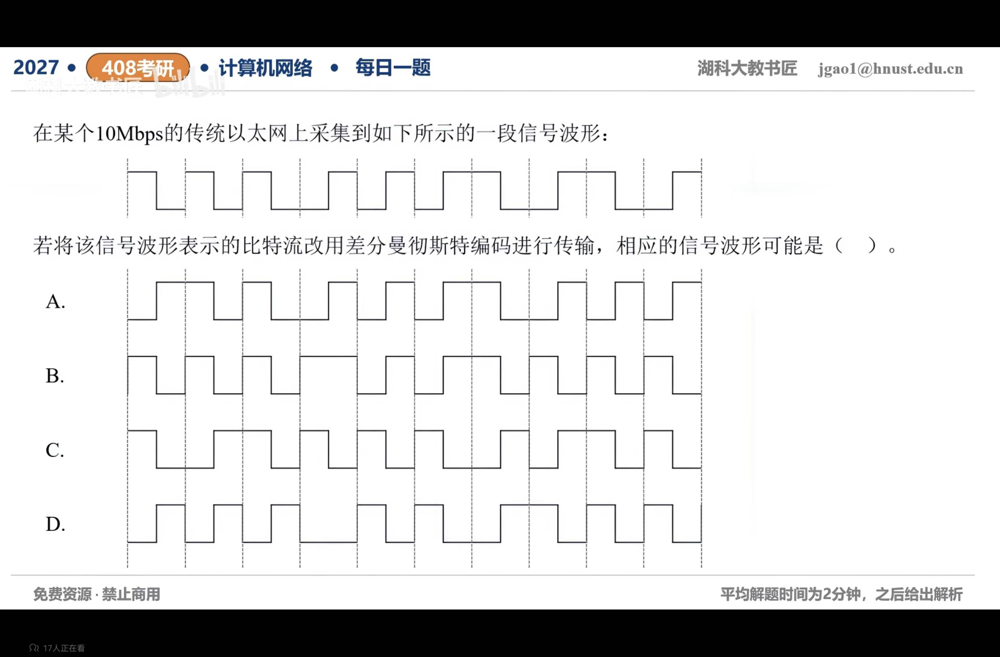
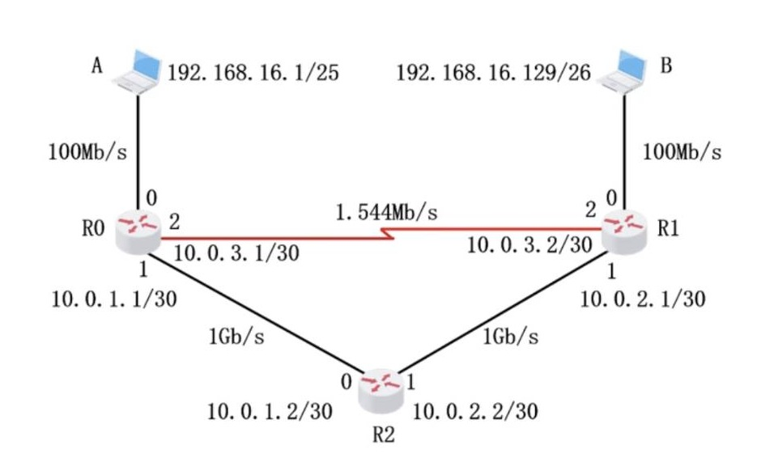

# 408 每日一题

> [!info] 说明  
> 汇总各来源的 408 每日一题，按科目分区、各自编号。  
> 题目版权归对应来源所有，仅作个人学习整理，免费资源 · 禁止商用。  
> **当前来源**：[湖科大教书匠](https://space.bilibili.com/360996402)、[零壹计算机考研](https://space.bilibili.com/521521146)

> [!abstract] 科目导航
>
> - [[#一、数据结构]]
> - [[#二、计算机组成原理]]
> - [[#三、操作系统]]
> - [[#四、计算机网络]]

---

# 一、数据结构

> [!abstract] 题号索引
>
> - [[#No.001 双层循环的时间复杂度]]
> - [[#No.002 内层次数带 i 的双层循环复杂度]]
> - [[#No.003 入栈序列含重复元素时的出栈序列数]]
> - [[#No.004 邻接多重表中删除一条边的指针修改]] ⭐
> - [[#No.005 最多连通分量数与必然连通的最少边数]] ⭐

## No.001 双层循环的时间复杂度

> [!note] 标签  
> #零壹计算机考研 #时间复杂度 #双层循环 #循环变量共享

**来源**：零壹计算机考研　**题型**：单选题

### 题目

下列程序段的时间复杂度是（　　）。

```c
sum = 0;
for (int i = 1; i <= n; i++) {
    for (int j = 1; j <= n; j++) {
        sum++;
        i++;
    }
}
```

- A. $O(\log_{2}n)$
- B. $O(n)$
- C. $O(n\log_{2}n)$
- D. $O(n^{2})$

### 答案

> [!success] 正确答案：B

### 我的作答

> [!question] 我选 B —— 正确  
> 关键是认出内层的 `i++` 会把外层循环变量顶出范围——外层实际只跑 1 轮。

### 解析

**思路**（按库里 `1. 数据结构知识.md` 的多变量处理法：列举 i 与 j 的变化，求和找出与 n 的关系）：

1. 内层 `for (j = 1; j <= n; j++)` 的循环条件只看 `j`，与 `i` 无关 → **每进一次内层就完整跑满 n 次**。
2. 内层循环体里除了 `sum++` 还有 `i++`：内层每循环一轮就把 `i` 加 1，所以内层跑完 `i` 净增 n。
3. 再看外层：`i = 1` 进入 → 内层跑完 `i = 1 + n` → 外层 `i++` 后 `i = n + 2 > n`，**第二次判断就不成立**，整个外层只执行 1 次。
4. 故总执行次数 = 内层的 n 次 + 常数次外层开销，即 $T(n) = n + O(1) = O(n)$。

**逐项**：

- **B 正确**：外层常数次 × 内层 n 次 = $O(n)$。
- **D 错**：看到两层嵌套就条件反射相乘。双重循环是 $O(n^{2})$ 的前提是**两层各自跑满**；本题外层被内层的 `i++` 压成了常数轮。
- **A 错**：$O(\log n)$ 要求每轮规模折半或倍增，本题没有这种跳跃。
- **C 错**：$O(n\log n)$ 需要「一层线性 × 一层对数」，本题是「常数层 × 线性层」。

---

## No.002 内层次数带 i 的双层循环复杂度

> [!note] 标签  
> #零壹计算机考研 #时间复杂度 #等比级数 #双重循环

**来源**：零壹计算机考研　**题型**：单选题

### 题目

下列程序段的时间复杂度是（　　）。

```c
i = 1;
while (i <= n) {
    j = i;
    while (j <= n) {
        j += i;
    }
    i *= 2;
}
```

- A. $O(n)$
- B. $O(n^{2})$
- C. $O(\log n)$
- D. $O(n\log n)$

### 答案

> [!success] 正确答案：A

### 我的作答

> [!question] 我选 A —— 正确  
> 干扰项 **D 是 $O(n\log n)$**。

### 解析

**概念**：外层 `i` 每次**翻倍**（$1,2,4,8,\dots$）→ 外层是**对数次**；但内层 `j` 从 `i` 开始、**步长也是 `i`** → 内层跑 $\lfloor n/i \rfloor$ 次，==**次数随外层变量变化，不能直接"外层 × n"**==。

**算链**：

$$\sum_{i=1,2,4,8,\dots}\left\lfloor \frac{n}{i} \right\rfloor = n\left(1+\frac12+\frac14+\cdots\right) < n\sum_{k\ge0}\frac{1}{2^{k}} = 2n$$

等比级数**收敛到常数 2**（不是发散的），所以

$$T(n)=\Theta(n)\;\Longrightarrow\;\textbf{A. }O(n)$$

**精确值**（$n$ 是 2 的幂时，实测）：$T(n)=n\!\left(2-\dfrac{1}{n}\right)=2n-1$

| $n$ | 8 | 16 | 32 | 64 | 128 | 1024 |
| --- | --- | --- | --- | --- | --- | --- |
| 实际执行次数 | 15 | 31 | 63 | 127 | 255 | 2047 |

非 2 的幂时略小（$n=1000\Rightarrow 1994$），仍是 $\Theta(n)$。

**逐项排除**：

| 选项 | 判定 |
| --- | --- |
| **A $O(n)$** | ✔ 等比级数收敛 → 总次数 $<2n$ |
| B $O(n^{2})$ | ✗ 没有哪一层跑满 $n$ 的平方级 |
| C $O(\log n)$ | ✗ 内层每一次都是**线性**的（不是只跑 1 次） |
| D $O(n\log n)$ | ✗ ==**本题最大的陷阱**== —— 只有"内层次数**恒为 $n$**、与外层无关"时才会乘出 $n\log n$ |

**坑**：

1. ==**先看"内层的次数里有没有外层变量"**==：本题内层是 $\lfloor n/i\rfloor$，**带 $i$** → 必须**求和**；若内层恒为 $n$ 次 → 直接**相乘**。
2. **`i *= 2` 是"倍增"**，正是外层对数次的来源；顺带注意 `j += i` 的**步长也是 $i$**（不是 1）。
3. **等比级数 $\sum_{k\ge0}2^{-k}=2$ 收敛** —— 这就是"看着像 $n\log n$、实际是 $O(n)$"的原因：$i$ 每翻一倍，内层就少一半。
4. **取整不影响阶**：非 2 的幂时实测 1994 vs 上界 1999，仍是 $\Theta(n)$。

> **一句话记法**：**内层次数带外层变量（$n/i$）→ 求和，等比收敛到 $2n$，得 $O(n)$；内层次数恒为 $n$（与外层无关）→ 相乘，得 $O(n\log n)$。**

---

## No.003 入栈序列含重复元素时的出栈序列数

> [!note] 标签  
> #零壹计算机考研 #卡特兰数 #出栈序列 #重复元素去重

**来源**：零壹计算机考研　**题型**：单选题

### 题目

若元素入栈序列为 **a, b, c, c**，则出栈序列有（　　）种可能性。

- A. 14
- B. 12
- C. 9
- D. 8

### 答案

> [!success] 正确答案：C（9 种）

### 我的作答

> [!question] 我选 C —— 正确  
> 自述：**「用两种方法。一种是直接枚举；一种是通过卡特兰数，先算四个不同元素的 C₄，再减去两个 c 在一起的情况，相当于 3 个不同元素的 C₃」** —— 两条路都对。

### 解析

#### 方法 1：枚举（9 种全列出来）

```
abcc   acbc   accb
bacc   bcac   bcca
cbac   cbca   ccba
```

（按"入栈 a→b→c₁→c₂，随时可入可出"穷举出 14 个，再把 c₁/c₂ 视同 c 去重 → 9）

#### 方法 2：卡特兰数修正（更快）

**第 1 步：先把两个 c 当成不同元素**（c₁、c₂）→ 4 个互不相同

$$C_4 = \frac{1}{5}\binom{8}{4} = \frac{70}{5} = \mathbf{14}$$

**第 2 步：减去"重复计数"的那部分**

==**两个 c 相邻**时，`c₁c₂` 与 `c₂c₁` 两种弹出顺序**都合法**，写成 c 之后却是同一个序列 → **每种多算了 1 次**==。

而"两个 c 相邻"相当于把 `cc` ==**捆成一个元素**== → 元素变成 {a, b, cc} **3 个**：

$$C_3 = \frac{1}{4}\binom{6}{3} = \frac{20}{4} = \mathbf{5}$$

**第 3 步**：

$$14 - 5 = \mathbf{9}$$ → **C** ✓

#### 为什么"不相邻"时不会重复

两个 c 不相邻时，中间必定夹着 a 或 b。==**c₂ 若先出，c₁ 还压在栈里，中间那个 a/b 就被 c₁ 挡住了**== → 那条顺序不合法。

所以不相邻的情形==**只有 c₁ 先出这一种**==，不会重复计数。

**结论**：重复只发生在"cc 相邻"的那 5 种上 → 减 5。

#### 三个坑

1. ==**元素有重复就不能直接套 Cₙ**== —— Cₙ 算的是**互不相同**元素的出栈序列数
2. ==**"捆绑"算出来的是"被多算的份数"**==：两个相同的元素相邻 → 捆成 1 个 → 元素数少 1 → 用 C_{n−1}
3. ==**不相邻不重复**（另一种顺序不合法）—— 这是本题最容易想漏的一步==

> **一句话记法**：**有一对相同元素时，先按全不同算 Cₙ，再把"这一对捆成一坨"算 C_{n−1}，两者相减。**

---

## No.004 邻接多重表中删除一条边的指针修改

> [!note] 标签  
> #数据结构习题 #邻接多重表 #ilink #jlink #删除边

**来源**：数据结构习题　**题型**：单选题

### 题目

已知无向图 G 采用**邻接多重表**存储，顶点表和边结点信息如下。`v[i].firstedge` 为顶点 i 的**首边指针**，e1~e6 为各边结点的指针；**ivex、jvex 为边的两个端点编号**，**ilink、jlink 分别指向依附于对应端点的下一条边**，`^` 表示空指针。

**顶点表**：

| 顶点编号 i | 0 | 1 | 2 | 3 | 4 |
| --- | --- | --- | --- | --- | --- |
| `v[i].firstedge` | e1 | e3 | e2 | e6 | e5 |

**边结点表**：

| 边结点 | ivex | jvex | ilink | jlink |
| --- | --- | --- | --- | --- |
| e1 | 0 | 2 | e2 | ^ |
| e2 | 2 | 0 | e5 | ^ |
| e3 | 1 | 2 | e1 | e4 |
| e4 | 2 | 3 | ^ | ^ |
| e5 | 4 | 2 | e6 | e3 |
| e6 | 3 | 4 | e4 | ^ |

**删除边结点 e3，并保持其余边在各顶点边链中的相对次序不变。除释放 e3 外，正确的指针修改是（　　）**。

- A. `v[1].firstedge = e4; e5->jlink = e1;`
- B. `v[1].firstedge = e1; e5->jlink = e4;`
- C. `v[1].firstedge = e1; e2->ilink = e4;`
- D. `v[1].firstedge = e1; e5->ilink = e4;`

### 答案

> [!success] 正确答案：B

### 我的作答

> [!question] 我选 B —— 正确  
> 但自述：**「没搞懂具体细节」** —— 会选但说不清链是怎么走出来的。

### 解析

#### 第一步：搞懂"一条边挂在两条链上"

| 字段 | 含义 |
| --- | --- |
| **ivex / jvex** | 该边的两个端点编号 |
| **ilink** | ==指向**依附于 ivex** 的下一条边== |
| **jlink** | ==指向**依附于 jvex** 的下一条边== |

==**判断"走哪个 link"的口诀：看这条边的哪一侧端点等于当前顶点 —— 等于 ivex 就走 ilink，等于 jvex 就走 jlink。**==

#### 第二步：把每个顶点的边链读出来（本题的全部功夫在这）

| 顶点 | 边链 | 怎么走出来的 |
| --- | --- | --- |
| **0** | **e1 → e2 → ^** | e1(ivex=0) 走 ilink = e2；e2(**jvex=0**) 走 jlink = ^ |
| **1** | ==**e3 → e1**== | e3(ivex=1) 走 ilink = **e1** |
| **2** | ==**e2 → e5 → e3 → e4 → ^**== | e2(ivex=2) → ilink=**e5**；e5(**jvex=2**) → jlink=**e3**；e3(**jvex=2**) → jlink=**e4**；e4(ivex=2) → ilink=^ |
| **3** | **e6 → e4 → ^** | e6(ivex=3) → ilink=**e4**；e4(**jvex=3**) → jlink=^ |
| **4** | **e5 → e6 → ^** | e5(ivex=4) → ilink=**e6**；e6(**jvex=4**) → jlink=^ |

> 说明：顶点 1 的链到 e1 就结束了（题给 e1 的端点是 0 和 2，链接关系即到此为止）。

#### 第三步：删 e3，只改两处

| 改哪 | 改成 | 为什么 |
| --- | --- | --- |
| **① `v[1].firstedge = e1`** | 1 的链首由 e3 变 e1 | 1 的链是 **e3 → e1**，==**e3 是链首**==，删掉链首必须挪 firstedge |
| **② `e5->jlink = e4`** | 越过 e3 指向 e4 | 2 的链是 **e2 → e5 → e3 → e4**，==**e3 的直接前驱是 e5**== |

→ **B** ✓

#### 三个错项

| 选项 | 错在哪 |
| --- | --- |
| **A** `firstedge = e4` | ==e4 **不在 1 的链里**==（它在 2 的链和 3 的链上） |
| **C** `e2->ilink = e4` | ==e3 的前驱不是 e2，是 **e5**==；改 e2 会跳过 e5 和 e3，破坏相对次序 |
| **D** `e5->ilink = e4` | 方向选错了：e5 是以 **jvex=2** 的身份出现在 2 的链里，==该改 **jlink** 不是 ilink== |

#### 三个坑

1. ==**走哪个 link 看端点编号对哪一侧**== —— 同一结点在不同顶点的链里用的字段可能不同
2. ==**删除要改两处**：所属顶点的 firstedge（若删的是链首）＋ **前驱**的 link==
3. ==**前驱要在链里往前找**== —— 本题 e3 在 2 的链里，前驱是 **e5**，不是链首的 e2

> **一句话记法**：**先把每条链顺着 ilink/jlink 读全；删边就是"链首换人"＋"前驱跨过它"。**

---

## No.005 最多连通分量数与必然连通的最少边数

> [!note] 标签  
> #数据结构每日一题 #连通分量 #完全图 #图论极值

**来源**：数据结构每日一题（Day 12）　**题型**：单选题

### 题目

设**无向简单图 G 有 8 个顶点**。当 **G 有 9 条边**时，其**连通分量个数最多**为 **m**；当 G 的**边数不少于 k** 时，**无论边如何分布，G 都必然连通**。则 **m** 的值与满足上述条件的**最小 k** 分别为（　　）。

- A. 4，7
- B. 3，22
- C. 4，22
- D. 5，22

### 答案

> [!success] 正确答案：C（4，22）

### 我的作答

> [!question] 我选 C —— 正确  
> 但自述：**「想半天才想起来是找完全图，知识点太生疏了」** —— ==两问的共同抓手确实都是"完全图"==。

### 解析

#### 第一问：m —— 把边尽量"堆"进一个小圈子，其余顶点全孤立

**目标**：分量数最大 ⇒ ==**让一个分量尽可能大（装满完全图），剩下的顶点一条边都不给**==

设最大分量占 **x** 个顶点，它能吃下的边数上限 = $\frac{x(x-1)}{2}$：

| x | 容量 $\frac{x(x-1)}{2}$ | 装得下 9 条吗 |
| --- | --- | --- |
| 4 | 6 | ✘ 装不下 |
| **5** | **10** | ==**✔ 能**== |

⇒ 至少要 **5** 个顶点才能把 9 条边全吃掉（K5 共 10 条，去掉 1 条正好 9 条）。

剩下 $8-5 = 3$ 个顶点**全孤立**，各成 1 个分量：

$$m = 1 + (8-5) = \mathbf{4}$$

✔ **m = 4**

#### 第二问：k —— 构造"最不连通"的极端，再加 1 条

**最坏情况**：==**让 n−1 个顶点构成完全图（吃掉最多的边），剩下 1 个顶点孤立**==

- $n=8$ → **7 个顶点做 K7**：边数 $=\frac{7\times6}{2}=$ ==**21**==
- 还剩 1 个顶点孤零零 → ==**图不连通**==

所以 **21 条边都不保证连通**。再多 1 条，那个孤立顶点必须连出去：

$$k = \frac{(n-1)(n-2)}{2} + 1 = \frac{7\times6}{2}+1 = 21+1 = \mathbf{22}$$

✔ **k = 22**

→ **C（4，22）** ✓

#### 两条通用公式（值得记死）

| 问什么 | 公式 |
| --- | --- |
| **e 条边时最多分量数** | ==**先求"最小 x 使 $\frac{x(x-1)}{2}\ge e$"，再算 $1+(n-x)$**== |
| **保证连通的最小边数** | ==**$\dfrac{(n-1)(n-2)}{2}+1$**== |

#### 三个坑

1. ==**第一问是"最小 x 使容量 ≥ e"**==，不是"最大 x 使容量 ≤ e" —— 因为**9 条边必须全部用掉**
2. ==**k ≠ $\frac{n(n-1)}{2}$**==（那是完全图）；保证连通只要 $\frac{(n-1)(n-2)}{2}+1$
3. ==**两问的共同思想都是"极端化"**== —— 一头"全挤在一起"，一头"尽量散开"

> **一句话记法**：**求最多分量 → 先让一个完全图吃掉全部边（8 顶点 9 边 → 要 5 个点 → 剩 3 孤立 → 1+3=4）；求必然连通 → 让 n−1 个点做完全图 + 1 个孤立，再加 1 条边（7×6/2+1=22）。**

---

# 二、计算机组成原理

> [!abstract] 题号索引
>
> - [[#No.001 加法运算标志位的组合分析]]
> - [[#No.002 哪些操作的时长不一定等于一个时钟周期]]
> - [[#No.003 CALL 指令在请求分页下会不会引发缺页]]
> - [[#No.004 CALL 指令执行后 SP、栈顶与 PC 的值]]
> - [[#No.005 TLB 缺失、页表命中、Cache 缺失能否同时成立]]
> - [[#No.006 写回法加写分配法下写未命中一定发生什么]]
> - [[#No.007 页表项自身的虚拟地址与物理地址]]
> - [[#No.008 哪些指令执行后可能按存放顺序执行下一条]]
> - [[#No.009 IEEE 754 双精度中非规格化数的边界值]] ⚠️
> - [[#No.010 TLB 缺失的处理该由谁做、要不要进内核]]
> - [[#No.011 单周期与多周期 CPU 的部件复用]]
> - [[#No.012 sw 指令的控制信号设置]]
> - [[#No.013 lw 与 sw 在单周期数据通路中的异同]]
> - [[#No.014 TLB 不含 ASID 时进程切换后的访问结果]] ⚠️
> - [[#No.015 分支预测开销下的执行时间比较]]
> - [[#No.016 同一组机器数作有符号与无符号乘法]]
> - [[#No.017 浮点加法不满足结合律]]
> - [[#No.018 共享存储多处理器系统的 Flynn 归类]]
> - [[#No.019 静态链接中的重定位与虚拟/物理地址]] ⭐
> - [[#No.020 DMA 与 CPU 共享总线的六条判断]] ⭐
> - [[#No.021 计算机系统层次中 ISA 与微体系结构的边界]] ⚠️
> - [[#No.022 直接映射改二路组相联的地址划分与 Tag 开销]]

## No.001 加法运算标志位的组合分析

> [!note] 标签  
> #零壹计算机考研 #标志位 #溢出 #进位 #补码

**来源**：零壹计算机考研　**题型**：单选题

### 题目

若某次**整数加法**运算后，标志位 **OF = CF = 1**，则二元组 **（ZF, SF）** 的可能取值有（　　）种。

- A. 1
- B. 2
- C. 3
- D. 4

### 答案

> [!success] 正确答案：B

### 我的作答

> [!question] 我选 B —— 正确  
> 一句话结论：**OF = CF = 1 时符号位必为 0 → SF 被锁死，只有 ZF 自由**，所以是 2 种。

### 解析

**先把四个标志位的定义摆清楚**。符号按本题讲解图的口径来：设**最高位（符号位）产生的进位输出**为 $C_{n+1}$，**进入符号位的进位输入**为 $C_n$，加减控制信号为 $sub$（加法 sub = 0，减法 sub = 1）。

| 标志     | 含义           | 由谁决定                                                        |
| ------ | ------------ | ----------------------------------------------------------- |
| **CF** | 无符号数运算的进位/借位 | $CF = C_{n+1} \oplus sub$ —— 加法时 sub = 0，退化为 $CF = C_{n+1}$ |
| **OF** | 有符号数是否溢出     | $OF = C_{n+1} \oplus C_n$（符号位的进位输出 ⊕ 符号位的进位输入）              |
| **ZF** | 结果是否为 0      | 结果各位**全 0** 时 ZF = 1                                        |
| **SF** | 结果的符号        | $SF = s_{n-1}$（结果的最高位）                                      |

#### 做法一： 枚举法（把 2 位数的加法全试一遍）

取 n = 2（补码范围 −2 ～ +1），4 个二位数两两相加共 3+2+1 = 6 个不同组合，逐个算进位与结果：

| 算式          | 硬件结果（截取低 2 位） | $C_2$（符号位进位输出） | $C_1$（进入符号位） | CF | OF = $C_2 \oplus C_1$ | 符合 OF=CF=1？ | 结果   | ZF    | SF    |
| ----------- | ------------- | -------------- | ------------ | -- | --------------------- | ----------- | ---- | ----- | ----- |
| 01 + 11     | 100 → `00`    | 1              | 1            | 1  | **0**                 | ✗           |      |       |       |
| **10 + 10** | 100 → `00`    | 1              | 0            | 1  | **1**                 | ✔           | `00` | **1** | **0** |
| **10 + 11** | 101 → `01`    | 1              | 0            | 1  | **1**                 | ✔           | `01` | **0** | **0** |
| 11 + 01     | 100 → `00`    | 1              | 1            | 1  | **0**                 | ✗           |      |       |       |
| **11 + 10** | 101 → `01`    | 1              | 0            | 1  | **1**                 | ✔           | `01` | **0** | **0** |
| 11 + 11     | 110 → `10`    | 1              | 1            | 1  | **0**                 | ✗           |      |       |       |

（讲解图里标红的正是满足条件的三行：`10+10`、`10+11`、`11+10`。）

- 注意 `01+11`、`11+01`、`11+11` 虽然 **CF = 1**，但 $C_1 = 1$ 使 $OF = C_2 \oplus C_1 = 0$，**被排除**；
- 剩下三行给出的 (ZF, SF) 是 **(1, 0)、(0, 0)、(0, 0)** → 不重复的取值只有 **2 种**，选 **B**。

**换成真数看更直观**（2 位补码：`10` = −2、`11` = −1）：

- `10 + 10`：−2 + (−2) = −4，溢出，硬件结果 `00` → **ZF = 1、SF = 0**
- `10 + 11` / `11 + 10`：−2 + (−1) = −3，溢出，硬件结果 `01` → **ZF = 0、SF = 0**
- `11 + 11`：−1 + (−1) = −2，**和仍在范围内，不溢出** → OF = 0，排除

#### 做法二：分析法（不用碰进位数，全靠符号推理）

推导链一共四步，环环相扣：

1. **OF = 1 ⟹ A、B 一定同号**（异号相加绝不会溢出）；
2. **同号里再分两正 / 两负，而 CF = 1 把"两正"排除了**：  
   两个正数的符号位都是 0，符号位相加最多是 $0 + 0 + 1 = 1$，**不可能产生进位输出** → CF 必为 0。  
   ∴ 只能是**两负**，即 **A = `1xxxxxxx`、B = `1yyyyyyy`**；
3. **两负数相加，结果本应是负数；但 OF = 1 说明发生了溢出** ⟹ 结果的**符号位被翻转**成了 0 ⟹ **SF = 0**（唯一取值，被彻底锁死）；
4. **ZF 独立判断**：两负数的和越小越可能全 0。极端例子取 **A = B = `10000000`**（即 −128）：−128 + (−128) = −256，溢出后截取 8 位得 `00000000` → **ZF = 1**；其他组合结果非全 0 → **ZF = 0**。

→ (ZF, SF) 只有 **(1, 0)** 和 **(0, 0)** 两种 → **2 种**，选 **B**。

**这条链最短**：抓住「OF = 1 → 同号」「CF = 1 → 不能是两正 → 两负」「溢出 → 符号位翻转」三句，符号位就定了。

#### 做法三： 进位信号法（从 CF、OF 的定义式解进位）

直接用两条定义式联立：

$CF = C_{n+1} \oplus sub = 1 \quad\Longrightarrow\quad C_{n+1} = 1 \quad(\text{加法 } sub = 0)$

$OF = C_{n+1} \oplus C_n = 1 \quad\Longrightarrow\quad C_n = 0 \quad(\text{已知 } C_{n+1} = 1)$

**两个进位信号都被解出来了**：符号位**产生了**进位输出（$C_{n+1} = 1$），却**没有收到**进位输入（$C_n = 0$）。

回到符号位那一位全加器：$a_{n-1} + b_{n-1} + C_n = s_{n-1} + 2C_{n+1}$，代入 $C_n = 0$、$C_{n+1} = 1$：

$a_{n-1} + b_{n-1} = s_{n-1} + 2$

而 $a_{n-1}, b_{n-1} \in \{0, 1\}$，左边最大为 2 → **只能 $a_{n-1} = b_{n-1} = 1$、$s_{n-1} = 0$**。

- 两个加数符号位都是 1 → 又是 **A = `1xxxxxxx`、B = `1yyyyyyy`（两负）**；
- 结果符号位是 0 → **SF = 0**；
- ZF 同做法二（取 A = B = `10000000` 时 ZF = 1，其余为 0）→ **2 种**，选 **B**。

**sub 在这里的角色**：$sub$ 是**加减控制信号** —— 加法时 sub = 0、最低位进位输入也是 0；减法时 sub = 1，同时把 B 各位取反、最低位进位输入置 1。它出现在 **CF 的定义式**（$CF = C_{n+1} \oplus sub$）里：减法时 $CF = \overline{C_{n+1}}$，正好对应"借位"的语义。而 **OF 的定义式不含 sub**，无论加减都是 $C_{n+1} \oplus C_n$。

#### 三种做法对比

| 做法        | 怎么做                                                                                 | 什么时候用                     |
| --------- | ----------------------------------------------------------------------------------- | ------------------------- |
| **枚举法**   | 取 n = 2，把 6 种加法全试一遍，筛出 CF = OF = 1 的三行                                              | 选择题**最快最稳**，不用记任何公式       |
| **分析法**   | OF=1 → 同号；CF=1 → 排除两正 → 两负；溢出 → 符号位翻转 → SF = 0                                      | 需要讲清**为什么**，逻辑链最短         |
| **进位信号法** | 由 $CF = C_{n+1} \oplus sub$、$OF = C_{n+1} \oplus C_n$ 解出 $C_{n+1}=1$、$C_n=0$，再回代符号位 | 与**加法器硬件**（进位链）挂钩，写推导时最正规 |

**三条路殊途同归**：符号位只能是 0（SF 被锁死），ZF 可 0 可 1 → **(ZF, SF) 共 2 种**。

**易错点**：

1. 别把 **CF 和 OF 混为一谈**：CF 管**无符号**（只看有没有进位），OF 管**有符号**（看符号位前后进位的异或）。本题两者都是 1，说明"无符号溢出"和"有符号溢出"同时发生。
2. **OF = 1 且 CF = 1 时符号位必为 0** —— 这是本题唯一需要记住的结论。
3. 别漏了 **ZF 的独立性**：ZF 由结果的**全部数据位**决定，与符号位不冲突，所以能取 2 个值。看到"有几种取值"就要想"哪些位被约束了、哪些还自由"。

---

## No.002 哪些操作的时长不一定等于一个时钟周期

> [!note] 标签  
> #计组习题 #时钟周期 #单周期CPU #流水线 #单总线

**来源**：计组习题（第 08 题）　**题型**：单选题

### 题目

下列操作中，**从开始到完成所持续的时间不一定等于一个时钟周期**的是（　　）。

- Ⅰ. 单总线数据通路中完成一次**主存读操作**
- Ⅱ. **单周期 CPU** 中执行一条完整指令
- Ⅲ. 单总线数据通路中，寄存器 R1 经内部总线传至寄存器 R2
- Ⅳ. **流水线**数据通路中，数据从一个流水段寄存器传入下一个流水段寄存器
- Ⅴ. **单周期 CPU** 中完成一次 **ALU 运算**

- A. Ⅰ、Ⅴ
- B. Ⅰ、Ⅲ、Ⅴ
- C. Ⅰ、Ⅱ、Ⅳ
- D. Ⅳ、Ⅴ

### 答案

> [!success] 正确答案：A

### 我的作答

> [!note] 本次只发了题图，未说明所选选项 —— 暂按答案记（A）。  
> 若实际选错，告我一声即可补标 ⚠️。

### 解析

#### 一句话判据

==**时钟周期是按"最坏情况"定的**==（单周期 CPU 看**最长指令**，流水线看**最长流水段**）→ 凡是**比这个最坏情况更快**的操作，都**不必占满**一个时钟周期。

#### 逐项判

| 项 | 该操作的实际耗时 | 等于 1 个周期？ |
| --- | --- | --- |
| **Ⅰ 单总线一次主存读** | ==**主存访问时间远大于时钟周期**==（DRAM 几十 ns，CPU 时钟 1 ns 级）→ 要**跨多个周期** | ==**✘ 不一定**== |
| Ⅱ 单周期 CPU 执行一条完整指令 | ==**"单周期"的定义就是 CPI = 1**==（周期按最长指令定） | ✔ 一定等于 |
| Ⅲ R1 经内部总线 → R2 | 寄存器间传送是**一条微操作**，一个周期内完成 | ✔ 等于 |
| Ⅳ 流水段寄存器 → 下一段寄存器 | ==**时钟周期本来就按最长流水段定**==，段间传送正好一个周期 | ✔ 等于 |
| **Ⅴ 单周期 CPU 一次 ALU 运算** | ==**ALU 是组合逻辑，延迟小于时钟周期**==（周期由**最长指令**决定，ALU 只是其中一段） | ==**✘ 不一定**== |

→ Ⅰ、Ⅴ → **A** ✓

#### 三个坑

1. ==**"单周期 CPU"里不是每个单元都占满一拍**== —— 周期是**最长指令**撑出来的，短指令、单步 ALU 都在**空等**
2. ==**主存读是"跨周期"的慢操作**== —— 别以为"一次访存 = 一拍"；CPU 时钟越快，访存跨越的拍数越多
3. ==**流水线的段间传送正好一个周期**== —— 因为周期就是按**最长流水段**定的，一点富余都没有

> **一句话记法**：**时钟周期 = 最坏情况（单周期看最长指令、流水看最长流水段）；比它快的（ALU、短指令）不必占满一拍，比它慢的（主存读）要跨多拍。**

---

## No.003 CALL 指令在请求分页下会不会引发缺页

> [!note] 标签  
> #雨涵计算机考研 #CALL指令 #请求分页 #缺页 #用户栈

**来源**：雨涵计算机考研　**题型**：单选题

### 题目

某采用**请求分页虚拟存储**的计算机，其 ISA 规定指令 `CALL target` 执行时，将**返回地址压入用户栈**，然后转移到 target。已知 **target 所在代码页已经在主存**。下列说法正确的是（　　）。

- Ⅰ. CALL 仍可能因为**访问用户栈**而发生缺页
- Ⅱ. CALL 除改变程序执行顺序外，还需要对**用户栈进行数据存储访问**
- Ⅲ. 用户栈中保存的返回地址一般是 CALL 指令**下一条指令的物理地址**
- Ⅳ. 即使目标代码页已在主存，也不能据此判断执行该 CALL **一定不会**发生缺页

- A. 仅 Ⅰ、Ⅱ
- B. 仅 Ⅰ、Ⅳ
- C. 仅 Ⅰ、Ⅱ、Ⅳ
- D. Ⅰ、Ⅱ、Ⅲ、Ⅳ

### 答案

> [!success] 正确答案：C（仅 Ⅰ、Ⅱ、Ⅳ）

### 我的作答

> [!question] 我选 C —— 正确  
> 三个对的都挑出来了，Ⅲ 的"**物理**地址"是唯一陷阱。

### 解析

#### 一句话：CALL 不只是"跳"，它**还要写一次内存**（用户栈）

| 项 | 判 | 依据 |
| --- | --- | --- |
| Ⅰ CALL 可能因访问用户栈而缺页 | ✔ | ==压栈要**写用户栈**，栈页可能不在主存== |
| Ⅱ CALL 除改执行顺序，还要对用户栈做存储访问 | ✔ | `M[SP] ← 返回地址` 是一次**写内存** |
| Ⅲ 返回地址是下一条指令的**物理地址** | ✘ | ==存的是**逻辑（虚拟）地址**，不是物理地址== |
| Ⅳ 目标页在主存 ≠ 一定不缺页 | ✔ | 还可能**栈页缺页** |

→ **C** ✓

#### Ⅲ 为什么必然错

- 虚拟存储下，**程序（含 PC 和栈里存的值）只认逻辑地址**
- 若栈里存物理地址：程序一被换出再换入、或页面在内存中搬迁，栈里的值就全废了
- ==**物理地址是硬件地址转换的中间结果，不会落在程序可见的数据结构里**==

#### 三个坑

1. ==**"返回地址 = 下一条指令的地址"（逻辑上对）≠ "返回地址 = 物理地址"（错）**== —— 两句话只差一个词
2. ==**CALL / RET 都要访存（读写栈）**== —— 所以都可能缺页，别以为"只是跳转"
3. ==**"目标页在主存"只保证取指不缺页**==，不保证压栈不缺页

> **一句话记法**：**CALL = 压栈（写内存）+ 跳转；栈里存逻辑地址；访存就可能缺页 —— 目标页在主存也不保险。**

---

## No.004 CALL 指令执行后 SP、栈顶与 PC 的值

> [!note] 标签  
> #雨涵计算机考研 #CALL指令 #栈指针 #返回地址 #指令长度

**来源**：雨涵计算机考研　**题型**：单选题

### 题目

某计算机**按字节编址**，指令 `CALL target` 的**第 1 个字节是操作码**，第 2、3 个字节共同给出 **16 位目标地址 target**。已知 CALL 开始运行前 **PC = 2400H**、**SP = 0180H**，指令中的目标地址为 **6800H**，栈向**低地址**方向增长，压入数据时==**先执行栈指针移动，再将数据写入新栈顶**==。则该 CALL 指令执行完成后，**SP 的值、新栈顶的内容和 PC 的值**分别为（　　）。

- A. 017EH，2403H，6800H
- B. 017EH，2400H，2403H
- C. 017FH，2403H，6800H
- D. 017EH，2397H，2403H

### 答案

> [!success] 正确答案：A

### 我的作答

> [!question] 我选 A —— 正确  
> 三步一次到位：返回地址 +3、SP 减 2、PC 跳到 target。

### 解析

#### 三步走

| 步 | 动作 | 结果 |
| --- | --- | --- |
| ① 算返回地址 | CALL 占 **3B**（1 操作码 + 2 地址）→ 2400H + 3 | ==**2403H**== |
| ② 压栈（先移后写） | SP = 0180H − 2 = **017EH**，再写 `M[017EH] ← 2403H` | SP = ==**017EH**==、栈顶 = ==**2403H**== |
| ③ 跳转 | PC ← target | ==**6800H**== |

→ **A** ✓

#### 每个选项错在哪

| 选项 | 错在哪 |
| --- | --- |
| **B** | 栈顶写成 2400H —— ==那是 CALL **自己**的地址==，返回地址必须是**下一条**（2403H）；且 PC 也错 |
| **C** | SP 写成 017FH —— ==只减了 1 字节==；返回地址是 **16 位 = 2 字节**，应减 2 |
| **D** | 栈顶 2397H —— 凭空多减 9（2400H − 9），与栈无关 |

#### 三个坑

1. ==**返回地址 = PC + 指令长度**==（本题 3B），不是 PC 本身
2. ==**SP 一次减 2**（16 位机器压 2 字节）== —— 按 1 字节算就会得到 017FH
3. ==**"先移后写"还是"先写后移"要看题干**== —— 本题明说先移，所以先减 SP 再写，新栈顶就是 017EH

> **一句话记法**：**返回地址 = PC + 指令长度；SP 减 2；栈顶写返回地址；PC 跳 target —— 三个值一次配平。**

---

## No.005 TLB 缺失、页表命中、Cache 缺失能否同时成立

> [!note] 标签  
> #雨涵计算机考研 #TLB缺失 #缺页 #Cache缺失 #三层存储

**来源**：雨涵计算机考研　**题型**：单选题

### 题目

某计算机采用**请求分页虚拟存储**，在一次访问中，**TLB 缺失、页表命中、Cache 缺失**，下列说法正确的是（　　）。

- A. Cache 缺失属于异常，因此 CPU 必须切换到内核态执行操作系统程序
- B. TLB 被重新填充后，后续对同一虚拟页的访问**仍不能保证** Cache 一定命中
- C. Cache 缺失需要从主存调入数据，因此进程 P 必须进入阻塞态
- D. TLB 缺失说明当前页表项无效，因此硬件查到该页在主存后，需要先将页表项的有效位置 1，再重新进行地址转换

### 答案

> [!success] 正确答案：B

### 我的作答

> [!question] 我选 B —— 正确  
> 自述：**「cache 缺失是硬件自动处理，不算异常」** —— 这正是排除 A 的判据。

### 解析

#### 一句话：TLB、页表、Cache 是**三个独立层次**，谁命中不决定谁

| 层次 | "缺失"到底意味着什么 | 谁处理 | 代价 |
| --- | --- | --- | --- |
| **TLB** | 快表里没这条映射（==页表里**可能有**==） | ==**硬件**（查页表回填 TLB）== | 小 |
| **页表 / 页不在主存** | 真·缺页 | ==**操作系统**（缺页中断）== | 大（访磁盘） |
| **Cache** | 数据没在缓存里 | ==**硬件**（自动访主存调入）== | 中（访主存） |

#### 四项判

| 选项 | 判 | 依据 |
| --- | --- | --- |
| A Cache 缺失属异常、要切内核态 | ✘ | ==**Cache 缺失由硬件自动处理**==，不产生异常、不切内核态 |
| **B TLB 回填后，后续访问仍不保证 Cache 命中** | ✔ | TLB 命中只保证**地址转换**快；==Cache 里那一行**可能已被替换出去**== |
| C Cache 缺失 → 进程必须阻塞 | ✘ | ==只停顿**几十个周期**去访主存==，进程照跑 |
| D TLB 缺失 = 页表项无效，要置有效位 | ✘ | ==TLB 缺失只是**快表没缓存**==；题干已说"页表**命中**"，说明页表项有效、页也在主存 |

#### 三个坑

1. ==**TLB 缺失 ≠ 缺页**== —— TLB 命中 ⇒ 页一定在主存；**TLB 缺失 ⇏ 缺页**
2. ==**Cache 缺失是硬件行为**== —— 既不算异常，也不让进程阻塞
3. ==**三层各有各的"缺失"**== —— 别把 TLB 缺失、缺页、Cache 缺失混成一个概念

> **一句话记法**：**TLB 缺失只慢在"查表"，Cache 缺失只慢在"访主存" —— 两者都由硬件兜、都不算异常；只有缺页才惊动操作系统。**

---

## No.006 写回法加写分配法下写未命中一定发生什么

> [!note] 标签  
> #雨涵计算机考研 #写回法 #写分配 #脏位 #Cache写策略

**来源**：雨涵计算机考研　**题型**：单选题

### 题目

某 Cache 采用**写回法**和**写分配法**。CPU 对某地址执行写操作时 **Cache 未命中**。下列操作中**一定发生**的是（　　）。

- Ⅰ. 从主存调入目标块
- Ⅱ. 修改 Cache 中目标块
- Ⅲ. 若发生替换，则会将替换块写回主存

- A. 仅 Ⅰ、Ⅱ
- B. 仅 Ⅰ、Ⅲ
- C. 仅 Ⅱ、Ⅲ
- D. Ⅰ、Ⅱ、Ⅲ

### 答案

> [!success] 正确答案：A（仅 Ⅰ、Ⅱ）

### 我的作答

> [!question] 我选 A —— 正确  
> Ⅲ 判了 ✘：==**只有脏块才写回**==，不是"发生替换就一定写回"。

### 解析

#### 写回 + 写分配 = "先搬进来，再在 Cache 里改"

| 步 | 动作 |
| --- | --- |
| ① 未命中 | ==**写分配**：先把目标块从主存调入 Cache==（Ⅰ ✔） |
| ② 写入 | ==在 Cache 里改，并打脏位==（Ⅱ ✔），**不马上写主存** |
| ③ 将来被替换 | ==**只有脏块才写回**主存==；干净块直接丢弃（Ⅲ ✘） |

#### Ⅲ 错在"一定"

- 写回法的规则是：==**被修改过（脏位 = 1）的块**才写回==
- 若被替换的那块只是被**读过**、没改过（干净）→ ==**直接扔掉，不写回**==
- 所以"发生替换 → 一定写回"不成立

#### 四种组合对照

| 写策略 | 写未命中怎么办 | 常配 |
| --- | --- | --- |
| **写回法** | ==**写分配**：调入后写 Cache== | 写回 + 写分配（常用） |
| **全写法（直写）** | ==**非写分配**：直接写主存，不调块== | 全写 + 非写分配 |

> ==口诀：**写回配分配，全写配非分**==

#### 三个坑

1. ==**"一定"两个字就是本题题眼**== —— Ⅲ 只在"被替换块是脏的"时才成立
2. ==**写分配 = 先调入；非写分配 = 不调入**== —— 别记反
3. ==**写回法必须有脏位**==，全写法不需要

> **一句话记法**：**写回 + 写分配 → 未命中先搬进来、再改、打脏位；替换时只写回脏块 —— "一定"两个字专治不清醒。**

---

## No.007 页表项自身的虚拟地址与物理地址

> [!note] 标签  
> #雨涵计算机考研 #两级地址转换 #页表基址 #页表项大小

**来源**：雨涵计算机考研　**题型**：单选题

### 题目

某计算机**按字节编址**，虚拟地址和物理地址均为 **24 位**，采用**一级页表**，页大小 **64KB**，页表项大小 **4B**。某进程自己的页表在虚拟地址 **E00000H** 开始的页面中。已知用于映射页表自身的页表项中记录的**物理页框号为 25H**。若该进程访问虚拟地址 **3A1234H**，则描述该虚拟页的**页表项的虚拟地址**和**物理地址**分别为（　　）。

- A. E000E8H，2500E8H
- B. E0003AH，25003AH
- C. E000E8H，250000H
- D. E003A0H，2503A0H

### 答案

> [!success] 正确答案：A

### 我的作答

> [!question] 我选 A —— 正确  
> 和 **24 年 408 大题**同一套路：==先算页表项的"页内偏移"，再换基址==。

### 解析

#### 四步

| 步 | 算什么 | 结果 |
| --- | --- | --- |
| ① 拆虚拟地址 | 24 位 = **8 位虚页号 + 16 位页内偏移**（64KB = 2¹⁶） | 3A1234H → 页号 **3AH = 58**、偏移 1234H |
| ② 页表多大 | 2⁸ = 256 项 × 4B | **1KB**（正好一页装得下） |
| ③ **页表项的虚拟地址** | 页表基址 ＋ 页号 × 项大小 | E00000H + 58×4 = E00000H + **E8H** = ==**E000E8H**== |
| ④ **页表项的物理地址** | 页框号 × 页大小 ＋ 页内偏移 | 25H×10000H = **250000H**，＋ E8H = ==**2500E8H**== |

→ **A** ✓

#### 关键：④ 里加的偏移是 **E8H**，不是 1234H

==页表项在**页表里**的偏移（E8H）≠ 被访问数据在**页里**的偏移（1234H）== —— 这是全题最容易串的一步，**C 选项就是漏了 E8H**。

#### 三个坑

1. ==**页表项地址 = 页表基址 + 页号 × 项大小**== —— 乘的是**项大小（4B）**，不是页大小
2. ==**换物理地址时"换基址、不换偏移"**==：`物理 = 页框号 × 页大小 + 页内偏移`
3. ==**页表 1KB，正好在一页内**== —— 所以"页表内的偏移"直接等于"页面内的偏移"

> **一句话记法**：**页号 × 项大小 = 页表项在页表里的偏移；虚拟 = 页表基址 + 它；物理 = 页框号×页大小 + 它。**

---

## No.008 哪些指令执行后可能按存放顺序执行下一条

> [!note] 标签  
> #雨涵计算机考研 #指令系统 #CALL #RET #Trap

**来源**：雨涵计算机考研（**2026 真题**）　**题型**：单选题

### 题目

下列指令中执行后**有可能按存放顺序执行其下一条指令**的是（　　）。

- Ⅰ. 条件跳转指令
- Ⅱ. 过程调用指令
- Ⅲ. 陷阱（Trap）指令
- Ⅳ. 过程返回指令

- A. 仅 Ⅰ、Ⅱ
- B. 仅 Ⅰ、Ⅳ
- C. 仅 Ⅱ、Ⅲ
- D. 仅 Ⅲ、Ⅳ

### 答案

> [!success] 正确答案：A（仅 Ⅰ、Ⅱ）

### 我的作答

> [!question] 我选 A —— 正确  
> 并指出：**「26 年真题，不过出的不行，有争议在，按理说只有 Ⅰ 是对的」** —— 争议就集中在 Ⅱ。

### 解析

#### 逐项判

| 项 | 能顺序执行下一条？ | 依据 |
| --- | --- | --- |
| **Ⅰ 条件跳转** | ✔ **能** | 条件**不满足**时 PC 自然加指令长度 → 顺序 |
| **Ⅱ 过程调用 CALL** | ✔ **能（争议点）** | ==**target 恰好等于"下一条指令的地址"**时，跳过去又正好落在下一条== |
| Ⅲ Trap 陷入 | ✘ | ==**必然**跳到内核处理程序==，不可能顺序 |
| Ⅳ 过程返回 RET | ✘ | 从栈弹地址 → 回到**调用点之后**，不是 RET 自己的下一条 |

→ **A（Ⅰ、Ⅱ）**

#### Ⅱ 的争议在哪（你的疑虑成立）

- **直觉**：CALL 是"跳转"，跳走了怎么算"按存放顺序"？
- ==但题干是"**有可能**"==：只要 `target` 就等于下一条指令的地址，执行完 CALL 后 PC 正好落在下一条
- **真实用途**：==`CALL 下一条` 是"取 PC 值"的经典技巧==（x86 `call 0`、ARM `bl .+4`），所以"有可能"不是空话

> ==所以题**不算错**，但它**完全依赖"有可能"三个字**== —— 题干若改成"一定"，Ⅱ 就必须排除。

#### 三个坑

1. ==**"有可能" vs "一定"是这题的生死线**==
2. ==**RET 回到的是"调用点之后"，不是"RET 的下一条"**== —— 它靠栈工作，与存放顺序无关
3. ==**Trap 是唯一"绝不可能"顺序的**== —— 它必然进内核

> **一句话记法**：**条件跳转"没跳"就顺序；CALL"跳到下一条"也算顺序（取 PC 的惯用招）；Trap 必进内核、RET 必回调用点 —— 都不可能顺序。**

---

## No.009 IEEE 754 双精度中非规格化数的边界值

> [!note] 标签  
> #雨涵计算机考研 #IEEE754 #双精度 #非规格化数 #隐藏位

**来源**：雨涵计算机考研　**题型**：单选题

### 题目

在 IEEE 754 **双精度**浮点数中，下列关于**正的非零非规格化数**的说法，正确的是（　　）。

- A. 最小正非零非规格化数为 $2^{-1022}$
- B. 最大正非零非规格化数为 $2^{-1022} - 2^{-1073}$
- C. 正的非零非规格化数共有 $2^{52} - 1$ 个
- D. 最大正非零非规格化数为 $2^{-1022} - 2^{-1072}$

### 答案

> [!success] 正确答案：C

### 我的作答

> [!warning] 我选 B —— 错误  
> 自述：**「回顾了一下双精度浮点数的格式，我选成 B 了，记成 1 12 51 了」** —— ==字段记成 1+**12**+**51**，于是尾数量级按 $2^{-51}$ 算，把 $2^{-1074}$ 写成了 $2^{-1073}$。==

### 解析

#### 第一步：先把字段背准（双精度 = 64 位）

| 字段 | 单精度（32 位） | ==**双精度（64 位）**== |
| --- | --- | --- |
| 符号 S | 1 | **1** |
| **阶码 E** | 8（偏置 127） | ==**11**（偏置 **1023**）== |
| **尾数 M** | 23 | ==**52**== |

==你记的「1 12 51」**两个数都错**：阶码是 **11** 不是 12，尾数是 **52** 不是 51。==

#### 第二步：非规格化数的值怎么算（E = 0）

$$值 = (-1)^s \times 0.f \times 2^{-1022}$$

两个关键：
- ==**隐含位是 0**（只有规格化数才隐含 1）==
- ==**阶码字段是 0，但实际指数固定为 $-1022$**（= $1 - 1023$）==

#### 第三步：四项判

| 项 | 判 | 依据 |
| --- | --- | --- |
| A 最小 = $2^{-1022}$ | ✘ | 最小非规格化数 = $0.00\cdots01\times 2^{-1022}$ = $2^{-52}\times 2^{-1022}$ = ==**$2^{-1074}$**==；$2^{-1022}$ 是**最小规格化数** |
| B 最大 = $2^{-1022}-2^{-1073}$ | ✘ | 最大 = $0.11\cdots1\times 2^{-1022}$ = $(1-2^{-52})\times 2^{-1022}$ = ==**$2^{-1022}-2^{-1074}$**== |
| **C 正的非零非规格化数 $2^{52}-1$ 个** | ✔ | 尾数 52 位 → 共 $2^{52}$ 种取值，==去掉 $f=0$（那是 0、不是非零）== → $2^{52}-1$ |
| D 最大 = $2^{-1022}-2^{-1072}$ | ✘ | 同 B，末项应是 $2^{-1074}$ |

→ **C** ✓

#### 你错在哪：尾数记成 51 位 → 指数差 1

```
尾数 52 位：2^(−1022−52) = 2^(−1074)   ✅ 正解
尾数 51 位：2^(−1022−51) = 2^(−1073)   ❌ 就是你选的 B
```

==**B、D 两个选项就是专门拿 $2^{-1073}$ / $2^{-1072}$ 这两个"错位数"设的套**== —— 只要记住 **52**，B、D 立刻排除。

#### 四个边界值（双精度，直接背）

| 量 | 值 |
| --- | --- |
| 最小正**非规格化**数 | $2^{-1074}$ |
| 最大正**非规格化**数 | $2^{-1022}-2^{-1074}$ |
| 最小正**规格化**数 | $2^{-1022}$ |
| 正的非零**非规格化**数个数 | $2^{52}-1$ |

> **一句话记法**：**双精度 1+11+52；非规格化 = 隐含位 0、指数钉在 $2^{-1022}$；最小 $2^{-1074}$、最大 $2^{-1022}-2^{-1074}$、个数 $2^{52}-1$。**

---

## No.010 TLB 缺失的处理该由谁做、要不要进内核

> [!note] 标签  
> #雨涵计算机考研 #TLB缺失 #缺页 #MMU #软硬件分工

**来源**：雨涵计算机考研　**题型**：单选题

### 题目

关于 **TLB 缺失**的处理，下列说法中正确的有几个？

- Ⅰ. TLB 缺失**只能由硬件处理**，因此**不会进入内核态**
- Ⅱ. TLB 缺失可能引发异常，使 CPU **转入内核态**，但**不一定**意味着发生缺页异常
- Ⅲ. 只要发生 TLB 缺失，就**必须**将当前进程置为**阻塞态**
- Ⅳ. 软件管理 TLB 意味着虚拟地址到物理地址的转换**全部由应用程序完成**

- A. 0 个
- B. 1 个
- C. 2 个
- D. 3 个

### 答案

> [!success] 正确答案：B（仅 Ⅱ 正确）

### 我的作答

> [!question] 我选 B —— 正确  
> 但自述：**「1 和 2 具体判断不了哪个对的」** —— 其实 ==**Ⅰ 和 Ⅱ 是正反两面**，判定了 Ⅱ 就等于判定了 Ⅰ==。

### 解析

#### Ⅰ vs Ⅱ：一句话分清

| | 说法 | 判 |
| --- | --- | --- |
| Ⅰ | TLB 缺失**只能**由硬件处理、**不会**进内核态 | ✘ |
| Ⅱ | TLB 缺失**可能**引发异常、**进内核态**，但**不一定**是缺页 | ✔ |

==**Ⅱ 对 ⇒ Ⅰ 必然错**== —— "可以进内核"直接否掉了"只能硬件处理"。

#### TLB 缺失的两种处理方式（Ⅰ 错在哪）

| 方式 | 谁处理 | 进内核态？ | 典型系统 |
| --- | --- | --- | --- |
| **硬件处理** | MMU 做**硬件页表遍历**，自动填 TLB | ==**不进**== | x86 |
| **软件处理** | 触发 **TLB 缺失异常**，内核处理 | ==**进**== | MIPS / ARM / RISC-V |

→ 题目说"**只能**由硬件处理"，把软件方式整个漏掉了 → **Ⅰ 错**

#### Ⅱ 的后半句为什么对：**TLB 缺失 ≠ 缺页**

| TLB 缺失时，页表里的状态 | 后果 |
| --- | --- |
| 页表项**有效**、页**在主存** | ==只是 TLB 没缓存 → 填进去即可，**不是缺页**== |
| 页表项有效、**页不在主存** | 这才是**缺页** |
| 页表项无效 | 缺页 / 保护异常 |

→ "TLB 缺失**不一定**意味着缺页异常" ✔ 成立

#### Ⅲ、Ⅳ 为什么错

| 项 | 错在哪 |
| --- | --- |
| **Ⅲ 必须置阻塞态** | ==TLB 缺失处理**极快**（几次访存内就解决）→ 进程继续跑==；只有**缺页**（要访磁盘）才阻塞 |
| **Ⅳ 全部由应用程序完成** | ==**地址转换永远由 MMU 完成**==；软件只负责"处理异常 / 更新 TLB 表项" |

> **一句话记法**：**TLB 缺失可硬件遍历、也可触发异常进内核；它是"快表没缓存"，不等于缺页、不阻塞、不改变"地址转换归 MMU"这条铁律。**

---

## No.011 单周期与多周期 CPU 的部件复用

> [!note] 标签  
> #雨涵计算机考研 #单周期CPU #多周期CPU #部件复用 #IR

**来源**：雨涵计算机考研　**题型**：单选题

### 题目

下列关于**单周期 CPU** 与**多周期 CPU** 的说法，正确的是（　　）。

- A. 单周期 CPU 可以在一个时钟周期内，先使用 ALU 计算 PC+4，再使用**同一个** ALU 计算有效地址
- B. 多周期 CPU 可以在**不同的时钟周期内复用同一个 ALU**，分别完成 PC+4、有效地址计算和算术逻辑运算
- C. **不管采用任何 CPU**，在取指的阶段都需要将指令放在 IR 中
- D. 多周期 CPU 中，ALU 可以**自行保存**当前周期的运算结果，无须借助寄存器即可供后续周期使用

### 答案

> [!success] 正确答案：B

### 我的作答

> [!question] 我选 B —— 正确  
> 但自述：**「C 选项不知道怎么判断，忘了单周期 CPU 不能复用」** —— B 是直接看出来的，A、C 靠排除，判据不牢。

### 解析

#### 一句话：**单周期靠"多备部件"，多周期靠"部件复用"**

| | **单周期 CPU** | **多周期 CPU** |
| --- | --- | --- |
| 一条指令占 | **1 个**时钟周期 | **多个**（3~5） |
| 部件策略 | ==**每个功能一套独立部件**（PC+4 有专用加法器、运算有 ALU）== | ==**同一 ALU 分周期复用**== |
| 时钟周期 | **长**（按最长指令定） | **短**（按最长微操作定） |
| 要 IR 吗 | ==**可以不要**（指令一次用完）== | **要**（跨周期保存） |
| 周期之间传值 | 不需要 | ==**必须有暂存寄存器**== |

#### A 为什么错（就是你说的"不能复用"）

- 单周期里"PC+4"与"算有效地址"是**同时**走两条不同组合逻辑路径 → ==必须用**两个不同**的加法器 / ALU==
- 若让同一个 ALU 串行干两件事，组合逻辑链会拉长 → **那个周期就得变长**，"单周期"名存实亡
- 所以 A 说"**同一个** ALU 一个周期内干两件事"不成立

#### ★ C 为什么错（你不会判的那个）

==**IR（指令寄存器）不是所有 CPU 都必需**==：

| CPU | 指令怎么用 | 需要 IR 吗 |
| --- | --- | --- |
| **单周期** | 取指后**同一周期内直接送到各部件**，用完即弃 | ==**可以不设**== |
| **多周期 / 流水线** | 指令要**跨周期**使用（译码、执行分布在不同周期） | ==**必须有**== |

→ "**不管采用任何 CPU**…都需要 IR"，这个"**任何**"就是错的 ✔

#### D 为什么错

==**ALU 是组合逻辑电路，没有存储能力**== —— 算完就"忘了"，结果必须写进寄存器（通用寄存器或暂存寄存器）才能留到下一周期。

#### 三个坑

1. ==**单周期 = 部件重复；多周期 = 部件复用**== —— 两者最根本的差别
2. ==**"任何 / 都 / 一定"这类绝对化词，九成是错的**== —— C 就是栽在这个"任何"
3. ==**ALU 不能存值**== —— 组合逻辑，结果必须落寄存器

> **一句话记法**：**单周期"多备零件、一拍干完"（不能复用）；多周期"一套零件、分拍复用"（要 IR、要暂存寄存器）；ALU 永远不存值。**

---

## No.012 sw 指令的控制信号设置

> [!note] 标签  
> #计组习题 #单周期数据通路 #控制信号 #store指令 #ALUSrc

**来源**：计组习题　**题型**：单选题

### 题目

CPU 采用图示**单周期数据通路**，各控制信号含义如下：

- **ALUSrc**：0 选择 busB，1 选择**扩展后的立即数**
- **RegWr**：寄存器堆**写**使能
- **MemWr**：数据存储器**写**使能

执行指令 `sw R6, 16(R3)`（将 R6 中的一个字写入内存地址 `(R3)+16`），下列控制信号设置正确的是（　　）。

- A. RegWr=1，ALUSrc=1，MemWr=0
- B. RegWr=0，ALUSrc=0，MemWr=1
- C. RegWr=0，ALUSrc=1，MemWr=0
- D. RegWr=0，ALUSrc=1，MemWr=1

### 答案

> [!success] 正确答案：D

### 我的作答

> [!question] 我选 D —— 正确  
> 三个信号一次判到位：**不写寄存器（0）＋ 算地址要加立即数（1）＋ 要写内存（1）**。

### 解析

#### 一句话：**sw = "算个地址，把数据塞进内存，完事"**

| 信号 | 值 | 为什么 |
| --- | --- | --- |
| **RegWr** | ==**0**== | ==store **不写回寄存器**==（它不产生寄存器结果） |
| **ALUSrc** | ==**1**== | 要算 `(R3) + 16`，ALU 的**第二个操作数是立即数 16**（经扩展器） |
| **MemWr** | ==**1**== | 要往**数据存储器写** |

→ **D** ✓

#### 关键：数据走的是**两条不同的路**

```
R3 ────→ busA ────→ [ ALU ] ──→ 地址 ──→ 存储器 Adr
立即数 16 ─扩展──→ [MUX] ──→ ALU 另一端        ↑
R6 ────→ busB ─────────────────────────→ DataIn ┘
```

==**ALU 只负责算地址**（R3 + 16）；**要写入的数据 R6 根本不经过 ALU**== —— 它从 busB 直接进存储器的 DataIn。

#### 三个错项

| 选项 | 错在哪 |
| --- | --- |
| **A** RegWr=1 | ==store 不写寄存器==（写寄存器的是 R 型和 lw） |
| **B** ALUSrc=0 | ALU 两个输入都取寄存器 → ==算不出 `+16`== |
| **C** MemWr=0 | ==不写内存，这条指令等于白执行== |

#### ★ 四类指令 × 四个信号（同类题的通用表）

| 指令 | RegWr | MemWr | ALUSrc | MemtoReg |
| --- | --- | --- | --- | --- |
| **R 型**（add 等） | ==**1**== | 0 | 0 | 0 |
| **lw** | ==**1**== | 0 | ==**1**== | ==**1**== |
| **sw** | ==**0**== | ==**1**== | ==**1**== | 无关（X） |
| **beq** | 0 | 0 | 0 | 无关（X） |

> 反推口诀：==**sw 是唯一"RegWr=0 但 MemWr=1"的指令**== —— 记住这一条，选项里凡 RegWr=1 且 MemWr=1 的立刻排除。

#### 三个坑

1. ==**sw 不写寄存器（RegWr=0）**== —— 最常见的错
2. ==**立即数要参与算地址（ALUSrc=1）**== —— 偏移量得走扩展器
3. ==**"被写入的数据"不经过 ALU**== —— ALU 只算地址，数据从 busB 直达 DataIn

> **一句话记法**：**sw：RegWr=0、MemWr=1、ALUSrc=1；ALU 只算地址，数据另走一条路。**

---

## No.013 lw 与 sw 在单周期数据通路中的异同

> [!note] 标签  
> #雨涵计算机考研 #单周期数据通路 #lw #sw #控制信号

**来源**：雨涵计算机考研　**题型**：单选题

### 题目

某 CPU 采用图示**单周期数据通路**，分别执行以下两条指令：

- `lw R6, 12(R2)` —— 将内存地址 `(R2)+12` 处的一个字读取到 R6
- `sw R6, 12(R2)` —— 将 R6 中的一个字写入内存地址 `(R2)+12`

假设两条指令**分别执行**，且执行前**寄存器和存储器的内容相同**，下列说法**正确的有几个**？

- ① 两条指令的 ALU **输入完全相同**，但 ALU 的**运算结果不同**
- ② 两条指令的**有效地址相同**，但 lw 将存储器数据写入寄存器，sw 将寄存器数据写入存储器
- ③ 两条指令**均需要**将 ALU 的输出通过 **MemtoReg** 多路选择器写回寄存器堆
- ④ 两条指令的 **RegWr 和 MemWr 控制信号均为 1**

- A. 1 个
- B. 2 个
- C. 3 个
- D. 4 个

### 答案

> [!success] 正确答案：A（1 个，只有 ②）

### 我的作答

> [!question] 我选 A —— 正确  
> 自述：**「只有 2 对」** —— 四项逐个判到位。

### 解析

#### 四项判

| 项 | 判 | 依据 |
| --- | --- | --- |
| ① 输入相同、**结果不同** | ✘ | ==两条指令的 ALU 都算 `(R2)+12`，**输入相同、结果也相同**== —— 错在"结果不同" |
| **② 地址相同，lw 写寄存器 / sw 写存储器** | ==**✔**== | 有效地址都是 `(R2)+12`；lw 是"内存 → 寄存器"，sw 是"寄存器 → 内存" |
| ③ **均**需 ALU 输出过 MemtoReg 写回 | ✘ | ==lw 的 MemtoReg 选的是**存储器数据**（不是 ALU 输出）；sw **根本不写回**== |
| ④ RegWr 与 MemWr **均为 1** | ✘ | ==lw：RegWr=1、**MemWr=0**；sw：**RegWr=0**、MemWr=1== |

→ 只有 ② 对 → **A** ✓

#### 两条指令的信号对照（本题的根）

| 信号 | **lw** | **sw** |
| --- | --- | --- |
| RegWr | ==**1**== | ==**0**== |
| MemWr | ==**0**== | ==**1**== |
| ALUSrc | 1 | 1 |
| MemtoReg | ==**1**==（写回源 = **存储器**） | 无关（不写回） |
| ALU 干什么 | **算地址** | **算地址** |
| 数据流向 | 存储器 → 寄存器 | 寄存器 → 存储器 |

#### 三个坑

1. ==**lw 与 sw 的 ALU 干的是同一件事（算地址）**== —— 所以"结果不同"必错
2. ==**MemtoReg 只对 lw 有意义**== —— 它选的是"写回存储器数据还是 ALU 结果"；sw 不写回，谈不到它
3. ==**"均为 1"是典型绝对化陷阱**== —— 两条指令各有一个 0（lw 的 MemWr、sw 的 RegWr）

> **一句话记法**：**lw 与 sw 的 ALU 同活同果（都算地址）；差别只在"谁写谁"—— lw 是 RegWr=1、MemWr=0，sw 反过来。**

---

## No.014 TLB 不含 ASID 时进程切换后的访问结果

> [!note] 标签  
> #OS每日一题 #TLB #ASID #进程切换 #物理地址

**来源**：OS 每日一题（Day 6）　**题型**：单选题

### 题目

某页式虚拟存储系统的**页大小为 4 KB**，TLB 按**虚页号**进行匹配，**表项中不含地址空间标识符（ASID）**。进程 P 运行时，TLB 中存在如下有效表项：**虚页号 3，页框号 5，允许用户态读取**。发生时钟中断后，操作系统将当前进程由 P 切换为 Q，**更新了页表基址寄存器，但未清空 TLB**。已知 **Q 的 3 号虚拟页不在内存中**。Q 在用户态读取虚拟地址 **3A20H**，此次访问的结果是（　　）。

- A. TLB 未命中，查询 Q 的页表后产生缺页异常
- B. TLB 命中，访问物理地址 5A20H
- C. TLB 命中，查询 Q 的页表后产生缺页异常
- D. TLB 命中，因该表项由 P 产生而发生存储保护异常

### 答案

> [!success] 正确答案：B

### 我的作答

> [!warning] 我选 A —— 错误  
> 自述：**「不含 ASID，所以就不会看出来」** —— 事后已想通：==TLB 不带 ASID，切换进程也不清空，虚页号 3 的项照样命中==。

### 解析

#### 一句话：**TLB 只按虚页号匹配，没有 ASID 就分不清是哪个进程**

| 概念 | 含义 |
| --- | --- |
| **ASID**（地址空间标识符） | TLB 项里标注"属于哪个进程"，==有了它，切换进程可以不清 TLB== |
| **本题没有 ASID** | 切换进程后，==P 留下的项对 Q **依然有效**== |

#### 三步算

| 步 | 做什么 | 结果 |
| --- | --- | --- |
| ① 拆地址 | 页 4KB = $2^{12}$：`3A20H` 低 12 位为偏移、高位为页号 | 虚页号 = **3**、偏移 = **A20H** |
| ② 查 TLB | TLB 里有"虚页号 3 → 页框 5"（P 留下的） | ==**命中**== |
| ③ 拼物理地址 | 页框 5 × 4KB ＋ A20H | ==**5A20H**== |

→ **B** ✓

#### 三个错项

| 选项 | 错在哪 |
| --- | --- |
| **A** TLB 未命中 | ==TLB 里**确实有**虚页号 3 的项（只是属于 P）==，照样命中 |
| **C** 命中却又查页表 | ==命中就不会再去查页表== —— 两者互相矛盾 |
| **D** 存储保护异常 | ==TLB 项里没有 ASID，硬件**根本不知道**它是 P 的==，无从判断"跨进程"；且该项标了"允许用户态读"，Q 也是用户态读 → 权限通过 |

#### 这题的真正含义：**进程隔离被破坏**

- Q 实际读到的是 **P 的物理页 5**（别的进程的数据）
- 这**不是缺页** —— 因为**根本没查页表**
- ==**这正是现代 CPU 要么带 ASID、要么切换进程时 flush TLB 的原因**==

#### 三个坑

1. ==**"TLB 未命中" ≠ "页不在内存"**== —— 命中与否只看 TLB 里有没有该虚页号
2. ==**命中后不再查页表**== —— 所以永远不会出现"命中 ＋ 缺页"
3. ==**没有 ASID，硬件就没有进程概念**== —— 连保护异常都判不出来

> **一句话记法**：**TLB 只认虚页号；没 ASID 又不 flush，P 的项 Q 照样用 —— 直接命中、直接算地址、直接读到别人的页。**

---

## No.015 分支预测开销下的执行时间比较

> [!note] 标签  
> #雨涵计算机考研 #CPI #分支预测 #执行时间 #主频

**来源**：雨涵计算机考研　**题型**：单选题

### 题目

某程序在处理器 M1、M2 上执行时**有效指令数相同**，其中**条件转移指令占 25%**。两款处理器的**分支预测正确率均为 80%**。在**不考虑预测错误开销时，平均 CPI 均为 1**。两款处理器的参数如下：

| 处理器 | 主频 | 每次分支预测错误的额外开销 |
| --- | --- | --- |
| **M1** | 2 GHz | **4** 个时钟周期 |
| **M2** | 3 GHz | **16** 个时钟周期 |

忽略其他停顿以及流水线填充、排空开销，则该程序在 **M2 上的执行时间相对于 M1**（　　）。

- A. 缩短为原来的 2/3
- B. 增加为原来的 3/2
- C. 保持不变
- D. 无法确定，必须知道程序的具体指令数

### 答案

> [!success] 正确答案：C（保持不变）

### 我的作答

> [!question] 我选 C —— 正确  
> 两个 CPI 都算对，再用"除以主频"一比，正好抵消。

### 解析

#### 两条公式

$$平均 CPI = 基础 CPI + 转移指令比例 \times 预测错误率 \times 每次开销$$

$$执行时间 = \frac{指令数 \times CPI}{主频}$$

#### 分别算两个处理器

| | 基础 CPI | 转移占比 | **错误率** | 每次开销 | 平均 CPI |
| --- | --- | --- | --- | --- | --- |
| **M1** | 1 | 25% | ==**20%**== | 4 | $1 + 0.25\times0.2\times4$ = ==**1.2**== |
| **M2** | 1 | 25% | ==**20%**== | 16 | $1 + 0.25\times0.2\times16$ = ==**1.8**== |

（==**错误率 = 1 − 80% = 20%**==，不是 80%）

#### 执行时间之比

$$\frac{T_{M_2}}{T_{M_1}} = \frac{I \times 1.8 \div 3G}{I \times 1.2 \div 2G} = \frac{1.8/3}{1.2/2} = \frac{0.6}{0.6} = 1$$

→ ==**执行时间相同** → **C（保持不变）**== ✓

#### 巧合还是必然？

| 比值 | 数值 |
| --- | --- |
| M2 每次开销 ÷ M1 = 16 ÷ 4 | **4 倍** |
| M2 主频 ÷ M1 = 3 ÷ 2 | **1.5 倍** |
| M2 的 CPI ÷ M1 = 1.8 ÷ 1.2 | ==**1.5 倍**== |

==**CPI 涨的倍数正好等于主频高的倍数**== → 两相抵消，时间不变。

> 这是出题人"配"出来的巧合：若把 M2 开销改成 **20**，CPI 变 **2.0**，时间比就变 **1.11**，M2 反而更慢。

#### D 为什么是诱饵

题干已明说"**有效指令数相同**" → 指令数 $I$ 直接约掉。
==看到"无法确定，需知道指令数"，先回头查题干给没给"相同"==。

#### 三个坑

1. ==**错误率 = 1 − 正确率**==（80% → 20%）
2. ==**乘的是"条件转移指令占全部指令的比例"（25%）**==，不是"转移指令内部的比例"
3. ==**主频高 ≠ 更快**== —— M2 主频快 1.5 倍，CPI 也慢 1.5 倍，正好抵消

> **一句话记法**：**CPI = 1 + 转移占比 × 错误率 × 每次开销；时间 = 指令数 × CPI ÷ 主频 —— 主频涨多少、CPI 也涨多少，就白涨了。**

---

## No.016 同一组机器数作有符号与无符号乘法

> [!note] 标签  
> #计组每日一题 #补码 #无符号乘法 #溢出判断 #模2运算

**来源**：计组每日一题（Day 9）　**题型**：单选题

### 题目

两个 8 位操作数的机器数分别为 **F5H** 和 **06H**。分别将其解释为**有符号补码整数**和**无符号整数**进行乘法，乘法器均生成**完整的 16 位乘积**，但指令只保留乘积的**低 8 位**作为结果。以**结果是否超出相应 8 位整数的表示范围**判断溢出，下列说法正确的是（　　）。

- A. 两次保留的结果均为 BEH，且均未溢出
- B. 两次保留的结果均为 BEH，且均发生溢出
- C. 有符号乘法保留的结果为 42H，无符号乘法保留的结果为 BEH，仅后者溢出
- D. 两次保留的结果均为 BEH，仅无符号乘法发生溢出

### 答案

> [!success] 正确答案：D

### 我的作答

> [!question] 我选 D —— 正确  
> 自述：**「我是拿左移算的；答案是拿真值进行乘法运算的，然后通过省去前 8 位，因为题目说的是超过范围是溢出」** —— ==两种方法各管一半，配合起来才完整==。

### 解析

#### 第一步：把 F5H、06H 还原成"两个身份"

| 机器数 | 无符号 | 有符号（补码） |
| --- | --- | --- |
| **F5H** | **245** | ==**−11**==（1111 0101 → 取反 0000 1010 → 加 1 得 0000 1011） |
| **06H** | **6** | **+6** |

#### 第二步：两种乘法各算一次

| | 真值乘积 | 16 位位模式 | 低 8 位 |
| --- | --- | --- | --- |
| **有符号** | $(-11)\times 6 =$ ==**−66**== | $-66 = 65536-66 =$ **FFBEH** | ==**BEH**== |
| **无符号** | $245\times 6 =$ ==**1470**== | $1470 =$ **05BEH** | ==**BEH**== |

→ ==**两次的低 8 位都是 BEH**== ✔

#### 第三步：溢出判断 —— **必须用真值，不能看位模式**

| | 真值 | 8 位范围 | 是否溢出 |
| --- | --- | --- | --- |
| **有符号** | −66 | $[-128,\ +127]$ | ==**不溢出**==（−66 在范围内） |
| **无符号** | **1470** | $[0,\ 255]$ | ==**溢出**==（1470 > 255） |

→ **D** ✓

#### 为什么低 8 位一定相同（补码的设计性质）

==**在模 $2^n$ 意义下，有符号与无符号运算的低 n 位必然相同**==：

$$-11 \bmod 256 = 245 \quad\Longrightarrow\quad 245\times6 \bmod 256 = 1470 \bmod 256 = 190$$

$$-66 \bmod 256 = 190 = \text{BEH} \quad\checkmark$$

所以"两次结果都是 BEH"是**必然**，不是巧合。

#### 你的左移法 vs 答案的真值法

| 方法 | 能得到什么 | 缺什么 |
| --- | --- | --- |
| **左移 / 移位加法**（你的） | ==**16 位乘积的位模式**（0x5BE）== | 得不出真值，**判不了溢出** |
| **真值乘法**（答案的） | ==**−66 与 1470**== | 溢出判断可直接用 |

==**两个都得会：位模式靠移位/乘法器拿，溢出判断必须回到真值。**==

（你左移得 `F5H<<2 + F5H<<1 = 0x3D4 + 0x1EA = 0x5BE` —— 位模式是对的；有符号那次完整是 FFBE，但**低 8 位同样是 BE**，所以不影响结果）

#### 三个坑

1. ==**"低 8 位是 BEH（190）" ≠ "结果没溢出"**== —— 190 确在 [0,255] 内，但**真值 1470 早超了**；判断必须用真值
2. ==**"范围"随解释方式变**==：有符号 $[-128,127]$、无符号 $[0,255]$
3. ==**低 n 位相同是补码的必然性质**== —— 别因为"两次结果一样"就以为"两次判定也一样"

> **一句话记法**：**低 8 位必然相同（模 2ⁿ 同余）；溢出却要看真值 —— 有符号查 [−128,127]、无符号查 [0,255]。**

---

## No.017 浮点加法不满足结合律

> [!note] 标签  
> #雨涵计算机考研 #IEEE754 #对阶 #大数吃小数 #结合律

**来源**：雨涵计算机考研　**题型**：单选题

### 题目

某计算机采用 **IEEE 754 单精度**浮点数格式及其默认舍入方式。设三个浮点数为：

$$x = 2^{30},\qquad y = -2^{30},\qquad z = 1$$

每次加法的结果均按**单精度格式舍入**，**不使用扩展精度**，且严格按照括号规定的次序运算。表达式 **$(x+y)+z$** 与 **$x+(y+z)$** 的结果分别为（　　）。

- A. 0，0
- B. 0，1
- C. 1，1
- D. 1，0

### 答案

> [!success] 正确答案：D（1，0）

### 我的作答

> [!question] 我选 D —— 正确  
> 对阶 → 尾数相加 → 规格化 → 舍入，四步走完，`y+z` 那一步的 1 被彻底吃掉。

### 解析

#### 先记一个数字：单精度在 $2^{30}$ 附近的"分辨率"

| 量 | 值 |
| --- | --- |
| 尾数位 | **23 位** |
| 加隐含位 → 有效位 | **24 位** |
| $2^{30}$ 处的相邻间隔 | $2^{30-23} = 2^{7} =$ **128** |

==**在 $2^{30}$ 附近，比它小 128 以内的量都会被舍掉**== —— 而 $z = 1$，远小于 128。

#### ① $(x+y)+z$

- $x+y = 2^{30} - 2^{30} =$ ==**0**==（精确，无舍入）
- $0 + 1 =$ ==**1**== ✔

#### ② $x+(y+z)$

**先算 $y+z = -2^{30}+1$**：

| 步 | 动作 |
| --- | --- |
| ① **对阶** | ==小阶向大阶看齐==：把 $1 = 1.0\times2^{0}$ 的阶提到 30 → 尾数**右移 30 位** |
| ② **尾数相加** | $-1.00\cdots0 \times 2^{30} + 0.\underbrace{00\cdots0}_{30个}1 \times 2^{30}$ |
| ③ **规格化 / 舍入** | ==那串 0 末尾的 1 **超出 24 位有效位 → 被舍去**== → 结果仍是 $-2^{30}$ |

**再算 $x+(y+z) = 2^{30} + (-2^{30}) =$ ==**0**== ✔

→ **D（1，0）** ✓

#### 本质：**浮点加法不满足结合律**

| 运算次序 | 结果 |
| --- | --- |
| $(x+y)+z$ | **1** |
| $x+(y+z)$ | **0** |

==**三个数不变、只换了括号，结果就不同**== —— 因为中间结果被舍入过。

#### "大数吃小数"的判据

$$2^{n} + 1 \text{ 在单精度下能表示} \iff n \le 23$$

- $2^{23}+1$：阶差 23，恰好在 24 位有效位内 → **能表示**
- $2^{24}+1$：阶差 24 > 23 → ==**1 被吃掉，结果 = $2^{24}$**==

本题 $n = 30 > 23$ → $2^{30}+1 = 2^{30}$ ✔

#### 三个坑

1. ==**对阶是"小阶向大阶看齐"**==（尾数右移），不是反过来
2. ==**舍入发生在每一次加法之后**==，不是最后统一舍一次
3. ==**浮点加减不满足结合律**== —— 别用数学直觉"括号随便换"

> **一句话记法**：**阶差超过 23（单精度）小数就被吃掉；所以 $(x+y)+z$ 先把大数抵消能得 1，而 $x+(y+z)$ 里 1 早被扔了，得 0。**

---

## No.018 共享存储多处理器系统的 Flynn 归类

> [!note] 标签  
> #计组每日一题 #Flynn分类 #SIMD #MIMD #共享存储

**来源**：计组每日一题　**题型**：单选题

### 题目

某**共享存储多处理器系统**包含 **4 个处理器核**，各核能**独立取指和执行程序**，并**支持向量指令**。下列叙述中，正确的是（　　）。

- Ⅰ. 该系统整体属于**多指令流多数据流（MIMD）**结构
- Ⅱ. 某核执行一条**向量加法指令**，对多个数据元素进行**相同运算**，体现了**单指令流多数据流（SIMD）**的处理方式
- Ⅲ. 各核可通过**访存指令**访问**统一的物理地址空间**
- Ⅳ. **只要各核运行相同的程序**，该系统就应归类为 **SIMD** 结构

- A. 仅 Ⅰ、Ⅱ
- B. 仅 Ⅱ、Ⅳ
- C. 仅 Ⅰ、Ⅲ、Ⅳ
- D. Ⅰ、Ⅱ、Ⅲ

### 答案

> [!success] 正确答案：D（Ⅰ、Ⅱ、Ⅲ）

### 我的作答

> [!question] 我选 D —— 正确  
> 用户：**「做对了，看看有没有什么能补充的知识点」** —— 下面把四类判据和两个易混概念补齐。

### 解析

#### 判据：Flynn 分类只看两件事 —— 指令流、数据流各几条

| 类别 | 指令流 | 数据流 | 典型 |
| --- | --- | --- | --- |
| **SISD** | **1** | **1** | 单核顺序机 |
| **SIMD** | **1** | **多** | ==**向量机**、GPU、阵列处理机== |
| **MISD** | **多** | **1** | ==现实中基本不存在（理论模型）== |
| **MIMD** | ==**多**== | ==**多**== | ==**多核 / 多处理器**、集群== |

#### Ⅰ 对：4 核各自独立取指 → 4 条指令流

==**"能独立取指和执行程序" = 每核有自己的 PC** → 多个指令流== → **MIMD** ✔

#### Ⅱ 对：向量指令是"核内部"的 SIMD

一条 `VADD` 指令**同时**对多个数据元素做同样的加法 → ==**一条指令、多个数据 = SIMD**== ✔

> ==**层次关系**：整个系统是 **MIMD**，但**单条向量指令内部**呈现 **SIMD**== —— 两者不矛盾，是"系统级"与"指令级"两个层次。

#### Ⅲ 对：共享存储 = 统一地址空间 ＋ 访存指令通信

| | **共享存储（SMP / UMA）** | **分布式存储（集群 / MPP）** |
| --- | --- | --- |
| 地址空间 | ==**统一物理地址空间**== | 各节点**各自独立** |
| 通信方式 | ==**访存指令**（load / store）== | **消息传递**（send / recv） |
| 典型 | 多核处理器、多路服务器 | 计算机集群 |

#### Ⅳ 错：**"跑相同程序" ≠ "只有一条指令流"**

- 4 个核跑**同一份程序**，但**各有自己的 PC、执行进度互相独立** → ==**仍是 4 条指令流 → MIMD**==
- 这个模型在并行计算里叫 **SPMD**（Single Program, Multiple Data）—— ==**它是 MIMD 的一种编程模式，不是 Flynn 的 SIMD**==

| 概念 | 含义 | 归属 |
| --- | --- | --- |
| **SIMD** | ==**一条指令**同时处理多个数据== | Flynn 分类（指令级） |
| **SPMD** | 多个处理器跑**同一份程序**、各处理不同数据 | ==**MIMD** 的编程模式== |

#### 三个坑

1. ==**SIMD 的判据是"一条指令动多个数据"**==，不是"多核跑同一程序"
2. ==**MIMD 系统里局部可以有 SIMD**==（向量指令、SIMD 扩展如 SSE/AVX）—— 是层次关系，不是互斥
3. ==**共享存储的标志是"统一地址空间 ＋ 访存指令通信"**==，不是"消息传递"（后者才是分布式存储）

> **一句话记法**：**Flynn 看"指令流几条、数据流几条"；SIMD 是一条指令动多数据（向量/GPU），MIMD 是多核各跑各的；多核跑同一程序仍叫 MIMD（SPMD）。**

---

## No.019 静态链接中的重定位与虚拟/物理地址

> [!note] 标签  
> #计组每日一题 #静态链接 #重定位 #符号解析 #虚拟地址

**来源**：计组每日一题　**题型**：单选题

### 题目

某 C 语言程序由两个源文件 a.c 和 b.c 组成，其中 a.c 调用的函数 f 定义在 b.c 中。两个源文件分别经过编译和汇编生成**可重定位目标文件** a.o 和 b.o，再通过**静态链接**生成可执行文件。假设调用函数 f 的指令采用 **PC 相对寻址**方式。关于上述过程，下列叙述正确的是（　　）。

- Ⅰ. 生成 a.o 时，即使尚未确定函数 f 的最终地址，也可以生成调用 f 的机器指令，并保留相应的**重定位信息**
- Ⅱ. 由于调用 f 的指令采用 **PC 相对寻址**，因此该指令中的**地址字段不需要在链接时进行修改**
- Ⅲ. 链接程序需要解析 a.o 中对函数 f 的**符号引用**，并可能根据目标文件的布局结果**修改调用指令中的地址字段**
- Ⅳ. 即使已经完成静态链接，程序运行时**所使用的虚拟地址也不一定与其实际所在的物理地址相同**

- A. 仅 Ⅰ、Ⅱ、Ⅲ
- B. 仅 Ⅰ、Ⅲ
- C. 仅 Ⅰ、Ⅲ、Ⅳ

### 答案

> [!success] 正确答案：C（仅 Ⅰ、Ⅲ、Ⅳ）

### 我的作答

> [!question] 我选 C —— 正确  
> 但自述：**「2、3、4 三个有点不理解，我记得静态链接不就是虚拟地址对应等于物理地址吗」** —— ==后半句正是本次要纠正的核心误解==。

### 解析

#### 先破除误解：**静态链接给的是"虚拟地址"，不是物理地址**

| | 谁决定 | 是什么 |
| --- | --- | --- |
| **链接时分配的地址** | **链接器** | ==**虚拟地址**==（写进可执行文件的地址） |
| **运行时的物理地址** | ==**OS 的页表（MMU）**== | 内存里的真实位置 |

==**"虚拟地址 = 物理地址"只是"没有分页时的特例"，不是静态链接的承诺**== ✔

> Ⅳ 说的就是这件事：静态链接完成后，**运行时虚拟地址仍要经页表映射到物理地址**，两者通常不同。

#### Ⅰ 对：a.o 里先占位，留重定位信息

- 汇编 a.c 时，**f 的地址根本不知道**（f 在 b.o 里，还没链接）
- 但 `call` 指令照样能生成，**地址字段先填 0（占位）**
- 同时在**重定位表**里记一笔："此处是对符号 f 的引用，链接时请修正" ✔

#### Ⅱ 错：**PC 相对寻址 ≠ 链接时不用改**

**PC 相对寻址**的字段 = **目标地址 − 下条指令地址**。

| 场景 | 要不要改 |
| --- | --- |
| **同一模块整体搬家**（段内相对位置不变） | ==不用改== |
| ==**跨目标文件合并**（a.o 的 .text 与 b.o 的 .text 拼在一起）== | ==**必须改**== |

为什么？链接后：

- `call f` 的位置 = a.o 的 .text 在**合并后 .text 里的起点** ＋ a.o 内的偏移
- f 的位置 = f 在**合并后 .text 里的位置**
- 两者的**相对距离变了** → ==**地址字段必须重算**==

> ==**"PC 相对寻址位置无关"只在本模块内成立**== —— 跨模块合并时相对距离必然变化，所以 Ⅱ 错。

#### Ⅲ 对：链接器干的两件事

| 动作 | 内容 |
| --- | --- |
| **符号解析** | 把 a.o 里"引用了 f"这个**未定义符号**，对应到 b.o 里 f 的**定义** |
| **重定位** | 按合并后的布局重算地址，==**改写调用指令里的地址字段**== |

（PC 相对引用用的公式是 $S + A - P$：S = 符号地址、A = 加数、P = 被修正处的地址）

#### 三个坑

1. ==**静态链接只解决"符号绑定 ＋ 虚拟地址分配"，与物理地址无关**== —— 物理地址由 OS 加载时通过页表确定
2. ==**"PC 相对寻址"只让"同一模块整体搬家"免改**== —— 跨模块合并仍要重定位
3. ==**未定义符号 ≠ 无法生成指令**== —— 编译器先占位 + 留重定位项，链接器再补上

> **一句话记法**：**a.o 里 f 未知 → 先占位 + 留重定位信息；合并后相对距离变了 → 链接器必须改写地址字段；静态链接只给虚拟地址，物理地址由页表定。**

---

## No.020 DMA 与 CPU 共享总线的六条判断

> [!note] 标签  
> #计组每日一题 #DMA #周期挪用 #突发传送 #总线仲裁

**来源**：计组每日一题（Day 12）　**题型**：单选题

### 题目

某计算机采用 **DMA 方式**进行 I/O 数据传送，**CPU 与 DMA 控制器共享主存总线**。假设 CPU 能够执行**已取入的、不需要进一步访问主存**的指令。下列说法正确的是（　　）。

- Ⅰ. 采用**周期挪用**方式时，DMA 控制器每占用一个主存总线周期，CPU 就**必须暂停指令执行**，直至该总线周期结束
- Ⅱ. DMA 控制器发出总线请求后，CPU 必须**等待当前指令执行完毕**，才能让出总线控制权
- Ⅲ. DMA 控制器收到外设的**数据就绪信号**后，仍可能需要**等待总线授权**，才能完成相应的主存数据传送
- Ⅳ. 采用**突发传送**方式时，DMA 控制器**连续占用**主存总线期间，CPU 仍可能执行**不需要使用该总线**的操作
- Ⅴ. 若 CPU 暂时**屏蔽可屏蔽中断**，则**已经启动的 DMA 数据传送无法继续进行**
- Ⅵ. 在传送**相同数据量**、**每次总线传送的数据宽度相同**的情况下，**周期挪用**和**突发传送**所需的数据传送**总线周期数可以相同**，但对 **CPU 访存造成的等待情况可能不同**

- A. 仅 Ⅰ、Ⅱ、Ⅲ
- B. Ⅲ、Ⅳ、Ⅵ

### 答案

> [!success] 正确答案：B（Ⅲ、Ⅳ、Ⅵ）

### 我的作答

> [!question] 我选 B —— 正确  
> 但自述：**「有点知识点不熟悉」** —— 下面逐条拆。

### 解析

#### 钥匙在题干里

题干给了一句关键的："**CPU 能执行已取入的、不需要进一步访问主存的指令**"。

==**所以"DMA 占总线" ≠ "CPU 停机"**== —— 只要指令不访存，CPU 照跑 ✔

#### 逐项

| 项 | 判 | 为什么 |
| --- | --- | --- |
| **Ⅰ** 周期挪用 → CPU 必须暂停指令 | ✘ | ==DMA 只占**总线**，不占 CPU==；已取入且不访存的指令**照样执行** |
| **Ⅱ** 必须等当前指令执行完才让总线 | ✘ | ==总线在**当前总线周期结束**时就交出==；一条指令可能跨多个总线周期，**不必等整条** |
| **Ⅲ** 数据就绪后仍可能等总线 | ==**✔**== | ==**"外设就绪" ≠ "总线到手"**==，还要拿到主存总线才能写 |
| **Ⅳ** 突发传送期间 CPU 仍能做不访存的操作 | ==**✔**== | 如**寄存器间加法**，压根不用总线 |
| **Ⅴ** 屏蔽中断 → DMA 停 | ✘ | ==DMA 传送由**控制器硬件自主完成**==；屏蔽中断只影响 CPU **对完成中断的响应**，不影响传送本身 |
| **Ⅵ** 周期数可相同，等待不同 | ==**✔**== | 周期数 = 数据量 ÷ 每次宽度（**只与这两者有关**）；但**分散 vs 集中**，CPU 等待的感受完全不同 |

→ **B（Ⅲ、Ⅳ、Ⅵ）** ✓

#### Ⅵ 为什么"周期数相同、等待不同"

**周期数**：只看"数据量 ÷ 每次传送宽度" → ==**与占用方式无关，当然可以相同**==

**等待**：看**总线被占的密度**

| 方式 | 总线占用形态 | CPU 的访存请求 |
| --- | --- | --- |
| **周期挪用** | ==**每次只偷 1 个总线周期**==，分散在长时间里 | 每次只**等 1 个周期**，影响小 |
| **突发传送** | ==**连续占用一整块**（多个周期连成串）== | 得**等一整段**，影响大 |

> ==**同样传 100 个字、同样占 100 个总线周期：挪用的 100 个周期是"撒开"的，突发的 100 个周期是"连成一串"的。**==

#### 三种 DMA 与 CPU 共享总线的策略

| 策略 | DMA 怎么占总线 | CPU 受影响 |
| --- | --- | --- |
| **停止 CPU 访存** | 整块传送期间**完全占用** | 最大（CPU 干等） |
| **周期挪用（周期窃取）** | ==每块只偷**一个存取周期**== | 小 |
| **交替访问** | 固定时隙交替 | 各占一半 |

#### 三个坑

1. ==**"DMA 占总线"不等于"CPU 停机"**== —— 不访存的指令照跑（Ⅰ 栽这）
2. ==**DMA 请求不等指令执行完**== —— 在**当前总线周期结束**就交接（Ⅱ 栽这）
3. ==**屏蔽中断 ≠ 停止 DMA**== —— DMA 是硬件自主传送，中断只是"完成后的通知"（Ⅴ 栽这）

> **一句话记法**：**DMA 只抢总线不抢 CPU（不访存照跑）；总线在当前周期末交出（不等整条指令）；外设就绪还要等总线；屏蔽中断挡不住 DMA；周期数只看数据量÷宽度，等待却看总线是"撒开"还是"连成串"。**

---

## No.021 计算机系统层次中 ISA 与微体系结构的边界

> [!note] 标签  
> #雨涵计算机考研 #ISA #微体系结构 #系统层次 #透明性

**来源**：雨涵计算机考研　**题型**：单选题

### 题目

下列关于**计算机系统层次**的叙述中，**错误**的是（　　）。

- A. **ISA** 是**软件与硬件之间的接口**
- B. **程序必须知道处理器的流水线级数**，才能正确解释机器指令
- C. **微体系结构**描述处理器的**具体硬件组织方式**
- D. **电路和器件**为指令功能的实现提供**底层支持**

### 答案

> [!success] 正确答案：B

### 我的作答

> [!warning] 我选 C —— 错误  
> 自述：**「我以为 C 不是具体实现」** —— ==其实"微体系结构"就是 ISA 的具体实现，C 说的就是定义原文==。

### 解析

#### 层次从高到低

```
应用程序 / 操作系统        ← 软件
─────────── ISA ───────────   ← 软硬件分界面
微体系结构（组织方式）       ← 硬件
逻辑电路 → 器件（晶体管）     ← 硬件
```

#### 四个选项逐一

| 项 | 判 | 依据 |
| --- | --- | --- |
| **A** ISA 是软硬件接口 | ✔ | ==定义就是如此== —— 软件能看到的全部，就是指令集 |
| **B** 程序必须知道流水线级数 | ==**✘（答案）**== | ==流水线级数属于**微体系结构**，对软件**完全透明**== |
| **C** 微体系结构 ＝ 具体硬件组织方式 | ==**✔**== | ==这就是它的定义==：几级流水、加法器串行还是并行进位、Cache 多大 |
| **D** 电路器件提供底层支持 | ✔ | 最底层，ISA 最终落在门电路与晶体管上 |

#### B 为什么荒谬：一个反证

==**若"必须知道流水线级数"才能执行，那同一份 x86 程序在使用 5 级流水线的 CPU 上和使用 14 级流水线的 CPU 上就得各写一份**== —— 这直接违背 ISA 的**兼容性**，也违背"程序只面向 ISA 编程"这条铁律。

#### C 为什么对（你错在这）

==**"微体系结构"本身就是"具体实现"**==：

| 层 | 比喻 |
| --- | --- |
| **ISA** | ==**合同**==（规定"能做什么"） |
| **微体系结构** | ==**施工方案**==（决定"怎么做"） |

- ISA 说"我要一条能加法的指令"
- 微体系结构决定"用**串行进位**还是**并行进位**、摆在**第几级流水**里"

==所以"描述处理器的具体硬件组织方式"正是微体系结构的定义，C 没有错。==

#### 三个坑

1. ==**流水线级数 = 微体系结构，对软件透明**== —— B 就栽在这
2. ==**"微体系结构" ＝ "具体实现"，不是"抽象约定"**== —— C 被你误判了
3. ==**ISA 是分界面，不是最底层**== —— 它下面还有微体系结构、电路、器件

> **一句话记法**：**ISA 是合同（软件可见），微体系结构是施工方案（软件透明）；流水线几级属于后者，程序永远不用知道。**

---

## No.022 直接映射改二路组相联的地址划分与 Tag 开销

> [!note] 标签  
> #雨涵计算机考研 #Cache #组相联 #标记位 #相联度

**来源**：雨涵计算机考研　**题型**：单选题

### 题目

某计算机按**字节编址**，主存地址为 **32 位**。**Cache 的数据区容量为 1KB**，**块大小为 64B**。现将 Cache 由**直接映射**改为**二路组相联映射**，采用 **LRU 替换算法**，其余条件不变。假设两种 Cache **初始均为空**，处理**相同的读访问序列**，且**不采用预取**。下列叙述中，正确的是（　　）。

- Ⅰ. 改为二路组相联映射后，主存地址中的**标记字段为 23 位**
- Ⅱ. 原来**映射到不同 Cache 行**的两个主存块，改为二路组相联映射后**可能映射到同一组**
- Ⅲ. 对于**任意读访问序列**，改为二路组相联映射后的**缺失次数一定不增加**
- Ⅳ. **仅计算各 Cache 行保存的 Tag 字段**，改为二路组相联映射后**共需增加 16 位存储空间**

- A. 仅 Ⅰ、Ⅱ
- B. 仅 Ⅰ、Ⅲ
- C. 仅 Ⅱ、Ⅳ
- D. 仅 Ⅰ、Ⅱ、Ⅳ

### 答案

> [!success] 正确答案：D（仅 Ⅰ、Ⅱ、Ⅳ）

### 我的作答

> [!question] 我选 D —— 正确  
> 地址划分和 Tag 总量都算对了；==Ⅲ 那句"一定不增加"才是真正的陷阱==。

### 解析

#### 一、两种结构各分几段

| | **直接映射** | **二路组相联** |
| --- | --- | --- |
| 行 / 组数 | $1024 \div 64 =$ ==**16 行**== | $16 \div 2 =$ ==**8 组**==（每组 2 行） |
| 行号 / 组号位 | $\log_2 16 =$ **4** | $\log_2 8 =$ **3** |
| 块内偏移 | $\log_2 64 =$ **6** | **6** |
| **Tag 位** | $32-4-6 =$ ==**22**== | $32-3-6 =$ ==**23**== |

→ **Ⅰ 对** ✔

#### 二、Ⅱ 对：索引位数从 4 缩到 3，范围变宽了

- 直接映射：块号 $\bmod 16$ 定**行**
- 二路组相联：块号 $\bmod 8$ 定**组**

==**原来 mod 16 不同（不同行）的两块，mod 8 可能相同（同组）**== —— 例：**块 0 与块 8**
（$0 \bmod 16 = 0$、$8 \bmod 16 = 8$，不同行；但 $0 \bmod 8 = 8 \bmod 8 = 0$，**同组**）✔

#### 三、Ⅲ 错：**"一定不增加"太绝对**

- **栈算法**（LRU 属于此类）只保证：==**容量变大时，缺失数不增加**==
- 本题**容量不变**（都是 1KB），变的只是**相联度**
- ==**容量相同、仅提高相联度，缺失次数可能反而增加**==（经典反例叫"**相联度异常**"）

> 所以只能说"**一般会减少冲突缺失**"，绝不能说"**任意序列都一定不增加**" ✘

#### 四、Ⅳ 对：每行多 1 位 × 16 行

| | Tag 总量 |
| --- | --- |
| 直接映射 | $16 \times 22 =$ **352 位** |
| 二路组相联 | $16 \times 23 =$ **368 位** |
| **差值** | ==**16 位**== ✔ |

> ==**关键：改成组相联后"总行数"仍是 16**==（16 组×1 路 → 8 组×2 路），所以是 $16 \times 1 = 16$。

#### 三个坑

1. ==**只改映射方式时"行数不变"**== —— 行数由"数据区容量 ÷ 块大小"定，与相联度无关
2. ==**Tag 每行只多 1 位**==（22 → 23）—— 因为索引从 4 位缩到 3 位
3. ==**"相联度提高 ⇒ 缺失一定不增加"是错的**== —— 栈性质管的是**容量**，不管**相联度**

> **一句话记法**：**行数 16 不变、组数减半到 8、Tag 22→23（每行多 1 位，共多 16 位）；索引位变少 → 原本不同行的块可能同组；提升相联度只"一般更好"，不是"一定不差"。**

---

# 三、操作系统

> [!abstract] 题号索引
>
> - [[#No.001 中断处理时进程的状态]]
> - [[#No.002 地址映射与地址转换的透明性]] ⚠️
> - [[#No.003 read 唤醒时数据的位置]]
> - [[#No.004 优先级抢占调度求完成时刻]]
> - [[#No.005 管道内核缓冲区的数据结构]]
> - [[#No.006 信号处理各步骤的运行态]] ⚠️
> - [[#No.007 安全状态检测算法的时间复杂度]]
> - [[#No.008 让工作集尽可能驻留该选哪个置换算法]]
> - [[#No.009 用条件变量保证 B 先于 A 执行]]
> - [[#No.010 伙伴系统里"相邻"与"伙伴"的区别]]
> - [[#No.011 由无向图求最少互斥信号量个数]]
> - [[#No.012 动态链接相比静态链接的优点]] ⚠️
> - [[#No.013 操作系统的模块化设计「不包括」哪项优势]]
> - [[#No.014 设备驱动程序的接口规范由谁决定]] ⚠️
> - [[#No.015 read() 系统调用中由硬件完成的事件有几个]]
> - [[#No.016 进程切换在内核中是通过什么完成的]]
> - [[#No.017 静态重定位下程序使用什么地址]]
> - [[#No.018 DMA 传送完成后的中断能做什么]]
> - [[#No.019 单级索引方式读前 200 个数据块的磁盘访问次数]] ⚠️
> - [[#No.020 下列操作中 CPU 一定处于内核态的是]] ⭐
> - [[#No.021 硬链接与软链接的 inode 归属与计数]] ⚠️
> - [[#No.022 位示图的三项判断]] ⚠️
> - [[#No.023 伙伴算法下已分配总量、内部碎片与最大空闲块]]
> - [[#No.024 多级页表至少需要多少个页表页面]] ⚠️
> - [[#No.025 管程条件变量的 wait 与信号量 wait 的区别]]
> - [[#No.026 LRU 下的缺页次数与磁盘写回次数]]
> - [[#No.027 文件系统综合：多级目录查找 + 链式/连续分配 I/O 次数]] ⭐
> - [[#No.028 微内核结构下的文件服务]]
> - [[#No.029 VMM 与客户操作系统在系统调用中的分工]] ⚠️
> - [[#No.030 修改页表项时的地址转换与页表自映射]]
> - [[#No.031 目录项改名与硬链接计数]]

## No.001 中断处理时进程的状态

> [!note] 标签  
> #零壹计算机考研 #进程状态 #中断处理 #状态转换

**来源**：零壹计算机考研　**题型**：单选题

### 题目

进程 P 响应键盘输入中断并开始执行中断服务程序时，进程 P 处于（　　）。

- A. 就绪态
- B. 运行态
- C. 阻塞态
- D. 挂起态

### 答案

> [!success] 正确答案：B

### 我的作答

> [!question] 我选 B —— 正确  
> 关键是认出中断处理程序不是进程、期间不发生进程切换——P 没被挂进就绪队列，状态不变。

### 解析

**一、先看清题干的两处措辞**

- 「**响应**中断」：这是**硬件**动作（中断隐指令：关中断 → 保存断点 PC/PSW → 按中断号查中断向量表 → 转入中断服务程序），由硬件自动完成，不需要指令参与。
- 「**开始执行中断服务程序**」：这是**软件**阶段，由内核的中断处理代码完成。

整个过程中，P 的执行流只是被打了个岔，**CPU 的"所有权"始终在 P 手里**，从没交给别的进程。

**二、为什么说"中断处理程序不是进程"**

- 进程 = 程序段 + 数据段 + **PCB**，是资源分配和调度的独立单位；
- 中断处理程序是**内核代码**，**没有自己的 PCB**，不参与调度、也不允许被调度；
- 它只是"借用"当前进程 P 的内核栈、页表等上下文，执行完 `iret` 就返回 P 被打断的那一条指令处。

**关键推论**：它既然不是进程，整个过程就**不会发生进程切换**；不发生进程切换，P 的 PCB 里 `state` 字段就**不会被改写，P 也不会被挂进就绪队列** → P 的状态保持不变。

**三、用三态的定义去卡**

| 状态  | 定义                     | P 符合吗                       |
| --- | ---------------------- | --------------------------- |
| 运行态 | **已获得 CPU，正在 CPU 上执行** | ✔ 中断处理程序用的是 P 的上下文、P 占着 CPU |
| 就绪态 | 已具备运行条件，**在等 CPU**     | ✘ P 没进就绪队列，也没在等调度           |
| 阻塞态 | 在等某个事件，**CPU 空闲也不能运行** | ✘ P 没等任何东西                  |

所以 P 处于**运行态**，选 **B**。

**四、什么情况才真的会变状态（这张表要背下来）**

| 触发事件                           | 转换           | 本质                   |
| ------------------------------ | ------------ | -------------------- |
| 时间片到                           | 运行 → 就绪      | 调度程序**换人**           |
| 被更高优先级进程抢占                     | 运行 → 就绪      | 调度程序**换人**           |
| P 主动请求资源 / 等待事件（如 `read`）      | 运行 → 阻塞      | P **主动**放弃 CPU       |
| **P 等待的事件完成**（该设备的 I/O 完成中断到来） | 阻塞 → 就绪      | 中断处理程序执行**唤醒**原语     |
| **P 被打断、转去执行中断处理程序**           | **不变（仍运行态）** | 只是**打断执行流**，不换人 ← 本题 |

核心分界线：**"被打断执行流" ≠ "被换下 CPU"**。只有后者才改状态。

**五、本题最大的争议点：A 就绪态**

有部分资料流传"中断处理期间被中断进程处于就绪态"，理由是"CPU 被中断处理程序占用了，所以 P 不再占有 CPU"。这个说法站不住：

1. **自相矛盾**：中断处理期间**禁止进程调度**。如果 P 真被放进就绪队列，调度程序一运行就可能把 CPU 分给别人，中断处理就无法保证及时完成——两者不可能同时成立。
2. **返回路径不同**：中断返回时 CPU 是**直接回到 P 被打断的那条指令**，**不经过调度器**。这也说明 P 从未离开运行态。
3. **教材口径**：库里 `4.操作系统.md` 2.1.4 写明，运行 → 就绪的触发条件只有「**时间片到 / 被抢占**」，都属于"换人"；中断处理不属于换人。

零壹给的 **B（运行态）** 与 408 教材口径一致。**但真要遇到官方标 A 的卷子，以官方答案为准** —— 这题真正的分值在于"能说清为什么"。

**六、三个变体，一题三吃**

| 变体问法                         | 答案          | 理由                         |
| ---------------------------- | ----------- | -------------------------- |
| 「P 正在等待的 I/O 完成，该设备的中断到来」    | **阻塞 → 就绪** | 等的事件发生了，中断处理程序执行唤醒原语       |
| 「P 的时间片用完（产生时钟中断）」           | **运行 → 就绪** | 时钟中断的语义就是"该换人了"，处理程序会调用调度器 |
| 「时钟中断处理程序**正在执行**时，P 处于什么状态」 | 仍是**运行态**   | 调度决策还没做出；决策做出后才把 P 转成就绪    |

**七、库内已补的对应条目**

`4.操作系统.md`「2.1.4 进程的状态与转换」节末尾有一块 `> [!warning] 中断处理时进程处于什么状态`，三条要点 + "什么时候才真的换态" + 排除项，与本题一一对应，可对照复习。

---

## No.002 地址映射与地址转换的透明性

> [!note] 标签  
> #零壹计算机考研 #透明性 #地址映射 #地址转换 #指令系统

**来源**：零壹计算机考研　**题型**：单选题

### 题目

下面过程对指令系统透明的是（　　）。

- A. 中断处理
- B. 中断初始化
- C. 地址映射
- D. 地址转换

### 答案

> [!success] 正确答案：D

### 我的作答

> [!warning] 我选 C —— 错误  
> **错因**：A、B 用「中断肯定要涉及指令」排掉是对的；卡在 C、D 上时把「映射」和「转换」当成同一件事了，没建立「映射＝软件、转换＝硬件」这条区分线。按本题的辨析：**地址映射是软件过程**——OS 用一条条指令去分配页框、创建页表和修改页表，指令系统全程看得见 → **不透明**；**地址转换是硬件过程**——MMU 在运行时自动完成，没有任何一条"转换指令" → 指令系统感知不到 → **透明**。

### 解析

**判据**：库里 `2.计算机组成原理笔记.md` 1.4.1 给出「透明 = 看不见 = 不需要关心」。套到本题，就是问**哪个过程不需要指令参与、指令系统感知不到**。实际上就是只需要硬件就能完成

| 过程    | 由谁完成                        | 需要指令参与吗      | 对指令系统    |
| ----- | --------------------------- | ------------ | -------- |
| 中断处理  | 中断服务程序（本身就是指令序列）            | 需要           | 不透明      |
| 中断初始化 | OS 用指令设置中断向量表、开中断等          | 需要           | 不透明      |
| 地址映射  | **软件**：OS 分配和创建页表、页框分配、修改页表 | 需要（一条条指令改页表） | 不透明      |
| 地址转换  | **硬件**：MMU 在程序运行时自动完成       | 不需要          | **透明** ✓ |

故只有 **D 地址转换**对指令系统透明。

**零壹的原文辨析**（照录）：

- **地址映射**（address mapping）：指建立逻辑地址与物理地址之间的映射关系，在虚拟页式管理中对应了分配和创建页表，页框分配和修改页表等过程。
- **地址转换**（address translation）：指通过 MMU 实现从虚拟地址向物理地址转换的过程，其具体过程与 TLB 等硬件息息相关。
- 地址映射是**软件**过程，地址转换是**硬件**过程，只有先经过了地址映射，地址转换才能正确进行。

**易错点**：

1. 「映射」和「转换」中文只差一个字，但前者是 OS 建表（软件、要指令），后者是 MMU 查表换算（硬件、不要指令）——本题就考这一刀。
2. 注意别被「中断隐指令」这个名字误导：它虽然叫"指令"，实际由**硬件**自动完成（关中断、保存断点、取中断入口）；但**中断处理**整体是实实在在的指令序列 → 仍不透明。
3. 交叉参考：地址转换的硬件实现（MMU、TLB、页表）见 `4.操作系统.md` 3.2 内存管理与 `3.存储系统串联.md`。

---

## No.003 read 唤醒时数据的位置

> [!note] 标签  
> #零壹计算机考研 #内核缓冲区 #用户缓冲区 #DMA #系统调用

**来源**：零壹计算机考研　**题型**：单选题

### 题目

进程 P 使用 read 系统调用读取文件数据时被阻塞，系统使用 DMA 方式传送磁盘块，则进程 P 被唤醒时对应文件数据位于（　　）中。

- A. 用户缓冲区
- B. 内核缓冲区
- C. DMA 控制器
- D. 磁盘控制器

### 答案

> [!success] 正确答案：B

### 我的作答

> [!question] 我选 B —— 正确  
> 我的理解：数据先落在**系统（内核）缓冲区**，再由内核送到**用户缓冲区**；被唤醒的那一刻只走完第一步。

### 解析

**关键在时刻**——「被唤醒」这个瞬间，数据刚由 DMA 搬进内核缓冲区，还没往用户空间拷。库里 `4.操作系统.md` 5.2「I/O 操作举例」的 read() 流程正好把这条时序写全了：

| 步骤 | 发生的事                                           | 数据在哪                      |
| -- | ---------------------------------------------- | ------------------------- |
| ①  | `sys_read()` 查磁盘高速缓存未命中，从缓冲池取一个缓冲区             | 磁盘上                       |
| ②  | 驱动启动 **DMA**，数据从磁盘**直接搬进内存缓冲区**（不经过 CPU）       | **内核缓冲区**                 |
| ③  | 数据没到，进程**阻塞**（＝题干的"被阻塞"）                       | 内核缓冲区（在传）                 |
| ④  | 传完，DMA 控制器**发中断** → 中断处理程序把缓冲区挂到装满队列、**唤醒原进程** | **内核缓冲区** ← **题目问的就是这一刻** |
| ⑤  | 进程重新被调度，内核把数据**从缓冲区拷到用户空间的 buf**，read 返回       | 两处都有（用户 buf 是新副本）         |

所以唤醒时数据位于**内核缓冲区**，选 **B**。

**逐项排除**：

- **A 用户缓冲区**：拷到用户 `buf` 是第 ⑤ 步，发生在唤醒**之后**（要等进程被重新调度）。这题的分水岭就是"**唤醒时**"这三个字——题目要是改成"read 返回后数据在哪"，才是 A。
- **C DMA 控制器**：DMA 控制器里只有主存地址寄存器、计数器、命令/状态寄存器和数据寄存器，数据寄存器是硬件接口用的临时暂存（字节级），文件数据不在那儿停留。库里的对比表说得很清楚：**缓冲区的数据流向是「设备 → 缓冲区 → 进程取走」**。
- **D 磁盘控制器**：同 C——设备侧的接口硬件，数据只是"路过"，真正的落脚点是内存里的内核缓冲区。

---

## No.004 优先级抢占调度求完成时刻

> [!note] 标签  
> #零壹计算机考研 #进程调度 #优先级抢占 #甘特图

**来源**：零壹计算机考研　**题型**：单选题

### 题目

在基于优先级抢占处理机的单 CPU 系统中，进程 P1、P2 均在 0 时刻就绪，P1 优先级大于 P2，且 P1 和 P2 执行流程均为：**8ms 计算 + 2ms I/O + 5ms 计算**。若全过程无其他进程就绪，进程调度和切换的时间忽略不计，则 P2 执行完毕的时刻为（　　）。

- A. 30ms
- B. 28ms
- C. 23ms
- D. 26ms

### 答案

> [!success] 正确答案：B

### 我的作答

> [!question] 我选 B —— 正确  
> 关键节点是 **t = 10**：P1 的 I/O 一结束、优先级又高于 P2，必须**立刻抢回 CPU**，P2 只能停在"算了一半"的位置上。

### 解析

**时间线推演**（单 CPU、优先级抢占、切换开销为 0）：

| 时刻     | 事件                                     | CPU 上是谁                                 |
| ------ | -------------------------------------- | --------------------------------------- |
| 0      | P1、P2 同时就绪，P1 优先级高                     | **P1** 开始算「计算 1」                        |
| 8      | P1 的「计算 1」做完，发起 **2ms I/O** → P1 阻塞    | CPU 空出 → **P2** 上（算「计算 1」）              |
| 10     | P1 的 I/O 完成 → P1 变就绪 → **优先级高于 P2，抢占** | **P1** 抢回，算「计算 2」；P2 只算了 2ms，**还剩 6ms** |
| 15     | P1 全部完成（8+2+5 = 15）→ CPU 空出            | **P2** 接着算剩下的 6ms                       |
| 21     | P2 的「计算 1」做完（2+6 = 8ms），发起 **2ms I/O** | CPU 空闲（无其他进程就绪）                         |
| 23     | P2 的 I/O 完成                            | **P2** 算「计算 2」（5ms）                     |
| **28** | **P2 全部完成**                            | —                                       |

**甘特图**：

```mermaid
gantt
    title P1、P2 执行甘特图（时间轴 0~28ms）
    dateFormat HH:mm:ss
    axisFormat %S
    todayMarker off

    section P1
    计算1 8ms    :a1, 00:00:00, 00:00:08
    I/O 2ms      :a2, 00:00:08, 00:00:10
    计算2 5ms    :a3, 00:00:10, 00:00:15

    section P2
    计算1 前2ms  :b1, 00:00:08, 00:00:10
    计算1 余6ms  :b2, 00:00:15, 00:00:21
    I/O 2ms      :b3, 00:00:21, 00:00:23
    计算2 5ms    :b4, 00:00:23, 00:00:28
```



因此 **P2 完成于 t = 28ms**，选 **B**。

**干扰项拆解**：

| 选项         | 来历                                                                                                                        |
| ---------- | ------------------------------------------------------------------------------------------------------------------------- |
| **A 30ms** | 误以为「被抢占后进度作废、要重跑」：P2 在 t=8~10 白算 2ms，t=15 从头再跑 8+2+5 = 15 → 15+15 = 30ms                                                  |
| **B 28ms** | ✔ 正确路径（抢占时保留进度，P2 只补算剩余 6ms）                                                                                              |
| **D 26ms** | **按非抢占调度**算出来的结果：P1 的 I/O 在 t=10 完成时不抢，等 P2 自己让出 CPU（P2 在 8→16 一口气算完 8ms，CPU 空闲后 P1 才上，P1 在 16→21 完成，P2 最后一段 21→26）→ 26ms |
| C 23ms     | 其他口径的漏算，不构成有效路径                                                                                                           |

**易错点**：

1. **本题唯一的分水岭就是"可抢占"三个字**。P1 的 I/O 一结束就立刻抢回 CPU —— 这跟"P1 重新获得 CPU 后要从头算"是两回事：**被抢占只是暂停，进度保留**。
2. **I/O 期间不占 CPU**：P1 在 8~~10 做 I/O，CPU 借给 P2；P2 在 21~~23 做 I/O，CPU 空转。这两段千万别算成"占用 CPU"。
3. **P2 的 8ms 计算被切成了两段**（2ms + 6ms），做题时把"分片"标出来就不容易漏。
4. 一旦题目改成"**非抢占**"，答案就是 D 26ms —— 这是常见的换条件考法，见上面的干扰项表。

---

## No.005 管道内核缓冲区的数据结构

> [!note] 标签  
> #零壹计算机考研 #管道 #循环队列 #FIFO

**来源**：零壹计算机考研　**题型**：单选题

### 题目

实现**管道的内核缓冲区**时，最适合使用的数据结构是（　　）。

- A. 栈
- B. 循环队列
- C. 堆
- D. 静态链表

### 答案

> [!success] 正确答案：B

### 我的作答

> [!question] 我选 B —— 正确  
> 关键在「**最适合**」三个字：循环队列不只是"能存"，它的**判空判满恰好就是管道"读空阻塞/写满阻塞"的触发条件**。

### 解析

#### 一、先看管道对缓冲区提了什么要求

管道的本质：**内核里一块固定大小的内存** + 两个文件描述符（读端、写端）。它给缓冲区提了四条要求：

| # | 要求                              | 出处                |
| - | ------------------------------- | ----------------- |
| 1 | **FIFO** —— 写进去的字节必须按写入顺序被读出    | 「FIFO，先写入先读出」     |
| 2 | **容量固定** —— 内核空间有限，创建时就定好，不能无限写 | 「特点：单向，**有容量限制**」 |
| 3 | **空间要反复复用** —— 写满一次不能就废了        | 由 2 推出            |
| 4 | **两端各自记录位置** —— 读端记读到哪，写端记写到哪   | 「一端写、一端读」         |

#### 二、为什么只有循环队列天然满足这四条

| 要求     | 循环队列的对应                                             |
| ------ | --------------------------------------------------- |
| FIFO   | 队列本身就是先进先出：**队尾入队**（写）、**队首出队**（读）                  |
| 容量固定   | 底层就是**定长数组**，无需动态分配                                 |
| 空间复用   | 取模：`rear = (rear + 1) % N`，写到末尾自动绕回开头，**复用已被读走的空间** |
| 两端各记位置 | 两个指针正是 `front`（读端）和 `rear`（写端）                      |

**两个指针 ↔ 管道两端**，这是最漂亮的对应：

```c
// 写端（生产者）
buf[rear] = ch;
rear = (rear + 1) % N;

// 读端（消费者）
ch = buf[front];
front = (front + 1) % N;
```

#### 三、关键：管道的阻塞语义 ＝ 循环队列的判空判满

管道最重要的行为是「**写满就阻塞写进程、读空就阻塞读进程**」。这两条规则落到数据结构上，正好就是循环队列的两个状态判据：

| 管道状态    | 循环队列判据                                   | 内核动作            |
| ------- | ---------------------------------------- | --------------- |
| 管道**满** | `(rear + 1) % N == front`（或 `size == N`） | **写进程阻塞**，进等待队列 |
| 管道**空** | `front == rear`（或 `size == 0`）           | **读进程阻塞**，进等待队列 |
| 非空      | `front != rear`                          | 唤醒等待的读进程        |
| 非满      | `(rear+1) % N != front`                  | 唤醒等待的写进程        |

**这就是"最适合"的真正含义**：循环队列不只是"能存数据"，它的**状态判据直接对应管道的同步逻辑** —— 判空判满这两个条件，恰恰就是"该阻塞谁、该唤醒谁"的触发条件。换成栈、链表，这个对应关系就得另写一套。

#### 四、还省了两笔开销

- **不用搬数据**：普通（非循环）顺序队列出队后要整体前移（$O(n)$），或指针单向推进到末尾就"**假溢出**"（前面明明空着却写不进去）。循环队列用取模一次性解决。
- **不用动态分配**：管道是**按字节**高频读写，若用链表/堆，每读写一次都要申请释放节点，开销和碎片都受不了。

#### 五、逐项排除

| 选项          | 排除理由                                                                                             |
| ----------- | ------------------------------------------------------------------------------------------------ |
| **A. 栈**    | LIFO（后进先出），与管道"按写入顺序读出"的 FIFO 要求**正好相反**                                                         |
| **C. 堆**    | **堆不是数据结构**，它是用于**动态内存分配**的内存区域（`malloc`/`new` 的来源）。管道缓冲区是内核创建的固定空间，不是堆上动态分配的 —— **概念错位**        |
| **D. 静态链表** | 用数组模拟链表，逻辑上确实能实现 FIFO，但要额外维护"空闲节点链 + 数据链"（游标 next），读一个字节要跳指针、还要管节点回收；**空间与实现成本都高于循环队列**，谈不上"最适合" |
| **B. 循环队列** | ✔ 定长数组 + 两指针 + 取模，FIFO、固定容量、判空判满三件事一次解决                                                          |

#### 六、一句话记法

> **管道 ＝ 定长数组 + 两个指针 + 取模。** FIFO 对应"队列"，容量固定且要复用对应"循环"，判空判满对应"阻塞 / 唤醒"。

---

## No.006 信号处理各步骤的运行态

> [!note] 标签  
> #零壹计算机考研 #信号 #用户态 #内核态 #系统调用

**来源**：零壹计算机考研　**题型**：单选题

### 题目

下列**用户自定义信号**的实现和处理过程中，在**用户态**下完成的是（　　）。

- A. 检测和响应信号
- B. 执行信号处理函数
- C. 注册信号处理入口
- D. 将信号递送到目标进程

### 答案

> [!success] 正确答案：B

### 我的作答

> [!warning] 完全没印象 —— 没写出来  
> **错因**：对「信号」这个机制只记住了一句"异步通信、只能传通知"，**没有建立信号的完整生命线**（注册 → 检测响应 → 递送 → 执行），所以四个步骤各在哪一侧完全无从判断。  
> 补救的主线就一条：**四步里只有"执行处理函数"发生在用户态，其余三步都是内核的活儿。**

### 解析

#### 一、信号的完整生命线（四步分别在哪儿）

用户自定义信号从"注册处理函数"到"函数被执行"，要经过四步：

| 步 | 动作             | 谁在做                                                             | 处于哪个态     |
| - | -------------- | --------------------------------------------------------------- | --------- |
| ① | **注册信号处理入口**   | 用户程序调用 `signal()` / `sigaction()`，**陷入内核**，由内核把处理函数地址登记到 PCB    | **内核态**   |
| ② | **检测和响应信号**    | 内核在**从内核态返回用户态之前**（以及进程被唤醒时）扫描 PCB 里的**未决（pending）信号集**，判断该不该处理 | **内核态**   |
| ③ | **将信号递送到目标进程** | 内核把信号写入目标进程 PCB 的未决集合，并设置待处理标志                                  | **内核态**   |
| ④ | **执行信号处理函数**   | 内核在返回用户态前改写栈帧，让进程返回后**跳到用户自己写的那段代码**上执行                         | **用户态** ✔ |

所以只有 **B 执行信号处理函数** 在用户态完成。

#### 二、逐项辨析

**A. 检测和响应信号 —— 内核态**

信号不是"用户程序自己去查"的。内核在**每次从内核态返回用户态前**（系统调用返回、中断返回）做一次检查，看 PCB 里的未决信号集有没有该处理的。这是内核的例行巡逻，用户程序根本感知不到这个过程。

**C. 注册信号处理入口 —— 内核态（本题最大的迷惑项）**

关键要分清"**谁发起**"和"**谁完成**"：

- **发起**：确实是用户在用户态写下 `signal(SIGUSR1, my_handler)`；
- **但这是一个系统调用** —— CPU 会从用户态**陷入内核态**，真正"注册"的动作（把 `my_handler` 的地址写进进程 PCB 的信号处理表）是**内核在内核态完成的**。

所以这一项**算内核态**。别看它由用户发起就选它。

**D. 将信号递送到目标进程 —— 内核态**

`kill()` 只是用户态发起的一个请求，真正的"递送"是内核把信号放进目标进程的 PCB（未决集合）里，并择机触发处理。递送动作本身由内核执行。

#### 三、一个容易忽略的细节：处理函数返回时又要进内核

处理函数（用户态代码）执行完之后，不能直接跳回被中断处 —— 它要通过 `sigreturn` 这个系统调用**回到内核**，由内核恢复被中断的现场，再返回用户态继续执行。

所以完整路径是：

$\text{用户态} \xrightarrow{\text{信号被检出}} \text{（内核态处理）} \to \text{用户态执行处理函数} \xrightarrow{\text{sigreturn}} \text{内核态} \to \text{用户态（原处继续）}$

**"用户态执行处理函数"这一段，是整条链里唯一在用户态跑业务代码的环节** —— 这正是本题选 B 的根据。

#### 四、易错点

1. **"注册"不等于"在用户态完成"**：`signal()`、`sigaction()` 都是**系统调用**，注册的实际动作由内核执行。
2. **检测 / 响应 / 递送这三步全靠内核**，用户程序无法自己查未决信号、也无法自己递送。
3. **信号处理函数是用户写的代码**（不是内核例程）—— 记住这个定位，B 就不会错。
4. 别与**中断**混淆：中断处理程序是**内核代码**（内核态）；信号处理函数是**用户代码**（用户态）。这是两套机制。

#### 五、一句话记法

> **注册、检测、递送 —— 这三步是内核的活儿；只有"执行处理函数"是你自己写的代码、在用户态跑。**

---

## No.007 安全状态检测算法的时间复杂度

> [!note] 标签  
> #零壹计算机考研 #银行家算法 #死锁避免 #安全序列 #时间复杂度

**来源**：零壹计算机考研　**题型**：单选题

### 题目

若系统中有 $m$ 类资源与 $n$ 个进程，资源总量为 $k$，则安全状态检测算法消耗的时间复杂度为（　　）。

- A. $O(mn)$
- B. $O(mn^2)$
- C. $O(mnk)$
- D. $O(m^2n)$

### 答案

> [!success] 正确答案：B

### 我的作答

> [!question] 我选 B —— 正确  
> 抓住了"每轮挑一个进程能做完"这个结构，认出外层最多转 $n$ 轮、每轮扫 $n$ 个进程、每个进程比 $m$ 类资源。

### 解析

#### 一、安全状态检测算法在做什么

这是银行家算法里的**安全性检查**那一半：拿当前可用向量 `Work`，反复"找一个 `Need[i] ≤ Work` 的进程，让它跑完并归还资源"，看能否把所有进程都跑完。

```
Work = Available;
Finish[i] = false;
while (存在 i：Finish[i] == false 且 Need[i] ≤ Work) {
    Work = Work + Allocation[i];   // Pi 完成，归还资源
    Finish[i] = true;
}
安全 ⟺ 所有 Finish[i] == true;
```

==重活不在循环体（循环体就一句加法），而在"判断要不要再转一圈"上——`while` 的条件本身就要扫一遍所有进程==。抓住这点，复杂度是自然推出来的。

#### 二、复杂度：数两个数

拆成两层数：**"找一个进程"要多少 × "找进程"这件事做几次**。

- **找一个进程**（即 `while` 转一圈）：扫一遍所有进程 —— $n$ 个进程，每个比 $m$ 类资源 → $nm$。
- **"找进程"这件事**：要做 $n$ 次 —— 一次只消掉一个进程（标记 `Finish = true`），共 $n$ 个，所以要找 $n$ 次。

$T(n,m)=O(n)\times O(nm)=O(mn^2)$

读作：**"找进程"做 $n$ 次 × 每次找花 $nm$（扫 $n$ 个、比 $m$ 类）= $mn^2$。**

| 数什么      | 上限   | 为什么                      |
| -------- | ---- | ------------------------ |
| "找进程"做几次 | $n$  | 每找到 1 个只消掉 1 个进程，共 $n$ 个 |
| 每找一次花多少  | $nm$ | 扫 $n$ 个进程，每个比 $m$ 类资源    |

#### 三、卡点：为什么是 $n^2$ 而不是 $n$

`while` 每转一圈都要==把进程从头重扫一遍，不能接着上一圈的位置往下扫==。

原因：每做完一个进程，`Work` 就变大一点，==上一圈"吃不饱"的进程，这一圈可能就吃得饱了==，所以必须回头重扫。"扫描"因此发生了 $n$ 次，每次扫 $n$ 个 → $n^2$，再乘每次比较的宽度 $m$。

> 别把它看成"三层循环"：伪代码只有两层（`while` + 扫描），$m$ 是一次比较的宽度，不是第三层循环。漏掉"转 $n$ 圈"这一层，就掉进 A 项 $O(mn)$。

#### 四、逐项辨析

**A. $O(mn)$ —— 少了一层**

只算了"扫 $n$ 个进程 × 比 $m$ 类资源"这一圈的代价，漏掉 `while` 要转 $n$ 圈。凡是"反复找、每次只消掉一个"的算法，都要乘上这个 $n$ 倍。

**B. $O(mn^2)$ —— 正确**

$n$（圈数）× $n$（每圈扫的进程数）× $m$（每次比较的资源类数）。

**C. $O(mnk)$ —— 混进了资源总量 $k$**

$k$ 是资源的**数值**，不是**规模**。申请 10000 个资源和申请 1 个资源，在算法里都只是**一次比较**，代价相同。复杂度衡量随规模增长的趋势，$k$ 不进入。==矩阵形式的复杂度基本不看数值。==

**D. $O(m^2n)$ —— 把两个字母换了位置**

$m$ 在每次判定里是**线性扫一遍**（逐类比较），不是嵌套两层。要出 $m^2$，得有"对每一类资源再遍历一遍所有资源类"的结构，本算法里没有。

#### 五、易错点

1. ==忘记乘"圈数" $n$== → 掉进 A 项 $O(mn)$，本题主坑。
2. ==把资源总量 $k$ 当规模== → 掉进 C 项。"个数"不是"规模"。
3. $m$、$n$ 角色别混：$n$ = 进程数（决定圈数），$m$ = 资源类数（决定每次比较的宽度）。$n$ 是平方那个，$m$ 是一次方那个。
4. 记忆钩子：==几圈 × 每圈几个 × 每次几类 = $n\cdot n\cdot m$==。

#### 六、一句话记法

> **"找进程"这件事做 $n$ 次 —— 一次只消掉一个进程；每次找要 $nm$ —— 扫 $n$ 个进程、每个比 $m$ 类资源。合起来 $O(mn^2)$。$k$ 是数值不是规模，不进复杂度。**

---

## No.008 让工作集尽可能驻留该选哪个置换算法

> [!note] 标签  
> #零壹计算机考研 #工作集 #驻留集 #页面置换算法 #LRU

**来源**：零壹计算机考研　**题型**：单选题

### 题目

（**零壹二模**）假设进程的**工作集为 P**，**驻留集为 Q**，则要使 $P \cap Q$ 中**元素数量尽可能多**，应采用下列置换算法中的（　　）。

- A. LRU
- B. LFU
- C. CLOCK
- D. OPT

### 答案

> [!success] 正确答案：A

### 我的作答

> [!question] 我选 A —— 正确

### 解析

**先分清 P 和 Q**（这是全题的地基）：

|           | 是什么                            | 由什么决定            |
| --------- | ------------------------------ | ---------------- |
| **工作集 P** | 进程**在某时间段 $\Delta$ 内访问过的页面集合** | 程序的**局部性**（访问历史） |
| **驻留集 Q** | 进程**当前在内存中的页框集合**              | 系统给它的**页框分配**    |

所以 $P \cap Q$ = "**工作集里那些确实还在内存的页面**"。要让这个交集尽可能大，就是==**别把正在用的页面换出去**==。

**判据**：谁的淘汰策略最贴近"最近访问过的那一批页面"，谁的交集就最大。

| 算法      | 淘汰谁               | 与工作集的吻合度                                        |
| ------- | ----------------- | ----------------------------------------------- |
| **LRU** | 淘汰==**最久未被访问**==的 | ==**天然吻合**==：留下的正是"最近访问过的"一批 → 最贴近 P ✔          |
| LFU     | 淘汰**访问次数最少**的     | 次数少 ≠ 最近没用；**刚调入、正被频繁使用的新页会被误杀**                |
| CLOCK   | 用**访问位**近似 LRU    | 只是 LRU 的近似，精度不如 LRU                             |
| OPT     | 淘汰**未来最久不用**的     | 理论缺页率最低，但==**要预知未来，无法实现**== → 题目问"**应采用**"，它用不了 |

→ **选 A**

**坑**：

1. **OPT 看着最优，但"应采用"要选能实现的** —— OPT 是**理论基准**，不是可用算法。题面出现"应采用 / 实际采用"就是排除 OPT 的信号。
2. **别把 P 和 Q 混了**：P 是"**该在内存里的**"（按访问历史），Q 是"**实际在内存里的**"（按页框分配）。$P \cap Q$ 越大 = **该在的都在** = 缺页率越低。
3. **LFU 的典型坑**：新调入的页面访问次数天然少，LFU 会优先淘汰它 —— 而它可能正被频繁使用。
4. 库里有现成结论可直接引：==**驻留集 ≥ 工作集大小，才能避免频繁缺页**==。

> **一句话记法**：**LRU 留下的就是"最近访问过的一批" = 最贴近工作集；OPT 虽最优但不可实现，问"应采用"就选 LRU。**

---

## No.009 用条件变量保证 B 先于 A 执行

> [!note] 标签  
> #零壹计算机考研 #条件变量 #管程 #同步 #谓词

**来源**：零壹计算机考研　**题型**：单选题

### 题目

（**零壹 day86**）线程 T1、T2 中包含如下代码：

```
T1 {  操作① ;  A();  }        T2 {  B();  操作②  }
```

为了保证 **B 先于 A 执行**，引入了**条件变量 x** 和**标志变量 flag**（`flag == true` 代表 B 已经执行），则**操作①**的代码为（　　）。

- A. `x.wait()`
- B. `while(flag) x.wait()`
- C. `while(!flag) x.wait()`
- D. `x.signal()`

### 答案

> [!success] 正确答案：C

### 我的作答

> [!question] 我选 C —— 正确

### 解析

**先看清谁等谁**：要求 **B 先于 A** → **A 这一侧必须等** → 操作① 在 T1 里、A 之前，是**等待方**；操作② 在 T2 里、B 之后，是**通知方**。

**flag 的含义**：`flag == true` = **B 已执行完**（可以放行 A 了）。

**正解 C：`while(!flag) x.wait()`**

- `!flag` = "B 还没执行" → **条件不满足就等**（`x.wait()`）
- 被唤醒后**回到 while 再查一次** → 条件真满足了才跳出 → 执行 A ✓

**逐项排除**：

| 选项                       | 错在哪                                                                                                                                             |
| ------------------------ | ----------------------------------------------------------------------------------------------------------------------------------------------- |
| A `x.wait()`             | ==**缺条件判断**==。若 T2 先跑完 B 并 signal，而 T1 这时**还没 wait** → 这次 signal 就"空放"了（==条件变量的 signal **不会缓存**==）→ 之后 T1 才 wait，==永远等不到下一次 signal== → A 永不执行 ✗ |
| B `while(flag) x.wait()` | ==**条件写反**==：flag 为 true 表示 B 已完成、**该放行**，这里反而去 wait → 死等 ✗                                                                                     |
| **C**                    | ✔ `!flag`（B 未完成）才等；B 完成后 flag = true，直接跳过 wait 去执行 A                                                                                            |
| D `x.signal()`           | ==**角色错了**==：操作① 在 T1 里、A 之前，T1 是**等待方**，不该去唤醒别人。signal 应由 T2 在 B 之后发（即操作② 的内容）✗                                                                |

**操作② 应该是什么**（题目没问，顺手记）：`flag = true; x.signal();` —— ==**先改标志，再唤醒**==。

**坑**：

1. ==**signal 不缓存，条件变量的等待必须配"谓词 + while"**== —— 这是条件变量最核心的规矩：signal 只唤醒"**此刻正在等**"的线程，没人等就**丢了**。所以必须靠 `flag` 这个**谓词**兜底：先查谓词，已满足就别进 wait。
2. **为什么是 `while` 而不是 `if`** —— 被唤醒后**条件未必真成立**（可能被别的线程抢先，也可能**虚假唤醒**）→ 必须**重新检查**。==标准写法固定是 `while(谓词不成立) wait();`==
3. **改标志要在 signal 之前**：先 `flag = true` 再 `x.signal()`；反过来，对手方被唤醒后看到 flag 还是 false，又会睡回去。
4. **wait 会释放锁**：条件变量==**必须配合互斥锁**==使用 —— `wait` **原子地**"释放锁 + 阻塞入队"，`signal` 唤醒后要**重新加锁**。这也正是它不像"忙等"那样烧 CPU 的原因。

> **一句话记法**：**要 B 先于 A，A 那侧就得等 —— 条件是"B 已完成"，所以 `while(!flag) x.wait()`；signal 不缓存，所以必须靠 flag 这个谓词兜底，还得 while 复查。**

---

## No.010 伙伴系统里"相邻"与"伙伴"的区别

> [!note] 标签  
> #零壹计算机考研 #伙伴系统 #动态分区分配 #内部碎片 #内存回收

**来源**：零壹计算机考研　**题型**：单选题

### 题目

（**零壹 day88**）伙伴系统中，内存块 **C 被释放**后，与之**相邻**的内存块 **A、B** 和 **C 大小相同**，则（　　）。

- A. A、B **之一必可**与 C 合并
- B. A、B **都可**与 C 合并
- C. A、B **可能都无法**与 C 合并
- D. A、B、C 可能合并到**更大**的内存块中

### 答案

> [!success] 正确答案：A

### 我的作答

> [!question] 我选 A —— 正确

### 解析

#### 一、核心一句话：**相邻 ≠ 伙伴**

伙伴系统的**回收**规则是"检查**伙伴块**是否空闲，空闲就合并"。==**相邻只是地址挨着，伙伴还要求"合并后的大块地址对齐"**== —— 相邻的两块**未必**是伙伴。

**判据**：设块大小为 $s$，C 的起始地址为 $x$（伙伴系统里 $s$ 大小的块起始地址必是 $s$ 的倍数，记 $x=ms$）。

| 想合并       | 合并后大块起始地址    | 是 $2s$ 的倍数？    |
| --------- | ------------ | -------------- |
| **A + C** | $x-s=(m-1)s$ | 要求 $m$ **为奇数** |
| **C + B** | $x=ms$       | 要求 $m$ **为偶数** |

==$m$ 不可能既是奇数又是偶数 → **恰有一个成立**==：

- $m$ **奇** → A 与 C 是伙伴 ✓
- $m$ **偶** → B 与 C 是伙伴 ✓

**举例**（$s=4$，块起始地址按 4 对齐）：

| 情形 | 三块布局                           | 谁是 C 的伙伴                      |
| -- | ------------------------------ | ----------------------------- |
| ①  | A=[0,4)、**C=[4,8)**、B=[8,12)   | 大块(A,C)=[0,8) 起始 0 ✓ → **A**  |
| ②  | A=[4,8)、**C=[8,12)**、B=[12,16) | 大块(C,B)=[8,16) 起始 8 ✓ → **B** |

→ 两种情况**各有一个伙伴**，就是不会有"两个都是"、也不会有"一个都不是" → **选 A**

#### 二、逐项排除

| 选项    | 判定                                                      |
| ----- | ------------------------------------------------------- |
| **A** | ✔ A、B 中**恰有一个**是 C 的伙伴 → "之一必可"                         |
| B     | ✗ 不可能两个都是 —— 两个判据互斥（$m$ 要么奇要么偶）                         |
| C     | ✗ 不可能"都无法" —— 由上面的表，$m$ 非奇即偶，**必有其一**                   |
| D     | ✗ 要让 A、B、C **三块合成一块**，就得 A–C 与 C–B **同时**成立，与"恰有一个"直接矛盾 |

#### 三、坑

1. ==**别把"相邻"当"伙伴"**== —— 伙伴块除了相邻，还要满足"**合并后地址对齐**"。这是本题唯一的考点（其余选项都在考同一个点）。
2. **回收后要"滚滚向上"**：C 合并出 $2s$ 的大块后，==还要继续检查那个新块**自己的伙伴**是否空闲==，能合就继续合 —— 这就是伙伴系统"回收容易合并"的原因。**只是这题问的是 C 与 A、B 的关系，别被"更大"带偏（D 错在这）。**
3. **优缺点**：优点是**伙伴地址可算**、回收合并快；缺点是 $2^k$ 的粒度带来==**内部碎片**==（申请 65 KB 得给 128 KB）。

> **一句话记法**：**相邻不等于伙伴 —— 合并后的大块必须地址对齐；三块等大的相邻块里，C 只可能与其中一个合并（$m$ 奇配 A、$m$ 偶配 B），所以是"之一必可"。**

---

## No.011 由无向图求最少互斥信号量个数

> [!note] 标签  
> #零壹计算机考研 #信号量 #互斥 #团覆盖

**来源**：零壹计算机考研（day90）　**题型**：单选题

### 题目

下面的**无向图**表示 A、B、C、D、E 这 5 个分别位于五个线程中的操作之间的同步互斥关系：若两点间有边，则代表这两个操作**必须互斥进行**。则为了实现下图中的互斥关系，至少需要（　　）个互斥信号量。

图的**顶点与边**（5 个顶点、5 条边）：

| 边        | 结构                       |
| -------- | ------------------------ |
| AB、AC、BC | A–B–C 两两有边 → 构成一个**三角形** |
| BD       | B 与 D                    |
| BE       | B 与 E                    |

- A. 2
- B. 3
- C. 4
- D. 5

### 答案

> [!success] 正确答案：B（3 个）

### 我的作答

> [!question] 我选 B —— 正确  
> 自述：**「ABC 一个，BD 一个，BE 一个」** —— 正好是三个团，一个团配一个互斥信号量。

### 解析

**判据（一句话）**：==**一个互斥信号量 = 一个「团」**==（团 = **两两之间都有边**的点集）。团内任意两点都互斥，正好用一个信号量管住，所以

$\text{最少互斥信号量数} = \text{盖住所有边所需的最少团数}$

**本题三个团**：

| 团             | 盖住哪些边    | 为什么是这样                          |
| ------------- | -------- | ------------------------------- |
| **{A, B, C}** | AB、AC、BC | A–B–C 两两有边（三角形）✔ 一个团吃掉三条边       |
| **{B, D}**    | BD       | D 只与 B 相连，能容纳 D 的团最大就是 {B, D} ✔ |
| **{B, E}**    | BE       | 同上 ✔                            |

→ 共 **3** 个，选 B。

**为什么 2 个不够**：

- BD、BE 两条边**都带 B**，而 D、E 各自只连 B → 这两条边**必须各占一个信号量**，两个信号量已经用完
- 剩下的 AB、AC、BC 三条边**一条都没被盖住**，而它们两两有边，**至少要再开一个新团** → 3 个

**四个坑**：

1. ==**团里不能塞「没有边的两点」**== —— 例如把 A 塞进 {B, D}，就凭空给 A、D 加了一层互斥，属于**多余的约束**（题目只要求实现图上那些边）
2. **B 同时属于三个信号量，没问题** —— 一个操作可以按顺序 P 多个信号量
3. **不是「顶点数 ÷ 2」，也不是「边数」** —— 要看**结构**：一个三角形能一次省掉两条边
4. **数边没用**：本题 5 条边，却只需要 3 个信号量

> **一句话记法**：**一个团 = 一个互斥信号量，团内两两必须都有边；最少信号量 = 用最少的团把图里所有边盖住。**

---

## No.012 动态链接相比静态链接的优点

> [!note] 标签  
> #零壹计算机考研 #程序的链接 #动态链接 #共享库

**来源**：零壹计算机考研（day91）　**题型**：单选题

### 题目

相比于**静态链接**方式，**动态链接**的优点包括（　　）。

- ① 节约外存空间
- ② 节约内存空间
- ③ 加快地址转换
- A. ①②③
- B. ②
- C. ①②
- D. ①③

### 答案

> [!success] 正确答案：C（①②）

### 我的作答

> [!warning] 我选 B —— 错误  
> 只认了②「节约内存」，==没想通①「节约外存」为什么也成立==。（③ 排除得对：地址转换跟链接方式无关。）

### 解析

#### ① 为什么「节约外存」：静态链接把库**抄**进每个程序

- **静态链接**：链接器把库函数的**代码本体拷贝**进每一个可执行文件 → 磁盘上 **$N$ 个程序就存 $N$ 份库代码**
- **动态链接**：可执行文件里**只留引用信息**，库单独存成一份共享库（`.so` / `.dll`）→ 磁盘上**只存 1 份**

→ **省外存** ✔

#### ② 为什么「节约内存」：共享库在内存里也只有一份

- 静态链接：每个进程各带一份库代码，$N$ 个进程 → 内存里 $N$ 份
- 动态链接：**只有一份共享库的物理副本**，多个进程的页表**映射到同一批物理页** → 内存里也只有 1 份

→ **省内存** ✔

#### ③ 为什么错：地址转换与链接方式**无关**

| 说法           | 实际                                                       |
| ------------ | -------------------------------------------------------- |
| 「动态链接加快地址转换」 | ==地址转换由 **MMU / TLB / 页表** 完成==，与「代码是事先链进去还是运行时才链进来」没有关系 |
| 动态链接的**代价**  | 运行时要做**符号解析 + 重定位** → 是**变慢**，不是加快                       |

**一张表收尾**：

|        | 静态链接        | 动态链接                |
| ------ | ----------- | ------------------- |
| 库放在哪   | 复制进每一个可执行文件 | 单独一份共享库             |
| **外存** | $N$ 份       | ==**1 份**== ✔       |
| **内存** | 每进程各 1 份    | ==**1 份，多进程共享**== ✔ |
| 库更新    | 所有程序重新链接    | 换共享库即可              |
| 地址转换   | ——          | 与链接方式无关（③ 错）        |

> **一句话记法**：**静态链接把库「抄」进每个程序，动态链接让所有程序「共用」一份库 —— 抄 $N$ 份占 $N$ 份的磁盘和内存，共用一份只占一份；地址转换看 MMU，跟链接无关。**

---

## No.013 操作系统的模块化设计「不包括」哪项优势

> [!note] 标签  
> #零壹计算机考研 #操作系统结构 #模块化 #性能

**来源**：零壹计算机考研（day76）　**题型**：单选题

### 题目

操作系统的**模块化设计**的优势**不包括**（　　）。

- A. 实现各功能模块解耦
- B. 可拓展性更强
- C. 具有更好的运行性能
- D. 便于构建轻量级的专用操作系统

### 答案

> [!success] 正确答案：C

### 我的作答

> [!question] 我选 C —— 正确  
> 抓住&#x4E86;**「不包括」**&#x548C;**「性能」**&#x8FD9;两个词：模块化优化的是**结构**（解耦、可扩展、可裁剪），**不是性能**。

### 解析

**模块化的三条优势**（对应 A、B、D）：

| 选项                 | 为什么算优势                                    |
| ------------------ | ----------------------------------------- |
| A 各功能模块**解耦**      | 模块化就是「==模块内部高内聚、模块之间低耦合==」，接口清晰，便于分头开发与维护 |
| B **可拓展性**更强       | 加功能 = 加 / 换模块，不必改动其他模块                    |
| D 便于构建**轻量级专用 OS** | 模块**可裁剪** —— 只保留需要的部分（这正是微内核能「瘦身」的前提）     |

**C 为什么不算**：==模块化**不提升、反而可能降低**运行性能==。

- 模块之间靠**过程调用 / 消息传递**协作 → 每次跨模块调用都有**额外开销**（参数传递、上下文切换）
- 对比：==宏内核把功能都压在一个大核里，模块间直接调用，**反而更快**（代价是难维护）==
- 模块化换来的是**可维护性 / 可扩展性**，代价之一就是性能 —— 典型的**设计取舍**
- （真题印证：`真题解析\2023\2023年408真题操作系统篇.md` **L48** 明写 ==微内核相比宏内核**运行效率有所降低**==，原因正是「客户—服务器通信都要经微内核、多次消息交互与态切换」）

**三个坑**：

1. ==**看清「不包括」**== —— 问的是「**不**」是「是」，别把 C 当正确项反选
2. **「性能」是横切指标**：凡「结构 / 设计」类优点（解耦、可扩展、易裁剪、易维护、可靠、安全）**都不含性能**；性能靠的是算法、缓存、硬件
3. **别把「模块化」和「微内核」混**：模块化是一种**设计思想**（宏内核里也能模块化），微内核是一种**具体结构**

> **一句话记法**：**模块化的好处是「解耦、可扩展、易裁剪、易维护」—— 全是结构上的，唯独不含性能（模块间调用反而更慢）。**

---

## No.014 设备驱动程序的接口规范由谁决定

> [!note] 标签  
> #零壹计算机考研 #设备驱动程序 #IO软件层次 #设备独立性

**来源**：零壹计算机考研（day92）　**题型**：单选题

### 题目

设备驱动程序的**接口规范**由（　　）决定。

- A. 系统调用接口规范
- B. 操作系统需求
- C. 设备的具体功能与设计细节
- D. I/O 端口的编址方式

### 答案

> [!success] 正确答案：B

### 我的作答

> [!warning] 我选 C —— 错误  
> 自述：**「没看清题的话就会选错」** —— 一针见血。  
> 看漏的是「**接口规范**」这四个字：C 决定的是驱动程序**内部怎么实现**（写哪个寄存器、发什么命令），**不决定它向上暴露什么接口**。

### 解析

**"规范"= 标准 / 约定**，所以题目问的是：**这套接口标准是谁定的？**

#### 驱动程序身上有两个"接口"，别混

| 接口 | 朝向 | 由谁决定 | 表现 |
| --- | --- | --- | --- |
| **向上**（对 OS 的 I/O 子系统） | 驱动 → 设备独立性软件 | ==**操作系统**== ✔ | 同一 OS 上所有驱动都实现同一组 `open` / `read` / `write` / `ioctl` |
| **向下**（对设备控制器） | 驱动 → 硬件寄存器 | ==**设备的具体功能与设计细节**== | 写哪个寄存器、发什么命令，每台设备都不同 |

题目问的是**上面那一行** → **B** ✓

#### 两条反证（最省事的判据）

1. **同一块设备，换个 OS 就得重写驱动** —— 同一张网卡的 Windows 驱动与 Linux 驱动不能互换。若接口由**设备**定，就不该有这种现象 → ==**接口规范由 OS 定**==
2. **同一 OS 上不同设备的驱动接口是统一的** —— 都实现同一组读写函数，所以上层 `read()` 不用管底下是磁盘还是串口 → 也正说明是 **OS 在定规范**

#### 另外三项

- **A 系统调用接口规范** —— 那是**设备独立性软件向上**提供的接口（更上面一层），不是驱动程序的接口
- **C** —— 决定驱动的**内部实现**，不决定接口规范（**本题的坑**）
- **D** —— 统一编址 / 独立编址是 CPU 访问寄存器的**编址约定**，与驱动对外的接口无关

**三个坑**：

1. ==**看到"驱动与硬件相关"就往 C 上靠**== —— 「与硬件相关」说的是**实现**：2022 真题就考过「驱动程序与 I/O 控制方式**相关**」，那是讲**实现**；本题问的是**接口规范**，两件事
2. **先问是哪一层的接口** —— 驱动程序夹在中间：==上面那层接口由 OS 定，下面那层由设备定==
3. **"须由厂商单独编写"≠"接口由厂商定"** —— 厂商是**按 OS 规定的接口**去写驱动，所以同一设备在不同 OS 上要各写一份

> **一句话记法**：**驱动向上对 OS 的接口由 OS 定（→ 换 OS 就要重写驱动）；驱动向下对硬件的操作由设备定（→ 换设备就要重写驱动）。**

---

## No.015 read() 系统调用中由硬件完成的事件有几个

> [!note] 标签  
> #雨涵计算机考研 #用户态与内核态 #MMU #缺页异常 #DMA

**来源**：雨涵计算机考研　**题型**：单选题

### 题目

用户进程执行 `read()` 系统调用读取文件。下列事件中，**由硬件完成**的有几个？（　　）

- ① 处理器完成从用户态到内核态的特权级转换
- ② 检查访存是否越权
- ③ 检测到缺页条件并触发缺页异常
- ④ 在采用 DMA 方式完成磁盘 I/O 时，将数据块传输到主存
- ⑤ 将等待 I/O 完成的进程置为阻塞态
- ⑥ 从内核态返回用户态

- A. 3 个
- B. 4 个
- C. 5 个
- D. 6 个

### 答案

> [!success] 正确答案：C（5 个，只有 ⑤ 不是）

### 我的作答

> [!question] 我选 C —— 正确  
> 自述：**「答案是 5 个，只有进程那个不算」** —— 判据抓得准：⑤ 要改 **PCB**，硬件干不了这个。

### 解析

**一句话判据**：==**"谁执行这个动作" → 硬件；"谁维护进程 / 资源的数据结构" → 软件**==

#### 逐条判

| # | 事件 | 谁 | 判据 |
| --- | --- | --- | --- |
| ① | 用户态 → 内核态的特权级转换 | ==**硬件**== | 陷入 / 中断触发「**中断隐指令**」，CPU 硬件自动保存 PSW、PC 并改写特权位 |
| ② | 检查访存是否越权 | ==**硬件**== | **MMU** 做地址转换时比对页表项的**权限位**（读 / 写 / 用户 / 内核） |
| ③ | 检测到缺页并触发缺页异常 | ==**硬件**== | MMU 查页表**有效位 P = 0** → 硬件直接发缺页异常信号（==处理程序才是软件==） |
| ④ | DMA 方式把数据块搬进主存 | ==**硬件**== | **DMA 控制器**独立接管总线搬运，全程 CPU 不执行指令 |
| ⑤ | 把等待 I/O 的进程置为阻塞态 | ==**软件**== | CPU 硬件**不认识「进程」和「PCB」**——改 PCB 状态、入阻塞队列全靠内核执行**阻塞原语** |
| ⑥ | 从内核态返回用户态 | ==**硬件**== | 执行 `iret` 时 CPU 硬件恢复 PSW、把特权位 0 → 1 |

→ 5 个（除 ⑤）→ **C** ✓

#### ★ ① 和 ⑥ 的"两种口径"（本题最容易纠结处）

| 题干问法 | ① 用户 → 内核 | ⑥ 内核 → 用户 |
| --- | --- | --- |
| **"由硬件完成 / 执行"**（本题） | 硬件 | ==**硬件**== |
| "**谁引起 / 谁发起**这个转换" | 硬件（中断） | **OS**（主动执行一条特权指令） |

==「改 PSW」这个**物理动作**永远由硬件执行；OS 只是**发起** ⑥ 的那条指令。==题问「完成」，就都算硬件；若题问「谁引起」，⑥ 才答 OS。

#### 三个坑

1. ==**硬件只认"寄存器 / 信号 / 地址"，不认"进程"**== —— 凡涉及 PCB、队列、调度策略 → 全是软件
2. ==**缺页"检测与触发"是硬件，"处理"是软件**== —— 两个环节别混
3. ==**① 和 ⑥ 看题干动词**== —— "完成 / 执行"→硬件；"引起 / 发起"→⑥ 是 OS

> **一句话记法**：**改 PSW、查页表权限、发缺页信号、DMA 搬数据、iret 恢复现场 —— 都是硬件；动 PCB、改进程状态、维护队列 —— 都是软件。**

---

## No.016 进程切换在内核中是通过什么完成的

> [!note] 标签  
> #零壹计算机考研 #进程切换 #上下文切换 #过程调用

**来源**：零壹计算机考研（day96）　**题型**：单选题

### 题目

从**内核实现的角度**看，进程切换实际上是通过执行一次（　　）来完成的。

- A. 过程调用
- B. 中断处理
- C. 异常处理
- D. 无条件跳转指令

### 答案

> [!success] 正确答案：A

### 我的作答

> [!note] 本次只发了题图，未说明所选选项 —— 暂按答案记（A）。  
> 若实际选错，告我一声即可补标 ⚠️。

### 解析

#### 关键：题干问的是「**实现**」，不是「**触发**」

| 视角 | 答案 |
| --- | --- |
| **谁触发**了进程切换？ | ==**中断 / 异常 / 系统调用**==（B、C 在这个视角下才对） |
| **内核代码里这次切换表现为什么？** | ==**一次过程调用**==（`schedule()` → `context_switch()` → `switch_to()`） |

题干加了「**从内核实现的角度看**」这个限定 → 问的是后者 → **A** ✓

#### 为什么「过程调用」才是实现

内核做一次进程切换，实际跑的是**一串函数调用**：

```
中断/异常入口 → schedule() → context_switch() → switch_to()
```

- 保存旧进程 CPU 现场（寄存器、PSW、栈指针）到 PCB
- 更新 PCB 状态、挂入相应队列
- 调度程序选出下一个进程
- 从新进程 PCB 恢复现场

==**这一整串动作在内核里就是「调用函数」完成的**== —— 所以说"通过执行一次**过程调用**"。

#### 三个选项错在哪

| 选项 | 错在哪 |
| --- | --- |
| **B 中断处理** | 中断只是==**触发的起因**==（如时间片到），不是"切换这个动作" |
| **C 异常处理** | 同上；异常（如缺页）也可能引发切换，但那仍是**起因** |
| **D 无条件跳转指令** | `switch_to` 内部确有跳转，但==**整体是一次函数调用**==，不能只摘出其中一条指令 |

> **一句话记法**：**"谁引起切换"→ 中断/异常/系统调用；"切换怎么实现"→ 一次过程调用（schedule → context_switch）。题干加了"内核实现"就选过程调用。**

---

## No.017 静态重定位下程序使用什么地址

> [!note] 标签  
> #零壹计算机考研 #静态重定位 #逻辑地址 #物理地址

**来源**：零壹计算机考研（day100）　**题型**：单选题

### 题目

在**静态重定位**方式下，内存中的程序使用的地址为（　　）。

- A. 逻辑地址
- B. 物理地址
- C. 可能是逻辑地址，可能是物理地址
- D. 指令采用逻辑地址，数据采用物理地址

### 答案

> [!success] 正确答案：B

### 我的作答

> [!question] 我选 B —— 正确  
> 自述：**「这个相关知识点有点忘了」** —— 结论对，但**三种装入方式的对比**需要重新捋一遍。

### 解析

#### 一句话：**静态重定位 = 装入时一次改完 → 程序里存的、CPU 用的都是物理地址**

| 装入方式 | 地址转换**何时**发生 | 谁来做 | 运行时程序用的地址 | 能否移动 |
| --- | --- | --- | --- | --- |
| **绝对装入** | **编译时** | 编译器 | 物理地址 | 否 |
| ==**静态重定位**==（可重定位装入） | ==**装入时一次性**== | **装入程序（软件）** | ==**物理地址**== | 否 |
| **动态重定位**（动态运行时装入） | ==**每次访存时**== | **重定位寄存器 / MMU（硬件）** | ==**逻辑地址**== | 是 |

→ 静态重定位**装入完地址就已经是物理地址** → **B** ✓

#### 为什么「静态」就意味着物理地址

装入程序会**逐条扫描**程序的地址部分，把每个逻辑地址**加上分配到的起始内存地址**，**改写进指令里**：

```
装入前：MOV R1, [100]     ← 100 是逻辑地址（从 0 编号）
装入后：MOV R1, [3100]    ← 已改成物理地址（假设装在 3000 起的区域）
```

于是 CPU 执行时==**直接用，不需要任何转换硬件**== —— 省硬件，但**程序一旦装入就不能移动**（地址已写死在指令里）。

#### 三个易错点

1. ==**"重定位"不等于"运行时转换"**== —— 只有**动态**重定位才是运行时做；**静态**是装入时一次做完
2. ==**静态重定位不需要硬件**==（全靠装入程序这个软件），**动态重定位必须有重定位寄存器**
3. ==**静态重定位的程序不能移动**== —— 所以不支持内存紧缩、不支持进程换出换入

> **一句话记法**：**静态重定位——装入时改完、用物理地址、不能移动、不需硬件；动态重定位——运行中每次转换、用逻辑地址、可移动、必须硬件。**

---

## No.018 DMA 传送完成后的中断能做什么

> [!note] 标签  
> #雨涵计算机考研 #DMA #中断处理 #进程状态 #阻塞与就绪

**来源**：雨涵计算机考研　**题型**：单选题

### 题目

某进程执行磁盘 `read()`，因等待该次 I/O 完成而进入**阻塞态**。随后 **DMA 完成数据传送并产生中断**。下列说法正确的是（　　）。

- A. DMA 中断到来意味着该进程获得 CPU
- B. 中断处理程序可唤醒该进程，使其由**阻塞态变为就绪态**
- C. DMA 完成前 CPU 不能运行其他进程
- D. 该进程被唤醒后将立即获得 CPU 并进入运行态

### 答案

> [!success] 正确答案：B

### 我的作答

> [!question] 我选 B —— 正确  
> DMA 中断只负责"叫醒"，能不能上 CPU 得看调度。

### 解析

#### 四项判

| 选项 | 判 | 依据 |
| --- | --- | --- |
| A 中断到来 = 获得 CPU | ✘ | ==中断只让进程**变就绪**==，能否上 CPU 由**调度**决定 |
| **B 中断处理程序唤醒它，阻塞 → 就绪** | ✔ | DMA 完成中断的处理程序里执行唤醒：改 PCB 状态、挂入就绪队列 |
| C DMA 完成前 CPU 不能跑别的进程 | ✘ | ==DMA 期间 CPU 正好去跑**其他进程**== —— 这正是 DMA 的意义 |
| D 唤醒后立即获得 CPU 并运行 | ✘ | 唤醒 = 变**就绪**，还要排队等调度 |

#### 一条链，别跳步

```
进程 read() → 阻塞（挂到 I/O 等待队列）
   ↓
DMA 后台搬数据（CPU 去跑别的进程）
   ↓
DMA 完成 → 发中断 → 中断处理程序 = 唤醒该进程 → 阻塞态 ⟶ 就绪态
   ↓
调度程序选中它时，才真正上 CPU 运行
```

> **一句话记法**：**DMA 中断只负责"叫醒"，不负责"让它跑" —— 阻塞→就绪靠中断处理程序，就绪→运行靠调度程序。**

#### 三个坑

1. ==**中断 ≠ 获得 CPU**== —— 唤醒只是把状态改成就绪
2. ==**DMA 期间 CPU 是自由的**== —— 这才叫"不经过 CPU 直接传数据"
3. ==**阻塞→就绪 与 就绪→运行 是两个不同的人做的**== —— 前者中断处理程序，后者调度程序

---

## No.019 单级索引方式读前 200 个数据块的磁盘访问次数

> [!note] 标签  
> #雨涵计算机考研 #inode #单级索引 #索引块 #磁盘访问次数

**来源**：雨涵计算机考研　**题型**：单选题

### 题目

某文件系统采用**索引节点（inode）**管理文件，文件采用**单级索引**分配方式。磁盘块大小 **1KB**，一个磁盘块地址占 **4B**。文件的**目录项已在内存中**，其中记录了该文件的 inode 号；该文件 **inode 所在的磁盘块、索引块以及所有数据块均不在内存中**。已知 inode 中保存该文件**索引块的地址**，且**读取过程中已调入内存的磁盘块不会被淘汰**。若读取该文件的**前 200 个数据块**，则**至少**需要访问磁盘多少次？

- A. 401
- B. 201
- C. 202
- D. 40（照抄 A 的干扰项）

### 答案

> [!success] 正确答案：C（202）

### 我的作答

> [!warning] 我选 A（401）—— 错误  
> 自述：**「单级索引是一个索引项」** —— ==把「单级索引」理解成「索引块里只有一项」==，于是以为每读一个数据块都要重读一次索引块。

### 解析

#### 一句话：单级索引 = **一个索引块，能装 256 个地址**

$$索引块容量 = \frac{1KB}{4B} = 256\ \text{项}$$

200 个数据块 ≤ 256 → ==**只需 1 个索引块**==，且它**调入后不被淘汰** → **只读一次**。

#### 三步累加

| 访问什么 | 次数 | 说明 |
| --- | --- | --- |
| **inode 所在磁盘块** | **1** | 目录项在内存，但"inode 号 → inode 内容"仍要读盘 |
| **索引块** | **1** | 只读一次，之后常驻 |
| **200 个数据块** | **200** | 每块一次 |
| **合计** | ==**202**== | → **C** ✓ |

#### 你的 401 错在哪

```
错解：1(inode) + 200×2 = 401     ← 每个数据块都"先读索引块、再读数据块"
正解：1(inode) + 1(索引块) + 200 = 202
```

==题干明说"**已调入内存的磁盘块不会被淘汰**"== —— 这就是提示**索引块只读一次**。这句你漏了。

#### 三个坑

1. ==**"单级索引" = 一级索引块，不是"一个索引项"**== —— 一个索引块装 `块大小 ÷ 地址大小` 项
2. ==**索引块调入后常驻**== —— 只算 1 次
3. ==**inode 块也要算 1 次**== —— 目录项在内存 ≠ inode 在内存

> **一句话记法**：**inode 1 次 + 索引块 1 次 + 数据块 N 次；索引块只要装得下就只读一次（题目"不淘汰"就是在说这个）。**

---

## No.020 下列操作中 CPU 一定处于内核态的是

> [!note] 标签  
> #雨涵计算机考研 #内核态 #特权指令 #MMU #好题

**来源**：雨涵计算机考研　**题型**：单选题

### 题目

下列操作中，CPU **一定处于内核态**的是（　　）。

- Ⅰ. 地址转换过程中访问页表
- Ⅱ. 将通用寄存器清零
- Ⅲ. 修改页表基址寄存器的值
- Ⅳ. 访问主存读取数据
- Ⅴ. 改变 PC 的值

- A. 仅 Ⅰ、Ⅲ、Ⅴ
- B. 仅 Ⅰ、Ⅴ
- C. 仅 Ⅲ
- D. 全部

### 答案

> [!success] 正确答案：C（仅 Ⅲ）

### 我的作答

> [!question] 我选 C —— 正确  
> **本题评为好题**（原话：「一出得很好，标注一下」）—— 五个选项全是"看着像内核、其实不全是"的操作，专治概念模糊。

### 解析

#### 判据只有一条：**这个操作是不是"特权指令"**

| 项 | 一定内核态？ | 依据 |
| --- | --- | --- |
| Ⅰ 地址转换中访问页表 | ✘ | ==**MMU 硬件自动做**==，用户态访存时照样发生 |
| Ⅱ 通用寄存器清零 | ✘ | `xor eax, eax` 用户程序随便写 |
| **Ⅲ 修改页表基址寄存器** | ==**✔ 一定**== | ==**特权指令**（改 CR3 / PTBR），只有内核能执行== |
| Ⅳ 访问主存读数据 | ✘ | 用户程序天天做 |
| Ⅴ 改变 PC 的值 | ✘ | ==跳转 / 分支 / 循环在用户态照样改 PC== |

→ **仅 Ⅲ** → **C** ✓

#### 为什么只有 Ⅲ 是"一定"

==**判断标准不是"这事重不重要"，而是"这条指令在不在特权指令表里"**==：

- **改页表基址** = 动"整张地址映射的根" → 用户态若能改，就能访问任意物理内存 → **必须特权**
- **访问页表**只是**走已有的映射**（MMU 干）
- **改 PC** 是**控制流**，用户态本就该有

#### 三个坑

1. ==**"访问页表"是硬件行为，不是一条指令**== —— 用户态也会发生
2. ==**"改 PC" ≠ 特权**== —— 只有"装载 PTBR / 关中断 / 停机 / 改 PSW 特权位"这类才特权
3. ==**别用"重要性"判特权，要用"指令清单"判**==

> **一句话记法**：**只有"动系统级寄存器/开关"的才一定在内核态 —— 改 PTBR、关中断、停机；访存、改 PC、清通用寄存器都是用户态常态。**

---

## No.021 硬链接与软链接的 inode 归属与计数

> [!note] 标签  
> #雨涵计算机考研 #硬链接 #软链接 #inode #链接计数

**来源**：雨涵计算机考研　**题型**：单选题

### 题目

某文件系统采用 **inode** 管理文件。依次执行以下操作：

1. 创建文件 A
2. 为文件 A 创建**硬链接**文件 B
3. 为文件 A 创建**软链接**文件 S
4. 为**软链接 S 本身**创建硬链接文件 T

假设上述操作均成功，且**创建 T 时不跟随软链接 S**。完成上述操作后，下列说法正确的是（　　）。

- A. inode-A 的链接计数为 3，inode-S 的链接计数为 2；A、B、S、T 共涉及 2 个 inode
- B. inode-A 的链接计数为 2，inode-S 的链接计数为 2；A、B、S、T 共涉及 2 个 inode
- C. inode-A 的链接计数为 2，inode-S 的链接计数为 1；A、B、S、T 共涉及 3 个 inode
- D. inode-A 的链接计数为 3，inode-S 的链接计数为 1；A、B、S、T 共涉及 3 个 inode

### 答案

> [!success] 正确答案：B

### 我的作答

> [!warning] 我选 C —— 错误  
> 自述：**「不知道软连接实际上就是创建了一个新的文件，所以有新的 inode」** —— ==这句其实是对的==，但错在**第 4 步**：以为给 S 建硬链接会**跟随**到 A。

### 解析

#### 四步走，盯住"谁和谁共享 inode"

| 步 | 操作 | 结果 | 链接计数 |
| --- | --- | --- | --- |
| 1 | 创建 A | 分配 **inode-A** | A = **1** |
| 2 | A 的**硬链接** B | ==B 指向**同一个** inode-A，不新建== | inode-A = **2** |
| 3 | A 的**软链接** S | ==**新建一个文件**：给 S 分配独立 inode-S==，内容是字符串 `"A"` | inode-A 仍 = 2；inode-S = **1** |
| 4 | S 的**硬链接** T（**不跟随**） | ==T 指向 **inode-S**，不是 A== | inode-S = **2** |

→ ==inode-A = **2**、inode-S = **2**；A/B 共用一个、S/T 共用另一个 → **共 2 个 inode**== → **B** ✓

#### 你错在哪

- "软链接是新文件、有自己的 inode" —— ==这一半**完全正确**==（所以 C 里"3 个 inode"你没觉得别扭）
- 错在**第 4 步**：==给 S 建硬链接时若**不跟随**，硬链接指向的是 **S 自己的 inode**，而不是 S 内容里写的那条路径==

| 若 | T 指向 | inode-A | inode-S |
| --- | --- | --- | --- |
| **跟随**（默认语义） | A | 变 **3** | 1 |
| ==**不跟随**（本题明说）== | **S** | 仍 **2** | 变 ==**2**== |

#### 硬链接 vs 软链接：一张表记死

| | **硬链接** | **软链接（符号链接）** |
| --- | --- | --- |
| 是否新建 inode | ==**不新建**== | ==**新建（自己的 inode）**== |
| 目录项里存什么 | 目标的 **inode 号** | 目标的**路径字符串** |
| 对目标计数的影响 | 目标 inode 计数 **+1** | 目标 inode 计数 **不变** |
| 目标被删 | ==**仍可访问**（数据还在）== | ==**悬空**，路径失效== |
| 跨文件系统 | ✘ | ✔ |
| 指向目录 | ✘（一般不允许） | ✔ |

#### 三个坑

1. ==**软链接是"新建文件"，所以有独立 inode**== —— 这是你的盲点，现在补上了
2. ==**给软链接建硬链接，默认是"跟随"到目标的**== —— 本题靠"**不跟随**"三个字才让 inode-S 变成 2
3. ==**"共几个 inode"要按"谁和谁共享"数**==，不是按文件个数数

> **一句话记法**：**硬链接 = 目录项多指一次同一个 inode（计数 +1）；软链接 = 新建一个只写着路径的小文件（自己一个 inode）；给软链接建硬链接"不跟随"就挂在它自己身上。**

---

## No.022 位示图的三项判断

> [!note] 标签  
> #雨涵计算机考研 #位示图 #磁盘块数 #字节偏移 #位偏移

**来源**：雨涵计算机考研　**题型**：单选题

### 题目

某文件系统管理一块容量为 **2 TB** 的磁盘，磁盘块大小 **8 KB**，按块进行分配，物理块号从 **0** 开始。系统采用**位示图**管理磁盘空间，位示图从物理块 **32** 开始**连续存放**。位示图第 0 位对应物理块 0，每个位示图磁盘块内按字节顺序存放位信息，每字节中的**第 0 位**对应较小的物理块号。

下列说法中，正确的有几个？

- Ⅰ. 一个存放位示图的磁盘块可以记录 **65536** 个物理块的使用状态
- Ⅱ. 完整位示图需要占用 **4096** 个磁盘块
- Ⅲ. 物理块 **131234** 对应的位存放在物理块 **34** 中，在该位示图块内的**字节偏移为 20、位偏移为 2**

- A. 0 个
- B. 1 个
- C. 2 个
- D. 3 个

### 答案

> [!success] 正确答案：D（三项全对）

### 我的作答

> [!warning] 我选 C —— 错误  
> 自述：**「把 T 当成 2 的 30 次方了……还有就是算的时候单位忘了换算」** —— ==**1 TB = $2^{40}$ B**，$2^{30}$ B 其实是 **1 GB**==；错在这一步，于是把 Ⅱ 误判成"错"。

### 解析

#### 第一步：单位先摆正（本题的命门）

| 单位 | 值 |
| --- | --- |
| 1 KB | $2^{10}$ B |
| 1 MB | $2^{20}$ B |
| 1 GB | ==**$2^{30}$ B**== ← 你把它当成 TB 了 |
| 1 TB | ==**$2^{40}$ B**== |

#### 第二步：总块数

$$总块数 = \frac{2\ \text{TB}}{8\ \text{KB}} = \frac{2\times 2^{40}}{2^{13}} = 2^{28}$$

#### 第三步：三项分别验

| 项 | 计算 | 判 |
| --- | --- | --- |
| **Ⅰ 一块记 65536 个** | 8 KB = $2^{13}$ B，每字节 **8 位** → $2^{13}\times 8 = 2^{16}$ = ==**65536**== | ✔ |
| **Ⅱ 需 4096 块** | $2^{28} \div 2^{16} = 2^{12}$ = ==**4096**== | ✔ |
| **Ⅲ 在块 34、字节 20、位 2** | 见下 | ✔ |

#### Ⅲ 的三步（整除取余，正是你说的那套）

```
131234 ÷ 65536 = 2 …… 162
        ↑商 2 = 位示图内的第 2 块（从 0 编号）
        ↑余 162 = 块内位偏移

物理块号 = 32（基址） + 2 = 34          ✔

162 ÷ 8 = 20 …… 2
      ↑字节偏移 20   ↑字节内位偏移 2    ✔
```

→ 三项全对 → **D** ✓

#### 你错在哪

| | 总块数 | 位示图块数 | Ⅱ 判定 |
| --- | --- | --- | --- |
| 误把 T 当 $2^{30}$ | $2^{18}$ | **4 块** | ✘ 被你判成错 |
| ==真值（T = $2^{40}$）== | ==**$2^{28}$**== | ==**4096 块**== | ==✔ 对== |

#### 位示图三问的通用套路

| 问 | 公式 |
| --- | --- |
| 一块能管多少块 | ==**块大小（字节） × 8**== |
| 位示图要几块 | ==**总块数 ÷ 每块位数**== |
| 某块的位在哪 | ==**块号 ÷ 每块位数**：商 = 位示图内块序号（＋基址 = 物理块号），余 = 块内位偏移；再 **÷8 得字节、%8 得位**== |

> **一句话记法**：**先背 1 TB = $2^{40}$ B；一块位图管「块大小×8」个块；求位置就"除每块位数取商得块号、取余再除 8 得字节" 。**

---

## No.023 伙伴算法下已分配总量、内部碎片与最大空闲块

> [!note] 标签  
> #雨涵计算机考研 #伙伴算法 #内部碎片 #空闲块 #2的幂

**来源**：雨涵计算机考研　**题型**：单选题

### 题目

某系统采用**伙伴算法**管理 **2048 KB** 内存，**最小分配块为 64 KB**。初始全部空闲，现依次申请 **70 KB、130 KB、300 KB、500 KB**。假设均成功分配，并**优先使用低地址块**。完成分配后，**实际已分配的内存总量、内部碎片总量和最大空闲块**大小分别为（　　）。

- A. 1408 KB、408 KB、512 KB
- B. 1408 KB、360 KB、640 KB
- C. 1536 KB、408 KB、512 KB
- D. 1408 KB、408 KB、640 KB

### 答案

> [!success] 正确答案：A

### 我的作答

> [!question] 我选 A —— 正确  
> 四步一次到位：==**向上取 2 的幂 → 累加已分配 → 碎片 = 已分 − 实需 → 数最大空闲块**==。

### 解析

#### 第一步：每笔申请"向上取整"到 64 KB × 2ⁿ

| 申请 | 落在哪个区间 | 实分块 |
| --- | --- | --- |
| 70 KB | 64 < 70 ≤ 128 | ==**128**== |
| 130 KB | 128 < 130 ≤ 256 | ==**256**== |
| 300 KB | 256 < 300 ≤ 512 | ==**512**== |
| 500 KB | 256 < 500 ≤ 512 | ==**512**== |

#### 第二步：分裂过程（2048 → 1024×2 → 512×2 → …，**优先低地址**）

| 步 | 申请 | 动作 | 已分配 | 剩余空闲 |
| --- | --- | --- | --- | --- |
| 1 | 70 | 2048→1024→512→256→**128**，取低半 | 128 | 128、256、512、1024 |
| 2 | 130 | 直接取空闲的 **256**（低地址） | 128、256 | 128、512、1024 |
| 3 | 300 | 直接取空闲的 **512** | 128、256、512 | 128、1024 |
| 4 | 500 | 1024 裂成 512+512，取低半 | 128、256、512、512 | ==**128、512**== |

#### 第三步：三个量

| 量 | 计算 | 结果 |
| --- | --- | --- |
| **已分配总量** | 128 + 256 + 512 + 512 | ==**1408 KB**== |
| **内部碎片** | 1408 − (70+130+300+500) = 1408 − 1000 | ==**408 KB**== |
| **最大空闲块** | 空闲只剩 128 和 512 | ==**512 KB**== |

→ **A** ✓

（碎片逐项加也对：58 + 126 + 212 + 12 = **408** ✔）

#### 三个坑

1. ==**申请量必须"向上取到 2 的幂"**== —— 70 要 **128**，不是 64（64 < 70）
2. ==**碎片用"已分配 − 实需"一步出**== —— 不必逐笔减，省时间
3. ==**伙伴算法的空闲块只能是"64 × 2ⁿ"**== —— 所以 **D 的 640 KB 根本不可能**（640 = 64 × 10，不是 2 的幂）

> **一句话记法**：**申请量向上取 2 的幂（×64）；总量 = 各块相加；碎片 = 总量 − 实需；空闲块也只能是 2 的幂 —— 出现 640 这种数直接排除。**

---

## No.024 多级页表至少需要多少个页表页面

> [!note] 标签  
> #雨涵计算机考研 #多级页表 #页表页面 #页目录 #向上取整

**来源**：雨涵计算机考研　**题型**：单选题

### 题目

某计算机采用 **4 KB** 页面和**多级页表**，每个页表项占 **4 B**，某进程从虚拟地址 **0** 开始**连续使用 9 GB** 的虚拟地址空间，则**至少**需要多少个**页表页面**？（　　）

- A. 2304 个
- B. 2307 个
- C. 2308 个
- D. 2309 个

### 答案

> [!success] 正确答案：C（2308）

### 我的作答

> [!warning] 没选出来 —— 错误  
> 自述：**「这题我选错了，没选出来」** —— 原理后来能讲清（==下一级有多少个页表页，上一级就要多少个页表项==），但**当时没算到底**：漏了顶级页表也要占整整 1 页。

### 解析

#### 一句话规律（你说的那句）

> ==**下一级有多少个页表页，上一级就需要多少个页表项。**==

#### 第一步：一个页表页面能装多少项

$$4\ \text{KB} \div 4\ \text{B} = 1024 = 2^{10}\ \text{项/页}$$

→ 每一级页表最多"管" **1024** 个下级页表页。

#### 第二步：一共多少数据页

$$9\ \text{GB} \div 4\ \text{KB} = \frac{9\times2^{30}}{2^{12}} = 9\times2^{18}$$

#### 第三步：从最末级往上，每级"÷1024 再向上取整"

| 级别 | 要管多少个东西 | 页表页数 | 算式 |
| --- | --- | --- | --- |
| **第 3 级**（最末） | $9\times2^{18}$ 个**数据页** | ==**2304**== | $9\times2^{18}\div2^{10}=9\times2^{8}$ |
| **第 2 级** | 2304 个**页表页** | ==**3**== | $9\times2^{8}\div2^{10}=2.25$ → **向上取整 3** |
| **第 1 级**（顶级） | 3 个页表页 | ==**1**== | $3\times4\text{B}=12\text{B}<4\text{KB}$ → 占 **1 个整页** |

**合计** = 2304 + 3 + 1 = ==**2308**== → **C** ✓

#### 三个干扰项是怎么来的（都是同一类错）

| 选项 | 怎么算出来的 |
| --- | --- |
| **A 2304** | ==只算了最末级==，忘了上面两级 |
| **B 2307** | ==漏掉顶级那 1 页==（以为 3 项不用占整页） |
| **D 2309** | 多算 1 页（把某一级取整取多了） |

#### 三个坑

1. ==**顶级页表哪怕只有 3 项，也占整整 1 个 4 KB 页面**== —— 页表**按页分配**，不是"有几项占几字节"
2. ==**每级都要向上取整**== —— $2304/1024=2.25$ → 取 **3**，不是 2
3. ==**"连续使用"才允许这样紧排**== —— 地址稀疏时页表页会多得多；题目说"至少"，靠的就是"从 0 开始连续"

> **一句话记法**：**一页装 1024 项；从最末级往上，每级"÷1024 向上取整"，直到剩 1 页；把各级加起来 —— 顶级那 1 页别忘了。**

---

## No.025 管程条件变量的 wait 与信号量 wait 的区别

> [!note] 标签  
> #雨涵计算机考研 #管程 #条件变量 #信号量 #阻塞判据

**来源**：雨涵计算机考研　**题型**：单选题

### 题目

设 **x** 是**管程中的条件变量**，**S** 是**记录型信号量**。关于 `x.wait()` 与 `wait(S)`，下列说法正确的是（　　）。

- A. 两者都先将**计数值减 1**，再判断是否阻塞
- B. 执行 `x.wait()` **一定**会使调用进程阻塞
- C. 调用者在使用管程内的过程时**必须自行实现互斥**
- D. 执行 `wait(S)` 时，若 S 的计数值减 1 后**等于 0**，则调用进程阻塞

### 答案

> [!success] 正确答案：B

### 我的作答

> [!question] 我选 B —— 正确  
> 这题的题眼就一句：==**管程的 wait 一定阻塞，信号量的 wait 不一定**==。

### 解析

#### 一句话：**条件变量没有计数值，它的 wait 是"无条件进队列"**

| | **管程条件变量 x** | **记录型信号量 S** |
| --- | --- | --- |
| 有计数值吗 | ==**没有**== | **有**（value） |
| `wait` 一定阻塞吗 | ==**一定阻塞**== | ==**不一定**（S > 0 减 1 继续走）== |
| 阻塞判据 | **无条件**入等待队列 | ==**S 减 1 后 < 0**== 才阻塞 |
| 唤醒操作 | `x.signal()`：==**没人等就丢弃**（不缓存）== | `signal(S)`：S 加 1，若 S ≤ 0 再唤醒一个 |
| 互斥谁负责 | ==**管程自动保证**== | **程序员自己写 P / V** |

#### 四项判

| 项 | 判 | 依据 |
| --- | --- | --- |
| A 都先减 1 | ✘ | ==条件变量**根本没有计数值**==，`x.wait()` 无从"减 1" |
| **B `x.wait()` 一定阻塞** | ==**✔**== | 条件变量无计数 → 调用即入等待队列，**无条件阻塞** |
| C 调用者自行实现互斥 | ✘ | ==**管程的互斥由管程自身保证**==（任一时刻只允许一个进程在管程内）—— 这正是管程优于信号量之处 |
| D `wait(S)` 减 1 后 **= 0** 就阻塞 | ✘ | ==阻塞条件是**减 1 后 < 0**==；减 1 后 = 0 表示资源刚好用完，**进程继续执行** |

→ **B** ✓

#### 为什么 B 是最该记的一条

| 情形 | `wait(S)` | `x.wait()` |
| --- | --- | --- |
| 资源还有（S > 0） | ==**不阻塞**，减 1 继续== | 不存在"有资源"这个概念 |
| 资源用完（减 1 后 < 0） | 阻塞 | —— |
| **任何时刻** | —— | ==**一律阻塞**== |

==**条件变量不是"资源计数器"，它只是"等某个条件成立"的排队点**== —— 所以它没有"能不能进"的判断这一步。

#### 三个坑

1. ==**条件变量没有计数值**== —— A 就靠这个设套
2. ==**"一定" vs "不一定"就是本题题眼**== —— 管程 wait 一定阻塞，信号量 wait 不一定
3. ==**管程的互斥是自动的**== —— C 说"必须自行实现"正好说反

> **一句话记法**：**条件变量无计数、wait 必阻塞、signal 不缓存；信号量有计数、wait 看"减 1 后是否小于 0"、互斥得自己写 P/V。**

---

## No.026 LRU 下的缺页次数与磁盘写回次数

> [!note] 标签  
> #雨涵计算机考研 #LRU #脏页写回 #缺页次数 #修改位

**来源**：雨涵计算机考研　**题型**：单选题

### 题目

某请求分页系统为一个进程分配 **3 个页框**，**初始均为空**，采用 **LRU** 页面置换算法。页面访问序列如下（R 表示读，W 表示写）：

`R1, W2, R3, R1, W4, R2, W5, R1, R2, R3, W4, R5`

每次缺页均需从磁盘读入一页；页面被写入后置为**脏页**，**被淘汰时才写回**磁盘。**脏页写回后，再次调入时视为干净页**。不考虑预取、后台写回及**访问序列结束后的主动写回**。该过程中，**缺页次数**与**磁盘写页次数**分别为（　　）。

- A. 9，3
- B. 10，3
- C. 10，4
- D. 9，4

### 答案

> [!success] 正确答案：B（10，3）

### 我的作答

> [!question] 我选 B —— 正确  
> 12 次访问逐条推，缺页 **10**、写回 **3**，与手算一致。

### 解析

#### 全过程（3 框、LRU，脏页标 **D**，框内按「旧 → 新」排列）

| 序 | 访问 | 缺页? | 淘汰 | 写回? | 框内 |
| --- | --- | --- | --- | --- | --- |
| 1 | R1 | ✔ | — | — | 1 |
| 2 | W2 | ✔ | — | — | 1, **2D** |
| 3 | R3 | ✔ | — | — | 1, 2D, 3 |
| 4 | R1 | **命中** | — | — | 2D, 3, 1 |
| 5 | W4 | ✔ | **2** | ==**✔ ①**（2 脏）== | 3, 1, **4D** |
| 6 | R2 | ✔ | 3 | —（3 干净） | 1, 4D, 2 |
| 7 | W5 | ✔ | 1 | —（1 干净） | 4D, 2, **5D** |
| 8 | R1 | ✔ | **4** | ==**✔ ②**（4 脏）== | 2, 5D, 1 |
| 9 | R2 | **命中** | — | — | 5D, 1, 2 |
| 10 | R3 | ✔ | **5** | ==**✔ ③**（5 脏）== | 1, 2, 3 |
| 11 | W4 | ✔ | 1 | —（1 干净） | 2, 3, **4D** |
| 12 | R5 | ✔ | 2 | —（2 **已写回过，重载时是干净页**） | 3, 4D, 5 |

**缺页 = 10**（只有第 4、9 两次命中）　**写回 = 3**（第 5、8、10 次各淘汰一个脏页） → **B** ✓

#### 三个关键约定（题干里全写着，逐条对上）

1. ==**脏页"被淘汰时才写回"**== —— 不是一写就回盘
2. ==**写回后再次调入 → 视为干净页**== —— 所以第 6 次装入的 2 是干净的，第 12 次淘汰它**不用写回**
3. ==**序列结束不做主动写回**== —— 最后框里的 **4D** 不算第 4 次写回

#### 你图上为什么圈了 W2 / W4 / W5 / W4？

==**只有 W 才产生脏页，而脏页必须"被淘汰"才写回**== —— 所以真正的写回只发生在"淘汰一个脏页"的那一刻：**2 → 4 → 5**，正好 3 次。

#### 三个坑

1. ==**命中也要更新 LRU**== —— 第 4、9 次命中后，被访问的页移到"最新"端
2. ==**"写回后重载视为干净"**== —— 漏这一句就会把第 12 次也算成写回（变 4 次 → 错选 C）
3. ==**结尾不主动写回**== —— 否则框里的 4D 又要 +1

> **一句话记法**：**先数缺页（命中只有 2 次 → 10 次缺页）；写回只看"被淘汰的那个页当时脏不脏"，且写过一次就干净了、结尾不主动回写。**

---

## No.027 文件系统综合：多级目录查找 + 链式/连续分配 I/O 次数

> [!note] 标签  
> #零壹计算机考研 #多级目录 #FCB #链式分配 #连续分配 #磁盘IO次数

**来源**：零壹计算机考研　**题型**：综合应用题

### 题目

某文件系统中，外存为硬盘。**物理块大小 512B**，文件 A 包含 **598 条记录**，每条记录占 **255B**，**每个物理块放 2 条记录**。文件 A 所在的目录采用**多级树形目录**结构，由根目录结点、作为目录文件的中间结点和作为信息文件的树叶组成。**每个 FCB 占 127B**，**每个物理块放 4 个 FCB**，这些 FCB **总是按图中从左往右的顺序依次存放在文件块中**，**根目录的第一块常驻内存**。

目录树（从左往右顺序）：

```
root
├─ bin   dev   etc   boot        ← root 共 6 项
├─ usr ─┬─ like  marg  mik  za   ← usr 共 6 项
│       └─ you ─┬─ file1
│               ├─ dir1 ─┬─ A  B  C   ← dir1 共 3 项
│               └─ dir2 ─┴─ D  E
└─ tmp
```

**(1)** 若文件的物理结构采用**链式存储**方式，链指针地址占 **2B**，则要将文件 A **读入内存**需要几次磁盘 I/O？

**(2)** 若文件为**连续文件**，则要读文件 A 的**第 487 条记录**至少要存取几次硬盘？

### 答案

> [!success] 参考答案：(1) **304 次**　(2) **6 次**

### 我的作答

> [!note] 未说明所选／得分情况  
> 用户指出：**「第二问答案可能不严谨，4+1 次 io 就行」** —— ==分歧就出在"usr 目录要不要读第 1 块"==，见下文「4 还是 5」那一节。

### 解析

#### 第一步：四个基础换算

| 量 | 算式 | 结果 |
| --- | --- | --- |
| 每块装几条记录 | $512 \div 255 = 2.008$，向下取整 | ==**2 条**（占 510B）== |
| A 需要几个块 | $598 \div 2$ | ==**299 块**== |
| 每块装几个 FCB | $127 \times 4 = 508 \le 512$ | **4 个**（放 5 个就 635B 超了） |
| 链式时剩余字节 | $512 - 2 \times 255 = 2$ | ==正好放 **2B 链指针**== |

> ==最后一行是"互相咬合"的设计==：510（两条记录）＋ 2（链指针）＝ 512，一分不剩。**所以别再额外扣 2B**。

#### 第二步：找 A 的 FCB —— 两问共用，先算清楚

A 的路径：**root → usr → you → dir1 → A**

| 步 | 找谁 | 序号 | 在哪个块 | 读几次 |
| --- | --- | --- | --- | --- |
| 1 | root 里找 **usr** | 第 **5** 个 | root 第 **2** 块（bin/dev/etc/boot 占第 1 块） | ==**1**==（第 1 块常驻内存，**不用读**） |
| 2 | usr 里找 **you** | 第 **5** 个 | usr 第 **1** 块（like/marg/mik/za）→ 没有 → 第 **2** 块（you/he） | ==**2**== |
| 3 | you 里找 **dir1** | 第 **2** 个 | you 第 **1** 块（file1/dir1/dir2） | ==**1**== |
| 4 | dir1 里找 **A** | 第 **1** 个 | dir1 第 **1** 块（A/B/C） | ==**1**== |

**合计 = 1 + 2 + 1 + 1 = ==5 次==**

> [!warning] 这里是「4 还是 5」的分歧点
> usr 的 6 个 FCB 跨了 2 块，you 在第 2 块。
> - ==**按"逐块比较"的目录查找**==：必须先读第 1 块、发现没有 you，再读第 2 块 → **2 次**（**408 口径，取 5 次**）
> - 若允许"按序号直接算块号"（$\lceil 5/4 \rceil = 2$）：只读 1 次 → 那样才是 **4 次**
>
> ==两种口径的差别只在"能不能直接定位块号"==，题干"FCB 按从左往右顺序存放"就是为**能算**服务的；但**真实的目录检索是逐项比较名字**，所以标准答案按 5 次。

#### (1) 链式存储：299 块必须一块块走

| 部分 | 次数 |
| --- | --- |
| 查目录找到 A 的 FCB | **5** |
| 读数据块（整文件 299 块） | ==**299**（链式必须顺链走，不读第 n−1 块就不知道第 n 块在哪）== |
| **合计** | ==**304 次**== |

> ==**链式存储的本质代价：不能随机定位**== —— 想读第 200 块，也得先把前 199 块顺着指针走一遍。

#### (2) 连续存储：算出块号，一步到位

**第 487 条记录落在第几块**：

$$\lceil 487 \div 2 \rceil = 244 \quad(\text{即第 244 块的第 1 条，因为 } 243\times2 = 486)$$

| 部分 | 次数 |
| --- | --- |
| 查目录找到 A 的 FCB | **5** |
| FCB 里存着**起始块号** → 目标块 ＝ 起始 ＋ 243（纯计算，不产生 I/O） | — |
| 读那 **1** 个块 | ==**1**== |
| **合计** | ==**6 次**== |

> ==**连续 vs 链式的核心对比**==：同样是"读第 487 条"，**连续 1 次、链式 244 次** —— 这就是"随机存取"到底值多少钱。

#### 这道题串起来的文件系统知识点（一张表看全）

| 知识点 | 在本题哪里用 |
| --- | --- |
| **多级树形目录** | root→usr→you→dir1→A 的绝对路径 |
| **FCB 与目录项** | 每 FCB 127B、每块 4 个 |
| **目录查找产生 I/O** | 逐块读、逐项比较 → 5 次 |
| **根目录常驻内存** | root 第 1 块免读 → 省 1 次 |
| **记录 → 块的映射** | $512 \div 255 = 2$ 条/块 |
| **文件物理结构：链式** | 只能顺序访问 → 299 次 |
| **文件物理结构：连续** | 可随机定位 → 1 次 |
| **块号换算** | $\lceil 487/2 \rceil = 244$ |
| **目录项与索引节点的取舍** | 若用 inode，目录项只剩"名 + inode 号"，占块更少、查找 I/O 更少 |

#### 三个坑

1. ==**"根目录第一块常驻" ≠ "整个根目录常驻"**== —— 6 个 FCB 占 2 块，**第 2 块仍要读**
2. ==**链式存储的 2B 指针已含在"每块 2 条记录"里**== —— 510 + 2 = 512，别再扣一次
3. ==**读第 487 条：连续 1 次、链式 244 次**== —— 题目若问链式，别惯性写 1 次

> **一句话记法**：**先算"每块装几条"和"共几块"；目录查找逐块数（本题 5 次）；链式读整文件＝块数（299）、连续读某条＝1 次 —— 差的就是"能不能随机定位"。**

---

## No.028 微内核结构下的文件服务

> [!note] 标签  
> #OS每日一题 #微内核 #地址空间隔离 #IPC #故障隔离

**来源**：OS 每日一题（Day 8）　**题型**：单选题

### 题目

某系统采用**微内核结构**，将**文件服务放在用户态服务器**中，由**内核**提供**地址空间保护、基本调度及进程间通信**。**用户进程通过消息请求文件服务**。下列叙述正确的是（　　）。

- Ⅰ. 文件服务器与请求进程可具有**不同的地址空间**，二者之间的数据传递需要**受控通信机制**
- Ⅱ. 将服务移到用户态有利于**减小内核规模**，但一次服务请求可能增加**消息传递与状态切换开销**
- Ⅲ. 文件服务器运行在用户态，因此它**可以直接修改内核页表**，以减少通信开销
- Ⅳ. 与把服务放在**同一内核地址空间**相比，**独立服务器发生故障时通常更容易限制故障影响范围**

- A. 仅 Ⅰ、Ⅲ
- B. 仅 Ⅱ、Ⅳ
- C. Ⅰ、Ⅱ、Ⅲ
- D. Ⅰ、Ⅱ、Ⅳ

### 答案

> [!success] 正确答案：D（Ⅰ、Ⅱ、Ⅳ）

### 我的作答

> [!question] 我选 D —— 正确  
> 用户要求重点解释 **Ⅰ**。

### 解析

#### Ⅰ 为什么对：**两个进程 ＝ 两个地址空间 ＝ 数据必须过内核**

- 微内核下，**文件服务器就是一个用户态进程**，它与请求者**各有独立的地址空间**（各有自己的页表）
- ==**地址空间隔离由 MMU 强制**==：A 的地址在 B 那里**没有意义**，拿它去解引用就是**访问违例**
- 所以传数据（文件名、读出的内容）只能走**受控通信机制**：

```
请求进程 ──消息──→ [内核缓冲区] ──消息──→ 文件服务器
        ←─消息─── [内核缓冲区] ←─消息───
```

==**"受控" = 必须经内核检查 + 拷贝，不能绕过**==（即使想用共享内存，也得先**经内核授权**建立映射）。

- **对比宏内核**：文件服务在内核里，和调用者**同在内核地址空间** → 直接读写指针，**不需要 IPC**
- ==**所以 Ⅰ 说的是"微内核隔离性的必然代价"，不是可选项**==

#### Ⅱ 为什么对：一减一增

| 好处 | 代价 |
| --- | --- |
| ==**减小内核规模**==（文件系统搬出内核） | ==**每次请求多出"消息传递 ＋ 多次态切换"**== |

一次请求的完整路径：**用户态 → 内核（发消息）→ 文件服务器 → 内核（回消息）→ 用户态**

#### Ⅲ 为什么错：**用户态碰不到内核页表**

- 内核页表在**内核地址空间**，改它要**特权指令**（改 PTBR / CR3）
- ==**题目自己写了"内核提供地址空间保护"** —— 保护的就是不让用户态动这些==
- 而且"改页表能减少通信开销"这个因果本身也不成立

#### Ⅳ 为什么对：**故障隔离**

| 服务放在哪 | 出错后果 |
| --- | --- |
| **用户态独立服务器** | ==只有该服务挂掉，可单独重启；内核与其他服务照常== |
| **内核内部** | ==内核态代码出错 → **整个系统崩溃**== |

#### 微内核 vs 宏内核（一张表收尾）

| | **微内核** | **宏内核（单体）** |
| --- | --- | --- |
| 内核里有什么 | 只有地址空间、调度、IPC | 文件系统、驱动、协议栈**全在** |
| 服务位置 | **用户态**进程 | **内核态** |
| 通信方式 | ==**消息传递（IPC）**== | ==**直接函数调用**== |
| 优点 | ==**可靠性高、易扩展、易裁剪**== | ==**性能好**== |
| 缺点 | ==**性能差**（态切换 ＋ 消息拷贝）== | 内核庞大、一处出错全局崩 |

> 2023 年 408 原话：「微内核相比宏内核==**运行效率有所降低**==」。

#### 三个坑

1. ==**"运行在用户态"这五个字直接否掉 Ⅲ**== —— 用户态没有任何特权，改不了内核页表
2. ==**隔离与 IPC 是一对**== —— 既要隔离又想直接访存，逻辑上不成立
3. ==**微内核的卖点是可靠性，不是性能**== —— 性能是短板（Ⅱ 的后半句说的正是这个）

> **一句话记法**：**微内核 = 服务搬进用户态、各有地址空间、数据只能靠内核中转（IPC）；换来故障隔离，赔掉运行性能。**

---

## No.029 VMM 与客户操作系统在系统调用中的分工

> [!note] 标签  
> #OS每日一题 #VMM #虚拟机 #硬件虚拟化 #系统调用

**来源**：OS 每日一题（Day 9）　**题型**：单选题

### 题目

某系统在支持**硬件虚拟化**的处理器上，由**虚拟机监控程序（VMM）**为采用**相同指令系统**的**客户操作系统**提供运行环境。下列叙述中，**错误**的是（　　）。

- A. 在满足保护条件时，客户程序的**普通非特权指令**可以**直接在物理处理器上执行**
- B. **客户应用程序执行系统调用时，应由 VMM 代替客户操作系统完成该系统调用的服务**
- C. VMM 负责**管理各虚拟机使用的物理资源**，并对各虚拟机的**资源访问实施隔离**
- D. **配置给所有虚拟机的虚拟 CPU 总数可以超过**物理处理器提供的**硬件线程数**

### 答案

> [!success] 正确答案：B

### 我的作答

> [!warning] 我选 D —— 错误  
> 自述：**「我忘了这个 VMM 不能执行系统调用了。然后 D 选项是对的，确实可以多」** —— ==D 是"反直觉但正确"的那一项，B 才是错的==。

### 解析

#### 一句话：**系统调用是"应用 ↔ 客户 OS"之间的事，VMM 不掺和**

```
客户应用程序
    ↓ 系统调用（陷入客户 OS）
客户操作系统（完整内核，自己处理系统调用）
    ↓ 特权 / 敏感指令
VMM（拦截并模拟）
    ↓
物理硬件
```

- ==**客户 OS 是完整的内核**== —— 前提正是"**相同指令系统**"，所以它能原样跑
- 应用的系统调用 → 由**客户 OS** 提供（文件、进程、内存管理都在它那）
- ==**VMM 只管"虚拟机"这一层，不实现客户 OS 的任何功能**== —— 让它代替客户 OS 服务，等于**越权**

#### 四项判

| 项 | 判 | 依据 |
| --- | --- | --- |
| **A 非特权指令直接执行** | ✔ | ==硬件虚拟化下，**非特权指令无需陷入**，可直接在物理 CPU 上跑==（性能的关键） |
| **B VMM 代替客户 OS 完成系统调用** | ==**✘（答案）**== | ==**系统调用归客户 OS**==；VMM 只管"特权 / 敏感指令"这一层 |
| **C VMM 管理资源 ＋ 隔离** | ✔ | 这正是 VMM 的**两大核心职责** |
| **D 虚拟 CPU 总数可超物理线程数** | ==**✔**== | ==vCPU 是**分时调度**的 → 允许超售（overcommit）== |

#### D 为什么"反直觉却正确"

| 类比 | 说明 |
| --- | --- |
| **进程数 ≫ CPU 核数** | 操作系统靠**分时**让几十个进程跑在 8 核上 |
| **vCPU ≫ 物理线程数** | 同理：VMM 把 vCPU **分时调度**到物理 CPU 上 |

==**资源"配置"从来不要求总数 ≤ 物理数量，靠的是时间维度的复用**==。

#### 三个坑

1. ==**系统调用的边界：应用 → 客户 OS，不经过 VMM**== —— 本题的题眼
2. ==**非特权指令直接执行**==（A 对）与 ==**特权指令被 VMM 拦截**== 是两件事，别混
3. ==**"虚拟资源可以超售"是虚拟化的常态**== —— 直觉上觉得"不能超"的选项，往往反而是对的

> **一句话记法**：**客户 OS 自己处理系统调用；VMM 只管资源、隔离和拦截特权指令；vCPU 数量可以超售，因为它是分时调度。**

---

## No.030 修改页表项时的地址转换与页表自映射

> [!note] 标签  
> #雨涵计算机考研 #页表自映射 #页表项 #地址转换 #物理地址

**来源**：雨涵计算机考研　**题型**：单选题

### 题目

某计算机采用**单级分页存储管理**，**不考虑 TLB**，现需**修改页表项 P**，其**虚拟地址为 A**。将对地址 A 进行转换时需要读取的页表项记为 **Q**。下列说法正确的是（　　）。

- A. Q 是 MMU 在地址转换过程中访问的页表项，P 是地址转换完成后根据所得物理地址访问的页表项，因此 **P 不可能与 Q 是同一个页表项**
- B. 确定 **Q 的物理地址**后，将该地址与 A 中的页内偏移量**相加**，即可得到 P 的物理地址
- C. 若 Q 与 P 不是同一个页表项，则读取 Q 后，还需依据 **P 中原有的物理页框号**，才能确定本次修改的目标物理地址
- D. 通过物理地址读取 Q 后，将其中的**物理页框号**与 A 中的**页内偏移量拼接**，可得到 P 的物理地址，且 **Q 不一定是 P**

### 答案

> [!success] 正确答案：D

### 我的作答

> [!question] 我选 D —— 正确  
> 自述：**「这题考的页表自映射，还是不错的」** —— 抓住了核心。

### 解析

#### 先把四个东西摆清楚

| 记号 | 是什么 |
| --- | --- |
| **P** | 一个**页表项**（本次要修改的对象） |
| **A** | **P 的虚拟地址** —— 说明页表本身被当成数据**映射进了虚拟地址空间** |
| **Q** | ==**A 在页表里对应的页表项**==（转换 A 时要读的那一项） |

#### 要改 P，先得算出"P 在哪"

```
A（P 的虚拟地址）
  ├─ 页号 ──→ 查页表 ──→ 读到 Q ──→ Q 里存着"页框号 F"
  └─ 页内偏移 ─────────────────────┐
                                    ↓
             P 的物理地址 = F × 页大小 ＋ 偏移
```

==**物理地址 = Q 里的页框号 ＋ A 的页内偏移**== ✔

#### D 为什么对

- **拿 Q 里的页框号与 A 的偏移拼起来** → 就得到 P 的物理地址 ✔
- ==**"Q 不一定是 P"** 这个补充也对== —— 见下一节

#### Q 什么时候恰好等于 P？—— 这就是"页表自映射"

若页表把自己所在的物理页也映射进虚拟地址空间（==**自映射：某一页表项指向的是页表自身所在的页**==），那么：

- 访问"页表自身"用的虚拟地址，其页表项恰好也是**页表里的一项**
- 于是可能出现 ==**Q 与 P 重合**==

> ==**所以 A 项说"P 不可能与 Q 相同"是错的**== —— 自映射正是让它们相同的机制。

#### 三个错项

| 选项 | 错在哪 |
| --- | --- |
| **A** P 与 Q 不可能相同 | ==自映射下**可以相同**== |
| **B** 用"Q 的物理地址"加偏移 | ==错在拿"Q 自己的地址"去加==；应当是 **Q 里存的页框号** ＋ 偏移 |
| **C** 还要依 P 原有的页框号 | ==混淆了"P 的值"与"P 的位置"==：目标地址由 **Q 的页框号**决定；P 原有的页框号只是**待改写的内容** |

#### 三个坑

1. ==**"页框号" ≠ "页表项的地址"**== —— 一个是**内容**，一个是**位置**（B 就栽在这）
2. ==**P 的原值不影响"P 在哪"**== —— 改之前必须先定位，而定位靠的是 Q（C 栽在这）
3. ==**页表也能被映射**== —— "页表项 P 有虚拟地址 A"这句话本身就说明：页表在虚拟地址空间里有一份映射

> **一句话记法**：**要改页表项，先用它的虚拟地址 A 查页表得 Q，用 Q 的页框号 ＋ A 的偏移拼出物理地址；自映射时 Q 可能就是 P。**

---

## No.031 目录项改名与硬链接计数

> [!note] 标签  
> #雨涵计算机考研 #目录项 #索引节点 #硬链接 #改名

**来源**：雨涵计算机考研　**题型**：单选题

### 题目

某文件系统采用**索引节点**管理文件。相关目录项如下表所示，其中 **file1** 和 **copy** 均为**普通文件名**，**63** 和 **25** 分别为相应对象的**索引节点编号**。

| 所属目录 | 目录项 |
| --- | --- |
| **dir2** | （dir1，63）、（copy，25） |
| **dir1** | （file1，25） |

现将 **dir2** 中的子目录 **dir1** **改名为 data**。下列说法中，正确的是（　　）。

- A. 此次改名只改变原 dir1 目录文件的内容，**dir2 目录文件的内容不变**
- B. 改名后，通过 **/dir2/data/file1** 和 **/dir2/copy** 仍可访问**同一个文件**，**25 号索引节点的硬链接计数不变**
- C. file1 和 copy 的文件名不同，因此二者是**相互独立的文件**，修改其中一个的内容**不会影响**另一个
- D. 由于 file1 的**索引节点编号未变**，改名后仍可通过 **/dir2/dir1/file1** 访问该文件

### 答案

> [!success] 正确答案：B

### 我的作答

> [!question] 我选 B —— 正确  
> 抓住两条就能全排掉：==**改名只动父目录的目录项**==、==**file1 与 copy 同指 inode 25 → 硬链接**==。

### 解析

#### 先把结构画出来

```
dir2 的目录文件
├─ (dir1, 63) ──→ 63 号 inode（目录）
│                   └─ dir1 的目录文件： (file1, 25) ──→ 25 号 inode
└─ (copy, 25) ──────────────────────────────────────────→ 25 号 inode（同一个！）
```

==**file1 与 copy 都指向 inode 25 → 这是硬链接，一个文件的两个名字**== ✔

#### 四项判

| 项 | 判 | 依据 |
| --- | --- | --- |
| **A** 只改 dir1 目录文件、dir2 不变 | ✘ | ==**说反了**：改的正是 **dir2 的目录项**（把名字 dir1 换成 data）；dir1 自己的目录文件**一个字都不动**== |
| **B** 两路径仍访问同一文件、链接计数不变 | ==**✔**== | 改名只换名字，**inode 25 与其链接计数都没动**；`copy` 本来就指向 25 |
| **C** 名字不同 → 独立文件 | ✘ | ==**同一个 inode = 同一个文件**==，改内容两边都变 |
| **D** inode 号没变 → 老路径仍可用 | ✘ | ==**路径靠目录项里的**名字**逐级解析，不靠 inode 号**==；`dir1` 这名字没了，`/dir2/dir1/...` 立即失效 |

#### 三个核心概念

**① 目录项只存 `(文件名, inode 号)`**

文件属性、数据块地址都在 **inode** 里。==**文件名只是目录项里的一个标签，不是文件本身**==。

**② 硬链接 = 多个目录项指向同一个 inode**

| 操作 | 链接计数 |
| --- | --- |
| 创建硬链接（`ln a b`） | ==**+1**== |
| 删除一个名字（`rm`） | ==**−1**== |
| 计数减到 **0** | 才真正回收 inode 与数据块 |
| ==**改名（rename）**== | ==**不变**== ✔ |

**③ 改名动的是"父目录的目录项"**

- 把 `dir2` 里那条 `(dir1, 63)` 的**名字字段**改成 `data`
- ==**不碰 63 号 inode，也不碰 dir1 自己的目录文件**==

#### 三个坑

1. ==**改名只改父目录的目录项，子目录内容不动**==（A 就栽在这，方向反了）
2. ==**inode 号不变 ≠ 路径不变**== —— 路径按**名字**逐级解析
3. ==**同 inode = 同文件**== —— 文件名不同不代表文件不同（C 栽在这）

> **一句话记法**：**改名 = 改父目录里那一条目录项的名字；inode 和链接计数都不动；名字变了老路径就废了；同 inode 的两个名字是同一个文件。**

---

# 四、计算机网络

> [!abstract] 题号索引
>
> - [[#No.001 分层网络体系结构]]
> - [[#No.002 时延带宽积]]
> - [[#No.003 海明码校验位数]] ⚠️
> - [[#No.004 CSMA/CD 最短帧长]]
> - [[#No.005 CIDR 地址块划分]]
> - [[#No.006 路由聚合精确覆盖]] ⚠️
> - [[#No.007 SDN 的三类接口]]
> - [[#No.008 可靠传输分布在哪几层]]
> - [[#No.009 最长前缀匹配]]
> - [[#No.010 应用层 PDU 的传输效率]] ⭐
> - [[#No.011 静态路由配置与路由环路全过程]] ⚠️
> - [[#No.012 总时延最小时的分组长度]] ⚠️
> - [[#No.013 广播域与冲突域的数量判断]]
> - [[#No.014 TCP 序号空间与文件长度上限]] ⚠️
> - [[#No.015 DHCP 中继代理转发后的地址]] ⚠️
> - [[#No.016 IPv4 选项段填充与以太网帧长]] ⭐
> - [[#No.017 导向型与非导向型传输介质]] ⭐
> - [[#No.018 曼彻斯特编码转差分曼彻斯特]]
> - [[#No.019 GBN 卫星链路的最少序号位数]]
> - [[#No.020 APSK 星座图点数与比特率]]
> - [[#No.021 网络互连设备的"最高功能层"排序]]
> - [[#No.022 按网段判断该用二层还是三层设备]] ⭐
> - [[#No.023 OSPF 区域划分与 Area ID 的写法]] ⭐
> - [[#No.024 Trunk 链路与 VLAN 的隔离]] ⭐
> - [[#No.025 IPv6 首部中被取消的字段]] ⚠️
> - [[#No.026 公网分组的源 IP 不能是哪几个值]]
> - [[#No.027 CRC 该补几个 0]] ⚠️
> - [[#No.028 静态路由配置与 PING 的全过程分析]] ⚠️
> - [[#No.029 0.0.0.0 的四种含义辨析]]
> - [[#No.030 CDMA 码片正交性与内积解出数据]]
> - [[#No.031 由时延带宽积反解带宽，再比 GBN 与 SR 的信道利用率]]
> - [[#No.032 由一帧十六进制数据反解 IPv4 / TCP 各字段（综合大题）]] ⚠️
> - [[#No.033 二进制数字调制中用「有载波 / 无载波」表示两个基本状态的是哪个]]
> - [[#No.034 QAM-16 星座图中与给定码元相邻的点表示什么比特串]] ⚠️
> - [[#No.035 IP 数据报再分片后最后一片的 MF 与片偏移]] ⚠️
> - [[#No.036 由十六进制 UDP 首部判断四项叙述]]
> - [[#No.037 IPv6 地址零压缩中「全 0 段」的个数]]
> - [[#No.038 广播帧的载荷里可能装哪些协议报文]] ⚠️
> - [[#No.039 同一网络中哪台主机的 IP 分配不当]]
> - [[#No.040 关于 IP 多播的四项叙述哪两个错]]
> - [[#No.041 哪个应用层协议同时用 UDP 53 和 TCP 53 提供服务]]
> - [[#No.042 哪种多址技术要求所有用户同时占用不同频带]]
> - [[#No.043 三路由器综合：子网地址 / RIP / OSPF / 静态路由 / HTTP 时延]] ⚠️
> - [[#No.044 关于服务访问点 SAP 的四项叙述]]
> - [[#No.045 TCP 连接管理中哪项叙述错误]]
> - [[#No.046 由发送时延反推链路的往返时延带宽积]] ⚠️
> - [[#No.047 CSMA/CD 用于以太网而 CSMA/CA 用于 802.11 的根本依据]]
> - [[#No.048 快恢复后三个 RTT 的发送窗口]]
> - [[#No.049 NAT 前后源端口与源 IP 的变化]] ⚠️
> - [[#No.050 802.11 成功发完一帧后继续发送下一帧要做什么]] ⚠️
> - [[#No.051 低成本无线传感器网络该选哪种多址方案]]
> - [[#No.052 由速率与 PDU 生存时间反推序号字段长度]] ⚠️
> - [[#No.053 OSPF Hello 报文的目的 MAC 地址]] ⚠️
> - [[#No.054 Cookie 的四项叙述中哪几项错]]
> - [[#No.055 以太网中从链路层到传输层用了哪些检错技术]]
> - [[#No.056 双自治系统综合：TTL、聚合路由、BGP、分片与 OSPF 封装]] ⚠️
> - [[#No.057 客户/服务器模型的四项叙述]] ⚠️
> - [[#No.058 FTP 被动模式下服务器传输文件列表所用的端口]]
> - [[#No.059 IPv4 分片时第 3 片的偏移与总长度]] ⚠️
> - [[#No.060 DHCP 分配参数时的报文交互顺序]]
> - [[#No.061 OSPF 五种分组的交互顺序]] ⚠️
> - [[#No.062 SR 的发送窗口大小与窗口能否滑动]] ⭐
> - [[#No.063 编码集的码距与检错纠错能力]]
> - [[#No.064 FTP 通信过程中的连接次数、端口与工作模式]]
> - [[#No.065 传输层"仅使用 UDP"的协议]] ⚠️
> - [[#No.066 由路由表推断跳数并确定 TTL 初始值]] ⭐
> - [[#No.067 截断二进制指数退避下第 11 次重传失败的概率]] ⚠️
> - [[#No.068 三次握手过程中的状态与序号推算]] ⚠️
> - [[#No.069 集线器/交换机/路由器的冲突域与广播域个数]] ⭐
> - [[#No.070 TCP 释放过程中主动方的状态变化]]
> - [[#No.071 CRC 生成多项式的合法性判定]] ⭐
> - [[#No.072 FTP 与 TCP 慢开始的综合计算（六问）]] ⚠️

## No.001 分层网络体系结构

> [!note] 标签  
> #湖科大教书匠 #分层体系结构 #网络模型 #协议与服务

**来源**：湖科大教书匠　**题型**：单选题

### 题目

下列有关分层网络体系结构的叙述中，错误的是（　　）。

Ⅰ. TCP/IP 模型的网际层只提供无连接服务。

Ⅱ. 分层应遵循"层内高内聚，层间低耦合"的原则。

Ⅲ. 由于 TCP/IP 模型取消了表示层和会话层，因此 TCP/IP 网络不具备数据格式转换、会话管理等功能。

Ⅳ. 同一结点内相邻两层实体之间通过协议交换信息，不同结点对等实体之间通过服务访问点（SAP）和服务原语交换信息。

- A. 仅Ⅲ
- B. 仅Ⅳ
- C. 仅Ⅰ和Ⅱ
- D. 仅Ⅲ和Ⅳ

### 答案

> [!success] 正确答案：D

### 我的作答

> [!question] 我选 D —— 正确  
> 关键是把「协议（水平）」与「服务（垂直）」分清，Ⅲ、Ⅳ 都栽在这个点上。

### 解析

**Ⅰ 正确。** TCP/IP 模型的网际层（IP 层）向上只提供无连接、尽最大努力交付的数据报服务。IP 本身不建立连接、不保证可靠送达。面向连接、可靠传输在传输层由 TCP 实现（UDP 仍是无连接）。

**Ⅱ 正确。** 层内高内聚：每一层内部功能紧密相关。层间低耦合：层与层之间通过清晰的接口交互，尽量降低相互依赖，便于实现、维护和替换。

**Ⅲ 错误。** TCP/IP 模型把 OSI 模型的会话层、表示层合并进了应用层，只是不再单独设立这两层，并不意味着 TCP/IP 网络不具备相应的功能。

**Ⅳ 错误。** 将协议（水平）和服务（垂直）的关系弄反了。

---

## No.002 时延带宽积

> [!note] 标签  
> #湖科大教书匠 #时延带宽积 #香农公式 #传播时延

**来源**：湖科大教书匠　**题型**：单选题

### 题目

某点对点链路的带宽为 2MHz、信噪比 $S/N = 1023$、链路长度为 1000km、信号传播速率为 $2\times10^{8}\ \mathrm{m/s}$。若发送端在该链路一端连续发送数据，则当第一个比特信号的前沿到达该链路另一端时，发送端已发送的比特数量最大为（　　）。

- A. $1\times10^{4}$
- B. $1\times10^{5}$
- C. $2\times10^{5}$
- D. $2\times10^{7}$

### 答案

> [!success] 正确答案：B

### 我的作答

> [!question] 我选 B —— 正确  
> 认出「最大比特数 = 时延带宽积」，先算传播时延再乘香农极限速率，两步都对。

### 解析

本题是对**时延带宽积**这个性能指标的考查，其中（速率）带宽是由香农公式求得的极限信息传输速率。

- 时延带宽积 = 传播时延（s）× 速率带宽（b/s）
- 传播时延 $=\dfrac{1000\ \mathrm{km}}{2\times10^{8}\ \mathrm{m/s}}=\dfrac{10^{6}}{2\times10^{8}}=5\times10^{-3}\ \mathrm{s}=5\ \mathrm{ms}$
- 速率带宽 $=W\log_{2}\left(1+\dfrac{S}{N}\right)=2\times10^{6}\times\log_{2}(1+1023)=2\times10^{6}\times\log_{2}2^{10}=2\times10^{6}\times10=2\times10^{7}\ \mathrm{b/s}$
- 时延带宽积 $=5\times10^{-3}\ \mathrm{s}\times2\times10^{7}\ \mathrm{b/s}=1\times10^{5}\ \mathrm{b}$

通过本题可以看出：

- 若发送端连续发送数据，则在发送的第一个比特即将到达终点时，发送端已经发送了**时延带宽积**个比特。
- 因此，链路的时延带宽积也称为**以比特为单位的链路长度**。
- 这对理解以太网的**最短帧长**也有帮助。

---

## No.003 海明码校验位数

> [!note] 标签  
> #湖科大教书匠 #海明码 #冗余校验位 #纠错编码

**来源**：湖科大教书匠　**题型**：单选题

### 题目

待传输的信息为 12 位，采用二进制海明（汉明）码进行校验，要求能够发现并纠正任意一位错误（不要求检测两位错），则所需冗余校验位数至少是（　　）。

- A. 3
- B. 4
- C. 5
- D. 6

### 答案

> [!success] 正确答案：C

### 我的作答

> [!warning] 我选 B —— 错误  
> **错因**：B 是最容易落进去的坑——用 $2^{r} \geq k + r$ 去卡，$r=4$ 时 $16 \geq 16$ 恰好成立，看着就「够了」。漏掉的是判据里的那个「+1」：「校验子全 0 ＝ 无错」也要占掉一个组合，所以 $r=4$ 只有 $2^{4}=16$ 种组合，而要指认 12 个数据位位置 + 4 个校验位位置 + 1 种无错共需 17 种，差一个，$r$ 必须取 5。主要是当时看到这题的时候有点模糊了，忘了海明码的检错了

### 解析

**海明校验码中数据位与校验位的长度关系**

- $r$ 位校验结果共有 $2^{r}$ 个组合：
  - 「全 0」组合用来表示**未出现误码**；
  - 剩余 $(2^{r} - 1)$ 个组合用来指出**误码位置**。
- 海明校验码的位数为 $(m + r)$ 位，且**仅 1 位误码**，所以每个位置都要能用校验子指认：

$m + r \leq 2^{r} - 1$

**对于本题**：$12 + r \leq 2^{r} - 1$，即 $2^{r} \geq r + 13$。

| $r$ | $2^{r}$ | $2^{r} \geq r + 13$ |
| --- | ------- | ------------------- |
| 4   | 16      | $16 \geq 17$ ✗      |
| 5   | 32      | $32 \geq 18$ ✓      |

解得 $r \geq 5$，即**至少需要 5 位**冗余校验位。

---

## No.004 CSMA/CD 最短帧长

> [!note] 标签  
> #湖科大教书匠 #CSMA-CD #最短帧长 #奈氏准则 #香农公式

**来源**：湖科大教书匠　**题型**：单选题

### 题目

某总线型网络采用 CSMA/CD 协议，总线长度为 2km（不考虑中继器及其他设备带来的时延），信号在总线中的传播速率为 $2\times10^{8}\ \mathrm{m/s}$。若总线的信道带宽为 10MHz、信噪比为 30dB、采用可调制出 128 种不同码元的调制方式、以总线在此调制方式下所能达到的最高数据率发送数据，为保证 CSMA/CD 正常工作，最短帧长至少为（　　）。

- A. 1000 比特
- B. 1400 比特
- C. 2000 比特
- D. 2800 比特

### 答案

> [!success] 正确答案：C

### 我的作答

> [!question] 我选 C —— 正确  
> 串对了整条链：奈氏准则与香农公式取小得 $R_{max}=100\mathrm{Mb/s}$，再乘争用期 $2\tau$。

### 解析

本题将以下知识点综合考查：

**1. 奈氏准则**

$R_{\text{奈}} = 2W\log_{2}128 = 2\times10\mathrm{M}\times\log_{2}2^{7} = 2\times10\mathrm{M}\times7 = 140\ \mathrm{Mb/s}$

**2. 香农公式**

① 将信噪比 30dB 转换为无量纲形式：$10\lg(S/N) = 30 \Rightarrow S/N = 10^{3} = 1000$

② $R_{\text{香}} = W\log_{2}(1+S/N) = 10\mathrm{M}\times\log_{2}(1+1000) \approx 10\mathrm{M}\times\log_{2}(1024) = 100\ \mathrm{Mb/s}$

**3. 最高数据率**

$R_{max} = \min(R_{\text{奈}},\ R_{\text{香}}) = \min(140\ \mathrm{Mb/s},\ 100\ \mathrm{Mb/s}) = 100\ \mathrm{Mb/s}$

**4. 争用期**

$2\tau = 2\times\frac{2\ \mathrm{km}}{2\times10^{8}\ \mathrm{m/s}} = 2\times10^{-5}\ \mathrm{s} = 20\ \mu\mathrm{s}$

**5. 最短帧长**

$L_{min} = R_{max}\times2\tau = 100\ \mathrm{Mb/s}\times20\times10^{-6}\ \mathrm{s} = 2000\ \mathrm{b}$

---

## No.005 CIDR 地址块划分

> [!note] 标签  
> #湖科大教书匠 #CIDR #子网划分 #二叉前缀树

**来源**：湖科大教书匠　**题型**：单选题

### 题目

将某个"／24"CIDR 地址块划分成恰好 5 个子块，以便分配给 5 个网络，不考虑每个网络所需 IPv4 地址数量，则以下划分方案正确的有（　　）。

Ⅰ. 1 个"／26"子块和 4 个"／27"子块

Ⅱ. 4 个"／26"子块和 1 个"／27"子块

Ⅲ. 1 个"／25"子块和 4 个"／27"子块

Ⅳ. 3 个"／26"子块和 2 个"／27"子块

- A. 仅Ⅲ
- B. 仅Ⅰ、Ⅱ
- C. 仅Ⅲ、Ⅳ
- D. 仅Ⅰ、Ⅱ、Ⅳ

### 答案

> [!success] 正确答案：C

### 我的作答

> [!question] 我选 C —— 正确  
> 用二叉树法逐条展开：／24 为根，每向下一层即前缀 +1、地址块减半；把每个子块在树上标出，检查同一父节点的两个分支是否被用完，以及有无"漏水"或"重复封堵"。

### 解析

**先把四层前缀的地址块大小摆出来**（／24 为根，每往下切一层，子块数 ×2、每块大小 ÷2）：

| 前缀  | 占 ／24 的份额 | 地址数（含网络地址与广播地址） |
| --- | --------- | --------------- |
| ／24 | 1         | 256             |
| ／25 | 1/2       | 128             |
| ／26 | 1/4       | 64              |
| ／27 | 1/8       | 32              |

**判据**：把 ／24 画成一棵二叉前缀树——根是 ／24，每次向下分叉即前缀 +1。划分合法的充要条件是：==每一条从根到叶的路径上，子块互不重叠，且并集恰好铺满 ／24 的全部 256 个地址==（等价说法：同一父节点的左右两个分支要么都不用、要么都用，不能只用一个）。

**逐条验证**（份额化为 1/8 为单位，／26 计 2 份、／27 计 1 份，总数必须是 8）：

| 方案 | 组成              | 份额合计        | 判定                                                              |
| -- | --------------- | ----------- | --------------------------------------------------------------- |
| Ⅰ  | 1 个／26 + 4 个／27 | $2 + 4 = 6$ | ✗ 只占 6/8，**剩下的 2 份（1 个 ／26）没有被划出去**——树上有分支悬空，题图称"漏水"            |
| Ⅱ  | 4 个／26 + 1 个／27 | $8 + 1 = 9$ | ✗ 超过 8 份，必然有两个 ／27 挤在同一个 ／26 里，**重复覆盖同一段地址**——题图称"重复封堵"         |
| Ⅲ  | 1 个／25 + 4 个／27 | $4 + 4 = 8$ | ✓ ／25 占半棵树；另外半棵 ／25 拆成两个 ／26，每个 ／26 再拆成两个 ／27，正好 4 个 ／27        |
| Ⅳ  | 3 个／26 + 2 个／27 | $6 + 2 = 8$ | ✓ 3 个 ／26 各占 1 个分支；剩下的第 4 个 ／26 拆成 2 个 ／27（该 ／26 内部刚好铺满），合计 8 份 |
|    |                 |             |                                                                 |

因此正确的是 **Ⅲ 和 Ⅳ**，选 **C**。

**用份额法可以更快**：把 ／24 当作 8 份（每份 ／27），只需检验各方案的份额之和是否恰好为 8、且组合在二叉树上能铺满——Ⅰ 少 2 份（漏水）、Ⅱ 多 1 份（重叠），排除；Ⅲ、Ⅳ 均为 8 份且结构完整，保留。

---

## No.006 路由聚合精确覆盖

> [!note] 标签  
> #湖科大教书匠 #路由聚合 #CIDR #精确覆盖

**来源**：湖科大教书匠　**题型**：单选题

### 题目

路由表中仅有下列 4 条具有相同"下一跳"的路由条目，若进行路由聚合且**不引入下列 4 个 /24 网络以外的其他 /24 网络（不产生多余覆盖）**，则得到聚合路由表中的路由条目数量最少是（　　）。

| 10.1.5.0/24 | 10.1.6.0/24 | 10.1.7.0/24 | 10.1.8.0/24 |
| ----------- | ----------- | ----------- | ----------- |

- A. 1
- B. 2
- C. 3
- D. 4

### 答案

> [!success] 正确答案：C

### 我的作答

> [!warning] 我选 B —— 错误  
> **错因**：没理解「不产生多余覆盖」的约束——以为块能合就合，想把条目压到 2 条。实际上聚合块不许圈进题干 4 个 /24 以外的任何 /24：{5,6,7} 聚合得 10.1.4.0/22，会把 10.1.4.0/24（第三字节 00000100）圈进来；把 8 往里并同理，聚合块会连到块外地址。只有 {6,7} 能干净地聚成 10.1.6.0/23、不碰块外，所以最少是 {5} + {6,7} + {8} 共 3 条。

### 解析

**「不产生多余覆盖」是本题的硬约束**：聚合块只能覆盖题干给出的 4 个 /24，不允许顺带圈进任何其他的 /24 网络。

**方法一：二进制展开第三字节，找最长共同前缀。**

| 网络          | 第三字节二进制      |
| ----------- | ------------ |
| 10.1.5.0/24 | 00000**101** |
| 10.1.6.0/24 | 00000**110** |
| 10.1.7.0/24 | 00000**111** |
| 10.1.8.0/24 | 00001**000** |
|             |              |

逐组合检验（关键看共同前缀切在哪一位、会多圈进谁）：

| 组合        | 聚合结果        | 覆盖范围    | 判定                          |
| --------- | ----------- | ------- | --------------------------- |
| {6,7}     | 10.1.6.0/23 | 仅 6、7   | ✓ 干净聚合                      |
| {5,6}     | 10.1.4.0/22 | 4、5、6、7 | ✗ 多圈了 4 和 7                 |
| {5,6,7}   | 10.1.4.0/22 | 4、5、6、7 | ✗ 多圈了 10.1.4.0/24（00000100） |
| {6,7,8}   | 10.1.0.0/20 | 0–15    | ✗ 多圈 0–5、9–15               |
| {7,8}     | 10.1.0.0/20 | 0–15    | ✗ 多圈 0–6、9–15               |
| {5,6,7,8} | 10.1.0.0/20 | 0–15    | ✗ 多圈 0–4、9–15               |

只有 {6,7} 这一种聚合合法，其余两个块只能落单保留原 /24。故最少条目数 = {5} + {6,7} + {8} = **3 条**，选 **C**。

**方法二：二叉树。** 两个 /24 能干净聚合，当且仅当它们是**同一个 /23 的左右两个孩子**，即第三字节是「偶数、奇数」相邻对（6=…110 与 7=…111 恰好是 10.1.6.0/23 的两个孩子）。5 的同父兄弟是 4、8 的同父兄弟是 9，都不在路由表里 → 5、8 无法聚合，只能落单。结论同样是 3 条。

---

## No.007 SDN 的三类接口

> [!note] 标签  
> #湖科大教书匠 #SDN #北向接口 #南向接口 #东西向接口

**来源**：湖科大教书匠　**题型**：单选题

### 题目

某数据中心采用软件定义网络（SDN）架构，运维人员开发了某种应用需要依次完成**从控制器读取全网络链路状态**、**将转发规则装入交换机**、**多个控制器之间同步状态**等三个动作，依次使用的接口是（　　）。

- A. 北向　南向　东西向
- B. 南向　北向　东西向
- C. 北向　东西向　南向
- D. 东西向　南向　北向

### 答案

> [!success] 正确答案：A

### 我的作答

> [!question] 我选 A —— 正确  
> 按「**上北下南，中间是东西**」的空间方位记的：应用在上 → 北向；交换机在下 → 南向；控制器与控制器平行 → 东西向。

### 解析

**SDN 的控制器夹在中间，三个方向各有一套接口**：

| 接口        | 连接的两端     | 典型协议     | 干什么                                 |
| --------- | --------- | -------- | ----------------------------------- |
| **北向接口**  | 应用 ↔ 控制器  | REST API | 「应用调用控制器」的**向上**接口：读取全网络链路状态、下发业务策略 |
| **南向接口**  | 控制器 ↔ 交换机 | OpenFlow | 「控制器管理设备」的**向下**接口：把转发规则（流表）装入交换机   |
| **东西向接口** | 控制器 ↔ 控制器 | （图中未画出）  | **多控制器协同**：同步状态、跨域协同                |

对照题干的三个动作：

1. 「从控制器读取全网络链路状态」→ 应用向控制器取信息 → **北向**
2. 「将转发规则装入交换机」→ 控制器向下管设备 → **南向**
3. 「多个控制器之间同步状态」→ 控制器之间平级通信 → **东西向**

故选 **A**。

**易错点**：① 千万别把「读链路状态」当成南向——那是应用在问控制器，走的是北向；② 东西向接口是控制器**之间**的，不是控制器跟设备的；③ 口诀「上北下南」里的「上」指应用层方向、「下」指数据面（交换机）方向，与地理方位无关。

---

## No.008 可靠传输分布在哪几层

> [!note] 标签  
> #湖科大教书匠 #可靠传输 #802-11 #TCP #数据链路层

**来源**：湖科大教书匠　**题型**：单选题

### 题目

某 802.11 无线局域网中的主机 H 通过 HTTP 访问 Web 服务器 S，从网络体系结构看，实现可靠传输的层有（　　）。

Ⅰ. 应用层　Ⅱ. 传输层　Ⅲ. 网际层　Ⅳ. 数据链路层

- A. 仅Ⅰ、Ⅱ
- B. 仅Ⅱ、Ⅳ
- C. 仅Ⅲ、Ⅳ
- D. 仅Ⅰ、Ⅱ、Ⅲ

### 答案

> [!success] 正确答案：B

### 我的作答

> [!question] 我选 B —— 正确  
> 我的理解：802.11 要求可靠传输；网际层 IP 是不可靠的（无连接、尽最大努力交付）；传输层 TCP 提供可靠传输；应用层自己不负责可靠传输。

### 解析

**湖科大原文解析（照录）**：

- 由于无线信道误码率远高于有线信道，因此 **802.11 要求数据链路层实现可靠传输**（使用停止-等待协议）。
- **网际层 IP** 提供的是**无连接、尽最大努力交付**的服务，即不可靠传输。
- **传输层 TCP** 提供的是**面向连接的可靠传输**服务。
- **应用层 HTTP** 本身只是简单的"请求-响应"式协议，自身不负责可靠传输，HTTP **享受 TCP 提供的可靠传输服务**。

**各层的可靠性分布**（把湖科大那张五层结构图转成文字）：

| 层次    | 协议                                                                       | 是否可靠                         |
| ----- | ------------------------------------------------------------------------ | ---------------------------- |
| 应用层   | HTTP、DNS、DHCP、FTP、SMTP、POP3                                              | 自身不负责（HTTP 是请求-响应，搭 TCP 的便车） |
| 传输层   | **TCP**                                                                  | **可靠**（面向连接）；UDP 则无连接不可靠     |
| 网际层   | IP（IPv4/IPv6）、ICMP                                                       | 不可靠（无连接、尽最大努力交付）             |
| 数据链路层 | PPP：面向连接不可靠；802.3 以太网（CSMA/CD）：无连接不可靠；**802.11（CSMA/CA）：无连接但可靠（逐帧 ACK）** | **本题中可靠** ✓                  |
| 物理层   | ——                                                                       | 不涉及可靠性                       |

题干限定了是 **802.11** 这一环境，所以数据链路层也算可靠 → 答案是 **Ⅱ、Ⅳ**，选 **B**。

**易错点**：

1. **本题的胜负手在数据链路层那一格**。如果把题干换成"主机 H 通过**以太网**访问 Web 服务器"，链路层就不可靠了，答案会变成"仅 Ⅱ"（TCP）。做题必须先确认链路层用的是什么技术。
2. 应用层别凑数：HTTP 自身没有任何确认、重传机制，它的可靠性完全是 TCP 给的——「A. 仅Ⅰ、Ⅱ」就是给这一误判准备的。
3. 网际层永远是"无连接、尽最大努力交付"，任何"IP 可靠"的表述都是错的（「C、D」两个选项都含 Ⅲ，一眼排掉）。

---

## No.009 最长前缀匹配

> [!note] 标签  
> #湖科大教书匠 #最长前缀匹配 #路由表 #IP转发

**来源**：湖科大教书匠　**题型**：单选题

### 题目

路由器 R0 的路由表如下表所示：

| 目的网络         | 子网掩码            | 下一跳 |
| ------------ | --------------- | --- |
| 0.0.0.0      | 0.0.0.0         | R5  |
| 172.16.0.0   | 255.255.0.0     | R1  |
| 172.16.5.0   | 255.255.255.0   | R2  |
| 172.16.5.128 | 255.255.255.128 | R3  |
| 172.16.5.255 | 255.255.255.255 | R4  |

R0 正确收到一个目的 IP 地址为 **172.16.5.200** 的 IP 数据报，则 R0 转发该数据报的下一跳是（　　）。

- A. R2
- B. R3
- C. R4
- D. R5

### 答案

> [!success] 正确答案：B

### 我的作答

> [!question] 我选 B —— 正确  
> 关键是**五条都要试一遍按位与**，不能看到 /24 匹配就停手 —— 命中四条后取前缀最长的那个 /25。

### 解析

**路由器转发 IP 数据报的三步**（湖科大原文）：

1. 将 IP 数据报的**目的 IP 地址**与路由表中**每个**路由条目中的**子网掩码**进行按位与运算；
2. 凡是「按位与运算的结果 ＝ 该路由条目中的**目的网络地址**」的都算**匹配**；
3. 在**所有匹配**的路由条目里选择**网络前缀最长**（可由子网掩码看出）的那一条 —— 这就是**最长前缀匹配**：网络前缀越长，地址块越小（地址越具体），匹配优先级越高。

**逐条验证 172.16.5.200**：

| 目的网络 / 掩码                      | 前缀长度 | 按位与结果        | 与目的网络比对        | 是否匹配           |
| ------------------------------ | ---- | ------------ | -------------- | -------------- |
| 0.0.0.0 / 0.0.0.0              | /0   | 0.0.0.0      | = 0.0.0.0      | ✔ 匹配（兜底，优先级最低） |
| 172.16.0.0 / 255.255.0.0       | /16  | 172.16.0.0   | = 172.16.0.0   | ✔ 匹配           |
| 172.16.5.0 / 255.255.255.0     | /24  | 172.16.5.0   | = 172.16.5.0   | ✔ 匹配           |
| 172.16.5.128 / 255.255.255.128 | /25  | 172.16.5.128 | = 172.16.5.128 | ✔ 匹配           |
| 172.16.5.255 / 255.255.255.255 | /32  | 172.16.5.200 | ≠ 172.16.5.255 | ✘ **不匹配**      |

**为什么 172.16.5.200 落在 /25 里**：把最后一段写成二进制，200 = `11001000`，**最高位是 1** → 落在 128～255 这一半 → 属于 **172.16.5.128/25**（该 /25 覆盖 172.16.5.128 ～ 172.16.5.255）。

四条匹配中前缀最长的是 **/25** → 下一跳 **R3**，选 **B**。

**易错点**：

1. **必须把五条都算一遍**，最长前缀匹配找的是"**最长**"，不是"第一个匹配"。
2. **/32 是特定主机路由**，前缀最长、优先级最高，但本题 172.16.5.200 ≠ 172.16.5.255，**它并不匹配** —— 选项 C（R4）就是为这个误判准备的。
3. **默认路由 /0 优先级最低**：它"匹配一切"，但只要有更长前缀命中就用不着它 —— 选项 D（R5）是给"只看默认路由"的人准备的。
4. 一句话口诀：**先把所有能匹配的都找出来，再挑前缀最长的那个**。

---

## No.010 应用层 PDU 的传输效率

> [!note] 标签  
> #湖科大教书匠 #传输效率 #首部开销 #最短帧长 #UDP

**来源**：湖科大教书匠　**题型**：单选题

### 题目

以太网中的主机 H 上运行了一个对**实时性要求很高**的私有应用，该应用基于 TCP/IP 协议栈传输数据，应用层 PDU 为 8B，不考虑以太网物理层的前导码，则该应用层 PDU 的传输效率最大约为（　　）。

- A. 10.8%
- B. 12.1%
- C. 12.5%
- D. 14.8%

### 答案

> [!success] 正确答案：C

### 我的作答

> [!question] 我选 C —— 正确  
> **但这题我是蒙对的，隐患要记下来**：
>
> - 抓住了「实时性要求很高」→ 识别出传输层用 **UDP**（这一步是对的，也是本题的关键信息）；
> - **却忘了传输层也有首部开销**（UDP 8B）——只记得网际层首部 20B、以太网最短帧长 64B；
> - 隐患：本题只要把 UDP 换成 TCP（首部 20B），算出来的就是 **12.1%（选项 B）**，我就掉坑了。传输层首部这 8B/20B 必须记牢。

### 解析

**第 1 步·从题干信息选协议**：「**实时性要求很高**」是唯一线索 → 传输层用 **UDP**（面向无连接、不重传、时延小；TCP 要建连、要重传，不适合实时）。这一步选错，整题数值全错。

**第 2 步·逐层封装加首部**（湖科大分层图，转成文字）：

| 层     | 内容        | 本层新增          | 累计字节   |
| ----- | --------- | ------------- | ------ |
| 应用层   | 应用层 PDU   | 8B            | 8      |
| 传输层   | UDP 用户数据报 | UDP 首部 **8B** | 16     |
| 网际层   | IP 数据报    | IP 首部 **20B** | 36     |
| 网络接口层 | 以太网帧      | 帧头 **14B**    | 50     |
| 网络接口层 | 补 FCS     | **4B**        | 54     |
| 网络接口层 | **填充**    | **10B**       | **64** |

**第 3 步·算填充**：以太网最短帧长 **64B**。不含 FCS 时帧长为 14+20+8+8 = 50B，加 FCS 4B 得 54B < 64B → 需填充 64 − 54 = **10B**。

**第 4 步·算效率**：

$\text{应用层 PDU 的传输效率} = \frac{8}{14+20+8+8+10+4} = \frac{8}{64} = 12.5\%$

选 **C**。

**干扰项拆解（本题最值钱的地方）**：

- **B 12.1% ＝ 误用 TCP 的结果**：若传输层是 TCP（首部 20B），则 14+20+**20**+8 = 62B，加 FCS 4B = 66B，**已超过 64B、不需要填充** → 效率 $=\dfrac{8}{66}\approx12.12\%\approx$ **12.1%**。所以 B 这个选项是为"没看清协议"或"按 TCP 硬算"的人准备的。
- 由此可得一条判断经验：**本题四个选项里，只有正确识别 UDP/TCP 才能选出唯一解**，两个数字分别对应两套协议。

**易错点**：

1. **传输层也要算首部**——最容易漏的一层（UDP 8B，TCP 20B）。
2. 分母是**实际发送的总字节数**，含 FCS 和填充；分子只是应用层 PDU 的 8B。
3. 「实时性要求很高」＝UDP 的固定信号；反过来「要求可靠传输」＝TCP。
4. 填充量 = $\max(0,\ 64 - \text{帧长})$。

**各层首部/帧头长度速查**（做封装 / 效率类题必用）：

| 段       | 长度  | 组成                            |
| ------- | --- | ----------------------------- |
| 以太网帧头   | 14B | 目的 MAC 6 + 源 MAC 6 + 类型 2     |
| 以太网 FCS | 4B  | 帧检验序列                         |
| IP 首部   | 20B | 固定部分（不含选项）                    |
| UDP 首部  | 8B  | 源端口 2 + 目的端口 2 + 长度 2 + 校验和 2 |
| TCP 首部  | 20B | 固定部分（不含选项）                    |
| 以太网最短帧长 | 64B | 不足要填充，另加帧间间隔 $9.6\ \mu s$     |

---

## No.011 静态路由配置与路由环路全过程

> [!note] 标签  
> #湖科大教书匠 #静态路由 #路由聚合 #路由环路 #黑洞路由

**来源**：湖科大教书匠　**题型**：综合题（5 小问）

### 题目

网络拓扑如图所示，路由器 R1、R2 各自的接口号（如 0、1、2）及其所配置的 IP 地址和子网掩码已标注在图中（子网掩码由接口的直连网络的网络前缀间接给出）。若 R1、R2 的路由表中的非直连路由均采用静态手工配置，路由表的格式为：**目的网络（CIDR 形式）｜下一跳｜自身接口**。

**（1）** 请给出 R1、R2 各自自行得出的直连网络路由条目。  
**（2）** 请给 R1 添加一条去往因特网的默认路由条目。  
**（3）** 请给 R2 添加一条去往 R1 的直连网络 192.168.1.0/24、192.168.2.0/24 的聚合路由条目。  
**（4）** 若 R2 收到一个目的 IP 地址为 192.168.3.166 的 IP 数据报 P，请详细描述 P 在整个网络拓扑中的转发过程。  
**（5）** 请给 R1 再添加一条路由条目以解决（4）中出现的问题。

**拓扑（把图转成文字）**：

| 设备     | 接口号 | 接口 IP         | 直连的网络                    |
| ------ | --- | ------------- | ------------------------ |
| **R1** | 0   | 192.168.1.254 | 192.168.1.0/24           |
| **R1** | 1   | 10.0.0.1      | 10.0.0.0/30（与 R2 的点对点链路） |
| **R1** | 2   | 192.168.2.254 | 192.168.2.0/24           |
| **R2** | 0   | 10.0.0.2      | 10.0.0.0/30（与 R1 的点对点链路） |
| **R2** | 1   | （图中未标注）       | 因特网                      |

### 答案

**（1）直连路由**

R1：

| 目的网络           | 下一跳 | 接口 |
| -------------- | --- | -- |
| 192.168.1.0/24 | 无   | 0  |
| 192.168.2.0/24 | 无   | 2  |
| 10.0.0.0/30    | 无   | 1  |

R2：

| 目的网络        | 下一跳 | 接口 |
| ----------- | --- | -- |
| 10.0.0.0/30 | 无   | 0  |

**（2）R1 去因特网的默认路由**

| 目的网络      | 下一跳          | 接口 |
| --------- | ------------ | -- |
| 0.0.0.0/0 | **10.0.0.2** | 1  |

**（3）R2 去 192.168.1.0/24、192.168.2.0/24 的聚合路由**

| 目的网络               | 下一跳          | 接口 |
| ------------------ | ------------ | -- |
| **192.168.0.0/22** | **10.0.0.1** | 0  |

**（4）** 数据报 P 会在 R1 与 R2 之间**反复兜圈（路由环路）**，直到 **TTL 减为 0** 被丢弃，并向源主机发送 **ICMP 差错报告报文（时间超过）**。

**（5）给 R1 加一条黑洞路由**

| 目的网络           | 下一跳 | 接口        |
| -------------- | --- | --------- |
| 192.168.0.0/22 | 无   | **Null0** |

### 我的作答

> [!warning] 第（2）(3) 问出错 —— 「下一跳」写成了网络地址  
> **错因**：新增路由时，两问的「下一跳」都写成了 **10.0.0.0**（把两个路由器之间那条链路的**网络地址**当成了对端地址）。
>
> - 第（2）问正确应写 **10.0.0.2**（R2 在 10.0.0.0/30 链路上的接口地址）
> - 第（3）问正确应写 **10.0.0.1**（R1 在该链路上的接口地址）
>
> 后果：第（3）问的 R2 路由表整体作废，第（4）问要判断"R1 把包发给谁"就失去了依据，环路推不出来。

### 解析

#### 一、先讲透根源：**「下一跳」到底写什么？**

这是本题的命门，也是唯一出错的地方。记死一句话：

> **下一跳＝"把包交给哪台设备的哪个接口"，必须写成某台设备的、可寻址的接口 IP 地址；绝不能写成网络地址。**

三个判断依据：

1. **10.0.0.0/30 是"网络地址"，不是一个可寻址的设备。** /30 的掩码是 255.255.255.252，只有 4 个地址：

| 地址       | 身份               | 能否做下一跳               |
| -------- | ---------------- | -------------------- |
| 10.0.0.0 | **网络地址**（主机位全 0） | ✘ 它代表"整条链路"，不是任何一台机器 |
| 10.0.0.1 | R1 的接口地址         | ✔ 可以（R2 用它当下一跳）      |
| 10.0.0.2 | R2 的接口地址         | ✔ 可以（R1 用它当下一跳）      |
| 10.0.0.3 | **广播地址**（主机位全 1） | ✘                    |

1. **下一跳永远写"对端"的地址，不写自己的。**
   - R1 要把包发给因特网方向 → 交给 R2 → 写 **R2 的地址 10.0.0.2**
   - R2 要把包发给 192.168.x 网段方向 → 交给 R1 → 写 **R1 的地址 10.0.0.1**
2. **「接口」列写的是本机的出接口号**，不是对端的。
   - R1 从接口 1 发出（因为 10.0.0.1 配在接口 1 上）
   - R2 从接口 0 发出（因为 10.0.0.2 配在接口 0 上）
   - 判断方法：**下一跳地址配在本机哪个接口上，出接口就是几号**。

> [!tip] 一个自查动作  
> 每次写完路由表，扫一眼「下一跳」列：**只要出现主机位全 0 的地址（网络地址），或者出现本机自己的地址，就是错的**。另外，**直连路由的下一跳栏一律填"无"**（直接交付，不经过别的路由器）。

#### 二、第（1）问：直连路由怎么来

直连路由**不需要手工配置**，路由器只要给接口配上 IP 和掩码，就会自动生成：

| 设备                                                | 推导                   |
| ------------------------------------------------- | -------------------- |
| R1 接口 0：192.168.1.254 配在 /24 下 → 网络地址 192.168.1.0 | → **192.168.1.0/24** |
| R1 接口 1：10.0.0.1 配在 /30 下 → 网络地址 10.0.0.0         | → **10.0.0.0/30**    |
| R1 接口 2：192.168.2.254 配在 /24 下 → 网络地址 192.168.2.0 | → **192.168.2.0/24** |
| R2 接口 0：10.0.0.2 配在 /30 下                         | → **10.0.0.0/30**    |

要点：**直连路由的下一跳是"无"**，因为目的地就在本接口直连的网段上，直接交付即可。

#### 三、第（2）问：默认路由

**默认路由＝0.0.0.0/0**（前缀长度为 0，匹配一切目的地址），它只在"其他路由都匹配不上"时才兜底。

| 目的网络      | 下一跳      | 接口 |
| --------- | -------- | -- |
| 0.0.0.0/0 | 10.0.0.2 | 1  |

界面判断：下一跳 10.0.0.2 是 R2 的地址，R1 从自己配着 10.0.0.1 的**接口 1** 发出去。

#### 四、第（3）问：聚合路由（含聚合过程）

**聚合算法的完整过程**：

1. 把两个网络写成二进制，找**最长共同前缀**：
   - 192.168.1.0/24 → 第三字节 1 = `00000001`
   - 192.168.2.0/24 → 第三字节 2 = `00000010`
   - 逐位比对：**前 6 位都是 0**（`000000`），从第 7 位起不同（1 的第 7 位是 0，2 的第 7 位是 1）
   - → 共同前缀长度 = 16 + 6 = **/22**
2. 网络地址 = 共同前缀 + 后面全补 0 → 192.168.**0**.0 → **192.168.0.0/22**

**聚合的代价（本题的关键铺垫）**：/22 覆盖的范围是第三字节 0～3，即：

| 覆盖的 /24            | 是否存在                |
| ------------------ | ------------------- |
| 192.168.**1**.0/24 | ✔ 存在                |
| 192.168.**2**.0/24 | ✔ 存在                |
| 192.168.**0**.0/24 | ✘ **不存在（被"多圈"进来的）** |
| 192.168.**3**.0/24 | ✘ **不存在（被"多圈"进来的）** |

> 这正是 2026-09-12 那道题（本库 **计网 No.006 路由聚合精确覆盖**）考的"**多余覆盖**"问题：聚合能省条目，但会顺带圈进不存在的网络 —— 第（4）(5) 问就是这些"多圈进来的网络"惹的祸。

#### 五、第（4）问：转发全过程（环路逐步推演）

**前提**：R2 只有 10.0.0.0/30（直连）+ 192.168.0.0/22（第（3）问加的）两条路由；R1 只有三条直连 + 0.0.0.0/0（第（2）问加的）默认路由。**R1 上没有 192.168.x 的静态路由**。

目的地址 192.168.3.166，第三字节 3 → 落在 192.168.0.0/22 范围内，但 192.168.3.0/24 实际**不存在**。

| 步 | 在哪里          | 查表结果                                                             | 动作                                                |
| - | ------------ | ---------------------------------------------------------------- | ------------------------------------------------- |
| ① | **R2** 收到 P  | 查表：`192.168.0.0/22`（/22）命中；默认路由它没有                               | **最长前缀匹配**选中 /22 → 下一跳 10.0.0.1 → 从接口 0 发给 **R1** |
| ② | **R1** 收到 P  | 查表：不匹配 192.168.1.0/24、192.168.2.0/24（直连），也不匹配 10.0.0.0/30 → 只剩兜底 | 命中 `0.0.0.0/0` → 下一跳 10.0.0.2 → 从接口 1 **发回 R2**   |
| ③ | **R2** 又收到 P | 与 ① 完全相同                                                         | 再次发给 R1                                           |
| ④ | **R1** 又收到 P | 与 ② 完全相同                                                         | 再次发回 R2                                           |
| … | ……           | **循环往复**                                                         | **路由环路形成**                                        |

**结局**：IP 首部里的 **TTL 每经过一个路由器减 1**。当 TTL 减到 0 时，持有它的路由器**丢弃 P**，并向**源主机**发送 **ICMP 差错报告报文（类型 11：时间超过）**。

**为什么绕不出来？**

- R2 的 /22 路由把它指向 R1，**R2 认为去 192.168.3.x 就该找 R1**；
- R1 上没有任何 192.168.x 的具体路由，只能走默认路由把包**全甩给 R2**；
- 两边互相推诿，谁都不知道 192.168.3.0/24 其实并不存在。

#### 六、第（5）问：黑洞路由解决问题

**思路**：R1 上补一条比默认路由**更精确**的路由，把这些"多圈进来、其实不存在"的地址在 R1 上就地丢弃，不再互相踢皮球。

| 目的网络               | 下一跳 | 接口        |
| ------------------ | --- | --------- |
| **192.168.0.0/22** | 无   | **Null0** |

**为什么这样就断环了？**

- **最长前缀匹配**：R1 再收到去 192.168.3.166 的包时，`192.168.0.0/22`（/22）比 `0.0.0.0/0`（/0）**更长更精确** → 优先命中黑洞路由 → 从 Null0 出去；
- **Null0 是一个虚拟黑洞接口**：凡是路由到 Null0 的报文**直接被丢弃**，不做任何转发，也**不产生路由环路**；
- 于是 R1 不再"甩回 R2"，环路被打破。

**代价与取舍**：丢包是**静默**的（一般不回 ICMP 不可达），源主机表现为"超时"。这属于**用"静默丢弃"换"消除环路"**&#x7684;工程折中 —— 也正是图 2 那条"注意 2"想说的：**有时候为了减少路由条目必须聚合，聚合又无法避免引入额外网络，此时就用黑洞路由兜底**。

#### 七、易错点汇总

1. **下一跳绝不能写网络地址**（本题唯一失分点）。
2. **接口列写本机出接口**，不是对端接口；判断依据是"下一跳地址配在哪个接口上"。
3. **直连路由下一跳填"无"**，别画蛇添足填对端地址。
4. **第（5）问能生效全靠最长前缀匹配**：/22 必须比 /0 更精确。若把黑洞路由写成 /16 或更短，就压不住默认路由。
5. **这道题和 No.006 是一对**：No.006 从"聚合时别引入额外网络"的角度考，本题从"引入了额外网络会怎样（环路）→ 怎么补救（黑洞路由）"的角度考 —— 建议对照看。

---

## No.012 总时延最小时的分组长度

> [!note] 标签  
> #湖科大教书匠 #分组交换 #总时延 #均值不等式 #分组长度

**来源**：湖科大教书匠　**题型**：单选题

### 题目

在某个分组交换网中，各设备的接口速率都相同，通信两端要经过 **3 段带宽相同的链路**。设报文长度为 8MB，分组的首部长度为 64B，传播时延、排队时延以及处理时延均忽略不计。为了使**总时延最小**，则分组的数据载荷长度应为（　　）。

- A. 2048B
- B. 4096B
- C. 8192B
- D. 16384B

### 答案

> [!success] 正确答案：D

### 我的作答

> [!warning] 没能算出答案 —— 两处失误  
> **失误 1（段数理解错）**：把题目里的数字当成了**交换机的个数**，于是**误认为是 4 段链路**——实际是 **3 段链路**，对应的是 **2 个转发点**的额外时延，即 $(3-1)$。  
> **失误 2（均值不等式没走完最后一步）**：自己设了未知数 $n$ 直接代入（用的是 $D = (n+2)\left(\frac{M_L}{nv}+\frac{H_L}{v}\right)$ 这条式子，见第七节——这个 $n$ **实际是"分组个数"**），用均值不等式解到 $n^2 = \dfrac{2M_L}{H_L}$ 就停了，**忘了开根号**。
>
> 两个坑叠在一起，最后算出的数在四个选项里都对不上，没能选出答案。

### 解析

**一、符号约定**（按图上的口径）

| 符号    | 含义                | 本题取值                               |
| ----- | ----------------- | ---------------------------------- |
| $M_L$ | 报文长度              | 8MB $= 8 \times 2^{20} = 2^{23}$ B |
| $P_L$ | 分组的**数据载荷**长度（所求） | 待定                                 |
| $H_L$ | 分组的**首部**长度       | 64B $= 2^{6}$ B                    |
| $C$   | 数据发送速率            | 常数                                 |
| $D$   | 总时延               | 待求最小                               |

一个分组的完整长度是 $P_L + H_L$，发送一个分组需要 $\dfrac{P_L + H_L}{C}$。

**二、总时延公式（分组交换的"类流水线"）**

报文要切成 $\left\lceil \dfrac{M_L}{P_L} \right\rceil$ 个分组（求极值时按连续量近似为 $\dfrac{M_L}{P_L}$）。总时延由两块组成：

$D = \underbrace{\frac{M_L}{P_L}\cdot\frac{P_L+H_L}{C}}_{\text{源端把全部数据依次发送出去}} + \underbrace{(3-1)\cdot\frac{P_L+H_L}{C}}_{\text{最后一段数据还要经过 2 个转发点}} = \frac{(P_L+H_L)(M_L+2P_L)}{CP_L}$

> [!warning] 这里就是第一个坑  
> **"经过 3 段链路" ⟹ 中间只有 $(3-1) = 2$ 个转发点**。  
> 记一条通用式：**$n$ 段链路的分组交换总时延 $= \left(\dfrac{M_L}{P_L} + n - 1\right)\times$ 单个分组的发送时延** —— 那个 $n-1$ 就是"最后一份数据除了源端发一次，还要在沿途每个转发点再发一次"。  

**三、化简（把常数和变量分开）**

把上式展开：

$D = \frac{1}{C}\left(M_L + 2H_L + 2P_L + \frac{M_L H_L}{P_L}\right)$

其中 $C$、$M_L$、$H_L$ 全是常数 → **要使 $D$ 最小，只需让 $\boxed{2P_L + \dfrac{M_L H_L}{P_L}}$ 最小**。

**四、均值不等式求最小值**

$2P_L$ 与 $\dfrac{M_L H_L}{P_L}$ 都为正数，且**乘积是常数** $2M_L H_L$，正好可以用均值不等式：

$2P_L + \frac{M_L H_L}{P_L} \geq 2\sqrt{2P_L \cdot \frac{M_L H_L}{P_L}} = 2\sqrt{2M_L H_L}$

**取到最小值的条件**（两项相等）：

$2P_L = \frac{M_L H_L}{P_L} \;\Longrightarrow\; P_L^2 = \frac{M_L H_L}{2} \;\Longrightarrow\; P_L = \sqrt{\frac{M_L H_L}{2}}$

> [!warning] 这里就是第二个坑  
> 均值不等式给出的取等条件只能推到 $P_L^2 = \dfrac{M_L H_L}{2}$ ——**最后必须再开一次根号**才是 $P_L$。停在平方这一步，数值就对不上任何选项。

**五、代入数值**

$P_L = \sqrt{\frac{M_L H_L}{2}} = \sqrt{\frac{2^{23} \times 2^{6}}{2}} = \sqrt{2^{28}} = 2^{14} = \textbf{16384 B}$

选 **D**。

**六、易错点**

1. **段数 → 转发点数**：$n$ 段链路对应 $n-1$ 个中间转发点。凡是"经过 $n$ 段链路"的题，先把这个数算出来再往下做。
2. **均值不等式的最后一步是开根号**：取等条件给的是 $P_L^2$，不是 $P_L$。
3. **四个选项都是 2 的幂**（$2^{11}$、$2^{12}$、$2^{13}$、$2^{14}$）：说明本题的区分度全在"指数算对没有"——段数多一段、少开一次根、或首部长度的指数取错，都会掉到别的选项上。**算完拿 2 的幂自查一遍**。
4. **$8\text{MB} = 2^{23}$ B**（8MB 按 $2^{20}$ 进位），$64 = 2^6$ —— 题面给的数据都是 2 的幂，就是为了让你用指数运算，别换成十进制硬算。

**七、另一种设法：直接设「分组数」为 $n$（我的写法）**

上面那是"设分组长度、推时延表达式"的路子；也可以反过来**设分组数**，式子会更短：

设分组数为 $n$，则

- 每个分组的数据载荷 $= \dfrac{M_L}{n}$
- 每个分组的发送时延 $= \dfrac{M_L/n + H_L}{v} = \dfrac{M_L}{nv} + \dfrac{H_L}{v}$

于是总时延：

$D = (n+2)\left(\frac{M_L}{nv} + \frac{H_L}{v}\right) = \frac{1}{v}\left(M_L + 2H_L + \underbrace{\frac{2M_L}{n} + nH_L}_{\text{需最小化}}\right)$

（$(n+2)$ 里的 2 就是转发点数 $3-1$。）

同样用均值不等式 —— 两项乘积是常数：

$nH_L \cdot \frac{2M_L}{n} = 2M_L H_L \quad (\text{常数})$

取等条件（**这一步给的是 $n^2$，最后要开根号**）：

$nH_L = \frac{2M_L}{n} \Longrightarrow n^2 = \frac{2M_L}{H_L} \Longrightarrow n = \sqrt{\frac{2M_L}{H_L}} = \sqrt{\frac{2^{24}}{2^{6}}} = \sqrt{2^{18}} = 2^{9} = \textbf{512 个}$

再换算回分组长度：

$P_L = \frac{M_L}{n} = \frac{2^{23}}{2^{9}} = 2^{14} = \textbf{16384 B}$

**两种设法对照**：

|         | 设**分组长度** $P_L$（湖科大）                | 设**分组数** $n$                                       |
| ------- | ----------------------------------- | -------------------------------------------------- |
| 时延表达式   | $\dfrac{(P_L+H_L)(M_L+2P_L)}{vP_L}$ | $(n+2)\left(\dfrac{M_L}{nv}+\dfrac{H_L}{v}\right)$ |
| 需最小化的部分 | $2P_L + \dfrac{M_L H_L}{P_L}$       | $nH_L + \dfrac{2M_L}{n}$                           |
| 均值不等式取等 | $P_L = \sqrt{\dfrac{M_L H_L}{2}}$   | $n = \sqrt{\dfrac{2M_L}{H_L}}$                     |
| 结果      | 直接得到长度 16384B                       | 先得分组数 512 个，再换算 $M_L/n$                            |

> [!tip] 注意 $n$ 的身份  
> 这里的 $n$ 是**分组个数**（无量纲），不是分组长度。判据很简单：$(n+2)$ 里的 2 是"转发点数"，能和"个数"直接相加的只能是"分组个数"。把它当长度代入，量纲就对不上了。

---

## No.013 广播域与冲突域的数量判断

> [!note] 标签  
> #湖科大教书匠 #广播域 #冲突域 #全双工 #VLAN

**来源**：湖科大教书匠　**题型**：单选题

### 题目

在图（a）、图（b）各自所示的网络拓扑中，主机、路由器、交换机的各接口都支持**全双工和半双工（CSMA/CD）自动协商**，若**全部按照最高性能协商成功且未划分 VLAN**，则图（a）、图（b）中**广播域和冲突域（碰撞域）**&#x7684;数量分别是（　　）。

- A. 图（a）：1，1；图（b）：1，3
- B. 图（a）：2，0；图（b）：2，0
- C. 图（a）：2，1；图（b）：2，3
- D. 图（a）：2，6；图（b）：2，4

**拓扑（把两张图转成文字）**：

| 结构                                                          | 图       |
| ----------------------------------------------------------- | ------- |
| 主机1、主机6 → 集线器 → 路由器 → **交换机** → 主机2、主机3、主机4、主机5（主机直接接交换机）   | **（a）** |
| 主机1、主机6 → 集线器 → 路由器 → **交换机** → 集线器（挂主机2、主机3）／集线器（挂主机4、主机5） | **（b）** |

### 答案

> [!success] 正确答案：C

### 我的作答

> [!question] 我选 C —— 正确  
> **我的理解（自述）**：路由器隔离广播域；接同一个集线器就冲突。
>
> **核对结论：答案对，两个题眼也都在。** 自述写得简略，但掌握得是完整的：
>
> - **交换机不隔离广播域** —— 图（a）右侧交换机连同它挂的 4 台主机，仍然只是 **1 个**广播域；
> - **全双工下交换机链路没有冲突域** —— 「最高性能协商成功」＝全双工，点对点链路**不用 CSMA/CD → 冲突域为 0**，本题只有集线器那一段算。

### 解析

**一、三台设备的边界**（湖科大口径）

| 设备               | 隔离冲突域 | 隔离广播域 |
| ---------------- | ----- | ----- |
| **集线器**          | ✘     | ✘     |
| **交换机**（未划 VLAN） | ✔     | ✘     |
| **路由器**          | ✔     | ✔     |

**二、题眼：题干的每个限定词都能换一个答案**

- 「**最高性能协商成功**」＝**全双工** → 点对点链路**收发各走一条线**，不存在介质争用 → **不用 CSMA/CD → 冲突域为 0**。==本题里只有集线器那一段才是真冲突域== —— 这正是要拆的那句"死记"：**"交换机每个接口一个冲突域"**，**只在半双工时成立**。
- 「**未划分 VLAN**」＝"交换机不隔离广播域"的**前提**。VLAN 让每个 VLAN 各成一个广播域；图（b）那台交换机若划 2 个 VLAN，广播域就从 2 变 **3**。

**三、两图分别数**

| 图       | 广播域   | 冲突域   | 冲突域明细                                       |
| ------- | ----- | ----- | ------------------------------------------- |
| **（a）** | **2** | **1** | 左侧集线器 **1** ＋ 右侧交换机（全双工）**0**               |
| **（b）** | **2** | **3** | 左侧集线器 **1** ＋ 两条集线器支路各 **1** ＋ 交换机各链路 **0** |

> **广播域只按路由器切** —— 路由器把它两边分开，左右各 1；交换机不切。故两图广播域都是 **2**。

**四、四个选项的来历**

| 选项               | 来历                                      |
| ---------------- | --------------------------------------- |
| A（1,1 / 1,3）     | 只数了路由器左侧，忘掉右边                           |
| B（2,0 / 2,0）     | 把图（b）那两个集线器也当成全双工                       |
| **C（2,1 / 2,3）** | ✔ 按**全双工**数                             |
| D（2,6 / 2,4）     | **按半双工数**：图（a）$1+4+1=6$；图（b）$1+1+1+1=4$ |

**一句话：D 就是"忽略全双工前提"的产物** —— 题干那句"最高性能协商成功"不是装饰。

**五、易错点**

1. ==**全双工链路没有冲突域**（计 0）== —— 与"交换机每端口一个冲突域"的直觉相反，那句话**只在半双工时成立**。
2. **看到"自动协商""最高性能"立刻想全双工** —— 近几年反复出现的条件陷阱。
3. **集线器不隔离任何东西**（广播域、冲突域都不改），它只做多端口中继。
4. **数广播域看路由器接口**（每个接口一个）；**数冲突域看集线器和半双工链路**。
5. ==**冲突的根源是"半双工"，不是"集线器"**== —— 交换机端口若协商成半双工，那条链路**同样是 1 个冲突域**；集线器总有冲突域，只是因为它**只能**半双工。
6. **VLAN 隔离广播域、但不改变冲突域** —— 它是逻辑划分，物理端口该几个还是几个。
7. **本题两个限定各能改一次答案**：去掉「最高性能」→ 换半双工口径（C→D）；划了 VLAN → 广播域 2→3。
8. ==**半双工速查**==：交换机连 2 主机 = **2 个**冲突域；集线器连 2 主机 = **1 个**。

---

## No.014 TCP 序号空间与文件长度上限

> [!note] 标签  
> #湖科大教书匠 #TCP序号 #MSS #传输时延 #封装开销

**来源**：湖科大教书匠　**题型**：单选题

### 题目

某以太网中的主机 A 通过 TCP（TCP/IPv4）给主机 B 发送一个长度为 L 的文件 F，**L 受限于「TCP 的序号不能重复使用」这个条件**。若 L 取最大值、**TCP 的 MSS = 1KB**、链路带宽为 10Mb/s、不考虑以太网物理层前导码，则为了传输 F 所耗费的传输时延（发送时延）最少约为（　　）。

- A. 3631s
- B. 3496s
- C. 3564s
- D. $3.7 \times 10^6$ s

### 答案

> [!success] 正确答案：A

### 我的作答

> [!warning] 没能写出 —— 卡在「TCP 序号字段有多大」  
> **错因**：不知道 **TCP 序号字段是 32 位**，于是 $L_{max} = 2^{32}$ B 这一步迈不出去，整题起不了步。
>
> - 更根本的是缺了第二个事实：**序号是按「字节」编号的**（不是按报文段编号）。只有"按字节"，32 位序号空间才等于 $2^{32}$ **字节**的文件长度上限。
> - 这两个事实是本题的钥匙，合起来记：**32 位 + 按字节 → 文件上限 4GB**。

### 解析

#### 一、题眼：TCP 序号的三个基本事实（本题的钥匙）

| # | 事实                                     | 推论                                  |
| - | -------------------------------------- | ----------------------------------- |
| ① | TCP 首部里的**序号字段是 32 位**                 | 共有 $2^{32}$ 个序号（约 43 亿个）            |
| ② | 序号给**数据载荷的每一个字节**编号，**不是给报文段编号**       | 所以 $2^{32}$ 个序号能覆盖 $2^{32}$ **个字节** |
| ③ | 32 位序号会**回绕**（用完从头再来）；题目限定「**不能重复使用**」 | 文件长度上限 = $2^{32}$ B = **4GB**       |

> [!warning] 这里就是本题迈不过去的那道坎  
> 一条 TCP 报文段有多少字节的数据，就**占用多少个序号**（首部不占序号）。所以"序号空间"直接等价于"能发多少字节的数据"。

#### 二、步骤 1：确定文件最大长度 $L_{max}$

序号共 $2^{32}$ 个，每个字节占一个序号，且序号不许重复 → 最多传 $2^{32}$ 个字节：

$L_{max} = 2^{32}\ \text{B} = 4\ \text{GB}$

#### 三、步骤 2：切分成多少个 TCP 报文段

**MSS（最大报文段长度）＝ 报文段里"数据载荷"的最大长度**，**不含 TCP 首部**：

$N = \frac{L_{max}}{MSS} = \frac{2^{32}\ \text{B}}{1\ \text{KB}} = \frac{2^{32}}{2^{10}} = 2^{22}\ \text{个报文段}$

#### 四、步骤 3：每段要套几层首部（额外开销）

| 层         | 开销                             |
| --------- | ------------------------------ |
| TCP 首部    | 20B                            |
| IP 首部     | 20B                            |
| 以太网帧头     | 14B（目的 MAC 6 + 源 MAC 6 + 类型 2） |
| 以太网帧尾 FCS | 4B                             |
| **每段合计**  | **58B**                        |

总额外开销 $= 58 \times 2^{22}$ B。

> [!tip] 为什么 IP、TCP 都按 20B 算？  
> 题干说"所耗费的传输时延**最少**"，这句话隐含两个条件：**① IP 和 TCP 都取最小首部 20B**（不加选项字段）；**② 不发生重传**（无丢包、无误码）。前导码题面已明确不计。

#### 五、步骤 4~5：实际要发的数据量与时延

$\text{实发数据量} = \underbrace{58 \times 2^{22}}_{\text{首部开销}} + \underbrace{2^{32}}_{\text{文件数据}}\ \text{B}$

**计算技巧**：把 $2^{32}$ 折成 $1024 \times 2^{22}$（因为 $2^{32}/2^{22} = 2^{10} = 1024$），再合并同类项：

$\text{时延} = \frac{(58 \times 2^{22} + 1024 \times 2^{22}) \times 8\ \text{bit}}{10\ \text{Mb/s}} = \frac{1082 \times 2^{22} \times 8}{10^{7}} \approx 1082 \times 3.355 \approx \textbf{3631 s}$

选 **A**。

（$2^{22} \times 8 / 10^{7} = 3.3554432$，$\times 1082 \approx 3630.6$ s。）

#### 六、易错点

**湖科大原文的两条**：

1. **误将 MSS 当作 TCP 报文段的最大长度**。实际上 MSS 是 TCP 报文段的**数据载荷**的最大长度。作为复习应联想到 **MTU** —— 它是数据链路层 PDU 的数据载荷最大长度，在 IPv4 数据报封装成帧需要分片的题目里，通常会给定 MTU 的具体数值。
2. **误将 TCP 序号当作 TCP 报文段的序号**。实际上 TCP 序号是对报文段数据载荷中**每个字节**的编号；可以把它第一个字节的编号当作该报文段的序号。

**补充三条**：

1. **记住 TCP 序号字段是 32 位**（本题唯一的拦路虎）—— 序号空间 $2^{32}$ 就是文件上限的来源。
2. **每段开销 = 58B**（20+20+14+4），前导码 8B 题面说不计就不加。
3. **大数别硬算**：把 $2^{32}$ 折成 $1024 \times 2^{22}$ 再合并同类项，全程用 2 的幂运算，最后只剩 $1082 \times 3.355$。

#### 七、一句话记法

> **TCP 序号 32 位、按字节编号 → 序号空间 = $2^{32}$ 字节 = 4GB。** 每段额外开销 58B，换算时把 $2^{32}$ 折成 $1024 \times 2^{22}$ 合并同类项。

---

## No.015 DHCP 中继代理转发后的地址

> [!note] 标签  
> #湖科大教书匠 #DHCP #中继代理 #giaddr #广播转单播

**来源**：湖科大教书匠　**题型**：单选题

### 题目

网络拓扑如下图所示，主机 H（DHCP 客户）从 DHCP 服务器 S 获取网络配置参数，路由器 R 已配置为 **DHCP 中继代理**，S、R 的相关接口的 IP 地址已标注在图中。H 发送装封有 DHCP DISCOVER 报文的 IP 数据报 **P1**，P1 经 R 中继后记为 **P2**，则 P2 的源 IP 地址、目的 IP 地址分别是（　　）。

- A. 192.168.0.254，192.168.0.252
- B. 192.168.1.254，192.168.0.252
- C. 192.168.1.254，255.255.255.255
- D. 0.0.0.0，255.255.255.255

**拓扑（把图转成文字）**：

| 位置                    | 设备 / 接口           | 地址                |
| --------------------- | ----------------- | ----------------- |
| 局域网1                  | **主机 H**（DHCP 客户） | 尚无 IP             |
| 路由器 R（中继代理）**客户端侧**接口 | 面向局域网1            | **192.168.1.254** |
| 路由器 R（中继代理）**服务器侧**接口 | 面向局域网2            | **192.168.0.254** |
| 局域网2                  | **DHCP 服务器 S**    | **192.168.0.252** |

### 答案

> [!success] 正确答案：B

### 我的作答

> [!warning] 我选 A —— 错误  
> **错因**：不理解 DHCP 中继代理在干什么，于是把**面向服务器的出口接口地址 192.168.0.254** 当成了源 IP。  
> **关键**：中继代理要暴露给服务器的是「**接收客户端广播的那个接口**」的地址 —— 即 **192.168.1.254**（客户端侧），不是出口接口（服务器侧）。

### 解析

#### 一、先弄清 DHCP 中继代理是干什么的

1. DHCP 客户端**此刻还没有 IP**，它的 DISCOVER 只能**广播**；
2. 但**广播不能穿过路由器**（路由器隔离广播域）；
3. 若 DHCP 服务器在**另一个网段**，广播根本到不了 → 就需要**中继代理**。

**中继代理 = 替客户端"跑腿"的那台路由器**：收下客户端的广播 → 把它**改头换面成单播**发给服务器 → 服务器把响应回给它 → 它再转交给客户端。

#### 二、P1 → P2 逐字段对照

| 字段            | **P1**（H 发出）          | **P2**（R 中继后）             |
| ------------- | --------------------- | ------------------------- |
| **源 IP**      | `0.0.0.0`（H 还没地址）     | **192.168.1.254**         |
| **目的 IP**     | `255.255.255.255`（广播） | **192.168.0.252**（服务器，单播） |
| **giaddr 字段** | `0.0.0.0`             | **192.168.1.254**         |
| UDP 源端口       | 68                    | 68 或 67                   |
| UDP 目的端口      | 67                    | 67                        |

#### 三、核心：为什么源 IP 必须是与 giaddr 同源的「客户端侧接口」

**湖科大原文（照录）**：

> IP 首部中的源 IP 地址与 DHCP DISCOVER 报文的 giaddr 字段同源，都是中继代理**接收客户广播的那个接口**（192.168.1.254）；而非面向 DHCP 服务器的出口接口 192.168.0.254，否则 DHCP 服务器既选错地址池，也无法将响应原路送回。

**把这个道理拆开**：DHCP 服务器收到这个包后，要用它回答两个问题 ——

| 服务器要回答的问题                           | 依据哪个地址         |
| ----------------------------------- | -------------- |
| ① **客户端在哪个网段？** → 决定从哪个**地址池**分配 IP | 包里带的那个"客户端侧"地址 |
| ② **响应该送回哪里？** → 决定回包的下一跳           | 同上             |

所以中继代理必须把 **192.168.1.254**（客户端所在网段的网关接口）露给服务器：

- **填对了** → 服务器知道"这个请求来自 192.168.1.0/24" → 从该网段地址池分配 ✓ 响应也送回 192.168.1.254（中继），中继再转给 H ✓
- **填成出口接口 192.168.0.254** → 服务器以为客户端在 **192.168.0.0/24**（它自己那个网段）→ **选错地址池**，给客户端一个不属于它网段的 IP；响应也送错方向 ✗

#### 四、两个配套细节

- **giaddr（Gateway IP Address）字段**：专门留给中继代理填"**客户端所在网段**的地址"，服务器就靠它选地址池 —— 所以它与源 IP 同源（都填 192.168.1.254）。

- **UDP 端口**：客户端用 68、服务器用 67。中继转发时**目的端口仍是 67**，源端口可以是 68（沿用客户端的）也可以是 67（用中继自己的）。

#### 五、逐项排除

| 选项                                 | 判定                                   |
| ---------------------------------- | ------------------------------------ |
| **A（192.168.0.254，192.168.0.252）** | ✗ 用**出口接口**当源 IP → 服务器会选错地址池（你的选项）   |
| **B（192.168.1.254，192.168.0.252）** | ✔ 正解：客户端侧接口 + 服务器单播地址                |
| C（192.168.1.254，255.255.255.255）   | ✗ 源对了，但目的还是广播 —— 中继的职责恰恰是**把广播转成单播** |
| D（0.0.0.0，255.255.255.255）         | ✗ 这是 **P1**（客户端原始广播）的地址对             |

#### 六、一句话记法

> **中继代理转发时，源 IP 与 giaddr 都填「客户端侧接口的地址」** —— 服务器靠它认网段、选地址池、回送响应。出口接口（服务器侧）地址绝不能拿来当源 IP。

---

## No.016 IPv4 选项段填充与以太网帧长

> [!note] 标签  
> #湖科大教书匠 #IPv4首部 #可选字段 #首部长度 #以太网帧长 #最短帧长

**来源**：湖科大教书匠　**题型**：单选题

### 题目

某 IPv4 数据报 P 的首部中包含 **1 字节长的可选字段**，P 的数据载荷长度为 **20 字节**，则将 P 封装成以太网 MAC 帧后，若**不考虑物理层为 MAC 帧添加的前导码**，则 MAC 帧的长度为（　　）。

- A. 44 字节
- B. 59 字节
- C. 64 字节
- D. 66 字节

### 答案

> [!success] 正确答案：C

### 我的作答

> [!question] 我选 C —— 正确  
> 想到了"首部长度是 4B 的整数倍"这一条，但**不清楚「可选字段」「填充」各自是什么** —— 这道题正好把两个填充机制放在一起考，需要把概念补上。

### 解析

**两个概念**（题目真正要考的）：

- **可选字段**：IPv4 首部 = 固定部分 **20B**（12 个必备字段）+ 可变部分 **0~40B**，可变部分就是可选字段（记录路由、时间戳等），按需添加；多数包不用，所以默认首部 20B。
- **填充**：首部里凑数的**全 0 字节**。因为「首部长度」字段只有 **4 位**（最大表示 15），而首部最大 60B，所以设计者把**单位定为 4B** → 首部长度只能是 4 的倍数，不足则补 0。

**算链**：

$20 + 1 = 21 \xrightarrow{\text{补 3B}} 24\ \text{B（首部）}\;\Rightarrow\;\text{IP 包} = 24+20 = 44\ \text{B}$  
$44 < 46 \xrightarrow{\text{补 2B}} \text{MAC 帧} = 14 + 46 + 4 = \mathbf{64}\ \text{B}$

（湖科大原话：首部长度字段取值 $24\div4=6$；帧的数据载荷 = "44 字节 + 2 字节填充"。）

**★ 两处填充别混**：

|      | IPv4 首部填充     | 以太网帧填充                        |
| ---- | ------------- | ----------------------------- |
| 层    | 网络层           | 链路层                           |
| 填几 B | **3**（21→24）  | **2**（44→46）                  |
| 为什么  | 首部长度**单位 4B** | **CSMA/CD** 要最短帧 64B（14+46+4） |

**逐项排除**：A 44 = IP 包长不是帧长；B 59、D 66 均＜或不对齐。湖科大先排除 A、B —— 以太网帧长**不可能小于 64B**。

> **一句话**：首部 21 → 补 3 成 24；IP 包 44 < 46 → 补 2；帧 = 14+46+4 = **64**。两个填充：一个为 4B 对齐，一个为凑够 64B 检碰撞。

---

## No.017 导向型与非导向型传输介质

> [!note] 标签  
> #湖科大教书匠 #传输介质 #导向型 #非导向型 #光纤 #自由空间激光

**来源**：湖科大教书匠　**题型**：单选题

### 题目

以下通信场景中，既使用了**导向型**传输媒体又使用了**非导向型**传输媒体的是（　　）。

Ⅰ. 家庭宽带通过光纤接入，室内使用 Wi-Fi 6 覆盖

Ⅱ. 低轨卫星通过激光链路与地面站通信，地面站通过光纤连接因特网的核心网

Ⅲ. 工业传感器通过 LoRa 无线传输数据至网关，网关通过电力线通信接入工厂内网

Ⅳ. 无人机编队使用 ZigBee 进行机间通信，并将采集到的环境参数传送到周围的 4G 基站

- A. 仅Ⅰ
- B. 仅Ⅱ
- C. 仅Ⅲ、Ⅳ
- D. 仅Ⅰ、Ⅱ、Ⅲ

### 答案

> [!success] 正确答案：D

### 我的作答

> [!question] 我选 D —— 正确  
> **没建立起"导向型 = 有线、非导向型 = 无线"这个映射**；且**误以为激光链路属于有线（导向型）** —— Ⅱ 其实是「**自由空间激光**（非导向型）+ 光纤（导向型）」。  
> **侥幸成分**：以为激光是有线 → Ⅱ 判成"纯导向型" → 本应排除；但**选项里没有"仅Ⅰ、Ⅲ"这一项**，只剩 D 可选，才蒙对。

### 解析

**判据**：不是"设备看起来是不是有线"，而是 —— **信号是否被约束在物理介质中沿线传播**。

|       | **导向型**（导引型）            | **非导向型**（非导引型）                             |
| ----- | ----------------------- | ------------------------------------------ |
| 信号怎么走 | 被**约束**在介质中沿线路传播        | 在**自由空间**中向各方向扩散                           |
| 典型介质  | 双绞线、同轴电缆、**光纤**、**电力线** | Wi-Fi、LoRa、ZigBee、4G/5G、微波、**自由空间激光（光无线）** |

**★ 本题唯一的坑：激光有两副面孔**

$\text{光纤里的激光} \to \text{导向型} \qquad \text{自由空间里的激光} \to \text{非导向型}$

- Ⅱ 的"**激光链路**"是**卫星 ↔ 地面站之间** —— 中间没有光纤引导，激光在自由空间（或近真空）中传播 → **非导向型**
- 别看到"激光"就往光纤上想。判"非导向"的关键词是**空间链路 / 空间传播**。

**逐项判定**：

| 项 | 导向型             | 非导向型                | 结论       |
| - | --------------- | ------------------- | -------- |
| Ⅰ | 光纤（接入）          | Wi-Fi 6（室内）         | ✔ 两者都有   |
| Ⅱ | 光纤（连核心网）        | **自由空间激光**（星地）      | ✔ 两者都有   |
| Ⅲ | **电力线通信**（接入内网） | LoRa（传感器）           | ✔ 两者都有   |
| Ⅳ | ——              | ZigBee（机间）+ 4G（对基站） | ✗ 全是非导向型 |

> **Ⅲ 的隐蔽点**：「电力线通信」不算电话线/网线，容易被当成"非通信介质"排除，但它恰恰是**导向型**（信号约束在电力线里）—— 解析里明确把它和双绞线、同轴、光纤并列。

> **一句话记法**：**导向 = 有线（光纤、双绞线、电力线），非导向 = 无线（Wi-Fi、LoRa、ZigBee、4G）；激光看场景 —— 光纤里是导向，自由空间里是非导向。**

---

## No.018 曼彻斯特编码转差分曼彻斯特

> [!note] 标签  
> #湖科大教书匠 #曼彻斯特编码 #差分曼彻斯特 #编码转换 #以太网

**来源**：湖科大教书匠　**题型**：单选题

### 题目

在某个 **10Mbps 的传统以太网**上采集到如下所示的一段信号波形：



若将该信号波形表示的比特流**改用差分曼彻斯特编码**传输，相应的信号波形可能是（　　）。

（A ~ D 四个选项均为波形图，见上图）

### 答案

> [!success] 正确答案：C

### 我的作答

> [!question] 我选 C —— 正确  
> 抓住了两者的分工：**传统以太网用曼彻斯特编码**（下 1 上 0 看中间，**中间必变**）；**差分曼彻斯特的中间跳变只起同步作用**，数据要看**起点**（**跳 0、不跳 1**）。

### 解析

**两种编码的分工**（本题核心）：

|      | **曼彻斯特**             | **差分曼彻斯特**        |
| ---- | -------------------- | ----------------- |
| 中间跳变 | 必有，且==**载数据**==（看方向） | ==必有，只作同步==（不载数据） |
| 数据在哪 | **中间跳变的方向**          | ==**码元起始处**有无跳变== |
| 读法   | 下 1 上 0              | ==跳 0、不跳 1==      |

**第一步：读原始波形**。共 **10 个码元**，每个码元中间都有一次跳变（这正是曼彻斯特的特征），看跳变方向（**下降 = 1、上升 = 0**）：

| 码元       | 1 | 2 | 3 | 4 | 5 | 6 | 7 | 8 | 9 | 10 |
| -------- | - | - | - | - | - | - | - | - | - | -- |
| 中间跳向     | 下 | 下 | 下 | 上 | 上 | 上 | 下 | 上 | 下 | 上  |
| → **比特** | 1 | 1 | 1 | 0 | 0 | 0 | 1 | 0 | 1 | 0  |

→ 比特流 = **1110001010**

**第二步：按差分曼彻斯特编回去**。设初始为**高电平**，逐码元看「**起始处跳不跳**」：

| 码元       | 1  | 2  | 3  | 4     | 5     | 6     | 7  | 8     | 9  | 10    |
| -------- | -- | -- | -- | ----- | ----- | ----- | -- | ----- | -- | ----- |
| 起始处      | 基准 | 不跳 | 不跳 | **跳** | **跳** | **跳** | 不跳 | **跳** | 不跳 | **跳** |
| 校验（=比特流） | 1  | 1  | 1  | 0     | 0     | 0     | 1  | 0     | 1  | 0     |

按这套规则（**起始处跳不跳定数据 + 中间必变**）画出的波形，与 **选项 C** 逐段一致。

**逐项排除**：

| 选项    | 判定                                   |
| ----- | ------------------------------------ |
| A     | ✗ 中间跳变都合规，但**起始跳变解不出**比特流 1110001010 |
| B     | ✗ 有**一个码元中间没跳变** —— 违反"中间必变"，直接淘汰    |
| **C** | ✔ 与推导结果**逐段吻合**                      |
| D     | ✗ 同样有**一个码元中间没跳变**，淘汰                |

> 排除的第一关最省事：**差分曼彻斯特每个码元中间必变** —— 先把中间不变的选项划掉，B、D 当场出局。

> **一句话记法**：**曼彻斯特看中间的跳向（下 1 上 0）；差分曼彻斯特中间只管同步，数据看起点（跳 0 不跳 1）。**

---

## No.019 GBN 卫星链路的最少序号位数

> [!note] 标签  
> #湖科大教书匠 #GBN #信道利用率 #发送窗口 #卫星链路

**来源**：湖科大教书匠　**题型**：单选题

### 题目

两个地面站 A、B 通过**地球同步卫星（GEO）**&#x94FE;路通信，数据链路层采用**后退 N 帧（GBN）**&#x534F;议传输数据，A 给 B 发送数据帧，B 给 A 发送确认帧。若**数据帧和确认帧的长度均为 128B**，数据传输速率为 **16kbps**，GEO 轨道高度为 **36000km**，忽略 GEO 的处理时延和发送时延，为使**信道利用率达到最高**，则序号的比特数**至少**是（　　）。

- A. 2
- B. 3
- C. 4
- D. 5

### 答案

> [!success] 正确答案：C

### 我的作答

> [!question] 我选 C —— 正确  
> 顺带注意到速度取值：电磁波在**空气/真空**中是 $3\times10^8$ m/s，在**光纤**中是 $2\times10^8$ m/s —— 卫星链路走自由空间，该取前者。

### 解析

**概念**：信道利用率 = 窗口里的帧能不能"填满"一整个发送周期。

$U = \frac{W_T \times T_{帧}}{T_{帧} + RTT + T_{ACK}}\quad(\text{上限 }1)$

要 **$U$ 最高**，就得让窗口刚好覆盖「发一帧 + 等一个往返 + 收一帧确认」这一整轮，取**能覆盖的最小整数窗口**。

**算链**（数据帧、确认帧同长，发送时延都记作 $T_D$）：

1. 发送时延：$T_D = \dfrac{128\times8\ \text{bit}}{16\ \text{kb/s}} = \dfrac{1024}{16000} = 0.064\ \text{s} = 64\ \text{ms}$
2. 往返传播时延（**A→星 36000km，星→B 36000km；确认帧再原路走一趟**）：  
   $\text{单程}=2\times36000=72000\ \text{km},\qquad RTT=\frac{72000\times2}{3\times10^5\ \text{km/s}}=480\ \text{ms}$
3. 求窗口：$W_T = \left\lceil \dfrac{64+480+64}{64} \right\rceil = \left\lceil 2+\dfrac{480}{64} \right\rceil = \lceil 9.5 \rceil = 10$
4. 用 GBN 的窗口约束反推序号位数 $n$（$W_T \le 2^n-1$）：  
   $2^n \ge 10+1 = 11 \;\Rightarrow\; n \ge 4$

（$2^3-1=7<10$ 不够，$2^4-1=15\ge10$ 够）→ **选 C**

**坑**：

1. **RTT 是"四倍"高度**：A→星 + 星→B 是两倍高度，确认帧再走一趟 → 共 $4\times36000$ km。只算一趟会得到 240ms，答案偏小。
2. **单位**：速度要用 **$3\times10^5$ km/s**（配 km）。拿 $3\times10^8$ m/s 直接除公里数会把 RTT 算成 0.48ms → $W_T\approx3$ → 掉进 A/B。
3. **窗口向上取整**：$9.5\to10$（问"至少"，不能四舍五入也不能舍去）。
4. **GBN 是 $2^n-1$ 不是 $2^n$**，否则发送方分不清"全 ACK 丢失的重传"和"新一轮的帧"。

> **一句话记法**：**$W_T=\left\lceil 2+\dfrac{RTT}{T_D}\right\rceil$（两个 $T_D$＝数据帧＋确认帧），再解 $2^n-1\ge W_T$；RTT 走四倍高度、速度用 $3\times10^5$ km/s。**

---

## No.020 APSK 星座图点数与比特率

> [!note] 标签  
> #湖科大教书匠 #APSK #星座图 #波特率 #奈奎斯特准则

**来源**：湖科大教书匠　**题型**：单选题

### 题目

某种 **APSK 调制技术**的星座图如下所示，若其波特率达到 **2400Baud**，则相应的比特率为（　　）。

- A. 4800bps
- B. 7200bps
- C. 9600bps
- D. 12000bps

> **星座图长什么样**（文字转述）：**三层同心圆环**，**内圈 4 点、中圈 12 点、外圈 16 点，共 32 个星座点**；外圈 16 点均匀分布（间隔 $360/16=22.5°$），内圈 4 点在 45°、135°、225°、315°（间隔 90°）。APSK = **幅移 + 相移联合**，每圈代表一个幅度、圈上每点代表一个相位。

### 答案

> [!success] 正确答案：D

### 我的作答

> [!question] 我选 D —— 正确  
> 数出 **32 个点** → $\log_2 32=5$ → $2400\times5=12000$。  
> **自己踩到的坑**：一开始把 2400 又**乘了个 2** —— 那个 2 属于**奈奎斯特准则**里「由带宽 $W$ 推极限码元速率 $2W$」，本题**直接给了波特率**，不该再乘。

### 解析

**概念**：

- 星座图上**每一个点 = 一种码元状态**，所以**点数就是码元状态数 $V$**（与圈数无关）。
- $\text{比特率}=\text{波特率}\times\log_2 V$，其中 $\log_2 V$ = **一个码元能带几位比特**。

**算链**：

1. 数点：$V = 4+12+16 = 32$
2. 每码元比特数：$\log_2 32 = 5$ bit/码元
3. 比特率：$2400\ \text{Baud} \times 5\ \text{bit/码元} = \mathbf{12000}\ \text{bps}$ → **D**

**坑**：

1. **别再乘 2**（本题最大的坑）：$2W$ 只出现在**奈奎斯特准则** $C_{\max}=2W\log_2 V$ 里，那是**由带宽求极限码元速率**；本题给的是**波特率本身**，它已经是"每秒几个码元"，直接乘 $\log_2 V$ 即可。
2. **点数是 $V$，不是圈数**：图上有 3 圈 ≠ 3 种状态；同一个幅度圈上有多个相位点，都算不同码元。
3. **两个公式别串**：$\text{比特率}=\text{波特率}\times\log_2 V$（定义式，给波特率用）；$C_{\max}=2W\log_2 V$（奈奎斯特，给带宽用）。

**选项其实是"点数取四种值"**：

| 选项          | 对应的 $\log_2 V$ | 相当于多少点     |
| ----------- | -------------- | ---------- |
| A 4800      | 2              | 4 点        |
| B 7200      | 3              | 8 点        |
| C 9600      | 4              | 16 点       |
| **D 12000** | **5**          | **32 点** ✔ |

> **一句话记法**：**数点 → 取 $\log_2$ → 乘波特率。** 星座图点数就是 $V$；只有题目给"带宽 Hz"时才搬出奈奎斯特的 $2W$。

---

## No.021 网络互连设备的"最高功能层"排序

> [!note] 标签  
> #湖科大教书匠 #网络互连设备 #OSI分层 #网关 #路由器

**来源**：湖科大教书匠　**题型**：单选题

### 题目

对于**中继器、集线器、二层交换机、路由器、网关**这五种网络互连设备，按其"**最高功能层**"在 OSI 参考模型中**由低到高**的排序，正确的是（　　）。

- A. 网关和中继器并列、集线器、二层交换机、路由器
- B. 网关和集线器并列、二层交换机、路由器、中继器
- C. 中继器和集线器并列、二层交换机、路由器和网关并列
- D. 中继器和集线器并列、二层交换机、路由器、网关

### 答案

> [!success] 正确答案：D

### 我的作答

> [!question] 我选 D —— 正确  
> 抓住了关键一条：**网关是最高层（应用层），比路由器（网络层）高**。

### 解析

**概念**：每个互连设备的"**最高功能层**" = 它能处理到的**最高那一层**。排"由低到高"就是把它们按这个层次排队，**同层的并列**。

**算链（其实就是一张层次对照）**：

| 设备           | 最高功能层       |
| ------------ | ----------- |
| 中继器、集线器      | ==**物理层**== |
| 二层交换机（以及网桥）  | ==**链路层**== |
| 路由器（以及三层交换机） | ==**网络层**== |
| 网关           | ==**应用层**== |

由低到高：**中继器 = 集线器 < 二层交换机 < 路由器 < 网关** → **选 D**

**逐项排除**：

| 选项    | 判定                                         |
| ----- | ------------------------------------------ |
| A     | ✗ 说"**网关**和中继器并列" —— 把最高的排到了最低，完全颠倒        |
| B     | ✗ 说"**网关**和集线器并列"，还把中继器排到路由器后面 —— 两处都反了    |
| C     | ✗ 说"**路由器和网关并列**" —— 差了一整个网络层（网络层 vs 应用层）  |
| **D** | ✔ 中继器＝集线器（物理层），二层交换机（链路层），路由器（网络层），网关（应用层） |

**坑**：

1. **"网关"不是"最高层"这种模糊说法** —— OSI 里最高就是**应用层**，答"网络层"或"高层"都是错的（旧笔记里曾把网关统一写成"高层"，容易含糊）。
2. **"最高功能层"≠"只在这一层"** —— 路由器也要处理物理层信号、链路层帧，但它**最高处理到网络层**；网关同理，它也吃下层，但**最高到应用层**。判据看"最高能到哪"。
3. **同层就要并列** —— 中继器/集线器（物理层）、网桥/二层交换机（链路层）、三层交换机/路由器（网络层）都是并列关系。题问"五种"所以只考到中继器与集线器这一组并列。
4. **别与"默认网关"混** —— **默认网关**是主机配置里写的那个**默认路由器**（干的是路由器的活，网络层）；**网关设备**是==能做协议转换==的互联设备（应用层）。名字像，东西不是一回事。

> **一句话记法**：**中继器＝集线器（物理）< 二层交换机（链路）< 路由器（网络）< 网关（应用）** —— 从下往上数，一层一类，同层并列；网关虽叫"网关"，位置是**应用层**。

---

## No.022 按网段判断该用二层还是三层设备

> [!note] 标签  
> #湖科大教书匠 #网络互连设备 #子网划分 #广播域 #路由器接口

**来源**：湖科大教书匠　**题型**：单选题

### 题目

网络拓扑和各主机的 IP 地址（CIDR 形式）如下，可选用的网络互连设备有**集线器 Hub、二层交换机 Switch、路由器 Router**。为了使各主机之间能够正常通信，则**设备 1、2、3**分别是（　　）。

- A. Switch、Router、Switch
- B. Hub、Switch、Router
- C. Router、Switch、Router
- D. Router、Router、Hub

**拓扑（文字转述）**：

$\text{主机1、主机2} \to \textbf{设备1} \to \textbf{设备2} \to \textbf{设备3} \to \text{主机3、主机4}$

| 位置  | IP / 前缀         | **网络地址**            |
| --- | --------------- | ------------------- |
| 主机1 | 172.16.16.1/29  | **172.16.16.0/29**  |
| 主机2 | 172.16.16.9/29  | **172.16.16.8/29**  |
| 主机3 | 172.16.19.17/29 | **172.16.19.16/29** |
| 主机4 | 172.16.19.18/29 | **172.16.19.16/29** |

三组关系：主机1 ↔ 主机2 **不同网络**；主机2 ↔ 主机3 **不同网络**；主机3 ↔ 主机4 ==**相同网络**==。

### 答案

> [!success] 正确答案：D

### 我的作答

> [!question] 我选 D —— 正确  
> 但**两处概念有窟窿**：① 以为**设备3 只能是交换机**，不知道 Hub 也行；② 不知道**设备2 三种都可以**。

### 解析

**判据只有一句**：看这个设备**两侧的主机是不是同一个 IP 网络**。

| 两侧关系         | 需要几层       | 可用的设备                                |
| ------------ | ---------- | ------------------------------------ |
| ==**同一网络**== | 只要**二层**互通 | ==**Hub 或 Switch**==（**不能用 Router**） |
| ==**不同网络**== | 必须**三层**转发 | ==**只能 Router**==（Hub/Switch 不行）     |

**设备1 → 只能 Router**

主机1（`172.16.16.0/29`）与主机2（`172.16.16.8/29`）==不同网络==，必须三层互联。Hub/Switch 是二层设备，**不认 IP、不隔离广播域**：主机1 要发给主机2 时会判断"目的不在本网段 → 交给网关"，而它俩之间根本没有网关 → **不通**。

**设备3 → Hub、Switch 都行，Router 不行** ★（误区①）

- 主机3、主机4 都是 `172.16.19.16/29`，==**同一网络**== → 只要把它俩接进**同一个广播域**就能通，**二层设备足够**。
- **Hub 为什么行**：Hub 把所有端口连成**一段共享介质**（同一冲突域、同一广播域）。两台主机同网段，广播帧和单播帧都直接在这段介质上传到对方 → 通。题目问的是"**能够正常通信**"，Hub 慢、半双工、共享带宽这些**缺点不影响连通性** → **合格**。
- **Switch 为什么行**：同网段二层转发本来就是它的正职。
- **Router 为什么不行**：==**路由器的每个接口必须属于不同的子网**==。把主机3、主机4 分别接在路由器的两个接口上，两个接口就得配**同一网段**的地址 —— 不允许；硬配成不同网段，两台主机又不在同一网络了，也就谈不上"同网段直连互通"。所以 ✗。

**设备2 → Hub、Switch、Router 三种都行** ★（误区②）

关键在于：**设备2 处在"不必须跨网段"的位置** —— 跨网段的任务已经被 设备1 承担了。所以它**可二层、可三层**：

| 设备2 取            | 怎么配                                                                                 | 是否通                 |
| ---------------- | ----------------------------------------------------------------------------------- | ------------------- |
| **Hub / Switch** | 把 设备1 面向设备2 的接口、和 设备3 侧连成**同一个网段**（如 `172.16.19.16/29`）；主机3/4 的网关指向 设备1 的那个接口       | ✔ 通                 |
| **Router**       | 设备2 两侧配成两个网段（如 `172.16.30.0/30` ↔ `172.16.19.16/29`），主机3/4 的网关指向 设备2，设备2 再与设备1 互指路由 | ✔ 通（多一台三层设备，能用但非必需） |

> **"能不能用"看连通性，"要不要用"看需不需要跨网段** —— 设备2 没有跨网段的硬需求，所以三种都不算错。

> [!tip] 两个容易忽略的前提
>
> - **① "设备1 的第三个接口"是什么网段，取决于设备2 怎么选**：设备2 取二层时，该接口与主机3/4 **同属** `172.16.19.16/29`；设备2 取 Router 时，就多出一个**设备1↔设备2 的互联网段**（如 `172.16.30.0/30`）。
> - **② 设备2 能取 Router 的前提是「设备1 也是 Router」** —— 两侧都有三层能力，才互指得起来路由。本题设备1 已确定是 Router，所以这个前提成立。

**坑**：

1. ==**Hub 也算"能用"**== —— 题目问的是**能否正常通信**，不是"哪个更好"。别把"性能差/共享带宽"当成"不通"。
2. ==**路由器不是万能插头**== —— 它的**每个接口必须配不同子网的 IP**（配了 IP 才有"网段归属"），所以**同一网段的多台主机没法各占它一个接口**。
3. ==**/29 的块大小是 8**==：`172.16.16.1` 落在块 `16.0–16.7`、`172.16.16.9` 落在块 `16.8–16.15` —— **看着挨着，其实是两个网络**。这种"相邻但不同网段"是题目最爱的设点。
4. 判断"同一网络"只比**网络地址**（IP AND 掩码），不比 IP 长得像不像。

> **一句话记法**：**同网段 → 二层（Hub / Switch 都行）；跨网段 → 三层（只能 Router）；中间那段"不必须跨网段"的位置，三种都不算错。**  
> **一条规则看两头**（设备1 与设备3 其实是同一句话的两面）：==**路由器的接口必须各属不同子网**== ——  
> 所以**设备1 只能是 Router**（主机1、主机2 **不同网段** → 必须各占一个接口）；  
> **设备3 不能是 Router**（主机3、主机4 **同网段** → 两个接口配不出同一子网）。

---

## No.023 OSPF 区域划分与 Area ID 的写法

> [!note] 标签  
> #湖科大教书匠 #OSPF #区域划分 #AreaID #链路状态

**来源**：湖科大教书匠　**题型**：单选题

### 题目

某**自治系统（AS）**&#x5185;部采用 **OSPF** 进行路由选择，且进行了**区域划分**，则下列叙述**错误**的是（　　）。

- A. OSPF **主干区域的 32 位标识符的点分十进制形式为 `0.0.0.0`**
- B. OSPF 划分区域的好处是把利用**洪泛法**交换链路状态信息的范围**局限于每一个区域**，而不是整个 AS
- C. R1、R2、R5、R8、R9 都属于**区域内部路由器**
- D. OSPF 收敛后，各路由器（R1~R9）**都知道整个 AS 内部的完整网络拓扑**

**拓扑（文字转述）**：AS 内共 **9 台路由器**，围绕**主干区域（Area 0）**&#x7EC4;织；区域边界在图上用虚线标出，**R6 另有一条链路上行"至其他 AS"**。

| 区域              | 该区的**区域内部路由器** | 连接它与主干的 **ABR** |
| --------------- | -------------- | --------------- |
| 区域 1            | R1、R2          | **R3**          |
| **主干区域 Area 0** | R5、R6          | ——              |
| 区域 2            | R8             | **R4**          |
| 区域 3            | R9             | **R7**          |

### 答案

> [!success] 正确答案：D

### 我的作答

> [!question] 我选 D —— 正确  
> 但 **A 看不懂**：「主干区域的 32 位标识符的点分十进制形式为 `0.0.0.0`」这句话不知道在说什么。

### 解析

#### 一、★ A 到底在说什么（本次补充的重点）

OSPF 给每个区域编一个号，叫 **Area ID（区域标识符）**。三个要点：

1. **长度固定 32 位**（4 字节）—— 因为 OSPF 报文和 **LSA 头**里的 Area ID 字段本身就是 32 位。
2. **有两种写法，完全等价**：

| 写法                | 主干区域          | 区域 1      | 区域 2      |
| ----------------- | ------------- | --------- | --------- |
| 十进制整数             | `0`           | `1`       | `2`       |
| **点分十进制**（长得像 IP） | **`0.0.0.0`** | `0.0.0.1` | `0.0.0.2` |

1. **主干区域（Backbone，骨干区）必须是 `0` 号** —— 这是 OSPF 的硬规定。

所以 A 那句话翻成大白话就是：**主干区域 = 区域 0 = `0.0.0.0`**，三种叫法指同一个东西。✓ **A 正确**。

> 之所以读不懂：它**长着一副 IP 地址的样子**，其实==跟 IP 毫无关系==，只是一个 32 位编号的另一种写法而已。

#### 二、B、C 为什么对（简）

- **B ✓**：划区域的意义就是==把洪泛限制在区内==。不划分时链路状态要洪泛给**整个 AS**，规模一大就撑不住 —— 这是 OSPF 比 RIP 更适合大网的根本原因。
- **C ✓**：**区域内部路由器**的定义 = ==所有接口都在同一个区域内==。图上 R1、R2 只在区域1，R5、R6 只在主干区域，R8 只在区域2，R9 只在区域3 → 都符合。  
  （对照：跨了区域边界的 **R3、R4、R7** 叫 **ABR 区域边界路由器**；**R6** 另有链路至其他 AS，兼作 **ASBR**。）

#### 三、★ D 为什么错（本题答案）

OSPF 收敛后：

- 每台路由器==只知道**本区域的完整拓扑**== —— 因为它只在**本区域内**洪泛链路状态、只在**本区域**跑 Dijkstra。
- 要跨区域，靠 **ABR 汇总出的"区域间路由"** —— 那只是一句"到某某网段往我这走"，**不含别的区域的拓扑细节**。

所以"R1~R9 都知道整个 AS 的完整拓扑"是错的 ✗。==**那是不划区域（把整个 AS 当成一个区域）时才成立的说法**== —— 而划区域的目的恰恰就是**让路由器不必知道全网拓扑**。**B 与 D 正好互为反面。**

#### 四、坑

1. **Area ID 与 IP 地址格式相同、含义无关** —— 别把 `0.0.0.0` 当成一个 IP。
2. **只有主干区域强制为 0**；其他区域可以是任意**非 0** 值。
3. **D 的说法只在"不划区域"时成立** —— 划区域就是为了砍掉全网拓扑，别把它当成 OSPF 的优点。
4. **三类路由器要能分**：**区域内部路由器**（所有接口在同一区）／**ABR**（跨区域，一般连着主干）／**ASBR**（连着其他 AS）。

> **一句话记法**：**主干区域 = Area 0 = `0.0.0.0`（同一件事的三种叫法）；划了区域之后，每台路由器只知道本区拓扑，跨区靠 ABR 汇总。**

---

## No.024 Trunk 链路与 VLAN 的隔离

> [!note] 标签  
> #湖科大教书匠 #VLAN #Trunk #Access链路 #802.1Q

**来源**：湖科大教书匠　**题型**：单选题

### 题目

下列有关虚拟局域网（**VLAN**）的叙述中，错误的是（　　）。

- Ⅰ. 交换机之间的 **Trunk 链路**可以承载不同 VLAN 的帧，因此不同 VLAN 的主机可**直接通过 Trunk 实现二层互通**
- Ⅱ. 不同 VLAN 属于不同的**广播域**，其互通必须借助**路由器或三层交换机**等网络层设备
- Ⅲ. 只要把两台主机的 **IP 地址配置在同一网段**，即使它们处于不同 VLAN 也能直接通信
- Ⅳ. VLAN 的划分是在**网络层**实现的，因此不同 VLAN 主机的 IP 地址必须位于不同子网
- A. 仅Ⅰ
- B. 仅Ⅱ、Ⅲ
- C. 仅Ⅱ、Ⅳ
- D. 仅Ⅰ、Ⅲ、Ⅳ

**拓扑（文字转述）**：两台**交换机**用一条 **Trunk 链路**相连；每台交换机各有 4 条 **Access 链路**接主机 —— 上排主机 A、B、E、F 属 **VLAN10**，下排主机 C、D、G、H 属 **VLAN20**。

### 答案

> [!success] 正确答案：D

### 我的作答

> [!question] 我选 D —— 正确  
> 但**不知道 Trunk 是什么东西**（所以才对 Ⅰ 为什么错没有把握）。

### 解析

#### 一、★ Trunk 是什么（本次补充的重点）

交换机上的端口（链路）按"承载几个 VLAN"分成两种角色：

|           | **Access 链路**（接入）      | **Trunk 链路**（中继）          |
| --------- | ---------------------- | ------------------------- |
| 连谁        | 交换机 ↔ **主机**           | 交换机 ↔ **交换机**（或交换机 ↔ 路由器） |
| 承载几个 VLAN | ==**只 1 个**==          | ==**多个（一般是全部）**==         |
| 帧上要不要打标签  | ==不打==（普通以太网帧，主机不认识标签） | ==要打 **802.1Q 标签**==      |

**为什么需要 Trunk**：若不用 Trunk，两台交换机之间想跑 $n$ 个 VLAN 就得拉 $n$ 条物理线。Trunk 的作用就是==**用一条物理链路承载所有 VLAN 的帧**==，靠**标签**区分谁是谁。

**802.1Q 标签**：4 字节，插在以太网帧的**源 MAC 之后**；核心字段是 **VID（VLAN ID，12 位）** → 最多标识 $2^{12}=4096$ 个 VLAN（可用 1–4094）。带标签后帧长上限由 1518 B 变成 ==1522 B==。

#### 二、★ 为什么 Ⅰ 错：Trunk 只是"通道"，不等于"互通"

这是本题的核心陷阱：

> **Trunk 能"承载"多个 VLAN 的帧 ≠ 它把这些 VLAN"打通"了。**

帧虽然物理上跑在**同一根线**上，但各自**打着的标签不同**；到了对端交换机，仍然被==按标签隔离进各自的广播域==，二层根本过不去。

> 类比：一条高速公路上跑着不同公司的货车 —— **路是共享的，货还是各归各家**，不因为共用一条路就变成一家。

湖科大图注的原话就是这句：==**"不同 VLAN 中的主机之间无法直接通过 Trunk 链路实现二层（数据链路层）互通"**==。

#### 三、其余三项

- **Ⅱ ✓**：不同 VLAN = 不同**广播域** → 二层天然不通，==**必须**借助路由器 / 三层交换机==做三层转发。
- **Ⅲ ✗**：==**VLAN 的隔离与 IP 无关**==。哪怕两台主机 IP 配在同一网段，只要不在同一个 VLAN，二层就被隔开 → **照样不通**。（常见误区："同网段就能通"。）
- **Ⅳ ✗**：VLAN 是在==**数据链路层（二层）**==实现的（按端口划分 + 802.1Q 标签），**不是网络层**。至于"不同 VLAN 的 IP 必须位于不同子网" —— 那只是**工程上的习惯做法**，不是 VLAN 的硬性要求（==IP 同子网也不会因此互通==）。

#### 四、坑

1. **Trunk 承载 ≠ 互通**（本题最大坑）—— 别把"能跑在同一根线上"当成"能通信"。
2. **VLAN 隔离在二层做，与 IP 无关** —— 别把"同一网段"当通行证（Ⅲ 就靠这个骗人）。
3. **主机侧一定是 Access** —— 因为主机不认识 802.1Q 标签；只有设备之间才用 Trunk。
4. **802.1Q 标签 4 B**：帧长上限 1518 → ==1522== B；VID 12 位。

> **一句话记法**：**Access 只跑 1 个 VLAN 不打标签，Trunk 跑全部 VLAN 靠标签区分；但 Trunk 只是"运输通道"，VLAN 之间照着隔离 —— 要互通必须走路由器 / 三层交换机。**

---

## No.025 IPv6 首部中被取消的字段

> [!note] 标签  
> #湖科大教书匠 #IPv6 #首部字段 #扩展首部 #首部检验和

**来源**：湖科大教书匠　**题型**：单选题

### 题目

相较于 **IPv4** 分组首部中的各字段，以下在 **IPv6** 分组首部中**被取消**的字段是（　　）。

- Ⅰ. **总长度**字段
- Ⅱ. **协议**字段
- Ⅲ. **首部检验和**字段
- Ⅳ. **标识、标志和片偏移**字段
- A. 仅Ⅲ
- B. 仅Ⅰ、Ⅳ
- C. 仅Ⅱ、Ⅲ
- D. Ⅰ、Ⅱ、Ⅲ、Ⅳ

### 答案

> [!success] 正确答案：D

### 我的作答

> [!warning] 我选 B —— 错误  
> **错因**：只记住了"**长度类**"和"**分片类**"被取消（总长度 Ⅰ、标识/标志/片偏移 Ⅳ），==**漏了 Ⅱ 协议字段和 Ⅲ 首部检验和**==。  
> 根因：**没有把 IPv6 基本首部那 8 个字段记全**，只是零散背了几个"取消项" —— 一旦题目把这些项凑在一起考（本题正是），漏项就暴露了。

### 解析

**防错的总办法：别记"取消了哪几个"，改记"IPv6 基本首部只剩哪 8 个"** —— 拿 IPv4 的字段去减它，减掉的自然就是被取消/替换的。

**IPv6 基本首部只有 8 个字段**（==定长 40 B==）：

$\text{版本 / 通信量类 / 流标号 / 有效载荷长度 / 下一个首部 / 跳数限制 / 源地址 / 目的地址}$

**把 IPv4 的字段逐个过一遍**（这才是防多选题漏项的方式）：

| IPv4 字段           | IPv6 里怎么处理                                  |
| ----------------- | ------------------------------------------- |
| 版本                | 保留（值改为 6）                                   |
| **首部长度**          | ==取消==（IPv6 首部**定长 40 B**，不需要这个字段）          |
| **服务类型**          | ==取消==（改用**通信量类 + 流标号**）                    |
| **总长度**           | ==取消==（改用**有效载荷长度**，只算首部之后的部分）← **Ⅰ ✓**     |
| **标识 / 标志 / 片偏移** | ==取消==（移入**分片扩展首部**，路由器不再分片）← **Ⅳ ✓**       |
| 生存时间 TTL          | ==改名== → **跳数限制**（作用不变）                     |
| **协议**            | ==取消==（改用**下一个首部**，取值沿用 IPv4 的协议号）← **Ⅱ ✓** |
| **首部检验和**         | ==取消==（加快路由器处理，不必每跳重算）← **Ⅲ ✓**             |
| 源 IP、目的 IP 地址     | 保留（**32 位 → 128 位**）                        |
| 选项                | ==取消==（改成**扩展首部**）                          |
| 填充                | ==取消==（首部定长，不用凑 4 的倍数）                      |

题干四项**全部落进"取消"里** → **选 D**

**坑**：

1. **口径提示**：题目说的"取消"==**包含"改名 / 替换"**== —— 总长度 → 有效载荷长度、协议 → 下一个首部，严格说是换了名（含义也变了）的新字段，但**原字段名不再存在**，考试一律算"取消"。
2. **唯一的例外是 TTL** —— TTL → 跳数限制**只是改名**（作用一致），所以==不算"取消"==（也因此不在选项里）。
3. **最容易漏的就是"看不见"的那两个**：==**首部检验和**==与==**选项 / 填充**==（本次错在漏了检验和）。
4. **分片功能没被取消**：只是**从基本首部挪进分片扩展首部**，且==**路由器不再分片**==（只有**源主机**能分）。

> **一句话记法**：**IPv6 基本首部只剩 8 个字段 —— 拿 IPv4 的字段去减，减掉的就是"取消"的；其中只有 TTL 是纯改名，其余全算取消。**

---

## No.026 公网分组的源 IP 不能是哪几个值

> [!note] 标签  
> #湖科大教书匠 #私有地址 #环回地址 #公有地址 #IANA

**来源**：湖科大教书匠　**题型**：单选题

### 题目

某个**在因特网中传送**的 IPv4 分组，按**互联网号码分配局（IANA）**&#x7684;规定，其首部**源 IP 地址字段的值不可能是**（　　）。

- Ⅰ. 11.12.34.56
- Ⅱ. 173.16.0.1
- Ⅲ. 192.16.166.166
- Ⅳ. 127.255.255.254
- A. 仅Ⅲ
- B. 仅Ⅳ
- C. 仅Ⅰ、Ⅲ
- D. 仅Ⅰ、Ⅱ、Ⅳ

### 答案

> [!success] 正确答案：B

### 我的作答

> [!question] 我选 B —— 正确

### 解析

**判据（一句话）**：在**因特网（公网）中传送**的 IPv4 分组，源 / 目的 IP 必须是==**公有可路由地址**==。两类专用地址不能出现：

1. **私有地址**（只在私网内部用，==公网不路由==）
2. **环回地址 127/8**（流量只在**主机内部**，不出网卡）

**四个值逐个验**：

| 选项 | 值                 | 判定                                                                                       |
| -- | ----------------- | ---------------------------------------------------------------------------------------- |
| Ⅰ  | `11.12.34.56`     | **公有** —— 私有段第一段是 `10`，这里是 `11` ✔ 可能                                                     |
| Ⅱ  | `173.16.0.1`      | **公有** —— ==`173` ≠ `172`==！172.16/12 的范围是 `172.16.0.0 – 172.31.255.255`，**不含 173** ✔ 可能 |
| Ⅲ  | `192.16.166.166`  | **公有** —— ==`192.16` ≠ `192.168`==！私有段是 192.**168**/16 ✔ 可能                              |
| Ⅳ  | `127.255.255.254` | 落在 **127/8 环回**段 → 只在主机内部，==不会以源 IP 出现在公网上== ✗ **不可能**                                   |
|    |                   |                                                                                          |

→ **仅 Ⅳ 不可能 → 选 B**

**私有地址三段（必背）**：

| 地址段                           | 简写             |
| ----------------------------- | -------------- |
| 10.0.0.0 – 10.255.255.255     | **10/8**       |
| 172.16.0.0 – 172.31.255.255   | **172.16/12**  |
| 192.168.0.0 – 192.168.255.255 | **192.168/16** |

**坑（本题两个干扰项全靠这两条设套）**：

1. ==**Ⅱ、Ⅲ 都是"长得像私有段"的公网地址**== —— `173.16`（差 1）和 `192.16`（少一位）。==只看数字像不像必错，要按**范围**严格比==。
2. **172.16/12 的"`/12`"意味着第二个字节只用前 4 位** → 范围是 `172.16 – 172.31`，==**不是整个 172/8**==。所以 `172.15.x`、`172.32.x`、`173.x` 统统是**公网**。
3. **192.168/16 是 192.168，不是 192.16** —— 第三段必须恰好是 `168`。
4. **127/8 与私有段的区别**：私有地址是"**能路由、但不该出现在公网**"（出门时被 NAT 换掉）；环回是"**根本不出网卡**" —— 所以环回**绝对不可能**当源 IP。

> **一句话记法**：**公网里跑的源 IP 必须是公有地址 —— 排除三段私有（10/8、172.16/12、192.168/16）和 127/8 环回；`173.16` 和 `192.16` 是"看着像但不是"，专骗只看数字的人。**

---

## No.027 CRC 该补几个 0

> [!note] 标签  
> #湖科大教书匠 #CRC #生成多项式 #零比特填充 #FCS

**来源**：湖科大教书匠　**题型**：单选题

### 题目

某数据链路层协议使用**面向比特的同步传输**链路传送 `10111111011`，该协议实现**透明传输**的方法与 **PPP 相同**，对**实现透明传输后**的比特流使用 **CRC** 计算 **FCS**，若生成多项式为 $G(X)=X^4+X+1$，则 FCS 为（　　）。

- A. 1100
- B. 1110
- C. 10111
- D. 10011

### 答案

> [!success] 正确答案：B

### 我的作答

> [!warning] 卡在"补几个 0" —— 未选出答案  
> 自述：「**我前面都对，就是补成 5 个 0 了，然后算出来是 01111，没有正确答案；如果我补的是 4 个 0，就有正确答案了**」。  
> 也就是说：**零比特填充那一步做对了**，只有"**补几个 0**"这条规则没记牢 —— 补 5 个时算出的余数落在四个选项之外，所以做不下去。（我实测：补 5 个的余数是 `1111`）

### 解析

#### 一、★ 补几个 0？看「最高次幂」，不看「除数位数」（你卡住的地方）

$G(X)=X^4+X+1$ 摊开：$1\cdot X^4+0\cdot X^3+0\cdot X^2+1\cdot X^1+1\cdot X^0$ → 系数串 `10011`。

| 看哪个量            | 值          | 决定什么                               |
| --------------- | ---------- | ---------------------------------- |
| **阶 $r$**（最高次幂） | **4**      | ==补 **4** 个 0==、==FCS 恒为 **4** 位== |
| 系数串长度 $r+1$     | 5（`10011`） | 只是**除法时用到的除数**长度，==**不是**补 0 个数==  |

> **为什么容易补错**：`10011` 摊开有 **5 个数字**，眼睛容易被这个"5"带走。  
> 但**除数是 5 位 → 余数最多 4 位**，所以要在数据后面腾出 **4** 个位置 —— 补的是 **4** 个。

#### 二、完整算链

**第 1 步 · 零比特填充**（与 PPP 相同 → 每 **5 个连续 1** 后插一个 **0**）：

$\texttt{1011111}\underline{\texttt{0}}\texttt{1011} = \texttt{101111101011}\quad(12\ \text{位})$

**第 2 步 · 数据后补 4 个 0**（$r=4$）：

$\texttt{101111101011}\underline{\texttt{0000}} = \texttt{1011111010110000}\quad(16\ \text{位})$

**第 3 步 · 模 2 除法**（异或代替减法、不借位），除数 `10011`：

$\texttt{1011111010110000} \div \texttt{10011} \;\Longrightarrow\; \text{余数}=\texttt{1110}$

**验算**（CRC 的定义性质 —— 拼上 FCS 后必须能被 $G$ 整除）：

$\texttt{101111101011}\texttt{1110} = \texttt{1011111010111110} \div \texttt{10011} \;\Longrightarrow\; \text{余数}\ \texttt{0000}\ ✔$

→ FCS = `1110` → **选 B**

#### 三、逐项排除

> 我实测了"补 **0～8** 个 0"的全部结果：3→`0111`、**4→`1110`**、5→`1111`、6→`1101`、7→`1001`、8→`0001` —— ==**只有"补 4 个"才落进选项**==。

| 选项           | 判定                                                             |
| ------------ | -------------------------------------------------------------- |
| A `1100`     | ✗ 4 位对，值不对，只能真算才排除得掉                                           |
| **B `1110`** | ✔ 与推导结果吻合                                                      |
| C `10111`    | ✗ ==**5 位**== —— FCS 位数**恒等于阶 $r$ = 4 位**，**光看长度就能排除**（最省事的一刀） |
| D `10011`    | ✗ ==**就是生成多项式的系数串本身**==（经典干扰：把**除数**当成了 FCS）                   |

#### 四、坑

1. ==**三个数字别串**==：阶 $r=4$ → **补 4 个 0**；**FCS 位数 = $r$ = 4 位**；**除数位数 = $r+1$ = 5 位**（`10011`）。
2. **零比特填充别漏**：题目特意写"对**实现透明传输后**的比特流"计算，所以要**先填充、再补 0**。（本题若跳过填充，凑巧也得 `1110`，但那只是巧合，规则上必须先填充。）
3. **模 2 除法是"异或"** —— 不借位、不进位。
4. **CRC 只检错不纠错**（链路层口径），别答成"能纠错"。

> **一句话记法**：**$G(X)$ 的最高次是几，就补几个 0、FCS 就是几位；系数串比它多一位，多出来的那一位只是除数的最左边，别当成补 0 的个数。**

---

## No.028 静态路由配置与 PING 的全过程分析

> [!note] 标签  
> #湖科大教书匠 #默认网关 #静态路由 #ICMP #ARP

**来源**：湖科大教书匠　**题型**：综合题

### 题目

**拓扑**（一条链，串起三段网络）：

| 位置 | 网络 / 地址 |
| --- | --- |
| A 所连网段 | **192.168.1.0/24** |
| R1 接口0 | 接 A 侧（192.168.1.0/24） |
| R1 接口1 ↔ R2 接口0 | 同一条 /30 链路：**10.0.0.1/30（R1）— 10.0.0.2/30（R2）** |
| R2 接口1 | 接 B 侧（172.16.0.0/12） |
| B 所连网段 | **172.16.0.0/12** |

请回答下列问题：

1. 分别给主机 A 和 B、路由器 R1 的接口0 和路由器 R2 的接口1 配置 IP 地址。要求**主机**所配置的 IP 地址是其所在网络中所能分配的==**最小**==地址、**路由器接口**所配置的 IP 地址是其所在网络中所能分配的==**最大**==地址。
2. 为了使主机 A 与 B 之间能够正常通信，需要给 A 和 B 各自配置的**默认网关**的 IP 地址分别是？
3. 为了使主机 A 与 B 之间能够正常通信，对 R1 和 R2 进行**静态路由**配置，给出两者配置后各自的**路由表**内容（格式：目的网络　地址掩码　下一跳）。除静态路由条目外，路由器自行得出的**直连路由**条目也需在路由表中给出。
4. 在主机 A 中使用 **PING** 工具测试 A 与 B 之间的连通性。则 A 发送给 B 的 IP 数据报中所封装的 **PDU** 以及该 PDU 的**具体类型**分别是什么？
5. 假设在问题 4）之前各主机和路由器的 **ARP 高速缓存是空的**，则问题 4）的测试过程中**使用 ARP 的数量**是多少？若测试过程中传输的 IP 数据报未出现首部格式错误和误码，则 PING 测试是否==**可能超时**==，为什么？

### 答案

| 问 | 答案 |
| --- | --- |
| 1 | A = **192.168.1.1**、B = **172.16.0.1**；R1 接口0 = **192.168.1.254**、R2 接口1 = **172.31.255.254** |
| 2 | A 的默认网关 = **192.168.1.254**；B 的默认网关 = **172.31.255.254** |
| 3 | 见下表（R1 / R2 路由表） |
| 4 | PDU = **ICMP 报文**，具体类型 = **回送请求**（Echo Request） |
| 5 | 使用 ARP **3** 次；==**可能超时**== |

**R1 的路由表**

| 目的网络 | 地址掩码 | 下一跳 |
| --- | --- | --- |
| 192.168.1.0 | 255.255.255.0 | 直连（接口0） |
| 10.0.0.0 | 255.255.255.252 | 直连（接口1） |
| 172.16.0.0 | 255.240.0.0 | 10.0.0.2 |

**R2 的路由表**

| 目的网络 | 地址掩码 | 下一跳 |
| --- | --- | --- |
| 172.16.0.0 | 255.240.0.0 | 直连（接口1） |
| 10.0.0.0 | 255.255.255.252 | 直连（接口0） |
| 192.168.1.0 | 255.255.255.0 | 10.0.0.1 |

### 我的作答

> [!warning] 第 3 题两处「直连路由的目的网络」写成了**接口地址**；第 5 问第二小问判据用错 —— 其余全对  
> 手写稿实况：
> - R1 表第二行目的网络写成 **`10.0.0.2/30`**、R2 表第二行写成 **`10.0.0.1/30`**
> - ⚠️ 这两个值**正好是官方表里「下一跳」列的值**（官方 R1 行第三行下一跳 = `10.0.0.2`、R2 行 = `10.0.0.1`）→ ==**把「下一跳」列的值填进了「目的网络」列**==
> - 官方「目的网络」列这一行，两张表都是 **`10.0.0.0`**（掩码 255.255.255.252）
> - 第 5 问先写「**不会。TTL最大16，不会超时**」，划掉后改成「**可能超时**」—— 结论对了，但**判据用错**（超时跟 TTL 无关）
> 
> 两处错误落在同一件事上：==**「目的网络」填网络地址、「下一跳」填对端接口地址 —— 两列不能互换**==。

### 解析

#### 一、Q1：可用地址 = 去掉网络号和广播地址

| 网络 | 网络地址 | 广播地址 | 可用范围 | 主机取最小 | 路由器取最大 |
| --- | --- | --- | --- | --- | --- |
| 192.168.1.0/24 | 192.168.1.**0** | 192.168.1.**255** | .1 ~ .254 | **192.168.1.1** | **192.168.1.254** |
| 172.16.0.0/12 | 172.16.0.0 | **172.31.255.255** | 172.16.0.1 ~ 172.31.255.254 | **172.16.0.1** | **172.31.255.254** |
| 10.0.0.0/30 | 10.0.0.**0** | 10.0.0.**3** | ==只有 .1 和 .2== | — | — |

> **`/12` 的坑**：掩码是 **255.240.0.0**，只吃第二个字节的**高 4 位** → 范围 `172.16 ~ 172.31`，==**不是**整个 `172.0.0.0/8`==。所以最大可用是 **172.31.255.254**，不是 172.255.255.254。

#### 二、Q2：默认网关 = 直连路由器的接口地址

| 主机 | 默认网关 | 是谁 |
| --- | --- | --- |
| A | **192.168.1.254** | R1 接口0 |
| B | **172.31.255.254** | R2 接口1 |

> 钉子：==**默认网关必须与主机同网段**== —— 主机是靠 **ARP（二层）**把帧直接交给网关的，跨网段送不到。

#### 三、Q3：直连路由的「目的网络」写==网络地址==，不写接口地址

**这就是两处错误所在。** 直连路由描述的是「这条链路上挂着**哪个网络**」，所以目的网络必须是**网络地址**：

| 写什么 | 对不对 | 为什么 |
| --- | --- | --- |
| **10.0.0.0**/30 | ✔ | 该链路的**网络地址**（块 = 10.0.0.0 ~ 10.0.0.3，网络号 .0、广播 .3） |
| 10.0.0.1/30 | ✗ | 那是 **R1 接口1 的地址**，属**主机号** |
| 10.0.0.2/30 | ✗ | 那是 **R2 接口0 的地址**，属**主机号** |

**10.0.0.0 是怎么算出来的**（接口地址 **AND** 掩码）：

$$\texttt{10.0.0.1}\ \text{AND}\ \texttt{255.255.255.252} = \texttt{10.0.0.0}\qquad \texttt{10.0.0.2}\ \text{AND}\ \texttt{255.255.255.252} = \texttt{10.0.0.0}$$

`/30` → 主机位只剩 **2 位** → 这一块只有 4 个地址：`10.0.0.0`（主机位全 0，**网络地址**）、`10.0.0.1` 与 `10.0.0.2`（**可分配给接口**）、`10.0.0.3`（主机位全 1，**广播**）。

> 两个接口地址算出来是**同一个网络地址** —— 因为它们本来就挂在同一条 /30 链路上。所以 R1、R2 两张表这一格==必然相同==；一旦写成 .1 / .2，就说明填进去的是**主机号**。

两条要点：**掩码写 /30 对应的 255.255.255.252**；**路由器只把「接口地址」配在接口上，路由表里记的是「网络地址」** —— 两回事。

> ==同一张表里两种地址并存==：**目的网络填网络地址**（10.0.0.0、172.16.0.0、192.168.1.0），**下一跳填对端接口地址**（10.0.0.2 / 10.0.0.1）—— 这才是最容易写错的地方。

#### 四、Q4：ping 封装的 PDU

PING 是 **ICMP** 的应用，ICMP 报文直接装在 **IP 分组的数据部分**（协议号 **1**），==不经 TCP / UDP==：

| 问 | 答 |
| --- | --- |
| PDU | **ICMP 报文** |
| 具体类型 | **回送请求**（Echo Request） |

> 注意问的是「**A 发送给 B**」→ 是**请求**；若问「B 返回给 A」才是**回送应答**。

#### 五、Q5：ARP 逐段使用 & 为什么可能超时

**ARP 不跨网络使用**，只在**每一条链路**上解析「下一跳的 MAC」，所以

$$\text{ARP 次数} = \text{经过的路由器数} + 1 = 2 + 1 = \mathbf{3}$$

| 第几次 | 谁在问 | 问谁的 MAC |
| --- | --- | --- |
| 1 | **A** | R1 接口0（192.168.1.254） |
| 2 | **R1** | 下一跳 10.0.0.2（R2 接口0） |
| 3 | **R2** | B（172.16.0.1） |

**为什么「无格式错误、无误码」也可能超时**（==别拿 TTL 说事==）：

1. **等 ARP 的时间** —— 路由器收到 IP 数据报后要先把下一跳 IP 解析成 MAC；解析耗时一旦超过该数据报能在路由器里**缓存的最大时间**，路由器就把它**丢弃** → ping 超时
2. **路由器自身拥塞** —— 按拥塞控制算法也可能丢弃 ping 报文
3. **链路故障**（本题未排除的因素）

> 对比：**TTL 管的是「活得久不久」**（每跳减 1、为 0 才丢），本题只经 2 跳，TTL 绰绰有余 —— **TTL 不是超时的原因**，拿它解释超时，就像拿「保质期」解释「快递送晚了」。

> **一句话记法**：**主机取最小、路由器取最大；默认网关跟主机同网段；直连路由的目的网络写网络地址、下一跳写对端接口地址；ping 的 PDU 是 ICMP 回送请求；ARP 次数 = 路由器数 + 1；超时看 ARP 等不等得及，跟 TTL 无关。**

---

## No.029 0.0.0.0 的四种含义辨析

> [!note] 标签  
> #湖科大教书匠 #特殊地址 #默认路由 #DHCP #OSPF

**来源**：湖科大教书匠　**题型**：单选题

### 题目

下列有关 0.0.0.0 的叙述中，正确的是（　　）。

- Ⅰ. 在默认路由条目中，既是目的网络地址，也是地址掩码
- Ⅱ. 未配置 IPv4 地址的主机，发送 DHCP Discover 报文时的源地址
- Ⅲ. 本地环回测试地址
- Ⅳ. OSPF 的主干区域标识符

- A. 仅Ⅰ
- B. 仅Ⅱ
- C. 仅Ⅲ、Ⅳ
- D. 仅Ⅰ、Ⅱ、Ⅳ

### 答案

> [!success] 正确答案：D

### 我的作答

> [!question] 我选 D —— 正确
> 抓住了「**0.0.0.0 出现在哪几个地方**」：路由表、DHCP 源地址、OSPF 区域号 —— 而**环回是 127/8 的活**，与它无关。

### 解析

**四项逐条对**：

| 叙述 | 判 | 依据 |
| --- | --- | --- |
| Ⅰ 默认路由中既是目的网络也是掩码 | ✔ | 默认路由 = **`0.0.0.0/0`**：目的网络地址 `0.0.0.0`、地址掩码也 `0.0.0.0` |
| Ⅱ 未配 IP 的主机发 DHCP Discover 的源地址 | ✔ | 客户此刻**没有地址**，源 IP 只能填 `0.0.0.0`，目的填 **`255.255.255.255`**（受限广播） |
| Ⅲ 本地环回测试地址 | ✗ | 环回是 **`127.0.0.0/8`**（常用 `127.0.0.1`），==根本不出网卡== —— 与 `0.0.0.0` 无关 |
| Ⅳ OSPF 主干区域标识符 | ✔ | Area ID 固定 **32 位**；主干必须是 **Area 0**，点分十进制即 **`0.0.0.0`** |

**★ `0.0.0.0` 的四种含义（本题的总结）**

| 出现位置 | 含义 | 关键 |
| --- | --- | --- |
| **路由表**（静态路由 / 主机默认路由） | **默认路由**的目的网络地址；掩码也写 `0.0.0.0`（即 `0.0.0.0/0`） | 前缀长 **0** → ==最长前缀匹配里优先级最低==，只在谁都匹配不上时兜底 |
| **DHCP Discover / Request 的源 IP** | 「我这还没 IPv4 地址」 | ==**只能作源地址**（主机初始化阶段），不能作目的地址==（RFC 1122）；目的用 `255.255.255.255` |
| **OSPF 区域标识符** | 主干区域 **Area 0** 的 32 位编号 | 只是点分十进制写法，==**长得像 IP，但不是 IP**== |
| **网络号全 0（旧口径）** | 「**本网络上的本主机**」 | 2017 真题口径：只能作源地址、不能作目的地址 |

**三组「别混」**：

| 别混 | 区别 |
| --- | --- |
| `0.0.0.0` vs **`127.0.0.0/8`** | 一个是「未指定 / 默认」，一个是**环回**（本机内部，不出网卡） |
| `0.0.0.0` vs **`255.255.255.255`** | `0.0.0.0` ==**只能当源**==；`255.255.255.255` ==**只能当目的**==（受限广播，路由器不转发） |
| `0.0.0.0` vs **网络号全 0** | CIDR 下两者合流：谈路由就说 `0.0.0.0/0`，谈主机初始化就说「本网络上的本主机」 |

> **一句话记法**：**`0.0.0.0` 三个身份 —— 默认路由（掩码也是 0）、DHCP 客户端的源地址、OSPF 主干区域号；它只能当源、不能当目的，环回是人家 `127/8` 的活。**

---

## No.030 CDMA 码片正交性与内积解出数据

> [!note] 标签  
> #湖科大教书匠 #CDMA #码片序列 #正交 #规格化内积

**来源**：湖科大教书匠　**题型**：单选题

### 题目

站点 A、B、C 通过 **CDMA** 共享链路，B 和 C 的码片序列分别是 `(1, -1, 1, -1)` 和 `(1, 1, -1, -1)`，而 A 的码片序列是从 `(-1, -1, 1, 1)` 和 `(1, 1, 1, 1)` 中挑选的一个。若链路上传送的序列是 `(2, 0, 2, 0, 0, -2, 0, -2, 0, 2, 0, 2)`，则 A 发送的是（　　）。

- A. 000
- B. 101
- C. 110
- D. 111

### 答案

> [!success] 正确答案：B（101）

### 我的作答

> [!question] 我选 B —— 正确  
> 自述：**「分辨出 A 是全 1 那个，然后算一下就行了」** —— 先用**正交性**定出 A 的码片是 `(1,1,1,1)`，再拿它做**规格化内积**解出比特。两步都对。

### 解析

#### 第一步：先定 A 的码片 —— 必须与 B、C 都正交

**规则**：各站码片序列必须**两两正交**（规格化内积为 0）。拿两个候选分别与 B、C 求内积：

| 候选 | 与 B`(1,-1,1,-1)` 的内积 | 与 C`(1,1,-1,-1)` 的内积 | 结论 |
| --- | --- | --- | --- |
| `(-1,-1,1,1)` | $-1+1+1-1=0$ ✔ | $-1-1-1-1=-4$ ✘ | 与 C **不正交** → 淘汰 |
| **`(1,1,1,1)`** | $1-1+1-1=0$ ✔ | $1+1-1-1=0$ ✔ | ==与两站都正交== ✔ |

→ **A 的码片 = `(1,1,1,1)`**

#### 第二步：链路序列按码片长度切块

码片 **4 位** → 12 位序列切成 **3 块**：

| 块 | 序列 |
| --- | --- |
| 1 | `(2, 0, 2, 0)` |
| 2 | `(0, -2, 0, -2)` |
| 3 | `(0, 2, 0, 2)` |

#### 第三步：用 A 的码片做规格化内积

$$\frac{S_A\cdot S}{m},\quad m=4 \quad\Rightarrow\quad +1\ \text{判 1}，-1\ \text{判 0}$$

| 块 | 内积 $S_A\cdot S$ | $\div 4$ | 比特 |
| --- | --- | --- | --- |
| 1 | $1\times2+1\times0+1\times2+1\times0=+4$ | **+1** | **1** |
| 2 | $1\times0+1\times(-2)+1\times0+1\times(-2)=-4$ | **-1** | **0** |
| 3 | $1\times0+1\times2+1\times0+1\times2=+4$ | **+1** | **1** |

→ **101** → 选 **B**

**反算校验**（各站贡献叠加，应还原出链路序列）：

- A 发 101 → `(1,1,1,1)` `(-1,-1,-1,-1)` `(1,1,1,1)`
- B 发 110 → `(1,-1,1,-1)` `(1,-1,1,-1)` `(-1,1,-1,1)`

逐位相加 = `(2,0,2,0, 0,-2,0,-2, 0,2,0,2)` —— ==**正好等于题目给的链路序列**==，说明 **C 这一段没发数据**（C 的码片只用来检验 A 是否正交）。

**四个坑**：

1. ==**内积必须除以码片长度 $m$**== —— 不除得到的是 $\pm4$ / $0$，看不出 $\pm1$
2. **顺序不能反**：**先定码片、再解数据**；定码片靠**正交性**（与已给各站内积都为 0）
3. **判据看正负号**，不看绝对值：$+1\Rightarrow1$、$-1\Rightarrow0$
4. **数据 0 发的是码片反码** —— 所以第 2 块算出 $-4$ 而不是 $+4$

> **一句话记法**：**码片挑"与别人内积为 0"的那个；解数据 = 用本站码片做规格化内积，正为 1、负为 0。**

---

## No.031 由时延带宽积反解带宽，再比 GBN 与 SR 的信道利用率

> [!note] 标签  
> #湖科大教书匠 #信道利用率 #GBN #SR #时延带宽积

**来源**：湖科大教书匠　**题型**：单选题

### 题目

主机 A 向主机 B 发送数据。已知链路的**时延带宽积为 96 kb**，**单向传播时延为 12 ms**，**数据帧长为 1000 B**，采用 **5 个比特**给帧编序号。确认帧长度、发送方 / 接收方的处理时延与排队时延均忽略不计。若分别采用**后退 N 帧（GBN）**和**选择重传（SR）**实现可靠传输，**SR 的接收窗口取最大值**，则下列关于信道利用率的叙述中，正确的是（　　）。

- A. 两者均能达到 100%
- B. GBN 能达到 100%，SR 最高只能达到 64%
- C. GBN 最高只能达到 80%，SR 能达到 100%
- D. 两者均不能达到 100%，且 SR 的信道利用率高于 GBN

### 答案

> [!success] 正确答案：B

### 我的作答

> [!question] 我选 B —— 正确  
> 自述：**「算出来带宽之后套公式即可」** —— 这题的全部工作量就是**由时延带宽积反解带宽**，剩下都是代公式。

### 解析

#### 第一步：由时延带宽积反解带宽

$$C = \frac{96\ \text{kb}}{12\ \text{ms}} = \frac{96\times10^{3}}{12\times10^{-3}} = 8\times10^{6}\ \text{b/s} = 8\ \text{Mb/s}$$

#### 第二步：求发送时延与 $\tau / T_d$

$$T_d = \frac{1000\ \text{B}}{8\ \text{Mb/s}} = \frac{8000\ \text{b}}{8\times10^{6}\ \text{b/s}} = 1\ \text{ms}\qquad \frac{\tau}{T_d} = \frac{12\ \text{ms}}{1\ \text{ms}} = 12$$

#### 第三步：取两个协议的窗口上限（**本题的分水岭**）

| 协议 | 发送窗口上限 | 代入 $n=5$ |
| --- | --- | --- |
| **GBN** | $2^n-1$ | $2^5-1 = 31$ |
| **SR** | $2^{n-1}$ | $2^{5-1} = 16$ |

> 题面说「SR 的**接收窗口取最大值**」，而 SR 里 $W_T = W_R \le 2^{n-1}$ → 取 **16**。

#### 第四步：代信道利用率公式

$$U = \min\left(1,\ \frac{W\cdot T_d}{T_d + 2\tau}\right) = \min\left(1,\ \frac{W}{1 + 2\tau/T_d}\right)$$

（确认帧忽略 → 一个周期里的等待就是 $2\tau$；分母 $= 1 + 2\times12 = 25$）

| 协议 | $W$ | $W/25$ | $U$ |
| --- | --- | --- | --- |
| GBN | 31 | 1.24（封顶） | **100%** |
| SR | 16 | 0.64 | **64%** |

→ **GBN 100%、SR 64%** → 选 **B**

**四个坑**：

1. ==**SR 的窗口是 $2^{n-1}$，不是 $2^n-1$**== —— 序号空间要**减半**（收发窗口各占一半），这是本题唯一容易翻车的地方；只有 GBN 才用 $2^n-1$
2. **上限要封顶**：GBN 算出 124% 得**截到 100%**（$U$ 是比例，不可能超过 1）
3. **单位别串**：$96\ \text{kb} = 96\times10^{3}$ bit（小写 k = 10³）、$1000\ \text{B} = 8000$ bit
4. **分母是 $T_d + 2\tau$**（确认帧已忽略）；若题目给的是 RTT，就直接代 RTT

> **一句话记法**：**时延带宽积 ÷ 传播时延 = 带宽 → 算 $T_d$ 与 $\tau/T_d$ → 代 $U=\min(1,\ W/(1+2\tau/T_d))$；GBN 取 $2^n-1$、SR 取 $2^{n-1}$。**

---

## No.032 由一帧十六进制数据反解 IPv4 / TCP 各字段（综合大题）

> [!note] 标签  
> #湖科大教书匠 #以太网帧 #IPv4首部 #TCP首部 #首部检验和 #NAT

**来源**：湖科大教书匠　**题型**：综合题

### 题目

主机 A 发送的某个**以太网 V2 的 MAC 帧**（不含帧尾 4B FCS）的字节如下（十六进制，自上而下、从左至右）；由**类型字段 0x0800** 可知数据载荷为 **IPv4 数据报 P**。假设 P 可顺利到达目的主机，无传输差错。

```
4c e9 e4 0f 16 66 58 11 22 d7 3c e6 08 00 45 00
00 28 1c b2 40 00 80 06 7b cd c0 a8 7c 10 77 54
ae 43 e6 64 01 bb 77 ea e9 c7 d8 36 65 24 50 10
04 02 c2 54 00 00
```

1. 若 A 所在网络 N 中的默认网关为 G，则 **G 与 N 进行连接的接口的 MAC 地址**是什么？
2. 在 P 未被转发前，P 的**源 IP** 和**目的 IP** 分别是什么？P 的**数据载荷长度**是多少？
3. 假设 P 到目的主机之间需要经过 **9 个路由器**的转发，则目的主机收到 P 后，P 首部中的 **TTL** 是多少？P 首部中的**源 IP 地址**是什么？若无法确定，请给出原因。
4. P 的数据载荷是 TCP **三报文握手**中的哪个报文段？判断依据是什么？A 给该报文段首部中的**检验和**字段的值设置得是否正确？为什么？
5. 该 TCP 连接为应用层的哪个应用（协议）提供服务？判断依据是什么？
6. A 基于该 TCP 连接发送的**第一个 TCP 数据报文段**的序号是多少（十六进制形式）？

### 答案

| 问 | 答案 |
| --- | --- |
| 1 | **4c:e9:e4:0f:16:66**（即该帧的**目的 MAC**） |
| 2 | 源 IP **192.168.124.16**、目的 IP **119.84.174.67**；数据载荷长度 ==**20 B**== |
| 3 | TTL = ==**119**==；源 IP ==**无法确定**== —— A 的地址是**私有地址**，出网要经 **NAT**，而题目未给默认网关外网侧的公有 IP |
| 4 | 三报文握手的第 **3** 个（= 客户端发的第 **2** 个）；依据 ==**ACK 标志位 = 1**==；检验和==**设置正确**== |
| 5 | **HTTPS**；依据==**目的端口 = 443**== |
| 6 | **0x77eae9c7** |

### 我的作答

> [!warning] 第 2、3 问答错；第 4 问的校验和、第 5 问不会 —— 第 1、6 问正确  
> 自述实况：
> - **第 2 问**：数据载荷长度写成了**总长度**（40B）→ 问的是「**数据载荷**」，应为 $40-20=$ **20 B**
> - **第 3 问**：**没察觉** 192.168.124.16 是**私有地址**（误以为那是默认网关的 IP）→ 没答出「经 NAT 会被换掉 → 源 IP 无法确定」
> - **第 4 问（校验和部分）**：**不会算**首部检验和
> - **第 5 问**：不知道目的端口 **443** 对应哪个应用层协议

### 解析

#### 零、先切分：14B 帧头 + 40B IP 数据报

| 段 | 字节位置 | 内容 |
| --- | --- | --- |
| 目的 MAC | 1–6 | `4c e9 e4 0f 16 66` |
| 源 MAC | 7–12 | `58 11 22 d7 3c e6` |
| 类型 | 13–14 | `08 00`（= IPv4） |
| **IPv4 数据报 P** | 15–54（==40 B==） | 20B 首部 + 20B 载荷（TCP 段） |

#### 一、Q1：目的 MAC 就是默认网关的接口 MAC

P 要出本网络 → A 只能把帧**交给默认网关** → 帧的**目的 MAC** 就是 G 与 N 相连那个接口的 MAC → **`4c:e9:e4:0f:16:66`**。

#### 二、Q2：源/目的 IP 与「数据载荷长度」

| 字段 | 值 | 字节 |
| --- | --- | --- |
| 源 IP | **192.168.124.16** | `c0 a8 7c 10` |
| 目的 IP | **119.84.174.67** | `77 54 ae 43` |
| IP **总长度** | 40 B | `00 28` |
| IP **首部长度** | 20 B（首部长度字段 = 5，$5\times4$） | `45` |
| **数据载荷长度** | $40-20=$ ==**20 B**== | —— |

> **你错在哪**：题目问 P 的「**数据载荷长度**」，那是**总长度 − 首部长度**；你填的是**总长度** 40B。
> 顺带一个信号：载荷恰好 20B = ==**只是一个 TCP 首部**== → 这个报文段**没带数据**。

#### 三、Q3：TTL 好算，源 IP 是「无法确定」（NAT）

- **TTL**：每过一个路由器减 1 → $128-9=$ ==**119**==
- **源 IP**：==**无法确定**==，理由分三步：
  1. 192.168.124.16 落在 **192.168.0.0/16** → 是**私有地址**（另两段：`10/8`、`172.16/12`）
  2. 私有地址**不能在公网上路由** → 出默认网关时要做 **NAT**，把源 IP 换成网关**外网侧接口的公有 IP**
  3. 题目**只给了内网侧的这一帧**，**没给**那个公有 IP → 所以算不出来

> **你错在哪**：==没认出 192.168.124.16 是私有地址==，也就想不到「中途会被 NAT 换掉」，于是默认源 IP 一路不变。
> 记住判据：**只要源 IP 落在三段私有地址里，「跨网络后源 IP 是什么」就未必是原值 —— 先问一句"经过 NAT 了吗"**。

#### 四、Q4：是第 3 个握手报文；校验和用「反码算术求和」

**① 是哪个报文段**：==标志位 **ACK = 1**==，且**无数据**（载荷 20B = 纯 TCP 首部）→ 这是三报文握手的**第 3 个**报文段（也就是**客户端发的第 2 个**）。

**② 校验和怎么验**：把**伪首部 + TCP 首部**的**全部 16 位字**做**反码算术求和**：

| 部分 | 16 位字 |
| --- | --- |
| 伪首部 12B | `c0a8` `7c10`（源 IP）、`7754` `ae43`（目的 IP）、`0006`（全 0 + 协议 6）、`0014`（TCP 长度 20） |
| TCP 首部 20B | `e664`（源端口）、`01bb`（目的端口）、`77ea` `e9c7`（序号）、`d836` `6524`（确认号）、`5010`（偏移 + 标志）、`0402`（窗口）、`c254`（**检验和**）、`0000`（紧急指针） |

求和并回卷：$6\text{FFF9}\Rightarrow 0006+\text{FFF9}=\text{FFFF}$ → 取反 = ==**0000**== → **校验和设置正确** ✔

> 这正是**接收方的检错方法**：把检验和字段**也一起加进去**，结果为全 1（取反后全 0）就说明没错。
> **易错点**：算校验和**必须带伪首部**（源 IP + 目的 IP + 全 0 + 协议号 + TCP 长度）；少了它一定对不上。

#### 五、Q5：目的端口 443 → HTTPS

| 端口 | 应用层协议 |
| --- | --- |
| **443** | ==**HTTPS**==（HTTP over TLS） |
| 80 | HTTP |
| 53 | DNS（主要用 UDP） |
| 25 / 110 / 143 | SMTP / POP3 / IMAP |
| 21 / 20 | FTP 控制 / 数据 |

> 判据就一句：**看目的端口号** —— 「为哪个应用提供服务」= 「这个熟知端口是谁的」。

#### 六、Q6：纯 ACK 不消耗序号 → 第一个数据报文段的序号 = 这个 ACK 的序号

- 三报文握手：`SYN(seq=x)` → `SYN+ACK(seq=y, ack=x+1)` → ==**`ACK(seq=x+1, ack=y+1)`（就是本帧）**==
- 这个 ACK **不携带数据** → ==**不消耗序号**== → A 紧接着发的**第一个数据报文段**，序号仍从 $x+1$ 起
- 本帧 TCP 首部的**序号字段**就是 $x+1$ = ==**0x77eae9c7**==

> **一句话记法**：**从帧的 14B 头切出 IP；「数据载荷」= 总长度 − 首部长度（不是总长度）；跨网络先看源 IP 是不是私有（要 NAT 就未必确定）；TCP 看标志位认报文（ACK=1 且无数据 → 握手第 3 个）；校验和 = 伪首部 + TCP 首部的反码求和、全 1 即正确；端口 443 是 HTTPS；纯 ACK 不耗序号，所以下一个数据段与它同序号。**

---

## No.033 二进制数字调制中用「有载波 / 无载波」表示两个基本状态的是哪个

> [!note] 标签  
> #湖科大教书匠 #数字调制 #ASK #FSK #PSK

**来源**：湖科大教书匠　**题型**：单选题

### 题目

在下列**二进制数字调制方法**中，**两个基本状态通常对应「有载波」和「无载波」**的是（　　）。

- A. ASK
- B. PSK
- C. FSK
- D. DPSK

### 答案

> [!success] 正确答案：A

### 我的作答

> [!question] 我选 A —— 正确  
> 自述：**「振幅就对应那个载波」** —— 抓得准：ASK 动的是**幅度**，而四种调制里只有**幅度能取到 0**。

### 解析

**一句话判据**：==看这种调制改变的那个物理量，能不能取到「0」。==

| 调制 | 改变的量 | 二进制两个基本状态 | 有「无载波」态吗 |
| --- | --- | --- | --- |
| **ASK** 幅移键控 | **幅度** | ==**有载波（幅度 A）/ 无载波（幅度 0）**== | ✔ 幅度可以归零 |
| FSK 频移键控 | **频率** | 频率 $f_1$ / $f_2$ | ✗ 两个频率都在发载波 |
| PSK 相移键控 | **相位** | 相位 0° / 180° | ✗ 振幅恒定，始终有载波 |
| DPSK 差分相移键控 | **相位变化** | 相邻码元相位**变 / 不变** | ✗ 同样是连续载波，只是改看相位差 |

→ 只有**幅度**能归零 → 只有 **ASK** 是「有载波 / 无载波」→ **A** ✓

（ASK 的这个特例也叫 **OOK**（On-Off Keying，通断键控）：发 1 发一段载波、发 0 完全不发。）

**三个坑**：

1. ==**「无载波」≠「低电平」**== —— 图里最上面那行「数字基带信号」的低电平（0 V）是**基带信号本身**；**调制之后**的 ASK 才叫「无载波」。两层别混。
2. **PSK 的 180° 是「反相」不是「无」** —— 0° 和 180° 都是**完整载波**，只差半个周期。
3. **DPSK 也始终有载波** —— 它是 PSK 的变体，信息载体从「相位的绝对值」换成「相邻码元的相位差」，波形照样连续。

> **姊妹题（2024·34）**：同一组选项，问「需要 **2 个不同频率**载波的是」→ 选 **FSK**。两题合看：==**幅度 ↔ ASK、频率 ↔ FSK、相位 ↔ PSK**==，英文首字母就是答案（Amplitude / Frequency / Phase）。

> **一句话记法**：**幅度能归零 → ASK 的 0 就是「不发载波」；频率、相位都归不了零，所以 FSK / PSK / DPSK 一直有载波。**

---

## No.034 QAM-16 星座图中与给定码元相邻的点表示什么比特串

> [!note] 标签  
> #湖科大教书匠 #QAM #格雷码 #星座图

**来源**：湖科大教书匠　**题型**：单选题

### 题目

下图为某种 **QAM** 的星座图（**4×4 共 16 个星座点**，横轴、纵轴穿过正中；图中**标出了 `1111` 那个点**，并标出它与**左侧紧邻的黑点 X** —— 两点在同一水平线上、只隔纵轴一格）。这种 QAM 的类型与码元 X 可能表示的比特串是（　　）。

- A. QAM-4, 1001
- B. QAM-4, 0111
- C. QAM-16, 0110
- D. QAM-16, 1110

### 答案

> [!success] 正确答案：D

### 我的作答

> [!warning] 我选 C —— 错误  
> 自述：**「能从 C/D 里选，但选了 C」** + **「相邻的只差 1 位这个也不知道」**。  
> 数点数定 QAM-16 这步你做对了（所以只在 C、D 里挑）；错在不知道**格雷码规则** —— C 的 `0110` 与 `1111` ==差 2 位==，不算相邻。

### 解析

#### 第一关：数点数，定 QAM 类型（排除 A、B）

星座图有 **16 个点** → **QAM-16** → 每个码元携带 $\log_2 16 = 4$ 个比特。

A、B 写的是 **QAM-4** —— QAM-4 只有 4 个点、每码元只能表示 **2 bit**，==根本放不下 4 位比特串==，自相矛盾，直接淘汰。

#### 第二关：格雷码 —— 紧邻的两点只差 1 位（**本题的关卡**）

> **QAM 星座图用格雷码映射**：图上**紧邻**的两个点，代表的比特串==**只有 1 位不同**==。

X 与 `1111` 紧邻 → X = **1111 改 1 位**，只有四种可能：

| 改哪一位 | 得到 | 在选项里吗 |
| --- | --- | --- |
| 第 1 位 | `0111` | ✗（B 是这个串，但类型写成 QAM-4） |
| 第 2 位 | `1011` | ✗ |
| 第 3 位 | `1101` | ✗ |
| **第 4 位** | **`1110`** | ✔ **D** |

→ X = **1110** → 选 **D**

#### 为什么用格雷码（抗噪）

| 映射方式 | 判决落到**相邻点**上时 | 错几个比特 |
| --- | --- | --- |
| 自然二进制 | `0111` 与 `1000` 相邻，却差 ==4 位== | 最多 4 位 |
| **格雷码** | 相邻点恒差 1 位 | ==恒为 1 位== |

接收端的判决错误，**最常见的就是「落到隔壁点」**（噪声把点推过格线）→ 格雷码让这种最常见的错误**只错 1 个比特**。

**三个坑**：

1. **数的是星座点数，不是别的** —— 点数 = 码元状态数 = $2^{k}$（$k$ = 每个码元的比特数），16 点 ⟹ 4 bit
2. **「相邻」指图上紧邻**（上下左右各一个），==不是比特串数值上相邻==
3. 本题只用 ==**「相邻 ⟹ 差 1 位」**== 这个方向；不必去管哪两位对应横轴、哪两位对应纵轴

> **一句话记法**：**数点数定几路 QAM（16 点 → 4 bit）；图中紧邻的两点比特串只差 1 位（格雷码）—— 拿给定串改 1 位，去选项里找。**

---

## No.035 IP 数据报再分片后最后一片的 MF 与片偏移

> [!note] 标签  
> #湖科大教书匠 #IP分片 #再分片 #片偏移 #MF

**来源**：湖科大教书匠　**题型**：单选题

### 题目

某个采用**固定首部**、长度为 **3820 B** 的 IPv4 数据报，需要被分片后经过 **MTU = 1420 B** 的数据链路传输。之后，**第 2 个分片还要被再分片**后经过 **MTU = 820 B** 的另一段数据链路传输。假设各分片都尽可能大，则对第 2 个分片进行再分片时得到的**最后一个分片**，其首部中 **MF 标志位的值**和**片偏移字段的值**分别是（　　）。

- A. 0, 175
- B. 0, 275
- C. 1, 175
- D. 1, 275

### 答案

> [!success] 正确答案：D

### 我的作答

> [!warning] 我选 C —— 错误  
> 自述三点复盘：**「MTU 要分成首部 + 数据，数据应该是 8B 的整数倍」** ✔；**「我以为对第二个分片再分片的最后，MF 应该为 0」** ✘；**「片偏移按第一个数据部分的位置是第 2200 个字节，所以 2200/8 = 275」** ✔。  
> ==三点里两点对、一点错，而错的那点正是本题的设计点==。

### 解析

#### 第一步：第一次分片（MTU = 1420 → 每片数据 ≤ 1400 B）

数据部分 $= 3820 - 20 = \mathbf{3800}$ B；每片数据上限 $= 1420 - 20 = \mathbf{1400}$ B（1400 能被 8 整除）。

$3800 = 1400 + 1400 + 1000$ → **3 个分片**

| 分片 | 数据在原数据报中的字节范围 | 数据长度 | 片偏移 | MF |
| --- | --- | --- | --- | --- |
| **1** | 0 – 1399 | 1400 | 0 | 1 |
| **2** | **1400 – 2799** | 1400 | 175 | 1 |
| **3** | 2800 – 3799 | 1000 | 350 | **0** |

#### 第二步：第 2 个分片再分片（MTU = 820 → 每片数据 ≤ 800 B）

每片数据上限 $= 820 - 20 = \mathbf{800}$ B（能被 8 整除）；分片 2 的数据是 1400 B。

$1400 = 800 + 600$ → **2 个再分片**

| 再分片 | 数据在原数据报中的字节范围 | 数据长度 | 片偏移 | MF |
| --- | --- | --- | --- | --- |
| 2-1 | 1400 – 2199 | 800 | $1400/8 = 175$ | 1 |
| **2-2** | **2200 – 2799** | 600 | $\mathbf{2200/8 = 275}$ | **1** |

→ 最后一个再分片 **2-2**：**MF = 1、片偏移 = 275** → **D** ✓

#### 两条硬规则（本题的两个坑）

1. ==**MF 是相对「原数据报」说的，不是相对「本次再分片」**== —— 再分片得到的最后一片，只要**原数据报后面还有别的分片**（本题有分片 3），MF 就**仍然是 1**；只有**原数据报的最后一片**（分片 3）才是 MF = 0。**你以为的"再分片的最后一片 MF = 0"，漏掉的正是这个"外面还有一次分片"。**
2. ==**片偏移的基准是「原数据报数据部分的起点」，不是「本片所在那个分片的起点」**== —— 再分片时**不能从 0 重算**，必须接着原来的字节位置：$2200/8 = \mathbf{275}$（写成 $(2200-1400)/8 = 100$ 就掉坑里了）。

**两个附带坑**：

- 每片数据长度**先按 `MTU − 20` 算，再向下取到 8 的倍数**（若 MTU = 823 → 上限 803 → 取 **800**）
- 「各分片尽可能大」= 除最后一片外**都取满**

> **一句话记法**：**数据每片 ≤ MTU − 20 且取 8 的倍数；片偏移永远按「原数据报里的字节位置 ÷ 8」算（再分片也不归零）；MF 只看「原数据报后面还有没有片」—— 有就还是 1。**

---

## No.036 由十六进制 UDP 首部判断四项叙述

> [!note] 标签  
> #湖科大教书匠 #UDP首部 #长度字段 #端口 #DNS

**来源**：湖科大教书匠　**题型**：单选题

### 题目

UDP 用户数据报的首部格式：**4 个字段各占 2 B** —— 源端口 / 目的端口 / 长度 / 检验和。

下面是以**十六进制格式**存储的一个 UDP 用户数据报 P 的首部（`****` 表示检验和，本题不关心）：

```
C000 0035 0028 ****
```

则下列叙述正确的是（　　）。

- Ⅰ. P 的目的端口号为 53
- Ⅱ. P 的数据载荷长度为 40B
- Ⅲ. P 中封装有 DNS 相关报文
- Ⅳ. P 是服务器发送给客户的

- A. 仅 Ⅱ
- B. 仅 Ⅰ、Ⅲ
- C. 仅 Ⅱ、Ⅳ
- D. 仅 Ⅰ、Ⅲ、Ⅳ

### 答案

> [!success] 正确答案：B

### 我的作答

> [!question] 我选 B —— 正确  
> 自述：**「选对了。但是 2 有坑，40B 总长度，还有 8B 是首部长度」** —— Ⅱ 正是本题唯一的陷阱，你一眼点破。

### 解析

#### 先把十六进制摊开

| 字段 | 十六进制 | 十进制 | 是什么 |
| --- | --- | --- | --- |
| 源端口 | `C000` | $12\times4096 = \mathbf{49152}$ | 落在**动态端口**（49152–65535）→ 客户进程的临时端口 |
| 目的端口 | `0035` | $3\times16+5 = \mathbf{53}$ | **DNS** 的服务端口 |
| 长度 | `0028` | $2\times16+8 = \mathbf{40}$ | UDP 数据报的**总长**（首部 + 数据） |
| 检验和 | `****` | —— | 本题不关心 |

#### 四项逐条判

| 叙述 | 判定 | 依据 |
| --- | --- | --- |
| Ⅰ 目的端口号为 53 | ✔ | `0035`₁₆ = 53 |
| **Ⅱ 数据载荷长度为 40B** | ✘ | ==`0028`₁₆ = 40 是**总长**==，载荷 $= 40 - 8 = \mathbf{32}$ B |
| Ⅲ 封装有 DNS 相关报文 | ✔ | 目的端口 53 → DNS |
| Ⅳ 是服务器发送给客户的 | ✘ | ==**53 是服务器端的熟知端口**== → 目的端口指向服务端，故是**客户发给服务器** |

→ 只有 Ⅰ、Ⅲ → **B** ✓

#### 两个坑

1. ==**UDP 的「长度」字段 = 首部 8B ＋ 数据**== —— 与 IPv4 的「总长度」一样**都含首部**。问"数据载荷多少"必须先减 8B。（TCP 反而**没有**长度字段，靠 IP 总长度推算 —— 别记反。）
2. ==**看目的端口判方向**== —— **目的**端口是熟知端口 ⟹ 报文**发往服务**（客户 → 服务器）；**源**端口是熟知端口 ⟹ 报文**来自服务**（服务器 → 客户）。本题源端口 49152（动态）、目的端口 53（熟知）→ 客户发给服务器。

> **一句话记法**：**UDP 长度字段含首部（载荷 = 长度 − 8）；看「目的端口」定是哪个服务，看「源端口是熟知还是动态」定方向。**

---

## No.037 IPv6 地址零压缩中「全 0 段」的个数

> [!note] 标签  
> #湖科大教书匠 #IPv6地址 #零压缩 #前导零 #双冒号

**来源**：湖科大教书匠　**题型**：单选题

### 题目

某 IPv6 地址的简洁表示为 `2001:DB8:AC10:FE01::A`，则其**完整展开形式**中，**"全 0" 的 16 位段**的数量是（　　）。

- A. 2
- B. 3
- C. 4
- D. 5

### 答案

> [!success] 正确答案：B

### 我的作答

> [!question] 我选 B —— 正确  
> 自述：**「选对了，就是忘了 IPv6 前导 0 也可以省略」** —— 正说在点上：`A` 其实是 `000A`，`DB8` 其实是 `0DB8`。

### 解析

#### 第一步：IPv6 地址固定 **8 组**，先数已写出几组

`2001:DB8:AC10:FE01::A` —— 按 `:` 拆开，已明确写出的是这 **5 组**：

> `2001`　`DB8`　`AC10`　`FE01`　`A`

==注意 `A` 是 `000A`、`DB8` 是 `0DB8`== —— **前导零省略不改变组数**，各仍算一整组。

→ `::` 要补的组数 $= 8 - 5 = \mathbf{3}$

#### 第二步：写全

`2001:0DB8:AC10:FE01:0000:0000:0000:000A`

中间 **3 组**全 0 → **B** ✓

#### 两个坑

1. ==**前导零省略不改变组数**== —— 它只是把 `0DB8` 写成 `DB8`、`000A` 写成 `A`，段的**个数**不变。数段数时**只数 `:` 分隔出的组**。
2. ==**`::` 代表「1 个或多个」全 0 组**== —— 不是"至少 2 组"，也可能只代表 **1 组**（如 `1:2:3:4:5:6:7::` 末尾只补 1 组）。所以必须用 **8 减去已写出组数**来**反推**，不能凭"看着省了几段"猜。

**附带**：`::` 在一个地址里==只能用一次==（用两次就无法确定各补几组，产生歧义）。

> **一句话记法**：**数 `:` 分出的组 → 用 8 减它，就是要补的全 0 组数；`DB8`、`A` 这种只是省了前导零，照样算一整组。**

---

## No.038 广播帧的载荷里可能装哪些协议报文

> [!note] 标签  
> #湖科大教书匠 #ARP #RIPv1 #OSPF #DHCP

**来源**：湖科大教书匠　**题型**：单选题

### 题目

若某个以太网 MAC 帧的**目的 MAC 地址为 `FF-FF-FF-FF-FF-FF`**，则其目的载荷中可能封装有（　　）。

- Ⅰ. ARP 请求（Request）报文
- Ⅱ. OSPF 链路状态更新（LSU）分组
- Ⅲ. RIPv1 响应（Response）分组
- Ⅳ. DHCP 发现（Discover）报文

- A. 仅 Ⅰ、Ⅳ
- B. 仅 Ⅱ、Ⅲ
- C. 仅 Ⅱ、Ⅳ
- D. 仅 Ⅰ、Ⅲ、Ⅳ

### 答案

> [!success] 正确答案：D

### 我的作答

> [!warning] 我选 A —— 错误  
> 自述：**「不知道 RIPv1 和 OSPF 怎么传播的」** —— 症结正在这里：==**RIPv1 用广播、OSPF 用组播**==，所以 Ⅲ 该选、Ⅱ 不该选。

### 解析

**一句判据**：目的 MAC 全 F = **广播帧** → 载荷里只能是**用广播方式发的协议**。

#### 四项各自的封装与目的地址

| 项 | 协议 | 承载 | 目的 IP | 目的 MAC | 广播？ |
| --- | --- | --- | --- | --- | --- |
| Ⅰ | **ARP 请求** | 直接以太网帧 | 本网段广播 | ==`FF-FF-FF-FF-FF-FF`== | ✔ |
| Ⅱ | **OSPF LSU** | 直接 IP（协议号 89） | **`224.0.0.5`** | ==`01-00-5E-00-00-05`== | ✘ **组播** |
| Ⅲ | **RIPv1 响应** | UDP 520 | **`255.255.255.255`** | ==`FF-FF-FF-FF-FF-FF`== | ✔ |
| Ⅳ | **DHCP Discover** | UDP 67 | **`255.255.255.255`** | ==`FF-FF-FF-FF-FF-FF`== | ✔ |

→ Ⅰ、Ⅲ、Ⅳ 是广播，只有 Ⅱ 是组播 → **D** ✓

#### 关键：广播 vs 组播，**看目的 MAC 开头**

- **广播**：目的 MAC = `FF-FF-FF-FF-FF-FF`（全 1）→ 本网段**所有**设备都收
- **组播**：目的 MAC = `01-00-5E` + 组播 IP 的**低 23 位** → ==**`01-00-5E` 开头就是组播，不是广播**==
  - `224.0.0.5` → `01-00-5E-00-00-05`（OSPF 所有路由器 AllSPFRouters）
  - `224.0.0.9` → `01-00-5E-00-00-09`（RIPv2）

#### 两个坑

1. ==**RIPv1 广播、RIPv2 组播**== —— 只有 **v1** 用 `255.255.255.255`；**RIPv2 改用组播 `224.0.0.9`**（v2 带子网掩码、支持 VLSM）。==别把两版混成"RIP 都广播"==。
2. ==**OSPF 全程用组播**==（`224.0.0.5` / `224.0.0.6`）—— 和它「直接用 IP、不套 UDP / TCP」一样，都是它的标志性特征。

> **一句话记法**：**目的 MAC 全 F = 广播；`01-00-5E` 开头 = 组播。用广播的：ARP 请求、RIPv1、DHCP Discover；用组播的：OSPF、RIPv2。**

---

## No.039 同一网络中哪台主机的 IP 分配不当

> [!note] 标签  
> #湖科大教书匠 #子网划分 #子网掩码 #网络地址 #广播地址

**来源**：湖科大教书匠　**题型**：单选题

### 题目

同一网络中的四台主机，各自的 IP 地址与地址掩码如下（掩码均为 `255.255.255.224`）：

| 主机 | IP 地址 |
| --- | --- |
| **H1** | 211.67.230.63 |
| **H2** | 211.67.230.66 |
| **H3** | 211.67.230.73 |
| **H4** | 211.67.230.86 |

则由于 **IP 地址分配不当**而存在**通信故障**的主机是（　　）。

- A. H1
- B. H2
- C. H3
- D. H4

### 答案

> [!success] 正确答案：A

### 我的作答

> [!question] 我选 A —— 正确  
> 自述：**「这个简单，和其他不是一个子网即可」** —— 判据完全抓住了：**同一网络 ⟺ IP AND 掩码 得到同一个网络地址**。

### 解析

#### 第一步：掩码 → 块大小

$255.255.255.224$ 的末字节 $224 = 11100000_2$ → 这是 **/27**，主机位 $h = 32 - 27 = 5$。

$$块大小 = 2^{5} = \mathbf{32}$$

#### 第二步：四个 IP 各自 AND 掩码

| 主机 | IP | 末字节 | 落在哪个块 | **网络地址** |
| --- | --- | --- | --- | --- |
| **H1** | 211.67.230.63 | 63 | **32 – 63** | ==**211.67.230.32**== |
| H2 | 211.67.230.66 | 66 | 64 – 95 | **211.67.230.64** |
| H3 | 211.67.230.73 | 73 | 64 – 95 | **211.67.230.64** |
| H4 | 211.67.230.86 | 86 | 64 – 95 | **211.67.230.64** |

→ H1 的网络地址是 `.32`，其余三台都是 `.64` → ==**H1 和大家不在同一网络**== → 通信必须经过路由器，无法二层直通 → **A** ✓

#### 判据（一句话）

==**判断"是否同一网络"，只看「IP AND 掩码」算出的网络地址是否相同**== —— **IP 长得像不像完全不算数**（63 与 66 看着挨着，却跨了块边界 32/64）。

#### 一个隐藏得更深的错

H1 的 `.63` 不只是"另一张网" —— 在块 32–63 里，==**63 恰好是主机位全 1 的广播地址**==，**本来就不能配给主机**。所以 H1 是**双重错误**：既不在本网络，地址本身也不合法。

**两个坑**：

1. 别按"数字远近"判同网段 —— 块边界（32 / 64 / 96 …）是硬线，`63` 与 `66` 分属两张网
2. ==**每个块的首尾（网络地址、广播地址）都不能配给主机**==，可用的是**首尾之间**那些（本题即 33–62、65–94）

> **一句话记法**：**掩码定块大小 $2^h$，IP AND 掩码 得网络地址 —— 网络地址相同才算同一网络；块的首尾是网络地址和广播地址，不能配主机。**

---

## No.040 关于 IP 多播的四项叙述哪两个错

> [!note] 标签  
> #湖科大教书匠 #IP多播 #IGMP #组播MAC

**来源**：湖科大教书匠　**题型**：单选题

### 题目

以下有关 **IP 多播**的叙述中，**错误**的是（　　）。

- Ⅰ. 多播地址既能作为目的地址，也能作为源地址
- Ⅱ. 一台主机可以属于多个多播组
- Ⅲ. IPv4 多播地址与多播 MAC 地址的映射关系并不唯一
- Ⅳ. 使用 IGMP 的多播路由器知道多播组的成员都分布在哪些网络中

- A. 仅 Ⅰ
- B. 仅 Ⅰ、Ⅳ
- C. 仅 Ⅱ、Ⅲ
- D. 仅 Ⅱ、Ⅳ

### 答案

> [!success] 正确答案：B

### 我的作答

> [!question] 我选 B —— 正确  
> 自述：**「做对了，但是四的知识点不确定，感觉像是错的」** —— ==Ⅳ 确实错==，而且错得很有代表性（IGMP 的作用范围）。

### 解析

#### 逐条判

| 叙述 | 判定 | 依据 |
| --- | --- | --- |
| Ⅰ 可作目的也可作源 | ✘ | 多播地址标识==**一组**接收者== → **只能作目的地址**，源地址必须是单播 |
| Ⅱ 一台主机可属多个多播组 | ✔ | 主机可同时加入多个组（用 IGMP 报告） |
| Ⅲ 多播 IP 与多播 MAC 映射不唯一 | ✔ | 见下（映射丢了 5 位） |
| Ⅳ IGMP 路由器知道成员分布在哪些网络 | ✘ | ==IGMP **只在本网络有效**==，跨网络的分布靠**多播路由协议** |

→ 错误的是 Ⅰ、Ⅳ → **B** ✓

#### Ⅲ 为什么对：映射**不是一一对应**

- IPv4 多播地址 **32 位**，其中前 4 位固定 `1110`（D 类）→ 剩 **28 位**是组号
- 多播 MAC = `01-00-5E` + 组号的**低 23 位**
- ==**28 位 → 23 位，丢了 5 位** ⇒ 每个 MAC 对应 $2^{5} = \mathbf{32}$ 个多播 IP==
- 例：`224.0.0.5` 与 `224.128.0.5` 映射到**同一个** `01-00-5E-00-00-05`

#### Ⅳ 为什么错：IGMP 管不到"网络分布"

IGMP 是**主机 ↔ 本地多播路由器**之间的协议，==**只在本网络（本局域网）内有效**==。它只回答一个问题：**本网络上现在有没有主机在听这个组**。

所以它**知道**的只是"本网段有没有成员"，**不知道**的是：

1. ==**成员有几个**== —— 路由器只知道"至少有一个"，**不做成员计数**
2. ==**成员分布在哪些网络**== —— 那是**多播路由协议**（DVMRP / MOSPF / PIM）的活儿

> 一句辨析：==**IGMP 管"本地有没有人听"，多播路由协议管"数据怎么跨网络送过去"**==。

**两个坑**：

1. ==**多播地址只能作目的地址**== —— 别被"多播"二字带偏，源地址永远是**单播**地址
2. ==**映射不唯一是多播 MAC 的固有缺陷**（丢 5 位），不是实现 bug== —— 所以主机收到组播帧后，还要靠 **IP 层**再筛一遍

> **一句话记法**：**多播地址只管"一组"→ 只能当目的；IGMP 只管本网络有没有人听（不计数、不跨网）；映射丢 5 位，32 个 IP 共用一个 MAC。**

---

## No.041 哪个应用层协议同时用 UDP 53 和 TCP 53 提供服务

> [!note] 标签  
> #零壹计算机考研 #DNS #区域传送 #端口号

**来源**：零壹计算机考研（day95）　**题型**：单选题

### 题目

下列应用层协议中，服务器**既可通过 UDP 端口 53，也可通过 TCP 端口 53** 提供服务的是（　　）。

- A. DNS
- B. SMTP
- C. HTTP/1.1
- D. FTP

### 答案

> [!success] 正确答案：A

### 我的作答

> [!question] 我选 A —— 正确  
> 自述：**「知道 DNS 是 53，不知道为什么还可以 TCP，就有点混乱」** —— 结论对了，卡在**为什么同一个服务能用两种传输层协议**这层。

### 解析

#### 四个协议的传输层与端口

| 协议 | 传输层 | 端口 |
| --- | --- | --- |
| **DNS** | ==**UDP ＋ TCP 都用**== | ==**都是 53**== |
| SMTP | 只有 TCP | 25 |
| HTTP/1.1 | 只有 TCP | 80 |
| FTP | 只有 TCP | 21（控制）/ 20（数据） |

→ 只有 **DNS** 同时挂在两种传输层协议上 → **A** ✓

#### 为什么 DNS 还能用 TCP（你的混乱点）

**关键一句**：==**53 是"DNS 这个应用"的端口号，与它底下跑 UDP 还是 TCP 无关**== —— DNS 是常见应用里==**唯一**一个"同一个端口号在 UDP 和 TCP 上都有"==的协议。

| 场景 | 用哪个 | 为什么 |
| --- | --- | --- |
| **普通域名查询**（一问一答） | ==**UDP 53**== | 报文小（传统上限 ≤ 512 B）、一问一答即可 → **免掉建连接的往返，快** |
| **区域传送**（主域名服务器把**整个区**的记录同步给从服务器） | ==**TCP 53**== | 数据量大（可能几 MB），必须**可靠、按序、完整** → UDP 不重传、不排序，扛不住 |

> 补充：普通查询的应答若**超过 512 B**（UDP 的传统限制），同样会改用 TCP（或靠 EDNS0 扩展让 UDP 也能传更大的）。

**两个坑**：

1. ==**别把"DNS 用 UDP"记死**== —— 那只是**默认 / 普通查询**；==**区域传送必须走 TCP 53**==。
2. **其余三项都只有 TCP** —— 所以"既 UDP 又 TCP"这个特征本身就是 DNS 的识别标志，见到 **53** 就往 DNS 上想。

> **一句话记法**：**53 是 DNS 的端口，UDP 和 TCP 都用它 —— 普通查询走 UDP（快），区域传送走 TCP（量大、要可靠）。**

---

## No.042 哪种多址技术要求所有用户同时占用不同频带

> [!note] 标签  
> #湖科大教书匠 #FDMA #TDMA #CDMA #信道划分

**来源**：湖科大教书匠　**题型**：单选题

### 题目

下列**介质访问控制（多址接入）和信道划分技术**中，**所有用户同时占用不同的频带资源**发送数据的是（　　）。

- A. FDMA
- B. TDMA
- C. CDMA
- D. CSMA/CD

### 答案

> [!success] 正确答案：A

### 我的作答

> [!question] 我选 A —— 正确  
> 自述：**「这个题简单，直接选 A 了」** —— 题眼正是「**同时** ＋ **不同频带**」，四项里只有 FDMA 对得上。

### 解析

#### 四种技术：分开的维度不同

| 技术 | 用什么分开 | 时间 | 频率 | 类别 |
| --- | --- | --- | --- | --- |
| **FDMA** 频分多址 | **频率** | ==所有用户**同时**发== | ==各占**不同频带**== | 静态划分 |
| TDMA 时分多址 | **时间** | 各占**不同时隙**（轮流） | ==共用**全部频带**== | 静态划分 |
| CDMA 码分多址 | **码型** | ==同时发== | ==同时同频== | 静态划分 |
| CSMA/CD | 不划分，靠**争用** | 随机 | 随机（==同一时刻只有一站独占整个信道==） | **动态争用** |

→ 题面要「同时」＋「不同频带」，只有 **FDMA** → **A** ✓

#### 关键分类（比逐项死记省力）

- ==**静态划分信道（不会冲突）**==：**FDMA / TDMA / CDMA** —— 分别对应复用里的 **FDM / TDM / CDM**
- ==**动态争用信道（会冲突）**==：**CSMA/CD**（有线以太网）、**CSMA/CA**（无线）—— 想发先听，撞了再退避

#### 三个坑

1. ==**TDMA 与 FDMA 正好互补**== —— TDMA 是「**不同时间**、**同一频带**」，FDMA 是「**同一时间**、**不同频带**」。题目只改一个词，答案就换人。
2. ==**CDMA 既不"分频"也不"分时"**== —— 所有用户**同时同频**发送，靠**码片正交**（$S \cdot T = 0$）在接收端分开。
3. ==**CSMA/CD 不属于"信道划分"**== —— 它没有给任何用户"划分"资源，而是**随机争用**；同一时刻只允许一个站使用整个信道。

> **一句话记法**：**FDMA 分频（同时不同频）、TDMA 分时（同频不同时）、CDMA 分码（同时同频，靠码正交）；CSMA/CD 不划分，靠抢。**

---

## No.043 三路由器综合：子网地址 / RIP / OSPF / 静态路由 / HTTP 时延

> [!note] 标签  
> #湖科大教书匠 #子网划分 #RIP与OSPF #静态路由 #HTTP时延

**来源**：湖科大教书匠　**题型**：综合应用题

### 题目

网络拓扑如图（主机 A、B 的 IP 地址，R0 / R1 / R2 各接口的接口号与部分接口 IP、各链路带宽均已标注）：



**1.** 假设给 R0 和 R1 各自的**接口 0** 所分配并配置的 IP 地址是它们**各自所在网络中可分配的最大地址**，则 R0 和 R1 各自的接口 0 所配置的 **IP 地址和子网掩码**（点分十进制）分别是什么？

**2.** 为了使 A 和 B 之间可以**正常通信**，给 A 和 B 各自配置的**默认网关**的 IP 地址分别是什么？

**3.** 假设各路由器采用 **RIP** 进行路由选择：

① 采用的是 **RIPv1 还是 RIPv2**？为什么？

② 若 RIP 已收敛且 A、B 已能正常通信，A 给 B 发送 IP 数据报 P1，则 P1 首部中 **TTL 字段的值至少应设置为多少**？为什么？若小于该最小值，会出现怎样的情况？

**4.** 假设各路由器采用 **OSPF**，链路成本 = **100Mb/s ÷ 链路带宽**；结果 > 1 时仅保留整数部分，< 1 时看作 1。

① 若各路由器 LSDB 已同步且 A、B 已能正常通信，A 给 B 发送 IP 数据报 P2，则 P2 **从第一个路由器转发出来时**，封装 P2 的以太网帧的**源地址和目的地址**分别是什么（指明路由器及接口）？P2 首部中的**源地址和目的地址**分别是什么？

② 若在 R2 命令行用 **ping** 测试 **R2 与 R1 的接口 2** 之间的连通性，则相关 IP 数据报在二者之间**经过的路径有几条**（具体指明并说明理由）？该数据报首部中**协议字段的值**是多少？

**5.** 若 **R2 不存在**，R0 和 R1 采用**静态路由**配置，为使 A、B 能正常通信，需要给 R0 和 R1 各添加的**一条路由条目**（格式：目的网络　子网掩码　接口　下一跳）分别是什么？（不使用默认路由和特定主机路由）

**6.** A、B 可正常通信，用户用 A 的浏览器向 B 的 Web 服务器请求某 Web 页，该页引用同一服务器上 **3 个非常小的 JPEG 图像**。忽略传输时延，浏览器与服务器间的往返时间记为 **RTT**。分别计算从**建立 TCP 连接开始到接收完所有内容**所需时间：

① 非持续连接 HTTP/1.0　② 非持续连接 HTTP/1.0 且支持**并行** TCP 连接　③ 持续连接 HTTP/1.1 **非流水线**　④ 持续连接 HTTP/1.1 **流水线**

### 答案

| 问 | 答案 |
| --- | --- |
| 1 | R0 接口0：==**192.168.16.126 / 255.255.255.128**==；R1 接口0：==**192.168.16.190 / 255.255.255.192**== |
| 2 | A 的网关：**192.168.16.126**；B 的网关：**192.168.16.190** |
| 3① | ==**RIPv2**== —— A 网段 /25、B 网段 /26 都是**变长子网**，RIPv1 不支持子网掩码传送 |
| 3② | ==**TTL 至少为 3**== —— RIP 按跳数走 A—R0—R1—B（**2 个路由器**），TTL ≥ 2 + 1 = 3 |
| 4① | 帧：源 = **R0 的接口1**、目的 = **R2 的接口0**；IP：源 = **192.168.16.1**、目的 = **192.168.16.129** |
| 4② | ==**2 条**==（代价各 65）；协议字段 = ==**1**==（ICMP） |
| 5 | R0：`192.168.16.128　255.255.255.192　2　10.0.3.2`；R1：`192.168.16.0　255.255.255.128　2　10.0.3.1` |
| 6 | ① **8 RTT**　② **4 RTT**　③ **5 RTT**　④ **3 RTT** |

### 我的作答

> [!warning] 1、2 全对；3②、4①（IP 部分）、4②、5 有错；6 的 ①② 也错  
> 自述：**「12 题我的答案是对的。345 都错了一部分」**＋**「第六题，我前两个错了，忘了非持续连接的时候 Web 页面和里面带的小图片是咋传的了」**  
> - **1 ✔ / 2 ✔**（.126 / .190 与两个掩码全对）
> - **3①** 结论对（RIPv2），但理由写成「**因为是有 2 个子网**」→ ✘
> - **3②** 答「**至少为 4**，因为最多经过 3 个路由器」→ ✘（应为 3）
> - **4①** 帧的源/目的对；但 IP 写成「源 10.0.1.1、目的 10.0.2.1」→ ✘
> - **4②** 答「**1 条**」→ ✘（应为 2 条）；协议字段 = 1 ✔
> - **5** **目的网络也写错了**（没填 A / B 的网段），且**下一跳写成「直连」**→ ✘
> - **6** **①② 错、③④ 对** —— 错因：**忘了非持续连接下"主页 + 3 张小图"是怎么传的**（每个对象都得重新建连）

### 解析

#### 第 1 问 ✔ —— 长度与"最大可分配地址"

A 网段是 **/25**（掩码 255.255.255.128，块大小 128）：`192.168.16.0 ~ .127`，可用 **.1 ~ .126** → 最大可分配 = **.126** ✔

B 网段是 **/26**（掩码 255.255.255.192，块大小 64）：`192.168.16.128 ~ .191`，可用 **.129 ~ .190** → 最大可分配 = **.190** ✔

#### 第 2 问 ✔ —— 网关 = 本网段内路由器的接口地址

A 的网关只能填**与自己同网段**的 R0 接口0 → **.126**；B 的网关 → **.190** ✔

#### 第 3 问 ① —— 为什么必须是 RIPv2（你的理由错了）

==**RIPv1 不携带子网掩码**== —— 它只认 A / B / C 类的**自然分类地址**，协议本身没有"掩码"这个字段，所以==**不支持任何子网划分（VLSM / CIDR 都不行）**==。

本题 A 网段 **/25**、B 网段 **/26**，都是**变长子网**（同一主网 192.168.16.0/24 被切成不等长的两块）→ **RIPv1 表达不了**，只能用 **RIPv2**。

> 你写的「有 2 个子网」不是判据 —— **哪怕只有一个子网，只要掩码不是自然掩码，RIPv1 也不行**。

#### 第 3 问 ② —— TTL 是 3，不是 4（本题最容易翻的车）

==**RIP 按"跳数"选路**==，不看带宽：

| 路径 | 经过的路由器 | 跳数 |
| --- | --- | --- |
| **A—R0—R1—B** | R0、R1 = **2 个** | ==**2 跳**== ← RIP 选它 |
| A—R0—R2—R1—B | R0、R2、R1 = 3 个 | 3 跳 |

所以收敛后 P1 走的是 **R0—R1 那条 1.544Mb/s 直连链路**（尽管带宽小，但跳数少）。

==**TTL 的下限 = 经过的路由器数 + 1**==：经过 $k$ 个路由器，要活下来需 $n \ge k+1$（第 $k$ 个路由器减完还剩 ≥ 1）→ $n \ge 2+1 = \mathbf{3}$。

按 TTL=3 走：A 发出 3 → R0 减为 2 → R1 减为 1 → 到达 B（主机不再减）✔

**若小于 3**（比如 TTL=2）：R0 减为 1 → R1 减为 **0** → ==**R1 丢弃该数据报，并向 A 回 ICMP「时间超过」差错报文**==，B 根本收不到。

> 你算 4 是因为按「**最长路径 3 个路由器**」算的 —— 但 RIP 只走**最短跳数**那条，不会走 R2。

#### 第 4 问 ① —— 帧地址逐跳变，IP 地址全程不变

OSPF 以**代价**为度量（100Mb/s ÷ 带宽）：直连 1.544Mb/s → 100÷1.544 ≈ 64.8 → **64**；1Gb/s → 100÷1000 < 1 → **1**。

最短路径：**A—R0—R2—R1—B**，代价 1 + 1 + 1 + 1 = **4**（而经 R0—R1 直连是 1 + 64 + 1 = 66，更贵）。

P2 从**第一个路由器 R0** 转发出来、发往 R2，从 **R0 的接口1**（连 R2 的口）出去：

| 层次 | 源 | 目的 | 变不变 |
| --- | --- | --- | --- |
| **以太网帧** | ==**R0 的接口1**== | ==**R2 的接口0**== | ==**逐跳都换**== |
| **IP 数据报** | ==**192.168.16.1**（A）== | ==**192.168.16.129**（B）== | ==**全程不变**== |

> **你错在把"帧的 MAC"和"IP 的 IP"弄混了** —— 中间路由器**从不改写 IP 源/目的地址**（只减 TTL、重算首部检验和）。10.0.1.1 / 10.0.2.1 是链路另一端的**接口地址**，根本不是 P2 的 IP。

#### 第 4 问 ② —— 2 条等价路径，别只看"物理直连"

R2 到 R1 的**接口2**，有两条代价同为 **65** 的路：

| 路径 | 拆解 | 代价 |
| --- | --- | --- |
| ① R2 接口0 → **R0 接口1 → R0 接口2** → R1 接口2 | 1Gb/s（1） + 1.544Mb/s（64） | **65** |
| ② R2 接口1 → R1 接口1 →（**R1 内部）R1 接口1 → 接口2** | 1Gb/s（1） + 内部转发的等效代价（64） | **65** |

第 ② 条的关键：==**R1 的接口1（1Gb/s）与接口2（1.544Mb/s）速率不匹配，按木桶效应，内部等效速率为 1.544Mb/s → 代价 64**==，所以总代价也是 1 + 64 = 65，与第 ① 条**等价**。

> 你答"1 条"，漏的就是第 ② 条 —— ==**"经过的路径"数的是"代价等价的路径"，不是"物理上有几条线"**==。

**协议字段 = 1** ✔：ping 用 **ICMP** 回送请求 / 回送回答，ICMP 封装在 IP 中，IP 首部协议号 **1**。

#### 第 5 问 —— 目的网络写"对方的 LAN"，下一跳写"对端接口 IP"

R2 不存在后，R0 与 R1 只剩 1.544Mb/s 直连（10.0.3.0/30）。各自要加的是"**怎么去对方 LAN**"这一条：

| 路由器 | 目的网络 | 子网掩码 | 接口 | 下一跳 |
| --- | --- | --- | --- | --- |
| **R0** | ==**192.168.16.128**== | ==**255.255.255.192**== | **2** | ==**10.0.3.2**（R1 接口2）== |
| **R1** | ==**192.168.16.0**== | ==**255.255.255.128**== | **2** | ==**10.0.3.1**（R0 接口2）== |

> **你错在"下一跳"写了「直连」** —— ==「直连」是**直连路由**的写法（目的网络就在本接口网段上）；只要目的是**对端 LAN**，下一跳就必须填**对端接口的 IP**==。

##### ★ 为什么"目的网络"要填 A / B 的网段（那不是私有地址吗？）

==**私有地址只是"出不了公网"，不是"不能路由"**== —— 这两件事常被「只能内网用」这句表述带混。

| 说法 | 对不对 |
| --- | --- |
| 私有地址**不能配给主机** | ✘ 完全可以，内网主机用的就是它 |
| 私有地址**不能出现在公网** | ✔ 公网路由器不转发它 |
| 私有地址**不能写进路由表 / 不能当目的网络** | ✘ ==**完全可以**——内网路由表里写的**全是**私有网段== |

「目的网络」这一列回答的只是"**我要去的那个网段长什么样**"，跟它是公有还是私有**毫无关系**。本题：

- R0 的**接口0 就直连 A 的网段** `192.168.16.0/25` → **直连路由自动生成**，不用手工加
- R0 唯一缺的是"**怎么去 B 的网段**" → 目的网络 = ==**192.168.16.128**（B 的网络号）、掩码 255.255.255.192==
- R1 反过来：B 的网段直连、A 的网段要手工加 → 目的网络 = ==**192.168.16.0**、掩码 255.255.255.128==

> **一句话**：==**私有地址只在"跨出本组织"时才受限；组织内部从主机到路由器，它和公网地址一样正常路由。**== 本题全程在私网内，所以路由表写的就是私有网段。
>
> **另一个易错**：目的网络要写**对方的** LAN —— 自己的网段已经是**直连路由**，不需要（也不该）再写一条静态路由。

#### 第 6 问 —— 关键：**非持续连接下，每个对象都要从"建连"重来**

先把这条立住：

| 连接方式 | 每个对象要花几个 RTT |
| --- | --- |
| **非持续（HTTP/1.0）** | ==**2 RTT**：建连 1 + 请求/接收 1== |
| **持续（HTTP/1.1）** | ==**1 RTT**：连接已建好，只需请求/接收== |

**对象共 4 个**：1 个基础 HTML（主页）+ 3 张 JPEG。而且==必须先拿到主页，才知道要请求哪 3 张图== —— 主页永远排第一步，**压不掉、也不能和图片并行**。

##### ① 非持续 HTTP/1.0 → **8 RTT**

| 步骤 | RTT |
| --- | --- |
| 建连（三次握手） | 1 |
| 请求 + 接收**主页** | 1 |
| 图1：建连 + 请求 | 2 |
| 图2：建连 + 请求 | 2 |
| 图3：建连 + 请求 | 2 |
| **合计** | **1 + 1 + 3×2 = 8** |

==**你错的地方就在这**==：非持续连接**一条连接只传一个对象**，用完即关 → 3 张图**各自要重新握一次手**，不是"一条连接把 4 个对象全拉下来"。

##### ② 非持续 + 并行 → **4 RTT**

主页拿到后，3 张图的**建连可以同时做**、**请求也可以同时做**：

| 步骤 | RTT |
| --- | --- |
| 建连 + 接收主页 | 2 |
| 3 张图**同时**建连 | 1 |
| 3 张图**同时**请求/接收 | 1 |
| **合计** | **2 + 1 + 1 = 4** |

> 并行把 ① 里"6 RTT 的图片段"压成 **2 RTT**；但==主页那 2 RTT 压不掉==（先有主页才知道要下哪些图）。

##### ③ 持续非流水线 → **5 RTT**

连接**只建一次**，之后每个对象只要 1 个 RTT，但**请求要一个一个发**（收到上一个响应才发下一个）：

**1（建连）+ 1（主页）+ 3×1（三张图串行）= 5**

##### ④ 持续 + 流水线 → **3 RTT**

连接只建一次，且 3 张图的请求**一口气全发出**，响应紧接着回来 → 图片段只花 **1 个 RTT**：

**1（建连）+ 1（主页）+ 1（三张图一并）= 3**

##### 一张表收尾

| 方式 | 建连几次 | 主页 | 图片段 | 合计 |
| --- | --- | --- | --- | --- |
| ① 非持续 | ==**4 次**== | 2 RTT | 串行 3×2 | ==**8**== |
| ② 非持续 + 并行 | ==**4 次**== | 2 RTT | 并行 2 | ==**4**== |
| ③ 持续非流水 | **1 次** | 2 RTT | 串行 3×1 | ==**5**== |
| ④ 持续流水 | **1 次** | 2 RTT | 一并 1 | ==**3**== |

> **只记一句**：==**非持续 = 每个对象都从"建连"重来（2 RTT/对象）；持续 = 只建一次（1 RTT/对象）；流水线 = 请求不必等响应（多个对象共用 1 RTT）。**==

#### 七个错点，一句话各记一条

1. **RIPv1 不传子网掩码** → 只要掩码不是自然掩码（有子网划分），就必须 RIPv2
2. ==**RIP 按跳数、OSPF 按代价**== —— 同一张图，两者选出的路径可能完全不同（本题 RIP 走 R0—R1、OSPF 走 R0—R2—R1）
3. **TTL ≥ 路由器数 + 1**，路由器数按**算法实际选的路径**算
4. ==**帧的 MAC 逐跳变，IP 的源/目的全程不变**==
5. ==**静态路由的下一跳写对端接口 IP**==，"直连"只用于直连路由
6. ==**非持续连接 = 一个对象一条连接**== —— 图片也要各自建连，别以为"一条连接能拉完"
7. ==**私有地址照样能写进路由表**== —— 「私有」限制的是**能不能出公网**，不是**能不能路由**；目的网络写"对方的 LAN"，自己的网段是直连路由

> **一句话记法**：**RIP 数跳数、OSPF 算代价；TTL = 跳过的路由器数 + 1；帧地址逐跳换、IP 地址不变；静态路由的下一跳是对端接口 IP。**

---

## No.044 关于服务访问点 SAP 的四项叙述

> [!note] 标签  
> #湖科大教书匠 #SAP #服务原语 #复用分用 #协议字段

**来源**：湖科大教书匠　**题型**：单选题

### 题目

下列有关**服务访问点（SAP）**的叙述中，正确的是（　　）。

- Ⅰ. SAP 为同一系统中相邻两层的实体交换信息的**物理接口**
- Ⅱ. TCP/IP **网际层**的 SAP 是 IP 分组的**"协议"字段**
- Ⅲ. TCP/IP **传输层**的 SAP 是该层 PDU 的**"端口号"字段**
- Ⅳ. 同一结点内相邻两层实体之间通过 **SAP 和服务原语**交换信息

- A. 仅 Ⅰ
- B. 仅 Ⅰ、Ⅳ
- C. 仅 Ⅱ、Ⅲ
- D. 仅 Ⅱ、Ⅲ和Ⅳ

### 答案

> [!success] 正确答案：D

### 我的作答

> [!question] 我选 D —— 正确  
> 自述：**「能判断出 SAP 是逻辑接口」**，但**对 Ⅱ、Ⅲ 两个点不是很确定** —— 也就是"协议字段 / 端口号凭什么就是 SAP"这一层没打通。

### 解析

#### Ⅰ 为什么错：**逻辑**接口，不是物理接口

SAP 是==抽象的**逻辑点**，用于标识下层实体向上层的**哪个实体**提供服务，**不存在实际的物理连接**==。

- **物理接口** = 网卡、插口这类硬件
- **逻辑接口** = 抽象访问点 —— Ⅰ 只改了一个词

#### Ⅱ、Ⅲ 为什么对：SAP = **下层 PDU 里"点名交给谁"的那个字段**

| 层 | 谁在共用下层 | SAP 就是这个字段 |
| --- | --- | --- |
| **传输层** | 多个**应用进程** | ==**端口号**（传输层 PDU 的"端口"字段）== |
| **网际层** | 多个**传输层协议**（TCP / UDP / ICMP…） | ==**协议字段**（IP 首部：1=ICMP、6=TCP、17=UDP）== |
| 数据链路层 | 多个**网络层协议** | 帧的**类型字段**（以太网 Type：0x0800=IPv4、0x0806=ARP） |

**为什么是这个逻辑**：下层只有**一个**实体，上层的**多个**实体都要用它 → 只能在下层的 PDU 里**留一个字段**，标明"这段数据交给上层哪个实体" → 那个字段就是 SAP。

所以换个说法：==**SAP 就是"复用 / 分用"的依据**==。
- 传输层**分用**看端口号 → 端口号 = 传输层 SAP（Ⅲ ✔）
- 网际层**分用**看协议字段 → 协议号 = 网际层 SAP（Ⅱ ✔）

#### Ⅳ 为什么对

这就是 SAP 的定义：同一结点内**相邻两层**实体之间，通过 **SAP + 服务原语**交换信息。

#### 三个坑

1. ==**SAP 是逻辑接口，不是物理接口**== —— Ⅰ 的整个陷阱就在这一个词上
2. ==**SAP 不是"接口硬件"，而是"上层实体在下层 PDU 里的标识"**== —— 想到"字段"就对了
3. ==**别只记住传输层的端口号**== —— 网际层有（协议字段）、链路层也有（类型字段），三层各有一个

> **一句话记法**：**SAP = 下层 PDU 里"点名交给上层哪个实体"的那个字段 —— 传输层用端口号、网际层用协议号、链路层用类型字段；它是逻辑的，不是物理的。**

---

## No.045 TCP 连接管理中哪项叙述错误

> [!note] 标签  
> #湖科大教书匠 #TCP连接管理 #三次握手 #四次挥手 #FIN合并

**来源**：湖科大教书匠　**题型**：单选题

### 题目

以下有关 **TCP 连接管理**的叙述中，**错误**的是（　　）。

- A. TCP"三报文握手"的第三个报文段可以携带数据，也可以不携带数据
- B. TCP 客户端与服务器端的应用进程可基于已建立的 TCP 连接进行**全双工**的字节流传输
- C. TCP"四报文挥手"释放连接的过程**只能**由 TCP **客户端**发起
- D. 某些情况下，TCP 释放连接也可通过"**三报文握手**"来完成

### 答案

> [!success] 正确答案：C

### 我的作答

> [!question] 我选 C —— 正确  
> 当时只发了题图和解析图、忘了说选项；事后补充：**选的是 C**。

### 解析

#### 逐项判 + 实际例子

| 选项 | 判 | 依据 | ==实际例子== |
| --- | --- | --- | --- |
| **A** 第三次握手可带数据，也可不带 | ✔ | 不带数据时**不消耗序号**（这点与 SYN / FIN 不同） | **`curl` 请求网页**：第三次 `ACK` 直接捎带 HTTP 请求报文（带数据）；**`telnet` 连上后一个字符都不发** → 纯 `ACK`，**不占序号**，下一个数据段仍从 `y+1` 起 |
| **B** 全双工字节流 | ✔ | 两个方向**互相独立** | **SSH 会话**：你敲命令（上行）与服务器回显（下行）**同时**在传；双方各有独立的发送 / 接收窗口与序号空间 |
| **C** 只能由**客户端**发起释放 | ✘ | ==**谁先调用 `close()`，谁就是主动关闭方**== | **HTTP/1.0 非持久连接**：服务器**发完响应就主动关连接**（服务器先发 FIN）；**SSH 空闲超时**：服务器主动踢人 |
| **D** 某些情况下三报文挥手 | ✔ | **FIN 与 ACK 可以合并** | **`curl` 取一个小文件后立即关闭**：服务器响应早已发完、此刻无数据要发 → 直接回 `FIN=1, ACK=1` **一个报文段** → 全程只有 **3 个报文段** |

#### 要点①：第三次握手带不带数据，差在哪

| 情况 | 第三次报文 | 序号怎么走 |
| --- | --- | --- |
| **带数据**（如 HTTP 请求） | `ACK=1, seq=y+1, ack=x+1` **＋ 数据** | 数据占用序号 → 下一段从 `y+1+数据长度` 起 |
| **不带数据** | 纯 `ACK=1, seq=y+1, ack=x+1` | ==**不消耗序号**== → 下一段仍从 `y+1` 起 |

> 对比强化：==**SYN 与 FIN 即使一个字节数据都不带，也各占 1 个序号**== —— 只有"纯 ACK"不占序号。

#### 要点②：什么情况下挥手变成三个报文段

四次与三次的差别，就在**第 2 步（ACK）与第 3 步（FIN）能不能并**：

| 场景 | 第 2 步 | 第 3 步 | 报文段数 |
| --- | --- | --- | --- |
| 被动方**还有数据没发完** | 先回 `ACK`（"我知道了"） | 数据发完后再单独发 `FIN` | ==**4 个**== |
| 被动方**已经没有数据要发** | 直接发 `FIN=1, ACK=1`（==**合并**==） | —— | ==**3 个**== |

> 所以 D 的说法成立：==**三报文挥手不是错，是"被动方恰好没数据要发"时的正常形态**==。

#### 三个坑

1. ==**"主动关闭"与"客户端 / 服务器"身份无关**== —— 任何一方先 `close()` 就是主动关闭方。C 的陷阱就在"**只能由客户端**"四个字。
2. ==**第三次握手的 ACK 可以带数据**== —— 顺带记：它**不消耗序号**（除非真带了数据）。
3. ==**FIN 与 ACK 能合并**== —— 所以挥手**可能只有 3 个报文段**，别把"四次挥手"当铁律。

> **一句话记法**：**第三次握手的 ACK 能捎数据（纯 ACK 不占序号）；挥手"谁先关谁主动"、不是客户端专利；被动方没数据要发时 FIN 与 ACK 合并 → 挥手变三个报文段。**

---

## No.046 由发送时延反推链路的往返时延带宽积

> [!note] 标签  
> #湖科大教书匠 #时延带宽积 #往返时延 #发送时延 #木桶效应

**来源**：湖科大教书匠　**题型**：单选题

### 题目

主机 A 和主机 B 之间通过一段链路连接：**链路带宽 10Mb/s**，**A 的网卡速率 1000Mb/s**，**B 的网卡速率 100Mb/s**。A 给 B 发送 **10MB** 数据，若**发送时延等于信号在该链路上传播时延的 2 倍**，则该链路的**往返时延带宽积**是（　　）。（注：M = 10⁶）

- A. 0.8Mb
- B. 8Mb
- C. 40Mb
- D. 80Mb

### 答案

> [!success] 正确答案：D

### 我的作答

> [!warning] 没选出答案 —— 错误  
> 自述：**「我做的时候脑子有点迷糊，往返时延把发送时延传播时延什么的都加上了」**。现在已想通：==往返时延带宽积 = 2 × 传播时延 × 带宽==，而传播时延要用「发送时延 = 2 × 传播时延」**反推**。

### 解析

#### 第一步：实际速率取"最慢的一环"（木桶效应）

$$实际速率 = \min(1000,\ 10,\ 100) = \mathbf{10\ Mb/s}$$

网卡再快也没用 —— ==通路的速度由**最慢的一段**决定==。

#### 第二步：发送时延

数据量 10MB $= 10\times10^6$ B $= 8\times10^7$ bit（**B → b 要乘 8**）

$$发送时延 = \frac{8\times10^7}{10\times10^6} = \mathbf{8\ s}$$

（$M=10^6$ 上下约掉，只剩 8）

#### 第三步：用题目给的关系反推**传播时延**

题目说「发送时延 = 2 × 传播时延」：

$$传播时延 = 8 \div 2 = \mathbf{4\ s}$$

#### 第四步：求**往返**时延带宽积

$$RTT = 2 \times 传播时延 = 8\ s$$

$$往返时延带宽积 = RTT \times 带宽 = 8 \times 10 = \mathbf{80\ Mb}$$

→ **D** ✓（单位是 **Mb** 兆比特，不是 MB）

#### ★ 你的迷糊点：往返时延**不含**发送时延

| 量 | 公式 | 含发送时延吗 |
| --- | --- | --- |
| 发送时延 | 数据量 ÷ 速率 | —— |
| 传播时延 | 距离 ÷ 波速 | —— |
| **往返时延 RTT** | ==**2 × 传播时延**== | ==**不含！**== |
| **往返时延带宽积** | RTT × 带宽 | ==不含== |

**为什么不含**：

- RTT 的物理含义是"**一个比特从这头跑到那头、再跑回来**"的时间 —— 全程都在**介质上传播**；"把数据推出网卡"的时间不属于"在路上"。
- 时延带宽积 = "**链路里同时能装下多少比特**"（管道的容量）→ 只跟**管道长度**（传播时延）有关，与"往里灌得多快"（发送时延）无关。

#### 三个坑

1. ==**RTT = 2 × 传播时延，不含发送时延**== —— 一迷糊就会把"发 + 传"都加进去
2. ==**速率取 min，不是 max**== —— 1000 / 10 / 100 取 **10**
3. ==**M = 10⁶、B → b 乘 8**== —— 10MB = 80 Mb；最后单位是 **Mb** 不是 MB

> **一句话记法**：**取最慢一环当速率 → 发送时延 = 数据量 ÷ 速率 → 用题目给的倍数反推传播时延 → RTT = 2×传播时延 → 乘带宽得往返时延带宽积。RTT 里没有发送时延。**

---

## No.047 CSMA/CD 用于以太网而 CSMA/CA 用于 802.11 的根本依据

> [!note] 标签  
> #湖科大教书匠 #CSMA/CD #CSMA/CA #802.11 #冲突检测

**来源**：湖科大教书匠　**题型**：单选题

### 题目

能够同时作为"**CSMA/CD 适用于以太网、CSMA/CA 适用于 802.11 WLAN**"的**根本依据**是（　　）。

- A. 前者是全双工协议，后者是半双工协议
- B. 前者所用传输介质实现"**发送期间可靠检测冲突**"，后者所用传输介质**难以可靠检测冲突**
- C. 前者使用曼彻斯特编码，后者使用 NRZ 编码
- D. 前者工作在数据链路层，后者仅工作在物理层

### 答案

> [!success] 正确答案：B

### 我的作答

> [!question] 我选 B —— 正确  
> 抓的就是"**能不能在发送的同时检测到冲突**"这一条根本原因。

### 解析

#### 一句话：区别在"能不能**边发边听**"

| | **CSMA/CD** | **CSMA/CA** |
| --- | --- | --- |
| 全称 | 冲突**检测** Detection | 冲突**避免** Avoidance |
| 用在 | 有线以太网（802.3） | 无线（802.11） |
| 策略 | ==**先发，边发边检测**==，撞了就退避 | ==**先预约再发**==（RTS/CTS），尽量别撞 |
| 前提 | **能边发边收**，能比较两者 | ==**做不到**== |

#### B 为什么对：无线**无法**在发送期间可靠检测冲突

三个物理原因：

1. ==**自身信号远强于对方信号**== —— 发射时自己的功率把接收信号淹没，网卡分不清"收到的是别人的还是自己的"
2. ==**隐蔽站问题**== —— A、C 都能和 AP 通信，但 A、C 互相**听不见** → 冲突只发生在**接收端**，发送端 A、C 毫不知情
3. **衰减与多径** —— 距离、障碍让信号强弱不稳定，检测不可靠

→ 所以无线只能把"**检测**"换成"**避免**"：用 **RTS/CTS 预约信道**，把冲突消灭在发送之前。

#### 逐个排除（其余三项为什么错）

| 选项 | 错在哪 |
| --- | --- |
| **A** 前者双工、后者半双工 | ==**现代交换式以太网也是全双工，根本不用 CSMA/CD**==；802.11 半双工是**结果**不是依据 |
| **C** 曼彻斯特 vs NRZ | ==**编码方式与 MAC 机制没有因果关系**==；且 802.11 用的是 **DSSS / OFDM**，不是 NRZ |
| **D** 前者链路层、后者物理层 | ==**两者都是数据链路层的 MAC 子层**==，物理层只负责比特流透明传输 |

#### 三个坑

1. ==**"半双工所以用 CSMA/CD"是倒果为因**== —— 全双工以太网（交换式、10G 起）不用 CSMA/CD
2. ==**CSMA/CA 的"避免"靠 RTS/CTS + ACK**== —— 不是"检测得更灵敏"
3. ==**两者都在数据链路层的 MAC 子层**== —— 802.11 不是纯物理层标准

> **一句话记法**：**有线能"边发边听"→ 撞了再退（CD）；无线不能边发边听（自身信号淹没 + 隐蔽站）→ 只能先预约（CA）。**

---

## No.048 快恢复后三个 RTT 的发送窗口

> [!note] 标签  
> #湖科大教书匠 #拥塞控制 #快重传 #快恢复 #发送窗口

**来源**：湖科大教书匠　**题型**：单选题

### 题目

主机甲和主机乙已建立 TCP 连接，甲始终以 **MSS = 1KB** 大小的段发送数据，并一直有数据发送；乙每收到一个数据段都会发出一个**接收窗口为 10KB** 的确认段。若甲在 **t 时刻**连续收到 **3 个重复的 ACK** 时**拥塞窗口为 16KB**，则从 t 时刻起、**不再发生超时**的情况下，经过 **3 个 RTT** 后，甲的**发送窗口**是（　　）。

- A. 10KB
- B. 11KB
- C. 16KB
- D. 32KB

### 答案

> [!success] 正确答案：A

### 我的作答

> [!question] 我选 A —— 正确  
> 自述：**「接收窗口就 10KB；拥塞不是超时，所以发送窗口从 8KB 开始，ssthresh 也是 8KB；经过 3 个 RTT 是 11KB；取最小值就是 10KB」** —— 四步全对。

### 解析

#### 第一步：认出「3 个重复 ACK」走的是**快重传 + 快恢复**，不是超时

| 触发事件 | 动作 |
| --- | --- |
| **超时** | ssthresh = cwnd / 2，==**cwnd = 1**，重新慢开始== |
| ==**3 个重复 ACK**== | ==**快恢复**：ssthresh = cwnd / 2，cwnd = ssthresh，进入拥塞避免== |

#### 第二步：按快恢复三步走（起始 cwnd = 16）

1. ssthresh = 16 ÷ 2 = **8**
2. cwnd = ssthresh = **8**
3. 进入**拥塞避免** —— 之后每个 RTT **线性 +1 MSS**

#### 第三步：3 个 RTT 各 +1

| 时刻 | cwnd |
| --- | --- |
| t 时刻（快恢复之后） | **8** |
| 第 1 个 RTT 后 | 9 |
| 第 2 个 RTT 后 | 10 |
| 第 3 个 RTT 后 | ==**11**== |

#### 第四步：发送窗口取两者较小

$$发送窗口 = \min(cwnd,\ rwnd) = \min(11,\ 10) = \mathbf{10\ KB}$$

→ **A** ✓

==**本题的"绊马索"就在这里**==：cwnd 明明涨到了 11，但**接收方只开 10KB**，多出的 1KB 用不上。

#### 三个坑

1. ==**3 个重复 ACK ≠ 超时**== —— 超时才 cwnd = 1；重复 ACK 走快恢复，cwnd = 8
2. ==**快恢复后 cwnd = ssthresh（不是 1，也不是 16）**== —— 少数教材写 Reno 原始定义的 cwnd = ssthresh + 3，**以题目给的流程图为准**
3. ==**发送窗口 = min(cwnd, rwnd)**== —— 两个上限取小，`rwnd = 10` 卡住了 `cwnd = 11`

> **一句话记法**：**3 个重复 ACK → ssthresh = cwnd/2、cwnd = ssthresh、进拥塞避免（每 RTT +1）；最后发送窗口 = min(cwnd, rwnd)。**

---

## No.049 NAT 前后源端口与源 IP 的变化

> [!note] 标签  
> #湖科大教书匠 #NAT #NAPT #源端口 #源IP

**来源**：湖科大教书匠　**题型**：单选题

### 题目

某私有网络中的主机 **H1 和 H2 的 IP 地址分别为 192.168.0.1/16、192.168.0.2/16**，路由器 R 是该私有网络中的 **NAT 路由器**，R 连接 Internet 的接口地址为 **218.75.230.16**。若 H1 和 H2 **同时**向 Internet 中发送了一个 HTTP 请求报文 M1、M2，则下列叙述正确的是（　　）。

- Ⅰ. M1 和 M2 **进入 R 时**，各自的**源端口可能相同**
- Ⅱ. M1 和 M2 **从 R 转发出来时**，各自的**源端口可能相同**
- Ⅲ. M1 和 M2 **进入 R 时**，各自的**源 IP** 分别是 192.168.0.1、192.168.0.2
- Ⅳ. M1 和 M2 **从 R 转发出来时**，各自的**目的 IP** 都是 218.75.230.16

- A. 仅 Ⅰ、Ⅲ
- B. 仅 Ⅰ、Ⅳ
- C. 仅 Ⅱ、Ⅲ
- D. 仅 Ⅱ、Ⅳ

### 答案

> [!success] 正确答案：A

### 我的作答

> [!warning] 我选 C —— 错误  
> 自述：**「第一个知识点是知道的，但是选错了，选成 C 了」** —— C = 仅 Ⅱ、Ⅲ，等于把 **Ⅰ 和 Ⅱ 判反了**。

### 解析

#### 一句话：**入口看"源 IP"，出口看"源端口"**

| 位置 | 源 IP | 源端口 | 为什么 |
| --- | --- | --- | --- |
| **进入 R 时**（内网侧） | ==**不同**==（.1 / .2） | ==**可能相同**== | 两台主机各自 OS 独立选临时端口，撞了也无妨 —— 回程靠**源 IP** 已能区分 |
| **从 R 出来时**（公网侧） | 都变成 ==**218.75.230.16**== | ==**必须不同**== | 源 IP 已被抹平，只能靠**端口**区分"回程给哪台主机" |

#### 四项判

| 项 | 判 | 依据 |
| --- | --- | --- |
| Ⅰ 进 R 时源端口可能相同 | ✔ | 各自 OS 选，可巧合同 |
| Ⅱ 出 R 时源端口可能相同 | ✘ | ==NAT 必须映射为**不同端口**，否则回程无法区分== |
| Ⅲ 进 R 时源 IP 是 .1 / .2 | ✔ | 内网侧还没做地址转换 |
| Ⅳ 出 R 时目的 IP 是 218.75.230.16 | ✘ | ==**目的 IP 全程不变**==（218.75.230.16 是 R 的**源** IP） |

→ 仅 Ⅰ、Ⅲ → **A** ✓

#### 你错在哪：**把"出口"的唯一性约束搬到了"入口"**

==**NAT 的唯一性要求只加在"出口"这一侧**==：

- **出公网时** `(公网 IP, 新端口)` 必须**唯一** → 否则两股回程流量撞在一起，分不清给谁
- **进内网时** 源 IP 本来就不一样（`.1` vs `.2`）→ 端口撞了**不影响区分**

你判成"进来端口不同、出去可能相同"，正好把这条约束的**方向搞反**。

#### Ⅳ 的坑：别把"源"当成"目的"

- **出去时**：**源** IP 变（`.1`/`.2` → `218.75.230.16`），**目的** IP **不变**（还是那台公网 Web 服务器）
- `218.75.230.16` 是 R 的公网接口地址 = **转换后的源地址**，不是目的地址

> **一句话记法**：**进 NAT 看源 IP（各不相同、未改）；出 NAT 看源端口（必须各不相同）；目的 IP 全程不动。**

---

## No.050 802.11 成功发完一帧后继续发送下一帧要做什么

> [!note] 标签  
> #湖科大教书匠 #CSMA/CA #强制退避 #DIFS #802.11

**来源**：湖科大教书匠　**题型**：单选题

### 题目

假设 S 是某个 **IEEE 802.11 WLAN（使用 CSMA/CA）** 中的一个站点，若 S **成功发送一个数据帧后还要继续发送下一个数据帧**，则 S 执行的操作是（　　）。

- A. 直接发送
- B. 等待 DIFS 后直接发送
- C. 等待 DIFS + SIFS 后重新争用信道
- D. 等待 DIFS 并**退避一个随机时间**后重新争用信道

### 答案

> [!success] 正确答案：D

### 我的作答

> [!warning] 我选错了 —— 错误  
> 自述：**「第二个也选错了，忘了有退避时间了」** —— 漏掉了 CSMA/CA 的**强制退避**。

### 解析

#### 核心：CSMA/CA 里**免退避只有一种情况**

==**信道空闲 且 这帧不是"刚成功发完上一帧后要立即连发的那一帧"**== —— 除此之外一律要退避。

**必须退避的三种情况**（记这三条就够）：

| 情况 | 要退避？ |
| --- | --- |
| 发送前检测到信道**忙** | ✔ 必须 |
| 每一次**重传** | ✔ 必须 |
| ==**每次成功发送后要连发下一帧**== | ==**✔ 必须（本题）**== |

→ 所以 **D** ✓

#### 为什么"连发也要退避"

- 刚发完一帧的站若**直接插队**发下一帧，会**长期霸占信道** → 其他站饿死
- 加一段**随机退避** = 强制它**重新排队**，给别的站留机会 —— 这是无线比有线更需要的公平机制
- 退避计时在信道**闲时递减、忙时暂停**，归零才发

#### 三个坑

1. ==**"发成功了就能接着发"是错的**== —— 连续发送同样要退避（本题就是这么设的）
2. ==**DIFS 之后不是"直接发"，而是"进入退避窗口"**== —— B 就是漏了退避
3. ==**C 的方向对、时长错**== —— 退避是**随机时长**，不是固定的 DIFS + SIFS

> **一句话记法**：**第一次争用可免退避，连发必退避；DIFS 之后是退避窗口，不是立刻发。**

---

## No.051 低成本无线传感器网络该选哪种多址方案

> [!note] 标签  
> #湖科大教书匠 #ALOHA #多址接入 #硬件代价

**来源**：湖科大教书匠　**题型**：单选题

### 题目

某无线传感器网络可供节点使用的**全部频带只有 1MHz**，节点**造价受到严格控制**。现要求在节点中**避免使用复杂射频前端、精确时钟和中心调度器**。下列接入方案中最符合上述约束的是（　　）。

- A. 将 1MHz 频带划分为 100 个 10kHz 子频带，每个节点固定占用一个子频带
- B. 将时间划分为固定时隙，由中心节点为每个节点静态分配发送时隙
- C. 节点产生数据时立即发送；发送期间持续接收并检测冲突
- D. 节点产生数据时立即发送；未收到确认则等待随机时间后重传

### 答案

> [!success] 正确答案：D

### 我的作答

> [!question] 我选 D —— 正确  
> 自述：**「我是看什么操作简单选什么」** —— 这个策略正好命中题眼：题干那串「避免……」就是在**给硬件成本设上限**。

### 解析

#### 题眼：题干排除了三样东西，谁**不用**它们谁就赢

| 选项 | 属于什么 | 需要什么硬件 / 机制 | 撞了哪条约束 |
| --- | --- | --- | --- |
| **A** 划 100 个 10kHz 子带 | **FDMA** | ==多个射频通道 / **复杂频率合成器**== | ✘ 撞"复杂射频前端" |
| **B** 中心节点静态分配时隙 | **TDMA** | ==**全网时间同步** + 调度器维护== | ✘ 撞"精确时钟 + 中心调度器" |
| **C** 边发边收检冲突 | **CSMA/CD** | ==能**边发边收**的射频前端== | ✘ 撞"复杂射频前端"，且无线有隐蔽站 |
| **D** 发完等 ACK、超时随机重传 | ==**纯 ALOHA**== | ==只要**发送 + 接收 + 定时器**== | ✔ 三样都不用 |

→ **D** ✓

#### 纯 ALOHA 凭什么最省硬件：**它连"先听一下"都不做**

| 需要什么 | 纯 ALOHA | CSMA | TDMA | FDMA |
| --- | --- | --- | --- | --- |
| 载波监听 | ==**不要**== | 要 | 不要 | 不要 |
| 时间同步 | ==**不要**== | 不要 | ==**要**== | 不要 |
| 中心调度 | ==**不要**== | 不要 | ==**要**== | 不要 |
| 频率合成 | ==**不要**== | 不要 | 不要 | ==**要**== |

代价也很直接：==**负载一大，冲突概率迅速上升**== —— 纯 ALOHA 吞吐率上限只有 **18.4%**；时隙 ALOHA 能翻倍到 **36.8%**，但**要全网时间同步**，本题不让。

#### 三个坑

1. ==**ALOHA ≠ 载波监听**== —— ALOHA 是"不听就发"，CSMA 才是"先听后发"
2. ==**时隙 ALOHA 的翻倍是拿"全网同步"换的**== —— 题干排斥"精确时钟"，所以只能选**纯** ALOHA
3. ==**FDMA 的代价在"射频前端"**== —— 「切成 100 个子带」听着轻巧，实际每个节点都要有对应的收发通道

> **一句话记法**：**要频率 → 合成器；要时隙 → 精确时钟 + 调度；要检测冲突 → 边发边收；什么都不需要的只有纯 ALOHA。**

---

## No.052 由速率与 PDU 生存时间反推序号字段长度

> [!note] 标签  
> #湖科大教书匠 #TCP序号 #滑动窗口 #字节流 #序号空间

**来源**：湖科大教书匠　**题型**：单选题

### 题目

使用类似 TCP 的滑动窗口可靠传输**字节流**的某种协议，其 **PDU 的最大生存时间为 51.2s**。若发送方以 **2.5Gb/s** 的最高速率连续发送数据，为避免序号在 PDU 的最大生存时间内发生**绕回**，则 PDU 首部中**序号字段的长度**至少应设计为（　　）。（注意：G = 2³⁰）

- A. 32b
- B. 34b
- C. 37b
- D. 64b

### 答案

> [!success] 正确答案：B（34b）

### 我的作答

> [!warning] 我算成 37（选 C）—— 错误  
> 自述：**「忘了是字节流了，算的 37」** —— ==漏了「÷8」这一步==，把速率当成比特流算了。

### 解析

#### 一句话：**序号按"字节"编号，所以速率要先 ÷8**

| 步骤 | 算式 | 结果 |
| --- | --- | --- |
| ① 速率换成 **B/s** | 2.5 Gb/s = 2.5 × 2³⁰ **bit**/s ==÷ 8== | 2.5 × 2²⁷ **B**/s |
| ② 生存期内的**字节数** | 2.5 × 2²⁷ × 51.2 | ==**2³⁴ B**== |
| ③ 序号空间要 ≥ 它 | 2ˣ ≥ 2³⁴ | **x ≥ 34** |

> 约分技巧：==2.5 × 51.2 = **128 = 2⁷**== → 2⁷ × 2²⁷ = **2³⁴**，一步出结果，不用硬乘。

→ 序号至少 **34 位** → **B** ✓

#### 你的 37 差在哪：正好差 3 位

按**比特**算（漏了 ÷8）：

$$2.5 \times 2^{30} \times 51.2 = 128 \times 2^{30} = 2^{37}$$

→ x ≥ 37（选 C）。

==**37 − 34 = 3**，这 3 位正好是「1 字节 = 8 比特」的 log₂8。==

#### 为什么必须按字节

- ==**TCP 的序号是对"字节"编号的**== —— 不是对报文段、更不是对比特
- 发 100 B 数据，下一段的序号就 **+100**（就是"序号按字节、不按段"那条坑）
- 所以"生存期内发出多少**字节**"才对应"序号要走多远"

#### 三个坑

1. ==**Gb/s 是 bit/s，除以 8 才是 B/s**== —— 本题全部分数就在这一步
2. ==**序号空间 2ˣ 的含义是"最多能编号多少字节"**==，不是多少比特
3. ==**先约分再算**：2.5 × 51.2 = 128 = 2⁷，直接得 2³⁴==

> **一句话记法**：**速率 ÷8 换成字节/秒 → 乘生存时间得字节数 → 取 2 的幂 ≥ 它 → 指数就是序号位数。忘了 ÷8 就多算 3 位。**

---

## No.053 OSPF Hello 报文的目的 MAC 地址

> [!note] 标签  
> #湖科大教书匠 #OSPF #组播地址 #MAC映射 #AllSPFRouters

**来源**：湖科大教书匠　**题型**：单选题

### 题目

在同一个**以太网广播域**中，运行了多台 OSPF 路由器。当其中一台路由器发送 **OSPF Hello 报文**时，为了使该广播域内**所有运行 OSPF 的路由器**都接收并处理该报文，则应使用的**目的 MAC 地址**是（　　）。

- A. 01-00-5E-00-00-05
- B. FF-FF-FF-FF-FF-FF
- C. 01-00-5E-00-00-06
- D. 发送该 Hello 报文的路由器接口自身的 MAC 地址

### 答案

> [!success] 正确答案：A

### 我的作答

> [!warning] 我选 C —— 错误  
> 自述：**「知道是多播，但不知道选 A 还是 C，并且地址映射也忘了」**、**「相当于蒙的」** —— ==C 对应 224.0.0.6，只有 DR / BDR 监听==，普通 OSPF 路由器根本不收这个组。

### 解析

#### ① 先定 IP：OSPF 的两个组播地址

| 组播 IP | 对应 MAC | 谁在监听 | 典型用途 |
| --- | --- | --- | --- |
| ==**224.0.0.5**==（AllSPFRouters） | ==**01-00-5E-00-00-05**== | ==**所有** OSPF 路由器== | **Hello**、多数 OSPF 报文 |
| **224.0.0.6**（AllDRouters） | **01-00-5E-00-00-06** | ==只有 **DR / BDR**== | DR 收的那几类（DBD / LSR / LSU / LSAck） |

题问「**所有**运行 OSPF 的路由器都接收」→ 只能是 **224.0.0.5** → **A** ✓
（选 C 等于"只有 DR / BDR 收"，普通路由器**根本不监听**这个组）

#### ② 再算映射：组播 IP → 组播 MAC

$$MAC = \texttt{01-00-5E} + \text{组播IP的低 23 位}$$

- 组播 IP 共 32 位，前 4 位固定 `1110`（D 类）→ 剩 **28 位**组号
- MAC 只能借 **23 位** → ==**丢掉 5 位**==（所以映射**不唯一**，32 个组播 IP 共用一个 MAC）
- `224.0.0.5` 的低 23 位 = `00-00-05` → ==**01-00-5E-00-00-05**==
- `224.0.0.6` 的低 23 位 = `00-00-06` → **01-00-5E-00-00-06**

#### ③ 为什么不用广播（B）

- 广播 `FF-FF-FF-FF-FF-FF` 会送到**网段内每一台设备**，不跑 OSPF 的主机也得收下、交给 CPU 判一遍
- ==**组播只让"加入该组"的设备收**== —— 这正是 OSPF 用组播而不广播的原因

#### 四个选项对照

| 选项 | 本质是什么 | 判 |
| --- | --- | --- |
| **A** `01-00-5E-00-00-05` | 对应 **224.0.0.5**，全体 OSPF 路由器 | ✔ |
| B `FF-FF-FF-FF-FF-FF` | 广播 MAC，会打扰非 OSPF 设备 | ✘ |
| C `01-00-5E-00-00-06` | 对应 224.0.0.6，**只有 DR / BDR** 收 | ✘ |
| D 自身接口 MAC | 那是**源** MAC，不能当目的 | ✘ |

#### 三个坑

1. ==**224.0.0.5 = 所有人；224.0.0.6 = 只有 DR/BDR**== —— 本题的 A / C 之争全在这一条
2. ==**映射只取低 23 位、丢 5 位**== —— 所以 `01-00-5E` 开头的是**组播**，不是广播
3. ==**广播 MAC ≠ 组播 MAC**== —— 广播全 1（`FF-FF-FF-FF-FF-FF`），组播以 `01-00-5E` 开头

> **一句话记法**：**224.0.0.5 → 01-00-5E-00-00-05（全体 OSPF 路由器），224.0.0.6 → …-06（只 DR/BDR）；映射 = 01-00-5E + 组播 IP 低 23 位。**

---

## No.054 Cookie 的四项叙述中哪几项错

> [!note] 标签  
> #湖科大教书匠 #Cookie #HTTP无状态 #会话管理

**来源**：湖科大教书匠　**题型**：单选题

### 题目

下列有关 **Cookie** 的叙述中，**错误**的是（　　）。

- Ⅰ. 万维网站点可以使用 Cookie 来**跟踪用户访问**
- Ⅱ. Cookie 识别码**仅由服务器产生和存储**
- Ⅲ. Cookie 使无状态的 HTTP **缩短了 Web 对象的响应时间**
- Ⅳ. Cookie **提高了 HTTP 的安全性**

- A. 仅 Ⅱ
- B. 仅 Ⅰ、Ⅱ
- C. 仅 Ⅲ、Ⅳ
- D. 仅 Ⅱ、Ⅲ和 Ⅳ

### 答案

> [!success] 正确答案：D（仅 Ⅱ、Ⅲ、Ⅳ 错）

### 我的作答

> [!question] 我选 D —— 正确  
> 三项错都揪出来了：**存储位置**、**与性能无关**、**不提升安全**。

### 解析

#### 一句话：Cookie 是「服务器发、客户端存、请求时捎带」的身份标签

| 环节 | 谁做 | 具体 |
| --- | --- | --- |
| **产生** | **服务器** | 响应首部 `Set-Cookie: id=…` |
| **存储** | ==**客户端**==（浏览器 / cookie 文件） | 保存那串识别码 |
| **携带** | 客户端 | 后续请求首部 `Cookie: id=…` |
| **作用** | —— | ==**让无状态的 HTTP「记住」你是谁**== |

#### 四项判

| 项 | 判 | 依据 |
| --- | --- | --- |
| Ⅰ 站点可用 Cookie **跟踪**用户访问 | ✔ | 这正是它的**设计目的**（会话保持、购物车、行为分析） |
| Ⅱ 识别码**仅由服务器产生和存储** | ✘ | ==产生在服务器、**存储在客户端**==；服务器只在库里存"该 ID 对应的记录" |
| Ⅲ Cookie **缩短了响应时间** | ✘ | ==Cookie 反而**增加首部开销**==；响应时间取决于连接方式、缓存、带宽、RTT |
| Ⅳ Cookie **提高了安全性** | ✘ | ==反而**降低**安全性==：明文可被窃听、可被伪造、易遭会话劫持 |

→ Ⅱ、Ⅲ、Ⅳ 都错 → **D** ✓

#### 三个坑

1. ==**「仅 / 都」是绝对化陷阱**== —— Ⅱ 就靠"仅由…**存储**"设套（**产生 ≠ 存储**）
2. ==**Cookie 与"性能"无关**== —— 它不减少请求数、不加快传输，只多几十字节首部
3. ==**安全靠 HTTPS，不靠 Cookie**== —— Cookie 明文存放，本身就是攻击面（XSS 偷、CSRF 冒用）

> **一句话记法**：**服务器发、浏览器存、每次请求自动带回 —— 作用只是"记住你是谁"；既不提速、也不加密，反而多一点开销、多一层风险。**

---

## No.055 以太网中从链路层到传输层用了哪些检错技术

> [!note] 标签  
> #湖科大教书匠 #差错控制 #CRC #因特网检验和

**来源**：湖科大教书匠　**题型**：单选题

### 题目

某以太网中的主机 H 通过 HTTP 访问 Web 服务器 S，则**数据链路层到传输层**所使用的**检错技术**有（　　）。

- Ⅰ. 奇偶校验
- Ⅱ. 循环冗余校验
- Ⅲ. 海明校验
- Ⅳ. 因特网检验和

- A. 仅 Ⅰ、Ⅱ
- B. 仅 Ⅱ、Ⅲ
- C. 仅 Ⅱ、Ⅳ
- D. 仅 Ⅲ、Ⅳ

### 答案

> [!success] 正确答案：C（仅 Ⅱ、Ⅳ）

### 我的作答

> [!question] 我选 C —— 正确  
> 自述：**「不知道这个因特网检验和是什么」** —— 选对靠排除 Ⅰ、Ⅲ，对 Ⅳ 只有"名字"层面的印象。

### 解析

#### 一句话：**链路层用 CRC，网络层 / 传输层用「因特网检验和」**

| 层 | 用的检错技术 | 覆盖范围 |
| --- | --- | --- |
| **数据链路层**（以太网） | ==**CRC**==（帧尾 **FCS** 4 B） | 整帧（除前导码） |
| **网络层**（IP） | ==**因特网检验和**== | ==**只校验首部**==（不含数据） |
| **传输层**（TCP / UDP） | ==**因特网检验和**== | 首部 ＋ 数据 ＋ **临时拼的 12 B 伪首部** |

→ Ⅱ、Ⅳ → **C** ✓

#### ★ 因特网检验和到底是什么

**它其实就是一套「16 位二进制反码求和」**（RFC 1071 定义，IP / TCP / UDP 三家共用）：

| 步 | 做什么 |
| --- | --- |
| ① 切块 | 把要校验的内容按 ==**16 位（2 字节）一组**== 切开，末尾不足补 0 |
| ② 累加 | 各组做 ==**反码求和**==：普通相加，但**最高位的进位要回卷到最低位**再加一次 |
| ③ 取反 | 累加结果**按位取反**，填进校验和字段 |
| ④ 接收端 | 把**含校验和字段**的全部 16 位组再反码求和 → ==**结果为 `0xFFFF`（全 1）才算对**== |

**TCP / UDP 还要多拼一个 12 B 伪首部**（源 IP 4 ＋ 目的 IP 4 ＋ 全 0 1 ＋ 协议号 1 ＋ 长度 2）—— ==**伪首部不传输**==，只为把"IP 地址"也纳入校验。

#### 为什么两层用不同算法

| | **因特网检验和** | **CRC** |
| --- | --- | --- |
| 算法 | 16 位**反码求和**再取反 | **模 2 除法**（生成多项式） |
| 实现 | ==**软件**（加法 + 取反，极简）== | ==**硬件**（移位寄存器）== |
| 强度 | 较弱（对"同一 16 位组内两字节互换"无感） | 强（擅长抓突发错误） |
| 用在哪 | IP 首部 / TCP / UDP | ==**链路层帧尾 FCS**==（以太网用 CRC-32） |

==**一句话**：链路层有硬件，用得起强的 CRC；传输层是软件，只求快和简单。==

#### Ⅰ、Ⅲ 为什么不算

| 项 | 为什么不算 |
| --- | --- |
| **Ⅰ 奇偶校验** | 只加 **1 位**、只能检**奇数个**错 → ==只是教材里讲"检错原理"的示例，实际协议栈不用== |
| **Ⅲ 海明校验** | 典型用途是**内存 ECC**（能纠 1 位错）—— ==链路层、传输层都不用== |

#### 三个坑

1. ==**IP 的检验和只覆盖首部**==，不校验数据；TCP / UDP 才覆盖数据
2. ==**TCP / UDP 算校验和要临时拼 12 B 伪首部，但不传输**==
3. ==**以太网 FCS 用的是 CRC-32**==，不是因特网检验和

> **一句话记法**：**链路层 CRC（硬件、强）；网络层 / 传输层因特网检验和（软件、16 位反码求和）；奇偶和海明只活在教材与内存 ECC 里。**

---

## No.056 双自治系统综合：TTL、聚合路由、BGP、分片与 OSPF 封装

> [!note] 标签  
> #湖科大教书匠 #RIP #BGP #路由聚合 #IP分片 #OSPF

**来源**：湖科大教书匠　**题型**：综合应用题

### 题目

**拓扑**（文字版）：

- **AS2**：R1 — R2 — R3 依次相连；R1 左侧接 `192.1.1.0/25`（主机 A 所在），R3 右侧接 `192.1.1.128/25`（主机 B 所在）
- **AS1**：R4 有三条链路 —— 左接 `192.1.2.0/25`、上接 `192.1.2.128/26`、右接 `192.1.2.192/26`（该链路 **MTU = 800B**）
- **两 AS 之间**：R2 与 R4 直连，R2 该接口 IP 为 `192.1.3.29/30`

**(1)** 若 AS2 内部各路由器使用 **RIP** 且已收敛，A 给 B 发一个 IP 数据报、首部 **TTL 初始值 = 128**，则 B 正确收到时 TTL 为多少？若 TTL 初始值被设为 **2**，会出现什么情况？

**(2)** 给 R2 添加一条去往 AS1 内各网络的**聚合路由**（格式：目的网络　子网掩码　下一跳）。这条聚合路由**是否会引入** AS1 内部三个网络以外的其他网络？

**(3)** AS1 与 AS2 之间可使用的**路由选择协议**是什么？该协议的**类别**是什么？

**(4)** 若 R4 在给 `192.1.2.192/26` 转发一个**总长 1580B**（首部 20B）的 IP 数据报时进行分片，且**每片尽可能大**，则**最小分片的长度字段**和**片偏移字段**分别是多少？

**(5)** 若 R4 的路由表中**仅含直连网络**的路由，收到一个**目的地址 `192.1.4.16`**、TTL > 1、首部无错的 IP 数据报，会如何处理？

**(6)** 若 AS2 内部各路由器使用 **OSPF**，则 R1 发送 **Hello 报文**的**目的 IP** 和**目的 MAC** 分别是什么？Hello 报文直接作为**哪种 PDU 的数据载荷**？

### 答案

| 问 | 答案 |
| --- | --- |
| 1 | TTL = ==**126**==（经 R1、R3 各减 1）；TTL = 2 时 → ==**R3 丢弃 + 向 A 回 ICMP「时间超过」**== |
| 2 | `192.1.2.0　255.255.255.0　192.1.3.30`；==**不会**引入额外网络== |
| 3 | **BGP**，类别 = ==**外部网关协议（EGP）/ 域间路由协议**==，跑在 **TCP** 上 |
| 4 | 长度字段 = ==**28**==（20 + 8）、片偏移 = ==**194**== |
| 5 | ==**丢弃 + 回 ICMP「目的不可达」**== |
| 6 | IP = ==**224.0.0.5**==、MAC = ==**01-00-5E-00-00-05**==；载荷 = **IP 数据报**（协议字段 **89**） |

### 我的作答

> [!warning] 红笔批改：5 处错、2 处半对  
> - **(1)** TTL = 126 ✔；后半只答"R3 丢弃、B 收不到"，==**漏了"向 A 回 ICMP 时间超过"**==（红笔补）
> - **(2)** 目的网络 / 掩码 ✔；**下一跳写成「R4」**（设备名）✘；==**误判"会引入 192.1.2.64/26"**==（红笔 ✘）
> - **(3)** BGP ✔；类别答 **eBGP** —— 不够准，应为 ==**外部网关协议（EGP）**==
> - **(4)** 长度答 **8** ✘（那是**数据长**，不是总长）；片偏移 **194** ✔
> - **(5)** ✔ 全对
> - **(6)** 目的 IP / MAC 都写成**广播** ✘（`192.1.255.255` / `FF-FF-FF-FF-FF-FF`）；载荷 ✔

### 解析

#### (1) TTL = 126；且"丢包要回信"

RIP 按**跳数**收敛 → 走 **A—R1—R3—B**（经 R1、R3 **两个**路由器）。

| 初始 TTL | 过 R1 | 过 R3 | 结果 |
| --- | --- | --- | --- |
| 128 | 127 | ==**126**== | B 正常收到 |
| 2 | 1 | ==**0 → 丢弃**== | B 收不到 |

==**关键补漏：丢包不是"默默扔"**== —— R3 必须回一个 **ICMP 差错报告报文**给源主机 A，类型为 **「时间超过」（Time Exceeded）**。

#### (2) 聚合路由：下一跳写**接口 IP**；且这个 /24 恰好"无缝"

**聚合**（前 24 位相同）：

```
192.1.2.0/25    → 192.1.2.0   ~ 192.1.2.127
192.1.2.128/26  → 192.1.2.128 ~ 192.1.2.191
192.1.2.192/26  → 192.1.2.192 ~ 192.1.2.255
                  └── 首尾相接 = 完整 0~255 ──┘
```

→ 聚合为 **`192.1.2.0/24`**（掩码 `255.255.255.0`）

| 列 | 填什么 | 本题 |
| --- | --- | --- |
| 目的网络 | 聚合后的网络地址 | `192.1.2.0` |
| 子网掩码 | `/24` | `255.255.255.0` |
| **下一跳** | ==**对端接口的 IP，不是设备名**== | ==**192.1.3.30**==（R4 与 R2 直连那个口） |

> **你错的两处**：
> 1. ==下一跳写 `R4`== —— 路由表的下一跳必须是**可寻址的 IP**，写设备名路由器根本没法转发
> 2. ==判"会引入 `192.1.2.64/26`"== —— **不会**：三个子网（0–127、128–191、192–255）**拼起来正好覆盖完整 0–255**，中间没有空隙 → /24 **不引入任何额外网络**

#### (3) BGP 的"类别"

| 问的是什么 | 答案 |
| --- | --- |
| 用什么协议 | **BGP**（BGP-4） |
| **类别** | ==**外部网关协议（EGP）/ 域间路由协议**== |
| 跑在哪 | **TCP**（端口 179） |

> ==**你答的 eBGP 是「外部 BGP」运行模式**==，指 AS 之间那一种；题目问"协议的**类别**"，标准答法是"**外部网关协议**"（与 RIP / OSPF 这类**内部网关协议 IGP** 相对）。

#### (4) 最小分片的长度是 **28**，不是 8

- MTU = 800 → 每片数据 ≤ 800 − 20 = **780B**
- 但==片偏移以 8B 为单位，数据长必须是 8 的倍数== → 780 不行（97.5 个单位）→ 取 **776B**（= 8 × 97）
- 原数据 1580 − 20 = **1560B**

| 片 | 数据 | **长度字段** | 片偏移 |
| --- | --- | --- | --- |
| 1 | 776 | 796 | 0 |
| 2 | 776 | 796 | 97 |
| **3（最小）** | **8** | ==**28**== | ==**194**==（1552 ÷ 8） |

> ==**你写的 8 是"数据长度"**==；题问的是**长度字段** = 首部 20 + 数据 8 = **28**。片偏移 194 ✔

#### (5) 目的不可达：丢弃 + 回 ICMP

R4 只有直连路由 → 查不到 `192.1.4.16`（不在 192.1.2.0/25、128/26、192/26 任一网段）→ ==**丢弃，并回 ICMP「目的不可达」**== 给源主机。✔ 全对。

#### (6) Hello 走**组播**，不是广播

| | 你写的 | 正确 |
| --- | --- | --- |
| 目的 IP | `192.1.255.255`（**定向广播**）✘ | ==**224.0.0.5**==（AllSPFRouters） |
| 目的 MAC | `FF-FF-FF-FF-FF-FF`（**广播**）✘ | ==**01-00-5E-00-00-05**== |
| 载荷 | IP 数据报 ✔ | IP 数据报（协议字段 **89**，不走 TCP / UDP） |

==**为什么不用广播**：广播会送到网段内**每一台设备**，不跑 OSPF 的主机也得收下交 CPU 处理；组播只让"加入该组"的路由器收。==

> ⚠️ **这个点连着错两次**：10-31 的 No.053 选了 `01-00-5E-00-00-06`（那是只有 DR/BDR 收的），这次又写成广播。
> 记死：==**224.0.0.5 → 01-00-5E-00-00-05（全体 OSPF 路由器）；.6 只给 DR / BDR。**==

#### 五个错点，一句话各记一条

1. ==**TTL 耗尽要回 ICMP「时间超过」**== —— 不是默默丢
2. ==**路由表的下一跳写对端接口 IP**== —— 写设备名没用
3. ==**聚合后要验"首尾是否相接"**== —— 子网无缝才不引入额外网络
4. ==**"长度字段"含首部**== —— 问"最小分片"先算余数那一片
5. ==**OSPF Hello 用 224.0.0.5 组播**== —— 不是广播，也不是 .6

> **一句话记法**：**TTL 归零回 ICMP；下一跳写 IP 不写名字；聚合看首尾接不接；长度字段含首部；Hello 走 224.0.0.5。**

---

## No.057 客户/服务器模型的四项叙述

> [!note] 标签  
> #湖科大教书匠 #客户服务器模型 #P2P #服务集中型 #固定端口

**来源**：湖科大教书匠　**题型**：单选题

### 题目

以下有关**客户 / 服务器模型**的叙述中，**错误**的是（　　）。

- Ⅰ. 客户和服务器是指通信中所涉及的两个**应用进程**
- Ⅱ. 客户 / 服务器模型描述的是**进程之间**服务与被服务的关系
- Ⅲ. 客户 / 服务器模型的应用服务通常是**服务分散型**的
- Ⅳ. 服务器具有**固定的传输层端口号**，运行服务器程序的主机一般也具有**固定的 IP 地址**

- A. 仅 Ⅲ
- B. 仅 Ⅰ、Ⅱ
- C. 仅 Ⅱ、Ⅳ
- D. 仅 Ⅲ、Ⅳ

### 答案

> [!success] 正确答案：A（仅 Ⅲ）

### 我的作答

> [!warning] 我选 D —— 错误  
> 自述：**「我以为 IP 地址会变」** —— 把"服务器 IP 可变"当成了常理，于是把 Ⅳ 也判成错。

### 解析

#### 一句话：**Ⅳ 是对的 —— 服务器必须"能被找到"**

| | 客户 | 服务器 |
| --- | --- | --- |
| 角色 | **主动发起**请求 | **被动**响应 |
| 地址 | ==**可以动态**（DHCP）== | ==**固定端口 ＋ 固定 IP / 域名**== |
| 为什么 | 谁发起都行，地址无所谓 | ==**被访问方必须先被找到**，地址不稳客户就找不到== |

#### 四项判

| 项 | 判 | 依据 |
| --- | --- | --- |
| Ⅰ 两个**应用进程** | ✔ | C/S 说的是**进程**，不是"两台机器" |
| Ⅱ **进程之间**服务与被服务 | ✔ | 客户请求、服务器响应 |
| **Ⅲ 服务分散型** | ==**✘（本题答案）**== | ==**C/S 是服务集中型**==；"分散型"是 **P2P** |
| Ⅳ 固定端口 ＋ 固定 IP | ✔ | 固定端口如 HTTP **80**；主机有固定 IP 或域名 |

→ 仅 Ⅲ 错 → **A** ✓

#### Ⅲ 为什么错：集中 vs 分散

| | **C/S** | **P2P（对等）** |
| --- | --- | --- |
| 服务位置 | ==**集中型**（服务器是服务中心）== | ==**分散型**（每个节点都既服务又被服务）== |
| 角色 | 客户 / 服务器**分明** | 每个节点**双重身份** |
| 典型 | Web、FTP、SMTP | BitTorrent、区块链 |

#### 你错在哪

- 你想到的"IP 会变"是**工程现实**（负载均衡、CDN、云主机漂移）
- 但题目问的是**模型层面**：==C/S 模型要求服务器有"可寻址的稳定地址"，否则这个模型不成立==
- 反过来才更值得记：==**通常可变的是"客户端"的 IP**（DHCP 动态分配）== —— 这正是 C/S 与 P2P 的一个对照点

#### 三个坑

1. ==**C/S = 服务集中型；P2P = 服务分散型**== —— Ⅲ 就靠这一条
2. ==**"客户 / 服务器"指进程，不是主机**== —— 同一台机器可以同时跑客户程序和服务器程序
3. ==**服务器的"固定"是模型要求，不是物理必然**== —— 现实中用"域名 + 负载均衡"看起来固定

> **一句话记法**：**C/S = 服务集中 + 服务器固定端口固定地址 + 客户地址可变；P2P = 服务分散 + 人人双重身份。**

---

## No.058 FTP 被动模式下服务器传输文件列表所用的端口

> [!note] 标签  
> #湖科大教书匠 #FTP #被动模式 #控制连接 #数据连接

**来源**：湖科大教书匠　**题型**：单选题

### 题目

假设采用 **FTP 被动模式**，某 FTP 客户给服务器发送了一个 **LIST 命令**以获取文件列表，则**服务器传输该文件列表**时所使用的**传输层端口号**可以是（　　）。

- A. 20
- B. 21
- C. 443
- D. 49152 ~ 65535 中随机选取的一个端口号

### 答案

> [!success] 正确答案：D

### 我的作答

> [!question] 我选 D —— 正确  
> 关键就一句：==被动模式下，数据连接的端口是**服务器临时开的随机端口**==。

### 解析

#### 一句话对照

| | **主动模式（PORT）** | ==**被动模式（PASV）**== |
| --- | --- | --- |
| 谁**发起**数据连接 | ==**服务器**主动连客户== | ==**客户**主动连服务器== |
| **服务器数据端口** | ==**20**（固定）== | ==**49152 ~ 65535 随机**== |
| 客户数据端口 | n+1（用 PORT 命令报给服务器） | n+1（自己用） |
| 控制连接 | 客户临时端口 → 服务器 **21** | 同左 |

→ 传文件列表走的是**数据连接**，端口就是那个随机端口 → **D** ✓

#### 题目的巧点：**LIST 是"命令"，但它的结果是"数据"**

```
控制连接（端口 21，全程保持）── 传命令：USER / PASS / LIST / RETR …
数据连接（每次新建、传完就关）── 传内容：文件内容、目录列表 ← LIST 的结果走这里
```

==**LIST 命令本身走 21，但它要的"文件列表"走数据连接**== —— 本题问的正是后者，别被"LIST 是命令"带偏。

#### 三个错项

| 选项 | 是什么 |
| --- | --- |
| **A 20** | ==**主动模式**下服务器发起数据连接时用的端口== —— 被动模式**不用**它 |
| **B 21** | ==**控制连接**端口，只传命令、不传数据== |
| **C 443** | **HTTPS** 的端口，与 FTP 无关 |

#### 为什么要有被动模式

客户端躲在 **NAT / 防火墙**后面时，服务器**主动连不进来** → 改成"服务器先报一个端口，让客户来连"。

#### 三个坑

1. ==**主动模式服务器用 20，被动模式用随机端口**== —— 这个 20 是最经典的诱饵
2. ==**21 只传命令**== —— 听到 LIST / RETR 别以为走 21 传数据
3. ==**数据连接每次新建、传完即关；控制连接整个会话保持**==

> **一句话记法**：**控制连接永远 21、永远客户端主动；主动模式下服务器用 20 来找你，被动模式下服务器开个随机端口等你来。**

---

## No.059 IPv4 分片时第 3 片的偏移与总长度

> [!note] 标签  
> #beokayy #IP分片 #片偏移 #8的倍数 #MTU

**来源**：beokayy（B 站 UP 主）　**题型**：单选题

### 题目

某 IPv4 数据报**总长度为 3820 B**，**首部长度为 20 B**。该数据报经过一个链路层 **MTU 为 1400 B** 的网络时需要分片，且各分片**首部长度均为 20 B**。则**第 3 个分片**的**片偏移字段值**和**总长度**分别为（　　）。

- A. 172，1396 B
- B. 344，1068 B
- C. 345，1060 B
- D. 344，1048 B

### 答案

> [!success] 正确答案：B（344，1068 B）

### 我的作答

> [!warning] 我选 C —— 错误  
> 自述：**「错误的原因是忘了：**数据部分**是 8 B 的整数倍，而不是**整个部分**」** —— 一句话点中要害。

### 解析

#### 第一刀：容量上限 → 但还得过"8 的倍数"这一关

| 步 | 算式 | 结果 |
| --- | --- | --- |
| 数据总量 | 3820 − 20 | **3800 B** |
| MTU 允许每片数据 | 1400 − 20 | **1380 B** |
| ==**8 对齐**== | 1380 ÷ 8 = 172.5 → 取 172 个单位 | ==**1376 B**（= 8 × 172）== |

> 依据：==片偏移字段以 **8 B** 为单位，所以**除最后一片外**，每片数据长度必须能被 8 整除。==

#### 第二刀：逐片列表

| 片 | 数据长度 | **总长度** | **片偏移**（单位 8 B） | MF |
| --- | --- | --- | --- | --- |
| 1 | 1376 | 1396 | **0** | 1 |
| 2 | 1376 | 1396 | **172**（1376 ÷ 8） | 1 |
| **3** | **1048** | ==**1068**== | ==**344**==（2752 ÷ 8） | 0 |

（3800 − 1376 × 2 = 3800 − 2752 = **1048**，它是**最后一片**，不必再凑 8 的倍数）

→ **B（344，1068）** ✓

#### 你的 345 / 1060 是怎么来的

```
按"每片 1380 B"算（没做 8 对齐）：
  片1 1380、片2 1380 → 前两片共 2760
  片3 数据 = 3800 − 2760 = 1040 → 总长度 1060
  偏移 = 2760 ÷ 8 = 345
```

==数字**内部自洽**，但前提错了：1380 不是 8 的倍数==，这样的片在真实 IP 里根本无法表达偏移。

#### 三个坑

1. ==**"8 的倍数"约束只作用于「数据部分」，不是「总长度」**== —— 总长度含 20 B 首部，不必是 8 的倍数
2. ==**最后一片不受 8 的倍数约束**== —— 它是余数，多长都行
3. ==**片偏移的分母是 8 B**== —— 偏移 = 该片数据起点 ÷ 8，不是 ÷ 1

> **一句话记法**：**先用 MTU 定上限，再向下取到 8 的倍数当作每片数据量；最后一片吃余数；偏移 = 起点 ÷ 8。**

---

## No.060 DHCP 分配参数时的报文交互顺序

> [!note] 标签  
> #湖科大教书匠 #DHCP #DORA #广播 #租期

**来源**：湖科大教书匠　**题型**：单选题

### 题目

DHCP 在分配网络配置参数（如 IP 地址、子网掩码等）的过程中，正确的 DHCP 报文交互顺序是（　　）。

- A. REQUEST → OFFER → DISCOVER → ACK
- B. REQUEST → ACK → DISCOVER → OFFER
- C. DISCOVER → REQUEST → ACK → OFFER
- D. DISCOVER → OFFER → REQUEST → ACK

### 答案

> [!success] 正确答案：D

### 我的作答

> [!question] 我选 D —— 正确  
> 记法用的是评论区那句：==**DORA（爱探险的朵拉）** = **D**iscover → **O**ffer → **R**equest → **A**CK==

### 解析

#### 一句话：**DORA —— 发现、提供、请求、确认**

| 步 | 报文 | 谁 → 谁 | 关键 |
| --- | --- | --- | --- |
| ① **D**ISCOVER | 发现 | 客户 → ==**全广播**== | 源 IP = `0.0.0.0`（还没 IP） |
| ② **O**FFER | 提供 | 服务器 → 客户 | 给出 IP、掩码、网关、DNS |
| ③ **R**EQUEST | 请求 | 客户 → ==**全广播**== | ==让**没被选中**的服务器撤回它的 OFFER== |
| ④ **A**CK | 确认 | 服务器 → 客户 | 分配生效，进入租期 |

#### 为什么前两步都要广播

| 报文 | 为什么广播 |
| --- | --- |
| **DISCOVER** | 客户**不知道服务器在哪** → 不得已 |
| **REQUEST** | 客户可能收到**多个 OFFER**，要广播"我选了谁"，==让其他服务器撤回== → **有意为之** |

（此刻客户**还没正式拿到 IP**，源 IP 仍是 `0.0.0.0`，也只能广播）

#### 端口与地址

| 项 | 值 |
| --- | --- |
| 服务器端口 | ==**UDP 67**== |
| 客户端口 | ==**UDP 68**== |
| DISCOVER 源 / 目的 IP | `0.0.0.0` / `255.255.255.255` |

#### 另外三种报文

| 报文 | 用途 |
| --- | --- |
| **DHCP NAK** | 服务器**拒绝**（请求的地址已不可用） |
| **DHCP RELEASE** | 客户主动**释放**地址 |
| **DHCP DECLINE** | 客户发现**地址冲突**，声明不用 |

#### 租期与续租

| 时刻 | 动作 |
| --- | --- |
| **0.5 倍租期** | 向**原服务器**单播 REQUEST 续租 |
| **0.875 倍租期** | 向**任意服务器**广播 REQUEST 续租 |
| 续租失败 | ==立即停用该 IP，重新 DISCOVER== |

#### 三个坑

1. ==**DISCOVER / REQUEST 是客户发的，OFFER / ACK 是服务器发的**== —— 一奇一偶，正好交替
2. ==**REQUEST 也是广播**== —— 很多人以为拿到 OFFER 就该单播了，其实要广播"我选了谁"
3. ==**续租时才改成单播**== —— 客户已有 IP，直接找原服务器

> **一句话记法**：**DORA（朵拉爱探险）：先 Discover 去找、再 Offer 给你、再 Request 要定、最后 ACK 落槌。**

---

## No.061 OSPF 五种分组的交互顺序

> [!note] 标签  
> #湖科大教书匠 #OSPF #DBD #LSR #LSU #LSAck

**来源**：湖科大教书匠　**题型**：单选题

### 题目

在 OSPF 的基本工作过程中，使用 OSPF 相关分组的顺序是（　　）。

- A. Hello → DBD → LSU → LSR → LSAck
- B. Hello → DBD → LSR → LSU → LSAck
- C. Hello → LSU → DBD → LSAck → LSR
- D. Hello → LSR → DBD → LSU → LSAck

### 答案

> [!success] 正确答案：B

### 我的作答

> [!warning] 蒙对 —— 按错题处理  
> 自述：**「蒙对了，刚好在库里补充完 OSPF 的报文，但是还没看」** —— ==这一分是运气、不是掌握==。库里「5.计算机网络梳理.md」**L1375** 早写了这条链："发现邻居 → 交换摘要 → 请求 → 更新 → 确认"，可惜没读。

### 解析

#### 一句话：**打招呼 → 报家底 → 要详情 → 给详情 → 签收**

| 序 | 分组 | 干什么 | 快递类比 |
| --- | --- | --- | --- |
| ① | **Hello** | 发现并维护邻居关系（顺带选 DR / BDR） | ==敲门== |
| ② | **DBD**（DD） | 把自己的 **LSDB 摘要**告诉邻居 | ==报清单== |
| ③ | **LSR** | 对比后请求**缺少的 LSA** 详情 | ==下单== |
| ④ | **LSU** | **洪泛**完整 LSA（回应 LSR，或拓扑变化时主动发） | ==发货== |
| ⑤ | **LSAck** | 对 LSU 的**确认** | ==签收== |

→ **B** ✓

#### 为什么不能 LSU 在前（A 的错法）

==**先请求、后给**== —— LSR 是"我要"，LSU 是"给你"。把 LSU 放到 LSR 前面，等于"没下单就先发货"。

#### 两种缩写是同一个东西

==**DBD = DD = Database Description（数据库描述分组）**== —— 题目用 DBD、库里用 DD，别对不上号。

（OSPF 报文类型字段：Hello=**1**、DD/DBD=**2**、LSR=**3**、LSU=**4**、LSAck=**5**）

#### 三个坑

1. ==**LSR 一定在 LSU 之前**== —— 请求在前，更新在后
2. ==**Hello 一定第一个**== —— 没邻居就没有后续任何交换
3. ==**LSAck 一定最后一个**== —— 它是确认，得等 LSU 到了才发

> **一句话记法**：**Hello 敲门 → DBD 报清单 → LSR 下单 → LSU 发货 → LSAck 签收。**

---

## No.062 SR 的发送窗口大小与窗口能否滑动

> [!note] 标签  
> #计网习题 #选择重传SR #发送窗口 #序号空间 #GBN对比

**来源**：计网习题（Day 5）　**题型**：单选题

### 题目

某数据链路层采用**选择重传协议（SR）**，**帧序号字段为 3 bit**，**发送窗口取允许的最大值**。某时刻**发送窗口左边界为 5**，发送方**已经发送窗口内的所有帧**，随后依次收到对**帧 6、7、0** 的确认，但**帧 5 的确认尚未收到**（且尚未超时）。

此时**发送窗口**及发送方**能否继续发送新帧**的情况为（　　）。

- A. 窗口为 [5, 6, 7, 0]，不能继续发送新帧
- B. 窗口为 [6, 7, 0, 1]，可以发送帧 1
- C. 窗口为 [1, 2, 3, 4]，可以连续发送 4 个新帧
- D. 窗口为 [5, 6, 7, 0]，可以发送帧 1

### 答案

> [!success] 正确答案：A

### 我的作答

> [!question] 我选 A —— 正确  
> 但自述：**「我把发送窗口大小理解成 7 了，答案认为是 4」** —— ==7 是 **GBN** 的上限，SR 只有 $2^{n-1} = 4$==。

### 解析

#### 第一步：SR 的窗口上限 = 序号空间的一半

| 协议 | 发送窗口上限 | n = 3 时 |
| --- | --- | --- |
| **GBN**（后退 N 帧） | ==**$2^n - 1$**== | **7** ← ==你记的就是这个== |
| **SR**（选择重传） | ==**$2^{n-1}$**== | ==**4**== |

$n = 3$ → 序号空间 $2^3 = 8$ → SR 窗口 = $8 \div 2$ = **4**

#### 第二步：窗口 = [5, 6, 7, 0]，4 帧已全部发出

- 左边界 **5**、长度 **4** → 覆盖 **5、6、7、0**（序号回绕）
- 题说"已发送窗口内所有帧" → 这 4 帧**全在途或待确认**

#### 第三步：收到 6、7、0 的确认，但 5 没到

- ==**窗口左边界只由"最小的未确认帧"决定**== → 5 没确认，**左边界卡在 5**
- 窗口**无法滑动**，仍是 **[5, 6, 7, 0]** 共 4 帧
- ==**窗口已满 → 一个新手都不能发**==（"已发送未确认数 ≤ 窗口大小"是硬约束）

→ **A** ✓

#### 为什么 SR 不能取 7（你最想不通的地方）

==**根约束：$W_s + W_r \le 2^n$（序号空间大小）**==

| 协议 | 接收窗口 $W_r$ | 由约束推出的 $W_s$ | n = 3 时 |
| --- | --- | --- | --- |
| **GBN** | ==**1**==（乱序帧直接丢，不缓存） | $W_s \le 2^n - 1$ | **7** |
| **SR** | ==**> 1**（要缓存乱序帧，一般取 $W_s = W_r$）== | ==$W_s \le 2^{n-1}$== | ==**4**== |

**反例：为什么 7 不行**（设 $n=3$、$W_s = 7$、$W_r = 2$，则 $7 + 2 = 9 > 8$，已违约）

```
发 0~6 → 接收方全收到 → 接收窗口滑到 [7, 0]
ACK 全丢 → 发送方超时重传 0
0 在接收窗口 [7, 0] 里 → 接收方以为是"新帧" → 交付了重复数据 ✘
```

==**同一个序号 0，既可能是重传、也可能是新帧 → 序号歧义**==

窗口取一半（$4 + 4 = 8$），新旧窗口的序号范围**不重叠**，歧义消失。

> ==**所以「7」只在 GBN 成立**：GBN 的接收窗口恒为 1，$1 + 7 = 8$ 刚好不超。SR 要缓存乱序帧，$W_r$ 大于 1，$W_s$ 就到不了 7。==

#### 三个坑

1. ==**GBN 是 $2^n - 1$，SR 是 $2^{n-1}$**== —— 差一倍，这是最常混的一对
2. ==**窗口左边界只由"最小未确认帧"决定**== —— 5 不确认就动不了，哪怕 6、7、0 都确认了
3. ==**"已发送未确认数 = 窗口大小"即窗口满**==，此时不能再发新帧

> **一句话记法**：**GBN 窗口是「满号减一」（2ⁿ−1），SR 是「一半」（2ⁿ⁻¹）；左边界卡在最小未确认处 —— 它没动，窗口就一步也滑不了。**

---

## No.063 编码集的码距与检错纠错能力

> [!note] 标签  
> #湖科大教书匠 #码距 #汉明距离 #检错纠错能力

**来源**：湖科大教书匠　**题型**：单选题

### 题目

若某差错编码的编码集为 **{1001, 0110, 1100, 0011}**，则该编码集的**码距**及对应的**检错和纠错能力**是（　　）。

- A. 码距为 2，可检测 1 位错误，无法纠错
- B. 码距为 3，可检测 2 位错误，纠正 1 位错误
- C. 码距为 4，可检测 2 位错误，纠正 1 位错误
- D. 码距为 4，可检测 3 位错误，纠正 2 位错误

### 答案

> [!success] 正确答案：A

### 我的作答

> [!question] 我选 A —— 正确  
> 两两比完取最小值 = **2**，再代公式 → "检 1 纠 0"。

### 解析

#### 第一步：两两比较，数"不同的位数"

| 对 | 哪些位不同 | 码距 |
| --- | --- | --- |
| 1001 vs 0110 | 全 4 位 | **4** |
| 1001 vs 1100 | 第 2、4 位 | ==**2**== |
| 1001 vs 0011 | 第 1、3 位 | ==**2**== |
| 0110 vs 1100 | 第 1、3 位 | ==**2**== |
| 0110 vs 0011 | 第 2、4 位 | ==**2**== |
| 1100 vs 0011 | 全 4 位 | **4** |

==**码距 d = 最小那个 = 2**==

#### 第二步：代公式

| 能力 | 公式 | d = 2 时 |
| --- | --- | --- |
| **检错 e 位** | $d \ge e + 1$ | $e \le 1$ → ==**可检 1 位**== |
| **纠错 t 位** | $d \ge 2t + 1$ | $2 \ge 2t+1$ → $t \le 0.5$ → ==**t = 0，不能纠错**== |

（第三个常用式：$d \ge e + t + 1$ 且 $e \ge t$ → 同时检 e 纠 t）

→ **A** ✓

#### 三个坑

1. ==**码距取"最小"的汉明距离**== —— 本题有 4 有 2，==取 **2**，不是平均、不是最大==
2. ==**d = 2 只能检 1 位、不能纠**== —— 纠 1 位要求 $d \ge 3$
3. ==**公式方向别记反**==：`d ≥ e+1`（检错）、`d ≥ 2t+1`（纠错）

> **一句话记法**：**码距 = 两两比出来的最小值；d=2 → 检 1 纠 0，d=3 → 检 2 纠 1，d=4 → 检 2 纠 1（或检 3）。**

---

## No.064 FTP 通信过程中的连接次数、端口与工作模式

> [!note] 标签  
> #湖科大教书匠 #FTP #控制连接 #数据连接 #被动模式

**来源**：湖科大教书匠　**题型**：填空题

### 题目

FTP 客户与 FTP 服务器的某个通信过程如图所示。在该过程中，FTP 客户与 FTP 服务器之间**建立 TCP 连接的次数**记为 **n**；**首次建立 TCP 连接**时，FTP 客户发送的 TCP 连接请求报文段的**目的端口号**记为 **d**；除了所建立的第一个 TCP 连接外，对于**新建立的其他 TCP 连接**，**FTP 服务器使用的端口号都大于 1023**；整个通信过程未出现任何差错。则 **n、d、FTP 采用的工作模式**分别是什么？

时序图（客户 ↔ 服务器）：

| 阶段 | 说明 |
| --- | --- |
| **登录** | 客户发起，目的端口 **21** —— 传 FTP 控制命令 |
| **下载一个文件** | 客户发起，目的端口是**客户告知的临时端口**（>1023） |
| **上传一个文件** | 客户发起，目的端口是**客户告知的临时端口**（>1023） |
| **结束会话并退出** | 释放控制连接 |

### 答案

> [!success] n = **3**，d = **21**，工作模式 = **被动模式（PASV）**

### 我的作答

> [!question] 我做对了 —— 三个空全对  
> 用户原话：**「今天这个相当于填空题吧，填三个空」** —— 本质是"读图 + 判模式"。

### 解析

#### 一、n = 3：**1 条控制连接 ＋ 2 条数据连接**

| 连接 | 干什么 | 条数 |
| --- | --- | --- |
| **控制连接** | 登录、发命令、退出，==**全程只有 1 条，一直保持**== | **1** |
| **数据连接（下载）** | 传一个文件 | **1** |
| **数据连接（上传）** | 传一个文件 | **1** |
| **合计** | | ==**3**== |

> ==**关键：数据连接"每传一个文件开一次、传完即关"**== —— 图里有"下载"和"上传"两次传输，就是 **2 条**数据连接。
> 不是"一条数据连接传两个文件"，也不是"每个阶段各一条"。

#### 二、d = 21：**首次连接永远是控制连接**

FTP 的**控制连接**固定用服务器 **21** 端口，且==**永远由客户端主动发起**==（主动/被动两种模式都一样）。

#### 三、模式判定的**唯一依据**：数据连接由谁发起

| | **主动模式（PORT）** | **被动模式（PASV）** |
| --- | --- | --- |
| 谁发起数据连接 | ==**服务器**主动连客户== | ==**客户**主动连服务器== |
| 服务器数据端口 | ==**20**（固定）== | ==**大于 1023 的临时端口**== |
| 客户数据端口 | n+1（用 PORT 命令告知服务器） | n+1（自己用） |

题干说"**除第一个连接外，服务器使用的端口号都大于 1023**" → ==**服务器的数据端口是临时端口，所以是被动模式**== ✔

> 反证：若为主动模式，服务器必须用 **20** 端口去连客户，**不可能** >1023。

#### 三个坑

1. ==**n 不是 2、也不是 4**== —— 控制 1 ＋ 数据 2 = **3**
2. ==**数据连接是"每个文件一条"**== —— 下载、上传各算一条
3. ==**"服务器数据端口 >1023" 是被动模式的铁证**== —— 主动模式下服务器一定用 20

> **一句话记法**：**控制连接 1 条（21 端口、全程不断）＋ 每个文件 1 条数据连接；服务器数据端口是临时端口 → 被动模式。**

---

## No.065 传输层"仅使用 UDP"的协议

> [!note] 标签  
> #湖科大教书匠 #传输层协议 #UDP #TCP #端口号

**来源**：湖科大教书匠　**题型**：单选题

### 题目

下列 TCP/IP 协议族中的协议，**在传输层仅使用 UDP** 的是（　　）。

- Ⅰ. RIP
- Ⅱ. DNS
- Ⅲ. POP3
- Ⅳ. DHCP

- A. 仅 Ⅰ、Ⅳ
- B. 仅 Ⅱ、Ⅳ
- C. 仅 Ⅰ、Ⅱ、Ⅲ
- D. 仅 Ⅰ、Ⅱ、Ⅳ

### 答案

> [!success] 正确答案：A（仅 Ⅰ、Ⅳ）

### 我的作答

> [!warning] 我选 D —— 错误  
> 自述：**「做错了，没看见"仅"」** —— 把 **DNS** 也算进来了。DNS 确实**主要**用 UDP，但**不止** UDP。

### 解析

#### 四个协议各自的传输层

| 项 | 协议 | 传输层 | 端口 | 备注 |
| --- | --- | --- | --- | --- |
| **Ⅰ** | **RIP** | ==**仅 UDP**== | **520** | 路由信息协议 |
| **Ⅱ** | **DNS** | ==**UDP ＋ TCP**== | **53** | ==常规查询用 UDP；**区域传送**或响应 **> 512B** 时用 TCP== |
| **Ⅲ** | **POP3** | ==**仅 TCP**== | **110** | 收邮件 |
| **Ⅳ** | **DHCP** | ==**仅 UDP**== | 服务器 **67** / 客户 **68** | 动态主机配置 |

→ 仅用 UDP 的只有 **Ⅰ、Ⅳ** → **A** ✓

#### "仅"这个字就是本题开关

==**DNS 是最典型的"两个都用"协议**==：

| 场景 | 用哪个 |
| --- | --- |
| 普通域名查询（数据量小、要快） | **UDP 53** |
| **区域传送**（主/从 DNS 同步整个区） | ==**TCP 53**== |
| 响应报文**超过 512B** | ==**TCP 53**== |

所以"DNS **主要**用 UDP" ≠ "DNS **仅**用 UDP"。

#### ★ 三类清单（直接背）

| 类别 | 协议（括号内为端口） |
| --- | --- |
| ==**仅 UDP**== | **DHCP**（67/68）、**RIP**（520）、**TFTP**（69）、**SNMP**（161）、**NTP**（123） |
| ==**仅 TCP**== | **HTTP**（80）、**FTP**（21 控制 / 20 数据）、**SMTP**（25）、**POP3**（110）、**TELNET**（23）、**BGP**（179） |
| ==**两个都用**== | **DNS**（53，区域传送与大响应用 TCP） |

#### 三个坑

1. ==**"仅 / 只 / 一定"是题眼**== —— 看到这类词，先把"两个都用"的（DNS）挑出来
2. ==**DNS ≠ 只用 UDP**== —— 区域传送和 >512B 的响应都走 TCP
3. ==**看图也能判**：DNS 的 53 端口**同时连到 UDP 和 TCP 两栏**==，其余协议只连一根线

> **一句话记法**：**仅 UDP = DHCP、RIP、TFTP、SNMP、NTP；DNS 是唯一的"UDP+TCP 两栖"，因为区域传送和大响应用 TCP。**

---

## No.066 由路由表推断跳数并确定 TTL 初始值

> [!note] 标签  
> #湖科大教书匠 #TTL #路由表 #子网划分 #下一跳

**来源**：湖科大教书匠　**题型**：单选题

### 题目

某小型互联网中路由器 **R1** 的路由表如下：

| 目的网络 | 子网掩码 | 下一跳 |
| --- | --- | --- |
| 192.168.0.0 | 255.255.255.128 | 直连 |
| 10.0.0.0 | 255.255.255.252 | 直连 |
| 192.168.0.128 | 255.255.255.128 | 10.0.0.2 |

若 IP 地址为 **192.168.0.66** 的主机 **H1** 给 IP 地址为 **192.168.0.132** 的主机 **H2** 发送一个 IP 数据报 P，在不产生任何传输错误的情况下，为了使 P 能够到达 H2，则 P 首部中 **TTL 字段的初始值至少应设置为**（　　）。

- A. 1
- B. 2
- C. 3
- D. 4

### 答案

> [!success] 正确答案：C（3）

### 我的作答

> [!question] 我选 C —— 正确  
> 但自述：**「原题是没图的，我也推断出了可能还有一个路由器，但不确定应该怎么推出来」** —— 答案配了图（R1、R2），==但原题没有图，全靠路由表推==。

### 解析

#### 第一步：H1 与 H2 不同网段

/25 把 192.168.0.0 切成两半：

| 网段 | 覆盖范围 | 谁在里面 |
| --- | --- | --- |
| **192.168.0.0/25** | .0 ~ .127 | H1（**.66**）✔ |
| **192.168.0.128/25** | .128 ~ .255 | H2（**.132**）✔ |

→ 不同网段，H1 必须把包交给**网关** → ==**第 1 跳：R1**==

#### 第二步：R1 查表，命中的是第 3 条

| 表项 | 对 192.168.0.132 的匹配 |
| --- | --- |
| 192.168.0.0/25 | `.132 AND /25 = 192.168.0.128` ≠ 192.168.0.0 → ✘ |
| 10.0.0.0/30 | ✘ |
| **192.168.0.128/25** | `.132 AND /25 = 192.168.0.128` ✔ → ==**下一跳 10.0.0.2**== |

#### ★ 第三步（你不会推的那一步）：10.0.0.2 是"谁"？

- R1 的直连网段是 **10.0.0.0/30** → 覆盖 **10.0.0.0 ~ 10.0.0.3**
- **10.0.0.2 落在里面** ✔ → 是 R1 的**直连邻居**
- 但 ==**10.0.0.2 ≠ R1 自己的接口（10.0.0.1）**== → **这个网段上必然还有另一台设备**

**这台设备只能是路由器**：

| 推理 | 结论 |
| --- | --- |
| H2 的地址是 192.168.0.132，**不是** 10.0.0.2 | 它不是 H2 |
| 它收到"目的 192.168.0.132"的包，自己又不是 .132 | ==**必须再次转发**== |
| 能转发 IP 包的设备 | ==**路由器（三层设备）**== |

→ ==**第 2 跳：10.0.0.2 这台路由器（图中称 R2）**==

#### 第四步：后面还有没有路由器？

- **R1 的路由表看不出来**（表只写到"下一跳 10.0.0.2"为止）
- ==**但题目问"至少"**== → 取**最少**情况：10.0.0.2 直接连着 H2 所在网段，一跳到底 ✔

#### 第五步：TTL

$$TTL_{初始} \ge 经过的路由器数 + 1 = 2 + 1 = \mathbf{3}$$

| TTL 初值 | R1 后 | R2 后 | 结局 |
| --- | --- | --- | --- |
| 2 | 1 | ==**0** → 丢弃== | ✘ 到不了 H2 |
| **3** | 2 | **1** | ==**✔ H2 收到**== |

→ **C** ✓

#### 为什么是"路由器数 + 1"

| TTL 规则 | 说明 |
| --- | --- |
| 每经**一个路由器** | **减 1**（主机发出、主机接收时**都不减**） |
| 减到 **0** | ==该路由器**丢弃** ＋ 回 ICMP「时间超过」== |

所以想"经过 k 个路由器还活着"，初始必须 ≥ **k + 1**（最后减完还剩 1 给目的主机）。

#### 三个坑

1. ==**"下一跳既不是自己的接口、又在自己直连网段里" → 那台设备一定是路由器**==（因为目的地址不是它）
2. ==**路由表只说"下一跳是谁"，不说"后面还有几跳"**== —— 问"至少"就取最少
3. ==**TTL 只在路由器上减，主机收发都不减**== —— 初始 = 路由器数 + 1

> **一句话记法**：**顺着"目的网段 → 命中哪条表项 → 下一跳是谁 → 下一跳是不是自己的直连邻居"一路推；路由器数 +1 就是 TTL 下限。**

---

## No.067 截断二进制指数退避下第 11 次重传失败的概率

> [!note] 标签  
> #湖科大教书匠 #CSMA/CD #截断二进制指数退避 #争用期 #碰撞概率

**来源**：湖科大教书匠　**题型**：单选题

### 题目

假设某个**总线型以太网**中**仅有两台主机**，它们**同时发送数据，产生了碰撞**，则**第 11 次重传失败**的概率是（　　）。

- A. 0
- B. $(0.25)^{11}$
- C. $(0.5)^{10}$
- D. 1

### 答案

> [!success] 正确答案：C（$(0.5)^{10}$）

### 我的作答

> [!warning] 我选 B —— 错误  
> 自述：**「选错了，没看见是第 11 次，没选出来答案」** —— 这一错正好踩中两个坑：==**k 没截断** ＋ **概率多乘了一次**==。

### 解析

#### 算法四步（截断二进制指数退避）

| 步 | 内容 |
| --- | --- |
| ① **基本退避时间** | 取争用期 **2τ**（10 Mb/s 以太网 = 512 bit 时间 = **51.2 μs**） |
| ② **取 k** | ==**k = min(重传次数, 10)**== —— 这就是"**截断**"二字 |
| ③ **选 r** | r 从 $\{0,1,\dots,2^k-1\}$ 中==**均匀随机**==取一个 |
| ④ **退避** | 等待 $r \times 2\tau$ 后再重传 |

#### 代本题的数字

**第 11 次重传** → $k = \min(11,10) =$ ==**10**==

→ r 的取值集合 = $\{0,1,\dots,1023\}$，共 ==**1024** $=2^{10}$ 个==，即 1024 个可能的退避时隙。

#### 两台撞在同一时隙的概率

> ==**第一台怎么选都行（概率 1），第二台必须选中同一个（概率 $1/1024$）**==

$$P = 1024 \times \frac{1}{1024} \times \frac{1}{1024} = \frac{1}{1024} = 2^{-10} = (0.5)^{10}$$

→ **C** ✓

#### 你的 B 是怎么来的：两个错叠在一起

$$(0.25)^{11} = \left(\frac14\right)^{11} = \frac{1}{2^{22}} = \left(\frac{1}{2^{11}}\right)^{2}$$

| 错 | 应该 |
| --- | --- |
| ① 用了 **k = 11**（把重传次数直接当 k） | ==**k = min(11,10) = 10**== |
| ② 把两台的选中概率**平方**了 | ==**只需"第二台匹配第一台"，只有一次 $1/2^k$**== |

#### 推广：n 台主机同时退避

$$P(\text{全部撞在同一时隙}) = \left(\frac{1}{2^k}\right)^{n-1}$$

| 台数 | 概率 |
| --- | --- |
| **2 台** | $1/2^k$ ✔（本题） |
| **3 台** | $1/2^{2k}$ |

#### 三个坑

1. ==**k 必须截断到 10**== —— 第 11、12、…、16 次重传都用 **k = 10**
2. ==**概率不平方**== —— "第一台任选、其余匹配"
3. ==**重传 16 次仍失败 → 丢弃该帧并向上报告**==（不是无限重传，也不是 k 封顶 16）

> **一句话记法**：**k = min(重传次数, 10)；r 在 $2^k$ 个时隙里均匀选；两台撞上的概率 = $1/2^k$（不平方）。第 11 次 → k=10 → $(0.5)^{10}$。**

---

## No.068 三次握手过程中的状态与序号推算

> [!note] 标签  
> #湖科大教书匠 #TCP #三次握手 #SYN-RCVD #序号

**来源**：湖科大教书匠　**题型**：单选题

### 题目

假设主机 A **主动发起**与主机 B 的 TCP 连接。在 TCP 连接**建立过程中**，A 发送的**第一个 TCP 报文段的序号为 2027**，B 接受 A 的 TCP 连接请求并**进入状态 s**；A 发送的**第二个 TCP 报文段携带了 408B 的数据**。TCP 连接**建立成功后**，A 发送给 B 的**第一个数据报文段的序号为 n**，则状态 s 和序号 n 分别是（　　）。

- A. **ESTABLISHED**，2436
- B. ESTABLISHED，2437
- C. **SYN-RCVD**，2436
- D. SYN-RCVD，2437

### 答案

> [!success] 正确答案：C（SYN-RCVD，2436）

### 我的作答

> [!warning] 我选 A —— 错误  
> 自述：**「忘了状态了」** —— 把 B 的 `SYN-RCVD` 记成了 `ESTABLISHED`。

### 解析

#### 一、状态：B 发完 SYN+ACK 之后，**还不是** ESTABLISHED

| 步 | 方向 | 报文 | A 的状态 | B 的状态 |
| --- | --- | --- | --- | --- |
| ① | A → B | **SYN=1**，seq=2027 | **SYN_SENT** | **LISTEN** |
| ② | B → A | **SYN=1，ACK=1**，seq=y，ack=2028 | SYN_SENT | ==**SYN-RCVD**== ← **s** |
| ③ | A → B | **ACK=1**，seq=2028（带 408B 数据），ack=y+1 | ==**ESTABLISHED**== | SYN-RCVD |
| ④ | B 收到 ③ 之后 | — | ESTABLISHED | ==**ESTABLISHED**== |

==**B 必须等收到 A 的第三个 ACK 才进 ESTABLISHED**==；它发完 ② 时只是 **SYN-RCVD**（同步已接收，还在等确认）✔

#### 二、序号：SYN 白占 1 个号，数据从 2028 起

| 报文 | 序号 | 消耗 |
| --- | --- | --- |
| ① SYN=1，seq=**2027** | 2027 | ==**SYN 占 1 个号**（即使不带数据）== |
| ② 里 ack = **2028** | —— | 说明 A 的下一个可用序号是 2028 |
| ③ ACK=1，seq=**2028**，**带 408B 数据** | 2028 ~ 2435 | ==数据占 408 个号== |
| 建立后第一个数据段 | ==**2436**== | 2028 ＋ 408 ✔ |

> ==**所以 n = 2436** ✔==

#### 三、两个错项

| 选项 | 错在哪 |
| --- | --- |
| **A** ESTABLISHED，2436 | 状态错：==B 发完 ② 还在 **SYN-RCVD**== |
| **B / D** 序号 2437 | 序号错：==多加了 1==（把"带数据的 ACK"又额外算 1 个号） |

#### 题给的两条 TCP 规定（题干下方，就是判据）

| 规定 | 含义 |
| --- | --- |
| ==**SYN=1 的报文段不能携带数据，但要消耗 1 个序号**== | 2027 被 SYN 占了，数据从 **2028** 起 |
| ==**普通 ACK（仅 ACK=1）可带数据也可不带；不带则不消耗序号**== | ==**纯 ACK 不占序号**== |

#### 三个坑

1. ==**SYN 占 1 个号，FIN 也占 1 个号；纯 ACK 不占**==
2. ==**B 的 ESTABLISHED 出现在"收到第三个 ACK 之后"**== —— 它发 SYN+ACK 时只是 **SYN-RCVD**
3. ==**"带数据的 ACK"占的号数 = 数据长度**==，别再多加 1

> **一句话记法**：**A 的 SYN 吃掉 2027 → 数据从 2028 起；408B 占 2028~2435 → 下个序号 2436；B 发完 SYN+ACK 只是 SYN-RCVD，收到第三个 ACK 才 ESTABLISHED。**

---

## No.069 集线器/交换机/路由器的冲突域与广播域个数

> [!note] 标签  
> #BOK408 #冲突域 #广播域 #集线器 #交换机 #路由器

**来源**：BOK408　**题型**：单选题

### 题目

某以太网由**一台集线器 Hub**、**两台二层交换机 S1、S2**、**一台路由器 R** 和**主机 H1~H6** 组成，连接关系如下表。表中**相连设备之间各有一条链路，不存在其他连接**。

| 设备 | 与其直接连接的设备或主机 |
| --- | --- |
| **Hub** | H1、H2、S1 |
| **S1** | Hub、H3、H4、R |
| **S2** | R、H5、H6 |

各以太网接口均工作在**半双工**方式，交换机**未划分 VLAN**，R **以路由方式**连接两侧网络。该网络的**冲突域个数**和**广播域个数**分别为（　　）。

- A. 7，2
- B. 9，2
- C. 7，3
- D. 9，3

### 答案

> [!success] 正确答案：A（7，2）

### 我的作答

> [!question] 我选 A —— 正确  
> 但自述：**「有点忘了怎么分割的冲突域」** —— 关键是把三条规则分清。

### 解析

#### 一、先画拓扑

```
H1 ─┐
H2 ─┼─ Hub ── S1 ─┬─ H3
                  ├─ H4
                  └─ R ── S2 ─┬─ H5
                              └─ H6
```

#### 二、三条规则（背死）

| 设备 | 冲突域 | 广播域 |
| --- | --- | --- |
| **Hub（集线器）** | ==**不分割**==（所有端口同属 1 个） | 不分割 |
| **二层交换机** | ==**每个端口 1 个**== | ==不分割==（除非划 VLAN） |
| **路由器** | ==**每个端口 1 个**== | ==**分割**（每个接口 1 个）== |

#### 三、数冲突域：数"共享介质的段"

| # | 冲突域 | 说明 |
| --- | --- | --- |
| 1 | ==**Hub ＋ H1 ＋ H2 ＋（Hub–S1 这段线）**== | Hub 不分割 → 全算 1 个 |
| 2 | **S1–H3** | 交换机每个端口各 1 个 |
| 3 | **S1–H4** | |
| 4 | **S1–R** | |
| 5 | **R–S2** | 路由器每个端口各 1 个 |
| 6 | **S2–H5** | |
| 7 | **S2–H6** | |

**= 7 个** ✔

> ==**口诀：Hub 整体算 1 段；交换机 / 路由器**每个端口**各算 1 段。**==
> 注意 Hub–S1 这条线**归 Hub 那一段**（交换机端口是"终点"，不往 S1 内部延伸）。

#### 四、数广播域：只数"路由器切了几刀"

- =="交换机未划 VLAN" → 交换机**不分割**广播域==
- ==R 以路由方式连接两侧 → **切成 2 个**==

| # | 广播域 | 包含 |
| --- | --- | --- |
| 1 | R 的 S1 侧 | Hub、H1、H2、S1、H3、H4 |
| 2 | R 的 S2 侧 | S2、H5、H6 |

**= 2 个** ✔

→ **A（7，2）** ✓

#### 三个坑

1. ==**"半双工"是全题前提**== —— 若交换机端口是**全双工**，那条链路**不构成冲突域**（本来就不会撞），个数会变
2. ==**Hub–S1 那条链路只归 Hub 那一段**== —— 别给 S1 的 Hub 端口再数一个
3. ==**广播域只看路由器（和 VLAN）**== —— 不划 VLAN 的交换机等于"透传广播"

> **一句话记法**：**冲突域数"共享介质的段"（Hub 整体 1 段、交换机/路由器每口 1 段）；广播域数"路由器切了几刀"（未划 VLAN 的交换机不算）。**

---

## No.070 TCP 释放过程中主动方的状态变化

> [!note] 标签  
> #湖科大教书匠 #TCP #四次挥手 #FIN-WAIT #状态机

**来源**：湖科大教书匠　**题型**：单选题

### 题目

主机 A 与主机 B 建立了 TCP 连接。通信后，A **主动发送 FIN=1 的报文段**，并**收到来自 B 的 ACK=1 的报文段**，此时 A 进入的状态是（　　）。

- A. CLOSE-WAIT
- B. FIN-WAIT-1
- C. FIN-WAIT-2
- D. TIME-WAIT

### 答案

> [!success] 正确答案：C（FIN-WAIT-2）

### 我的作答

> [!question] 我选 C —— 正确  
> 用户：**「做对了，那个评论的口诀挺不错的」** —— 口诀的实质就是"看它在等谁"。

### 解析

#### 一句话：**FIN-WAIT-1 等 ACK，FIN-WAIT-2 等 FIN**

#### 四次挥手 ＋ 双方状态

| 步 | 方向 | 报文 | A（主动方） | B（被动方） |
| --- | --- | --- | --- | --- |
| ① | A → B | **FIN=1** | ESTABLISHED → ==**FIN-WAIT-1**== | ESTABLISHED |
| ② | B → A | **ACK=1** | FIN-WAIT-1 → ==**FIN-WAIT-2**== ← **本题** | ESTABLISHED → **CLOSE-WAIT** |
| ③ | B → A | **FIN=1, ACK=1** | FIN-WAIT-2 → **TIME-WAIT** | CLOSE-WAIT → **LAST-ACK** |
| ④ | A → B | **ACK=1** | TIME-WAIT（等 **2MSL**）→ CLOSED | LAST-ACK → **CLOSED** |

→ A 发完 FIN 是 **FIN-WAIT-1**；**收到 ACK 后进 FIN-WAIT-2** → **C** ✓

#### 口诀：看"在等谁"

| 状态 | 在等什么 | 谁在等 |
| --- | --- | --- |
| **FIN-WAIT-1** | ==等对方的 **ACK**== | 主动方 |
| **FIN-WAIT-2** | ==等对方的 **FIN**== | 主动方 |
| **TIME-WAIT** | ==等 **2MSL** 走完== | 主动方 |
| **CLOSE-WAIT** | ==等**自己的应用**关闭== | 被动方 |
| **LAST-ACK** | ==等对方最后的 **ACK**== | 被动方 |

> ==**主动方三个状态按"等 ACK → 等 FIN → 等 2MSL"一路走下来，就不会混。**==

#### ★ 口诀「FFTCL —— 反复听成龙」

==**这就是主动方闭合的完整顺序**==：

| 字母 | 状态 | 谐音 |
| --- | --- | --- |
| **F** | **F**IN-WAIT-1 | 反 |
| **F** | **F**IN-WAIT-2 | 复 |
| **T** | **T**IME-WAIT | 听 |
| **CL** | ==**CL**OSED（终点）== | 成龙 |

> ==**FF ＝ 反复、T ＝ 听、CL ＝ 成龙 —— 而 CL 同时又是 CLOSED 的缩写**==
>
> 所以它**就是顺序**：**FIN-WAIT-1 → FIN-WAIT-2 → TIME-WAIT → CLOSED**
>
> 被动方不在这句里，单独记 `CLOSE-WAIT → LAST-ACK → CLOSED`。

#### TIME-WAIT 为什么要等 2MSL

| 理由 | 说明 |
| --- | --- |
| ① 保证最后一个 **ACK 送达** | 若 ACK 丢了，B 会重发 FIN，A 还在就能再答一次 |
| ② 让**旧报文彻底消散** | 2MSL 后旧连接的所有报文都过期，不会串到新连接（四元组相同）上 |

#### 三个坑

1. ==**FIN-WAIT-1 等 ACK，FIN-WAIT-2 等 FIN**== —— 一字之差，最容易混
2. ==**TIME-WAIT 只有主动方有**==；被动方是 CLOSE-WAIT / LAST-ACK
3. ==**是 2MSL 不是 MSL**== —— 往返两倍

> **一句话记法**：**发 FIN → FIN-WAIT-1（等 ACK）；收 ACK → FIN-WAIT-2（等 FIN）；收 FIN → TIME-WAIT（等 2MSL）；2MSL 到 → CLOSED。**

---

## No.071 CRC 生成多项式的合法性判定

> [!note] 标签  
> #湖科大教书匠 #CRC #生成多项式 #差错控制

**来源**：湖科大教书匠　**题型**：单选题

### 题目

下列选项分别是某个**生成多项式**各项系数构成的**二进制位串**的**十六进制形式**，则**不能用于 CRC** 的是（　　）。

- A. 0x2F
- B. 0x0107
- C. 0x8005
- D. 0x04C11DB6

### 答案

> [!success] 正确答案：D（0x04C11DB6）

### 我的作答

> [!question] 我选 D —— 正确  
> 但自述：**「是根据选项猜出来的，忘记了相关的规则」** —— ==规则其实只有一条：末位必须是 1==。

### 解析

#### 一条规则：**生成多项式必须含 $X^0$ 项**

$G(X)$ 的**常数项必须为 1** —— 也就是**二进制位串的最低位必须是 1**。

**为什么**：若 $G(X)$ 不含常数项，就能提出一个 $X$ 因子，

$$G(X) = X^k \cdot H(X)$$

于是 ==**"数据末尾被补上若干 0"这类错误根本检测不出来**==（商和余数都不受影响）。CRC 的抗错能力直接失效。

#### 快速判法：**只看十六进制最后一位的奇偶**

$X^0$ 对应最低位 → 只需看**末尾那个十六进制数字的二进制最低位**：

| 选项 | 末位 | 二进制 | 最低位 | 判 |
| --- | --- | --- | --- | --- |
| A | **F** | 111**1** | 1 | ✔ 可用 |
| B | **7** | 011**1** | 1 | ✔ 可用 |
| C | **5** | 010**1** | 1 | ✔ 可用 |
| **D** | **6** | 011**0** | ==**0**== | ==**✘ 不能用于 CRC**== |

→ **D** ✓

> ==**一句话判法：十六进制末位是偶数（0/2/4/6/8/A/C/E）→ 不能用；是奇数（1/3/5/7/9/B/D/F）→ 能用。**==

#### 出题人的小心机

D 的 `0x04C11DB6` 正是**真实 CRC-32 多项式 `0x04C11DB7`** 把末位 `7` 改成 `6` —— ==一个字母之差，专门钓"背过 CRC-32 却没记规则"的人==。

#### 另一条规则：最高位也必须为 1

- $G(X)$ 的**最高次项系数必须为 1**，否则那一位就是没意义的前导 0
- ==**最高位代表多项式的阶数，可以省略不写**==；但**最低位绝不能是 0**

#### 三个坑

1. ==**只看末尾一位的奇偶**== —— 不用把整串转二进制
2. ==**末位偶数 = $X^0$ 系数为 0** → 不能用==
3. ==**"最高位为 1"是另一条规则**== —— 别和"最低位"混

> **一句话记法**：**生成多项式的常数项必须为 1 → 十六进制末位必须是奇数；末位是偶数（如 …B6）就一定不能用于 CRC。**

---

## No.072 FTP 与 TCP 慢开始的综合计算（六问）

> [!note] 标签  
> #湖科大教书匠 #FTP #TCP #慢开始 #拥塞窗口 #发送窗口

**来源**：湖科大教书匠　**题型**：综合应用题

### 题目

FTP 客户 H 与 FTP 服务器 S 之间依次进行了以下通信：**登录 S**；H **列出 S 的当前工作目录中的所有文件和子目录**；H 从 S **下载一个文件**；H 向 S **上传一个大小为 18000B 的文件 F**。

假设**建立 FTP 数据连接时**选择的**初始序号为 100**，**MSS = 1000B**，**慢开始门限 ssthresh 的初始值为 8 MSS**，**RTT = 10ms**，忽略 TCP 段的传输时延，忽略 TCP 连接建立过程中的 SYN 段不携带数据；在 F 的传输过程中，**H 均以 MSS 段向 S 发送数据**；**S 通告给 H 的接收窗口始终为 5 MSS**；且**未发生差错、丢包和乱序现象**。

请回答以下问题：

1. 整个通信过程中，**TCP 连接建立的总次数**是多少？
2. 首次建立 TCP 连接时，H 发送的 TCP 段的**目的端口号**是多少？
3. 除了第一个 TCP 连接，对于其他 TCP 连接，S 使用的端口号都大于 1023，则 FTP 采用的**工作模式**是什么？
4. H 通过数据连接发送 F 的过程中，当 **H 收到确认序号为 1101** 的确认段时，H 的**拥塞窗口调整**为多少？**收到确认序号为 12101** 的确认段时，H 的**发送窗口调整**为多少？
5. H 从请求建立数据连接开始，到确认 F 已被 S 全部接收为止，**至少需要多长时间**？
6. 在**慢开始**算法阶段，H 的**最大平均数据传输速率**是多少？

### 答案

| 问 | 答 |
| --- | --- |
| (1) | ==**4 次**==（控制连接 1 次 ＋ **数据连接 3 次**） |
| (2) | **21** |
| (3) | ==**被动模式（PASV）**== |
| (4) | 拥塞窗口 → ==**2 MSS**==；发送窗口 → ==**5 MSS**== |
| (5) | ==**70 ms**== |
| (6) | ==**150 KB/s**== |

### 我的作答

> [!warning] (1) 我答 2 次 / 3 次，(6) 我答成了拥塞避免阶段 —— 均错  
> 自述：**「第一问不知道为什么有三次数据连接」**、**「第六问没看清题目，以为是拥塞避免阶段」**。

### 解析

#### (1) ★ 为什么数据连接是 3 次 —— **FTP 每次传输都新开一条数据连接**

| 操作 | 用的是什么连接 | 条数 |
| --- | --- | --- |
| **登录 S** | **控制连接**（21 端口，全程保持） | **1** |
| **列出目录**（LIST） | ==**新建数据连接**== | **1** |
| **下载一个文件**（RETR） | ==**新建数据连接**== | **1** |
| **上传文件 F**（STOR） | ==**新建数据连接**== | **1** |
| **合计** | | ==**4 次**== |

> ==**关键：列目录也要建数据连接**（目录内容是通过数据连接传回来的），不是只用控制连接就行==。
>
> 对照：若只有"下载 ＋ 上传"没有"列目录"，就是 1 ＋ 2 = 3 次（No.064 那道题的情形）。

#### (2) 首次连接就是控制连接 → 目的端口 **21**

#### (3) 服务器数据端口 > 1023 → **被动模式（PASV）**

主动模式服务器用固定 **20** 端口去连客户；被动模式才用随机高端口。

#### (4) 两个窗口分开算

**(a) 收到 ack = 1101 时 —— 问"拥塞窗口"**

- 数据连接初始序号 **100**，**SYN 占 1 个号** → 第一个数据字节序号 **101**
- ack = 1101 → 确认了 **101 ~ 1100**，即 ==**1 个 MSS（1000B）**==
- 此时仍是**慢开始**（cwnd = 1 MSS），收到 1 个 ACK → ==**cwnd 1 → 2 MSS**==

**(b) 收到 ack = 12101 时 —— 问"发送窗口"**

- ack = 12101 → 确认了 101 ~ 12100，共 **12000B = 12 MSS**
- 慢开始 1 → 2 → 4 → 8（到 ssthresh）→ 之后 +1 → 拥塞避免涨到约 **6 MSS**
- ==**发送窗口 = min(cwnd, rwnd) = min(6, 5) = **5 MSS**== ← **被接收窗口卡住**

> ==**看清问的是"拥塞窗口"还是"发送窗口"**== —— (a) 问 cwnd，(b) 问 swnd。

#### (5) 时序表：至少 70ms

| 时刻 | 动作 |
| --- | --- |
| 0 | H 发 SYN |
| 10 | 收 SYN+ACK，发 ACK **捎带段 1** |
| 20 | 收段 1 的 ACK，发段 **2、3** |
| 30 | 收段 2、3 的 ACK，发段 **4~7** |
| 40 | 收段 4~7 的 ACK，发段 **8~12**（swnd = min(8,5) = 5） |
| 50 | 收段 8~12 的 ACK，发段 **13~17**（swnd = min(6,5) = 5） |
| 60 | 收段 13~17 的 ACK，发段 **18** |
| **70** | 收段 18 的 ACK，==**F 全部确认**== |

（1＋2＋4＋5＋5＋1 = **18 段 = 18000B** ✔）

#### (6) ★ 慢开始阶段的平均速率

**慢开始的 cwnd 序列**：**1 → 2 → 4**（MSS），第 3 轮结束时 cwnd 冲到 ssthresh（8 MSS），此后转入拥塞避免。

按解析口径，**慢开始阶段的有效数据量 = 1 MSS ＋ 2 MSS = 3000B**，耗时 **2 RTT = 20ms**：

$$v = \frac{1000 + 2000}{2 \times 10\text{ms}} = \frac{3000\text{B}}{20\text{ms}} = \mathbf{150\ KB/s}$$

> ==**你算的 361.4 KB/s 是"整个传输过程"或"拥塞避免段"的平均**== —— 题目问的是**慢开始那一段**，范围小得多，速率也就低得多。
>
> 审题要点：**"慢开始算法阶段"这五个字 = 只取 cwnd 从 1 翻倍到 ssthresh 之前的那一两轮**。

#### 慢开始 vs 拥塞避免（这次错在这，务必分清）

| | **慢开始** | **拥塞避免** |
| --- | --- | --- |
| cwnd 怎么长 | ==**每 RTT 翻倍**（1→2→4→8）== | ==**每 RTT +1**（线性）== |
| 何时切换 | cwnd 涨到 **ssthresh** | 一直线性涨到超时/丢包 |
| 平均速率 | **低**（早期只有 1、2 个 MSS） | **高** |

#### 三个坑

1. ==**列目录也要建数据连接**== —— 数据连接数 = 数据传输次数，不是"文件个数"
2. ==**"拥塞窗口"和"发送窗口"是两回事**== —— swnd = min(cwnd, rwnd)，本题 rwnd = 5 会封顶
3. ==**问"慢开始阶段"就只算那一段**==，别把拥塞避免的吞吐混进来

> **一句话记法**：**FTP 每传一次就新开一条数据连接（列目录也算）→ 1 控制 + 3 数据 = 4 次；慢开始是 1→2→4 翻倍段，平均速率只有 3000B/2RTT = 150 KB/s。**

---