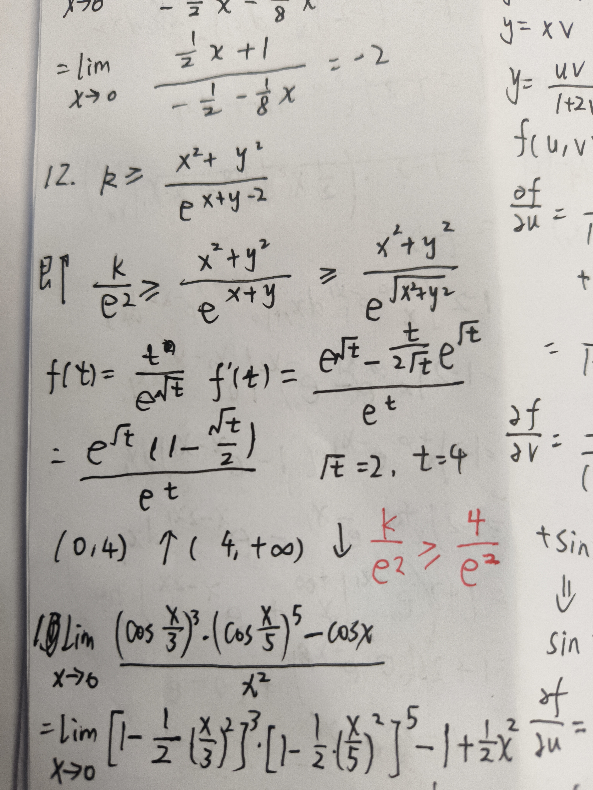
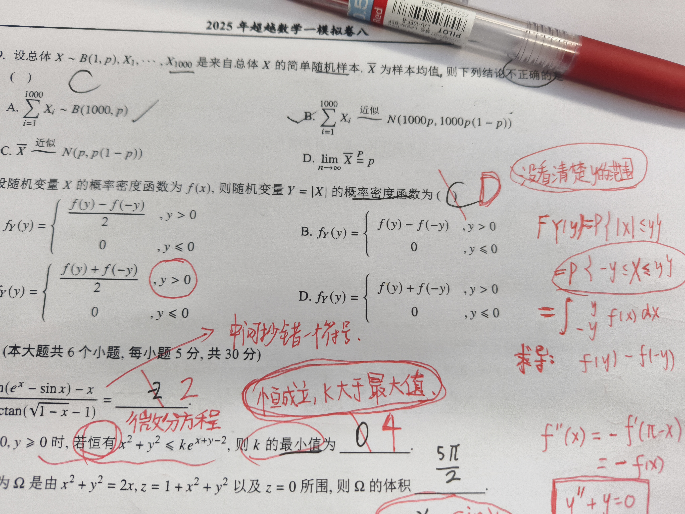
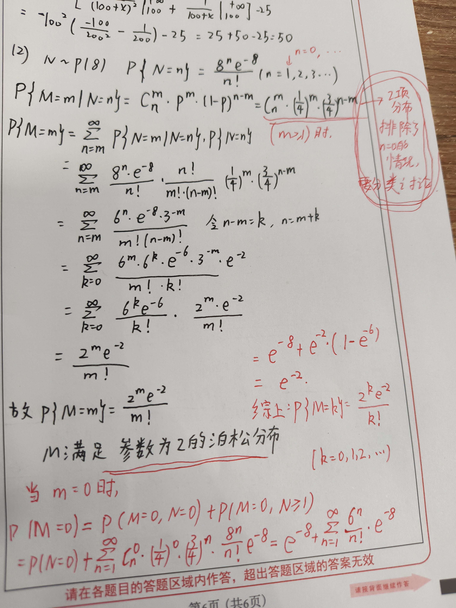
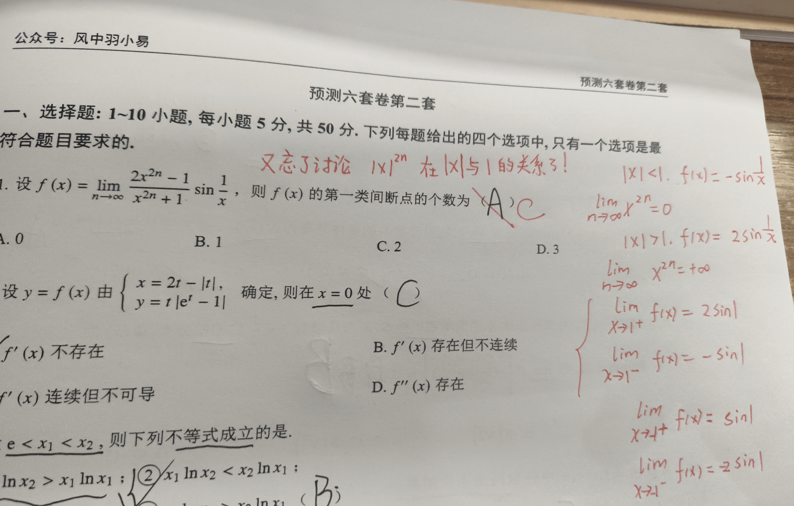
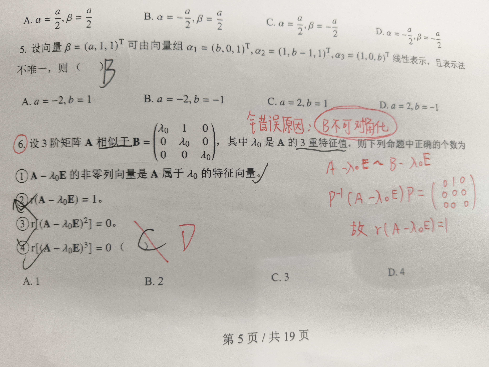
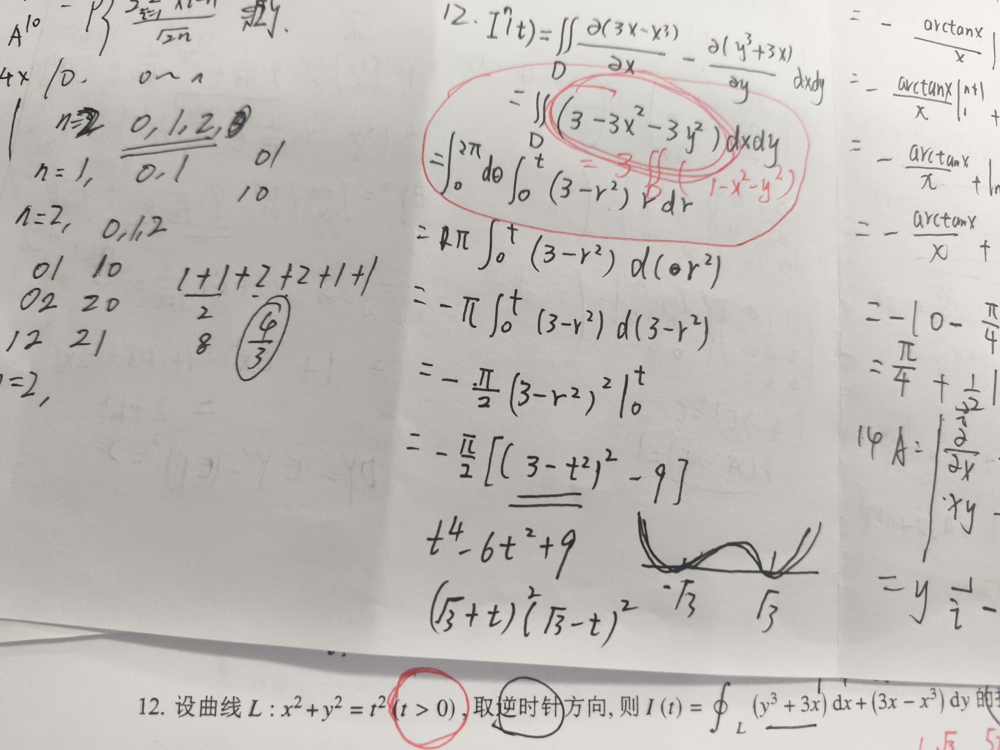
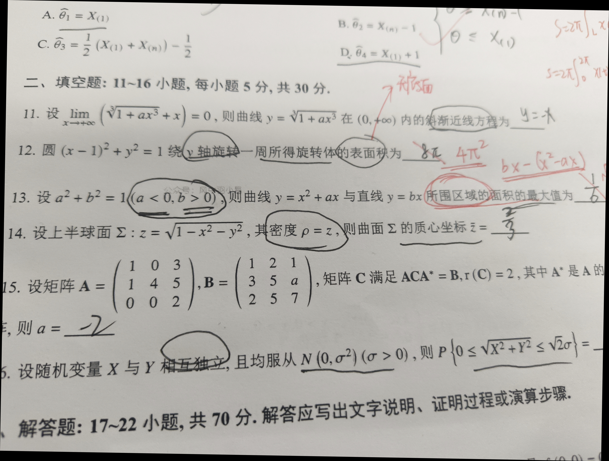
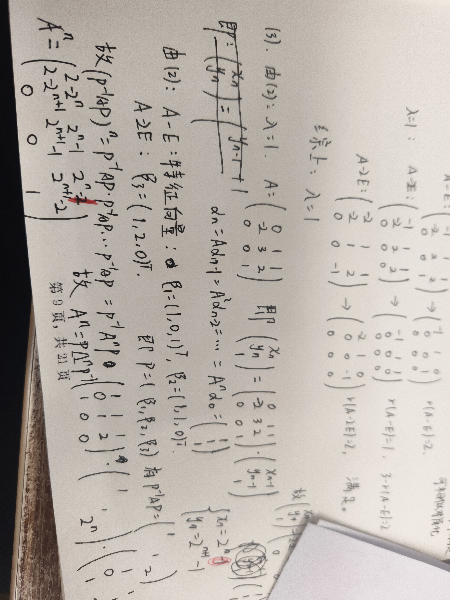
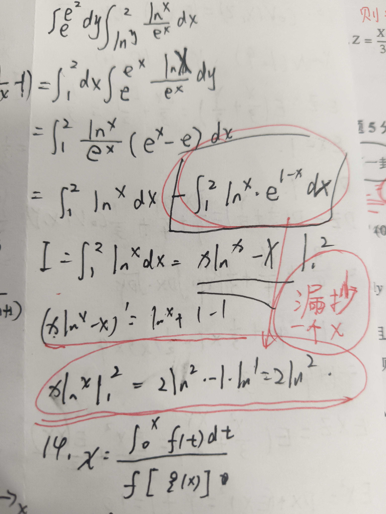
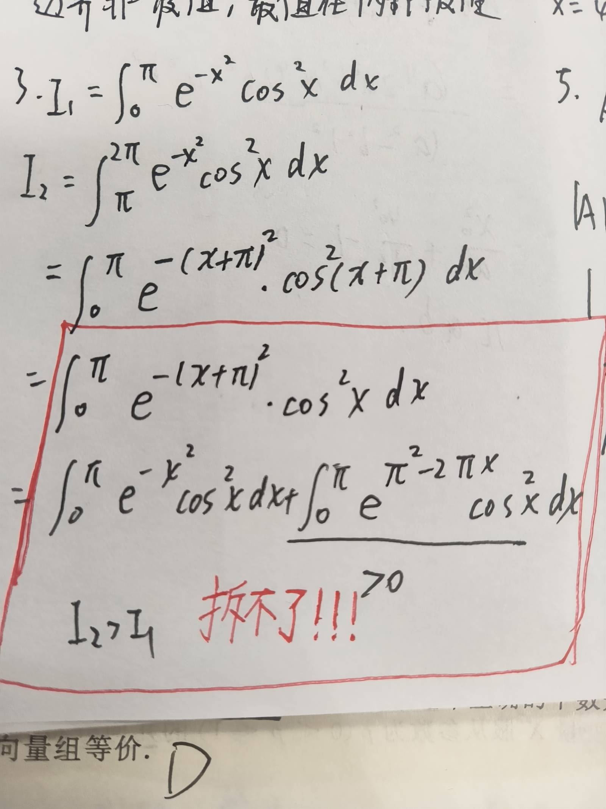

# 粗心记录合集

> 汇总 2026 年 11 月 18、20、21、22、25、26 日的记录，按原有日期结构编排；原文、图片引用均予保留。

## 目录

- [11.18](#1118-记录)
- [11.20](#1120-记录)
- [11.21](#1121-记录)
- [11.22](#1122-记录)
- [11.25](#1125-记录)
- [11.26](#1126-记录)

## 来源文件

- 11.18：粗心 11.18.md（压缩包 粗心 11.18.zip）
- 11.20：粗心 11.20.md（压缩包 粗心 11.20.zip）
- 11.21：粗心 11.21.md（压缩包 粗心 11.21.zip）
- 11.22：粗心 11.22.md（压缩包 粗心 11.22.zip）
- 11.25：粗心 11.25.md（压缩包 粗心 11.25.zip）
- 11.26：粗心 11.26.md（直接提供，无压缩包）

## 11.18 记录

来源：粗心 11.18.md（粗心 11.18.zip）

符号抄错

应该是大于最大值

u 是 1 却带成 1/3 了

变量代入错误 x2 代入 0，x1 不动

没看清楚 y 的范围

cos（π-x）= -cosx，当成 -sinx 了，看到这种题直接代换再求两次导就行

漏解 x=0

区域是封闭曲面，不好看的时候可以把坐标系转一下，让 y 轴对着自己。高斯公式之后就用对称性

泰勒公式不同代入点的可赛不一样

## 11.20 记录

来源：粗心 11.20.md（粗心 11.20.zip）

arctan x-1 在 0 到 1

一阶齐次线性微分方程跳步了！

矩阵分解错了，应该是列是 1 1 1 的倍数，把 1 1 1 列提出去

漏情况了，二项分布没有 n 为 0 的情况，所以需要单独讨论 m 为 0

## 11.21 记录

来源：粗心 11.21.md（粗心 11.21.zip）

忘了要讨论 x 绝对值与 1 的关系

没看清楚 B 不可相似对角化

系数问题，且没看见 t 大于 0

二阶非齐次特解代入错误

多元微分无条件极值对 y 求导错误

## 11.22 记录

来源：粗心 11.22.md（粗心 11.22.zip）

围成区域不包括 x 轴 13 题

忘了对 a 进行平方了😂

矩阵乘法出错，本质上还是过程没写清楚，导致计算的时候模糊

## 11.25 记录

来源：粗心 11.25.md（粗心 11.25.zip）

这是两个 3/2 啊😭，到最后口算了，真不应该，老老实实写完整不行吗

提项的时候漏了系数 1/2，哎，不是这都能错的

没化简，或者式子就是错的，因为 n 阶乘不能带负号

漏抄了个 x，醉了

ES²=seigema²

算极限用佩亚诺余项，用成拉格朗日余项了但是还是算出来了😄

## 11.26 记录

来源：粗心 11.26.md（直接提供，无压缩包）

脑子不清，指数函数运算法则搞混：把 $e^{a+b}$ 当成 $e^a+e^b$，$e^{-(x+\pi)^2}$ 拆成两项相加后彻底卡死；正解是 $e^{-x^2}\cdot e^{-2\pi x-\pi^2}$，指数因子小于 1 ⇒ $I_2<I_1$（原写 $I_2>I_1$ 是这个错的连带）

没看清题目问的是 $D(Y^2)$，答成了 $DY$——$D(Y^2)=D(\chi^2(1))=2$，$DY=1$ 是另一回事

级数展开式记错，负号丢了：$\ln(1-x)=-\sum\limits_{n=1}^{\infty}\dfrac{x^n}{n}$，记成了 $+\sum$，跟 $\ln(1+x)$ 混了

第 19 题：补面用高斯，代 $z=1$ 那个补面时把第三项 $(z^2+z)$ 也当成 0 了——$z=1$ 处它是 2，纯经验主义；另外一开始没读清 $\Sigma$ 是「曲面」不是封闭曲面，读到后面才反应过来，读题不仔细

